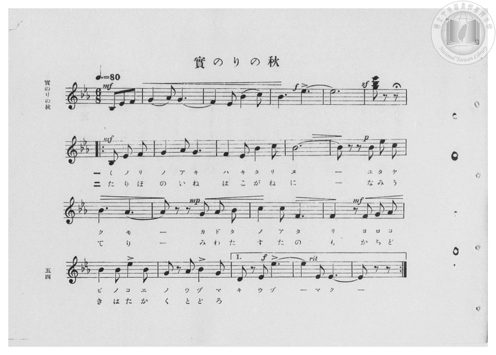
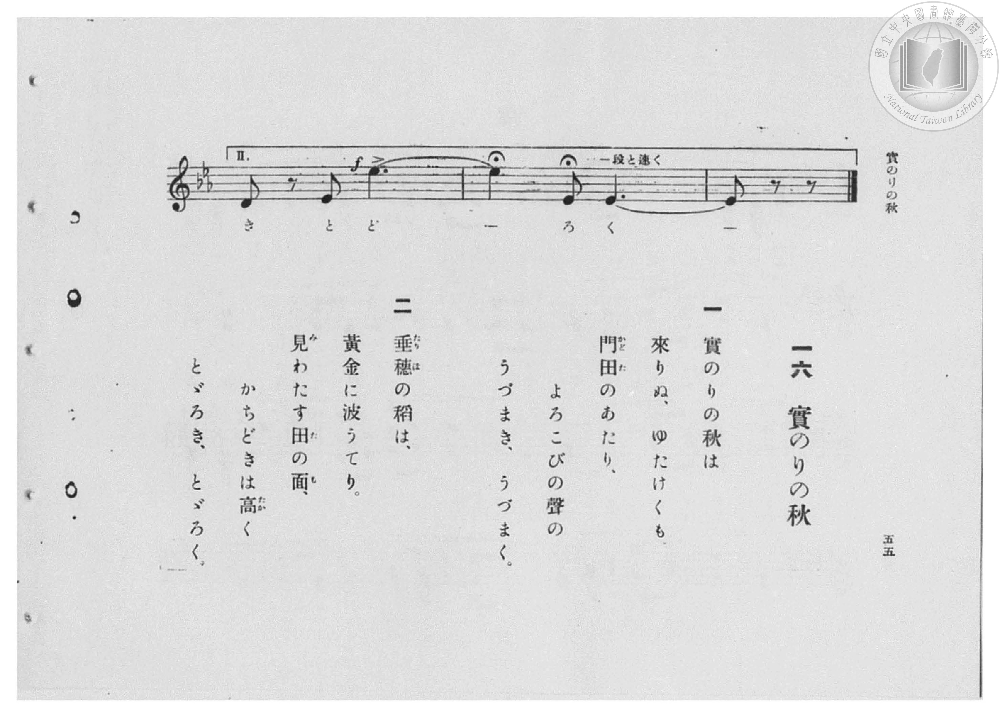

# 實のりの秋

> Re:Shōka 使用 AI 協助辨識與重建樂譜，可能會有錯誤。歡迎回報。

- **鋼琴伴奏版**：<br><audio controls src="minori_no_aki.mp3"></audio>
- **NEUTRINO 歌聲合成版**：<br><audio controls src="minori_no_aki_neutrino.mp3"></audio>

- 臺灣總督府《公學校高等科唱歌》第二學年用（昭和十一年，索書號 0729 74）

## 說明

原書資訊與歌詞全文（對應 P056.jpg–P057.jpg，原書 pp. 54–55，第 16 首）：
調性與拍號：變ホ長調（E♭ 大調，3 降記號）6/8 拍（弱起 3 拍），速度 ♩.=80


## 歌詞

```text
一
實のりの秋は來りぬ、
ゆたけくも門田（かどた）のあたり、
よろこびの聲のうづまき、うづまく。

二
垂穗（たりほ）の稻は黃金（こがね）に
波うてり。見わたす田の面（も）、
かちどきは高くとゞろき、とゞろく。
```

## ABC

<div class="abc-score" data-abc-src="minori_no_aki.abc" aria-label="五線譜載入中"></div>

[下載 ABC 原始檔](minori_no_aki.abc)

## TMD 檔案連結

- [主旋律 TMD 檔案](minori_no_aki.tmd) [[在 TMD Studio 編輯](https://tmdlang.github.io/Tmd-TS/#tmd=s7IKdvYPcrWy4qpTUCpJTLdSSM7PyUlNLsnMz7PKzk9PzM7Ojy_OyM9OVIKrKMvPKc1NBcqW5McbIYSL80uLklOtipMz8vNz4ktSK0qS8vOz0eXjCxLTU60CDEzNcMqYI2QKivLLUvMS84DmFhRl5pWkpoANRihILctMSQVJFycn5sWXpRZlpmWmpiC5NbWoGOQVqBUlRYl5xclFmQUg_yFU5ReVZOSnFyUWZFRaZWQWl-QXZSYn5sRnJ-YhebskIxXo68R0oFxpTklpUSq6VHFqYnF-XjGysZnpmXlWpXkgN5ZAXaalpfB0_bLHjeseN3UByefLuxW0tLgUbRUMjQy47G0VXHW4bMz0LexAprxo3_W8cfHzHXufz138dNecxw1dT1vXPF2749mChS9Xz3i-tvP58olPp2x8trbncUP38zVrnuzqAco-3bnl-ZQV7_d0PJux9umknqe9jU92NAAF3-_peb5l0bPZO17MnK9gYG5kqWBu8n5PpxIXl76Wgi21AJeCgsLTvvkgaza3v1jR9aKjHei-FyvnPW1d8WxaO9BZTzf0PmvvVAClAb2sgvRHDZNBkQ5iAl0I0apQUKCnYGoClDI1BTl7zRoFQzOFl8umAd37fs8skB0vVu1_1rAcZHp3L9BDQNEX67oeN89-OXU7UApojeujmWsVni5ZDub1GCu8nNn7YsUMsNJOYAArAPWBHLNn44ut2xWMIVyg4T0vG-Y_3bVM4dHMlXq2FgZcILuA4Qf2Fmq8PW5c_2RfG5i75nFDI0jF46a2x43zHzdOfNzY_7ip6eW0hudTNgBtedwIVL0SKAW0AmREYxNIGVAnTFvH46bex42THzduBkq_aNwEVgQ0a-njxn2PG3uB6pC4_Y8bmiDu2tUDdte8pucrp4OtARvauBtizfMVu4FufLm7-WX7RLAs0Pyex41rwbKrQTqfbV4ENncZ2C1NL5Z1P27qB_tgJtDhQCNezl0E0tnUBNIDdSzILwvB3gE6eT0wIYJc1LjicdM8sCcgjoVzwY4FaqM8ZUGBgpY-F5dnXklRvlVAZmJevkONQU01yAYFGwstOzADW3oGJcoXa-c87ex9urRfQQMa79oKpgpPN_Q_X9-gA0-QCqCctKPhxcIeTSzGAG0HWVGjYACG1blptQqm8QqGCkZAMWMFXQUTMKkL5BkBSUOgBboKZkAeiNZVqAYqN4yDKgCRMFgDlILIQQwGi3HVcnH5ZuYBCxK_fMfsTNI8DMx2wMLhZfMKJN8aGmP37q6eF-2bn86eDfQ0MPpg-ZEG_od51hSiuwCoGeRnoAKwsT6GNQrxYPi4eT4Q9wHxKqByEEsXmE8WAfFaqBGPm_vBYmuBeD-IBVXZg2LR4-Y9UPOWgdU9btoIs8sIblcj0K6mLiC9G6SjcR3ItMYWIIbb1bgeLDYZiEHmg2RAoqux29W4CoiBdjW2Ae2ChhfE_yZQpSbQ0AMGgDGQYwoUMgMHFCjQYIEHDV4jsBJEAD1uAjkG5OFF6BY3rQayO8EeRQ00UABBVK4C0qDgWAHEoKDbjBQcwJIAYjIwMNC9BAq6fnBQgdTNBAcCMNjAgQVW2dQEMbmxG4gXAvFKVM-DIxpEgdKJAdjTukBWDTCNGAD9iJIzwAwjeGCAVCAyBTwcmieDQwGYSIC-ALGAUQvmg0ICGN3NrWDReWDXrUURhfkNIg8LUYR_45HtAodML9jH68G-BrG6weHQD_YxMCyBvgWFWy9YtBdFFMkuoDxID3a7gJld104BXLQpABlIGR_EVeYCAA)]
- [鋼琴伴奏 TMD 檔案](minori_no_aki_piano.tmd) [[在 TMD Studio 編輯](https://tmdlang.github.io/Tmd-TS/#tmd=s7IKdvYPcrWy4qpTUCpJTLdSSM7PyUlNLsnMz7PKzk9PzM7Ojy_OyM9OVIKrKMvPKc1NBcqW5McbIYSL80uLklOtipMz8vNz4ktSK0qS8vOz0eXjCxLTU60CDEzNcMqYI2QKivLLUvMS84DmFhRl5pWkpoANRihILctMSQVJFycn5sWXpRZlpmWmpiC5NbWoGOSVgszEvPz4xKKixLz01NzUPCQjkAStEjPjE5OT83MLEvMyUVXlF5Vk5KcXJRZkVFplZBaX5BdlJifmxGcn5iGFTEkG0BirxHSgXGlOSWlRKrpUcWpicX5eMbKxmemZeVYliZnlQPfnp6VlJmcm5ihxaWkpPF2_7HHjusdNXUDy-fLu93s6XnbveT5hy5M9W54u7X_e2fF-T6eClhaXoq2CoZEBl72tgqsOl42ZvoUdyPQX7bueNy5-vmPv87mLn-6a87ih62nrmqdrdzxbsPDl6hnP13Y-Xz7x6ZSNz9b2PG7ofr5mzZNdPUDZpzu3PJ-yAmjVsxlrn07qedrb-GRHA1Dw_Z6e51sWPZu948XM-QoG5kaWCuYmQOuVuLg880qK8q0CQMEb5OFQY1BTzaUABDYWWnZgRo2CARhW56bVKpjGKxgqGAHFjBV0FUzApC6QZwQkDRVMgaQZkAeidRWqgcoN46AKQCQM1gClgHLG2qbaQHmI4WBxrloU1_jgcw1Ui0J1AdCWeIi7YDTQBfFAJ5nCKDgfoQBTi2G8tmm8tiG6e3wz84Ax7JfvmJ2JCCNdQ2oFEixETCG6gZ4BujIOpABsrI9hjUI8GD5ung_EfUC8CqgcxNJVeNy0CIjXQo143NwPFlsLxPtBLKjKHhSLHjfvgZq3DKzucdNGmF1GcLsagXY1dQHp3SAdjetApjW2ADHcrsb1YLHJQAwyHyQDEl2N3a7GVUAMtKuxDWgXNLwg_jeBKjWBhh4wAIyBHFCcmYEDChRosMCDBq8RWAkigB43gRwD8vAidIubVgPZnWCPogYaKIAgKlcBaVBwrABiUNBtRgqOx43LICYDAwPdS6Cg6wcHFUjdTHAgAIMNHFhglU1NEJMbu4F4IRCvRPU8OKJBFCidGIA9rQtkAVMikGeEmn3ADCN4YKCmUng4NE8GhwIwkQB9AXL1CqivQSEBiu5dYPl5YNetRRGF-Q0iDwtRhH_jke0Ch0wv2Mfrwb4GsbrB4dAP9jEwLIG-BbmgFyzaiyKKZBdQHqQHu13Ych-oTMCd-8gqFJD5ICOAGsC6IJ5FVmYOYmGqUzABsYDxh2KwAcRaoB6YQdjKHFDEA9moIiA2sogxmAM3HkdJpWunAC48FYAMpHCL9jGMxRAyAgspcwEA)]

## 分析

```text
================================================================================
📊 TMD Song Profile: [ 實のりの秋 ]
================================================================================
⏱  Duration:       0:30 (30.0s), 20 measures total
🎼 Key & Tempo:    首調基準 E,, != 120.0 BPM, <6/8>
   - 分析範圍：      由實際發聲的音符與和弦推測調性；播放脈絡另行呈現
🎤 人聲音域:    A#3 (MIDI 58) – D#5 (MIDI 75) [跨度: 17 個半音 / 1.4 個八度, 難度: challenging]
   - 最低音:  A#3 in [Intro #1 @ m.1, 0:00]
   - 最高音: D#5 in [Intro #1 @ m.4, 0:05]
   - 適合: soprano, mezzo-soprano, contralto, tenor, baritone, bass
🏛  結構:      Intro (9.0s) -> MinoriNoAki (21.0s)
⚡ 編曲密度:        Peak 1 軌道同時演奏
🗝  調性診斷：       D# 大調（純淨自然大調，未偵測到可信轉調）
   - 風格氣質:    純淨自然大調（陽光明朗、易唱易記，無明顯調外色彩）
   - 轉調歷程:    全曲維持單一推測調性（未偵測到可信轉調）
   - 核心骨幹音:  A#, D#, F, G, G#
   - 調性數值:    D# 大調 [相關度: 0.91, 穩定度: High, 自然音純度: 100.0%]
   - 候選調性 (K-S): D# 大調 (0.91), A# 大調 (0.77), G 小調 (0.53)
   - 五度圈歷程:   -3 -> -3
   - 各段落調性細節:
     • [Intro #1]: D# 大調 (r: 0.93, 自然音純度: 100.0%)
     • [MinoriNoAki #1]: D# 調性不明確 (r: 0.82, 自然音純度: 100.0%)

  [ 五度圈游移軌跡 ]
               C  
         F            G  
      Bb               D  
     [Eb]*              A  
         Ab           E  
            Db       B  
               F# 
     (* = active key center)

  [ 十二半音累積音高分佈 ]
     C  : █████                      6.2%
     C# :                            0.0%
     D  :                            0.0%
     D# : █████████████████████     24.7%
     E  :                            0.0%
     F  : ███████████████           17.5%
     F# :                            0.0%
     G  : ████████████              14.4%
     G# : ████████                   9.3%
     A  :                            0.0%
     A# : ████████████████████████  27.8%
     B  :                            0.0%
--------------------------------------------------------------------------------
Assignment 軌道音域：
  - Piano         : A#3 – D#5 (17 個半音 / 1.4 個八度, 56 個音符)
================================================================================
```


## 原書掃描頁






