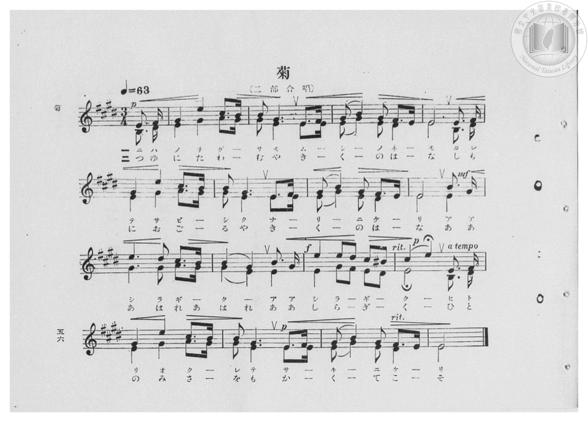
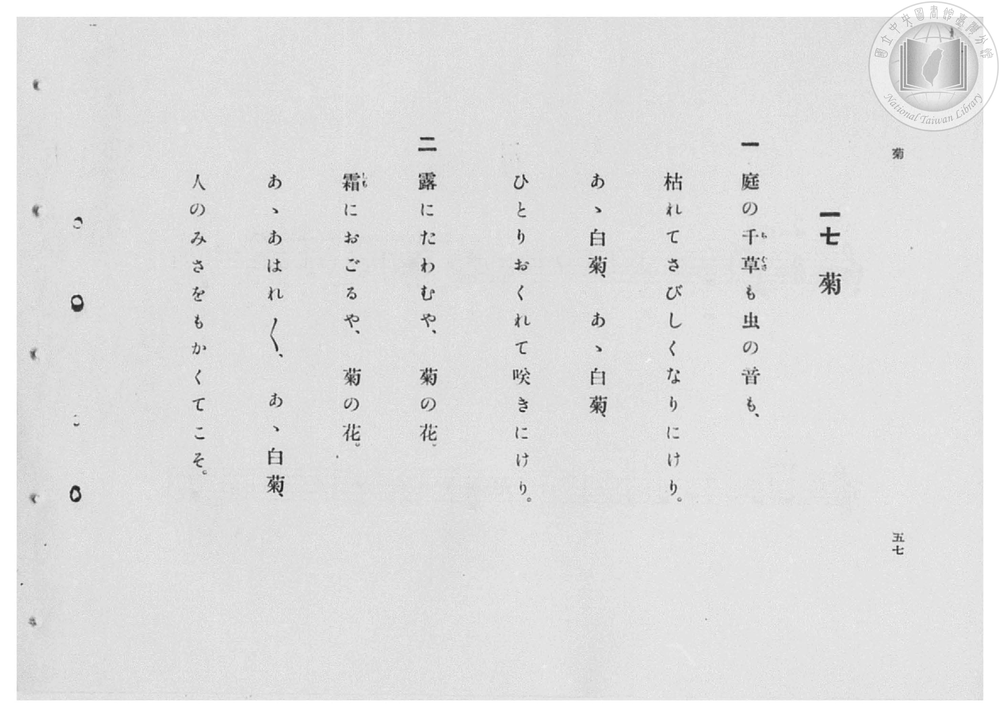

# 菊

> Re:Shōka 使用 AI 協助辨識與重建樂譜，可能會有錯誤。歡迎回報。

- **鋼琴伴奏版**：<br><audio controls src="kiku.mp3"></audio>

- 臺灣總督府《公學校高等科唱歌》第二學年用（昭和十一年，索書號 0729 74）

## 說明

原書資訊與歌詞全文（對應 P058.jpg–P059.jpg，原書 pp. 56–57，第 17 首）：
調性與拍號：ホ長調（E 大調，4 升記號）3/4 拍（弱起 1 拍），速度 ♩=63（二部合唱）


## 歌詞

```text
一
庭の千草（ちぐさ）も虫の音も、
枯れてさびしくなりにけり。
あゝ白菊、あゝ白菊、
ひとりおくれて咲きにけり。

二
露にたわむや、菊の花。
霜（しも）におごるや、菊の花。
あゝあはれ〳〵、あゝ白菊、
人のみさをもかくてこそ。
```

## ABC

<div class="abc-score" data-abc-src="kiku.abc" aria-label="五線譜載入中"></div>

[下載 ABC 原始檔](kiku.abc)

## TMD 檔案連結

- [主旋律 TMD 檔案](kiku.tmd) [[在 TMD Studio 編輯](https://tmdlang.github.io/Tmd-TS/#tmd=s7IKdvYPcrWy4qpTUCpJTLdSSM7PyUlNLsnMz7PKzk9PzM7Ojy_OyM9OVIKrKMvPKc1NBcqW5McbIYSL80uLklOtipMz8vNz4ktSK0qS8vOz0eXjCxLTU60CDEwtEDIFRfllqXmJeUDdBUWZeSWpKWDtCAWpZZkpqSDp4uTEvPiy1KLMtMzUFCQXpRYVgxwMtaKkKDGvOLkoswDkC4Sq_KKSjPz0osSCjEqrjMzikvyizOTEnPjsxDwkz5VkpAL9VpCTmFdSjC5anJpYnJ-HIZybX5SYg2xNZnpmnlVJYmY50LH5aWmZyZkgeS0thRf9XQpaWlyKtgpmxlz2tgquXDbG-iZ2IK0v2nc9b1z8fMfe53MXP90153FD19PWNU_X7ni2YOHL1TOer-18vnzi0ykbn63tedzQ_XzNmie7eoCyT3dueT5lxfs9Hc9mrH06qedpb-OTHQ1Awfd7ep5vWfRs9o4XM-crGJgbWSqYm7zf06nExaWvpWBLLcCloKDwtG8-yJrN7S9WdL3oaAe678XKeU9bVzyb1g501tMNvc_aOxVA0a2XVZD-qGEykGkJYgJdCNGqUFCgp2BqBpQyNQc5e80aBUNzhZfLpgHd-37PLJAdL1btf9awHGR6dy_QQ0DRx82zX07dDhQH2uGq8HTJcjCzx0ThaS_QITPAijqBQasA1AFyxp6NL7ZuVzCEcIHG9rxsmP901zKFRzNX2poZA1UAg_Nl84qnEzqAYQxUwQWyFhiUYB_uWvu4cd3T3uYXvUCdHY8bFz5unPC4cSpQ2eOmphczVwNlX87fDGQ_bmgEaXg2b_3jpp7HjcuAih43bn7cOP1xY__jxlWPm7oeNwJVTwQxGppASh83Nj1umvt85l5gygDqRuNCVGx63LgCrBWI-iEGP50EFOxFMQzs4F09IOrlHKAsUGr-4yag-obHTS1As0AmNq570bURavPLOXPAnpkOdDfIJyANQBVTHjd1Y9cAcRuIbAR7r2Hz44at2N38ZNcuoNbHjftBAdA0CRQyjd3gMAAGyeTHjXOhRlKeAqFAQUufi8s7M7vUKiAzMS_f0KHGoKYaZIOCjaGZlh2YhS3hK4Ay0o6GFwt7FDSgaURbAZiINvQ_X9-gA0-2CGWaWMwA2g0yv0bBQEEXDGF0dUEtMMmBWEZAWWOoqGEclGEGJk2BUqZAGiYNVgLTBDbYx7BGIR4qA6MfN3dD6X6g_sfNfXDxRhiraQNUZA9IRdNWMHsRki2PmxcgVEBsMsJiU-MSqHltIHMaV8PF58Nt6kexqQEs1oJsU2Mvkk3Q0AJ5GORxEASxjaBer4Gy8AXH46btUONgXgEFwONmJGvQPAtxKMTxj5vXIHkYmC5RzWpcBybXI5vVuArdrMbpUDObYF7CmcB29YATGI50BZbFm67ISTl4gheiBgGrc9NqoUqBRiLCuLkNHm6gxAMJjcnIoQKJhSZISMFUdCGraAaFG3I8gZLt46aNGGpQ4wkScyAaOZ4QSQ9iB4g1BcU9ENNxJj2y47oJThOK6x2d-OIaLIs3ruFxDILmQIwa17DYhIjBZKqBEQjXCGbAdJqoAwmEVnCJBFcIJjGzFSIqV4KDExREiCCGRTZSICJHF5IZUP1gdRBTIGwcpjRPgtIdKJEOCXpYRID0ASsfKA8YHfDIQ4ijRRg8q4JUdCJc1AgpMqAuAicMNBc1boLSKwhF-9PZs_FEO0SWWlkcs1YhLpvDaiXkHA5L6Y-bECyUvAAsKUFsWEkAUQEpDWAJYi1qoBGVw2GVC3JEQ5IZKLj3w1lTUWwCJRBQeYvklkZYNYg9dy8DkyhlVuNcnG6pRW5DGA2eNoQpxInIkQpLECZQHiQhIEc5hA3UAytYkHSB2OYIQ9HrW6h9QBW0rtnI8A4-j2Ct2SCCQDNpXHIj51EQG9UvCD_AaJAMuOBG0gOKCRDfDOSnGpjXyIgZigsk4mMGUR6RGDuIAgmY8XTtFEB5L9rHMFYBzjYCs5W5AA)]
- [鋼琴伴奏 TMD 檔案](kiku_piano.tmd) [[在 TMD Studio 編輯](https://tmdlang.github.io/Tmd-TS/#tmd=s7IKdvYPcrWy4qpTUCpJTLdSSM7PyUlNLsnMz7PKzk9PzM7Ojy_OyM9OVIKrKMvPKc1NBcqW5McbIYSL80uLklOtipMz8vNz4ktSK0qS8vOz0eXjCxLTU60CDEwtEDIFRfllqXmJeUDdBUWZeSWpKWDtCAWpZZkpqSDp4uTEvPiy1KLMtMzUFCQXpRYVgxxckJmYlx-fWFSUmJeempuah2QEkqBVYmZ8YnJyfm5BYl4mqqr8opKM_PSixIKMSquMzOKS_KLM5MSc-OzEPCT_l2QAjbEqyEnMKylGFy1OTSzOz8MQzs0vSsxBtiYzPTPPqiQxsxzon_y0tMzkTJC8lpbCi_6u93s6XnbveT5hy5M9W54u7X_e2fF-T6eClhaXoq2CmTGXva2CK5eNsb6JHci8F-27njcufr5j7_O5i5_umvO4oetp65qna3c8W7Dw5eoZz9d2Pl8-8emUjc_W9jxu6H6-Zs2TXT1A2ac7tzyfsgJo0bMZa59O6nna2_hkRwNQ8P2enudbFj2bvePFzPkKBuZGlgrmJkDLlbi4PPNKivKtAkABHOThUGNQU82lAAQ2hmZadmBWjUJ1Qa2CsYKugikQgyCIbQRmGQJlDaGiMGgApWu4alFM98Fjuml8PMhMEGGKxIIzaxSiDeO1TeO1DWPx2eadmV0KscwQu10w1TAaZDfE_UZAWZC_wL6KgzLMwKQpUArkdZg0xONQTWCDfQxrFEDOBEEY_bi5G0r3A_U_bu6DizfCWE0boCJ7QCqatoLZi5Bsedy8AKECYpMRFpsal0DNawOZ07gaLj4fblM_ik0NYLEWZJsae5FsgoYW7jiHsPAFx-Om7VDjYF4BBcDjZiRr0DwLcSjE8Y-b1yB5-HEjyPlIZjWuA5Prkc1qXIVuVuN0qJlNqF4CO5iEKCYh7VfnpgETM8xIRGA0t8E9CIpliLMnIzsfElxNEC_BVHQhq2gGeRA5QEHp63HTRgw1qAEKCWIQjRygiDQCsQPEmoLiHojpONMI2ZHSBKfhkQKPDBA0B2LUSIEFO0QMJlMNDGm4RjADptNEHUggtILzOFwhmMRMqIgwXwn2N8gviLCAxQqSb5HDFckMqH6wOogpEDYOU5onQekOlNiBhBEsxED6Hjf1QHnAcIOHMkIcLWThiR-kohPhokZIJoS6CByDaC5q3ASlV5CVaTALVFIrDUSegaWdx00IFkrqAhYSIDYsb0FUQPIXLObWovqOqDwDK1eRYwSSHkDhsh_OmopiEygmQUUNklsaYTUA9vyyDEyilAKNc3G6BaV6MyK-egPXp6iBDoswEygPElHIUQJhA_XAciiSLhDbHGEoelUAtQ-oAlkzidbisxBrmQsRBJqJlmRh9qLaibALRoNkwCUKkh6Qz0B8M0gLBOoE6vgUkU9I9C2O9g6uxhV6ioBrh7gA3uACWQNmmIAbXWAJoOWY8mAhkClwP2OqQWm44WnaETCGeKcQdASZHiHBBWZgpcZoNiOJDpKQIKodrWunAG64KwAZoDQW7QNSD2MbgdnKXAA)]

## 分析

```text
================================================================================
📊 TMD Song Profile: [ 菊 ]
================================================================================
⏱  Duration:       1:37 (97.1s), 34 measures total
🎼 Key & Tempo:    首調基準 E, != 63.0 BPM, <3/4>
   - 分析範圍：      由實際發聲的音符與和弦推測調性；播放脈絡另行呈現
🎤 人聲音域:    E4 (MIDI 64) – E5 (MIDI 76) [跨度: 12 個半音 / 1.0 個八度, 難度: easy]
   - 最低音:  E4 in [Kiku[L1] #1 @ m.1, 0:01]
   - 最高音: E5 in [Kiku[L1] #1 @ m.2, 0:03]
   - 適合: soprano, mezzo-soprano, contralto, tenor, baritone, bass
🏛  結構:      Kiku[L1] (48.6s) -> Kiku[L2] (48.6s)
⚡ 編曲密度:        Peak 2 軌道同時演奏
🗝  調性診斷：       E 大調（純淨自然大調，未偵測到可信轉調）
   - 風格氣質:    純淨自然大調（陽光明朗、易唱易記，無明顯調外色彩）
   - 轉調歷程:    全曲維持單一推測調性（未偵測到可信轉調）
   - 核心骨幹音:  E, G#, B, F#, D#
   - 調性數值:    E 大調 [相關度: 0.87, 穩定度: High, 自然音純度: 99.5%]
   - 候選調性 (K-S): E 大調 (0.87), C# 小調 (0.59), G# 小調 (0.58)
   - 五度圈歷程:   +4 -> +4
   - 各段落調性細節:
     • [Kiku[L1] #1]: E 大調 (r: 0.87, 自然音純度: 99.5%, 調外音: A#)
     • [Kiku[L2] #1]: E 大調 (r: 0.87, 自然音純度: 99.5%, 調外音: A#)

  [ 五度圈游移軌跡 ]
               C  
         F            G  
      Bb               D  
      Eb               A  
         Ab          [E ]*
            Db       B  
               F# 
     (* = active key center)

  [ 十二半音累積音高分佈 ]
     C  :                            0.0%
     C# : ██                         4.2%
     D  :                            0.0%
     D# : ████                       6.0%
     E  : ████████████████████████  40.4%
     F  :                            0.0%
     F# : █████                      8.6%
     G  :                            0.0%
     G# : ███████████████           25.0%
     A  : ██                         3.1%
     A# :                            0.5%
     B  : ███████                   12.2%
--------------------------------------------------------------------------------
Assignment 軌道音域：
  - Piano1        : E4 – E5 (12 個半音 / 1.0 個八度, 130 個音符)
  - Piano2        : B3 – A4 (10 個半音 / 0.8 個八度, 128 個音符)
================================================================================
```


## 原書掃描頁






