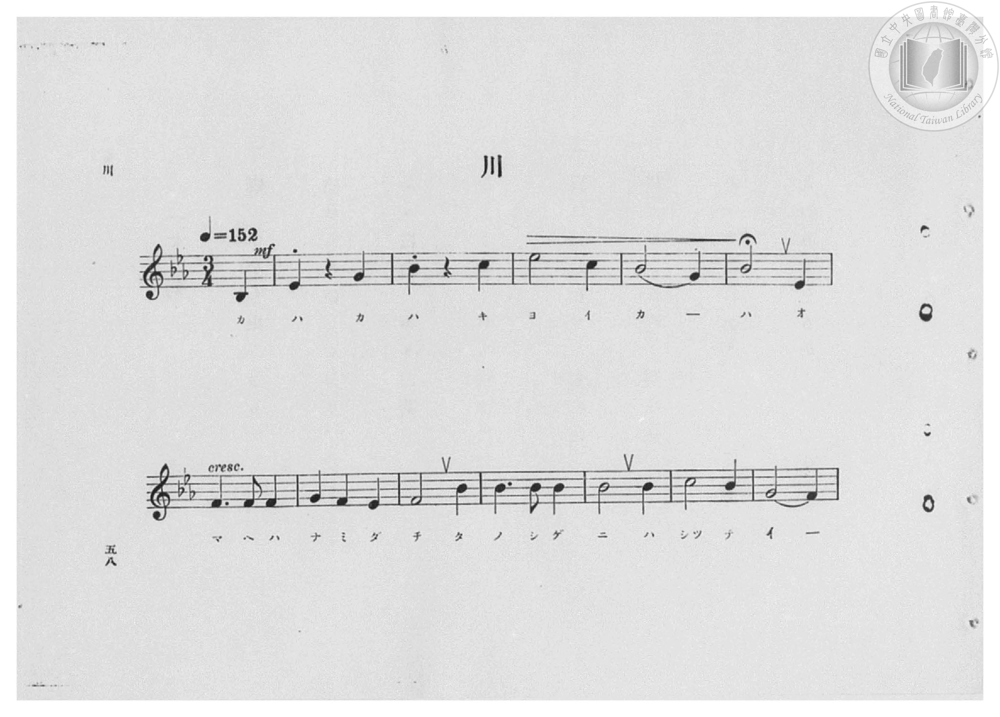
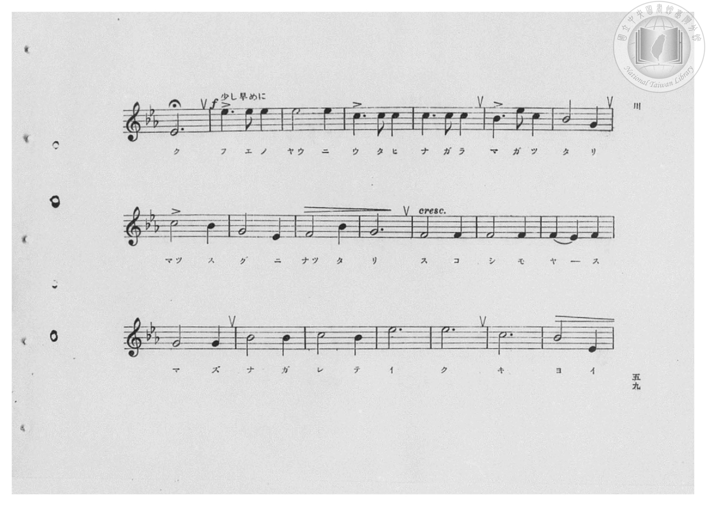
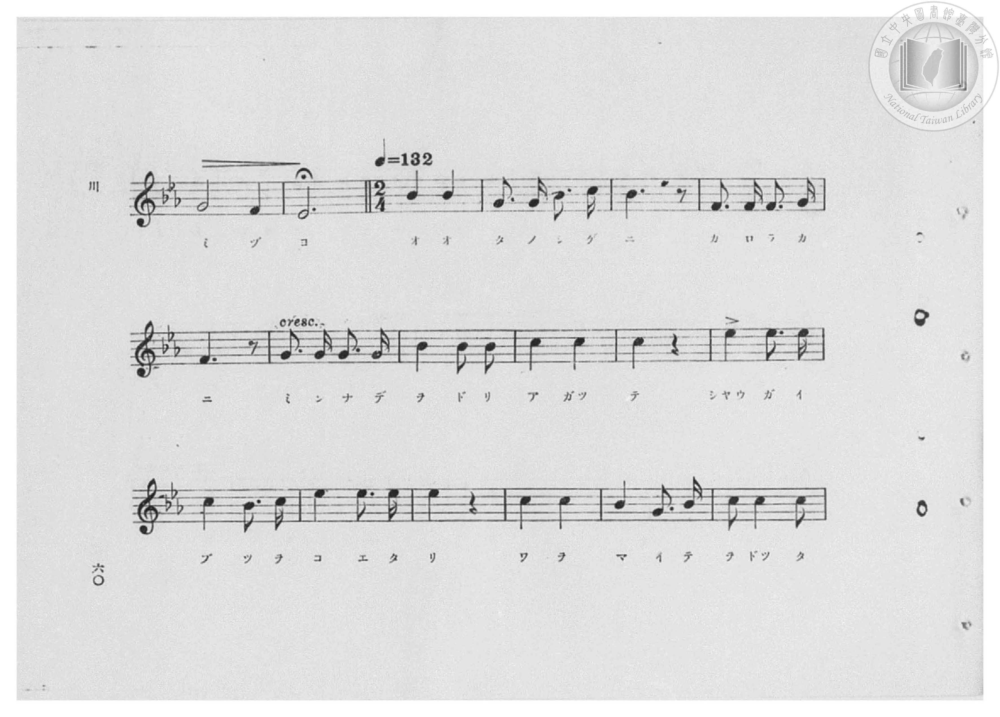
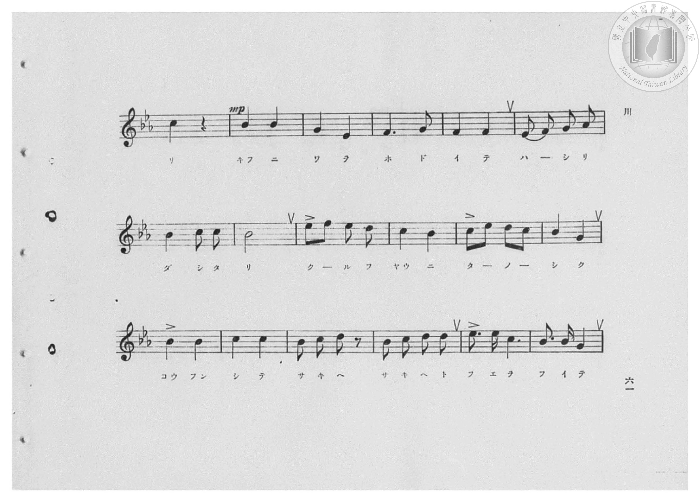
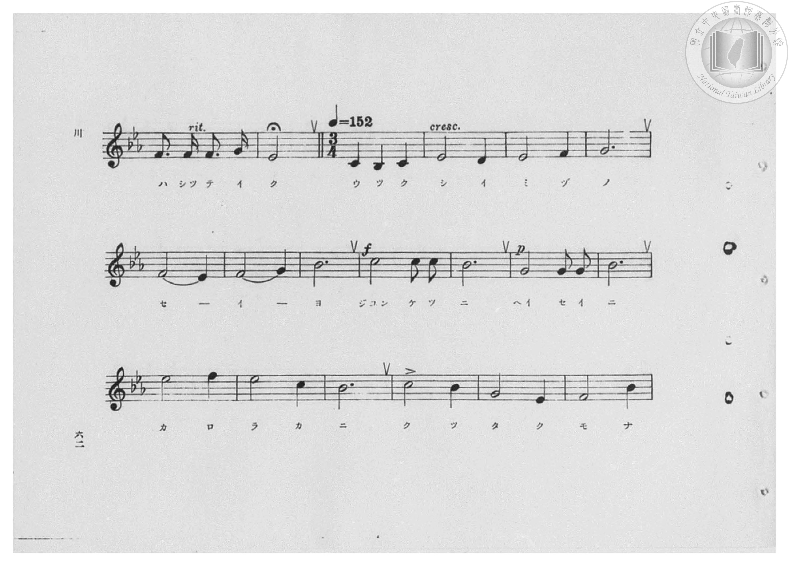
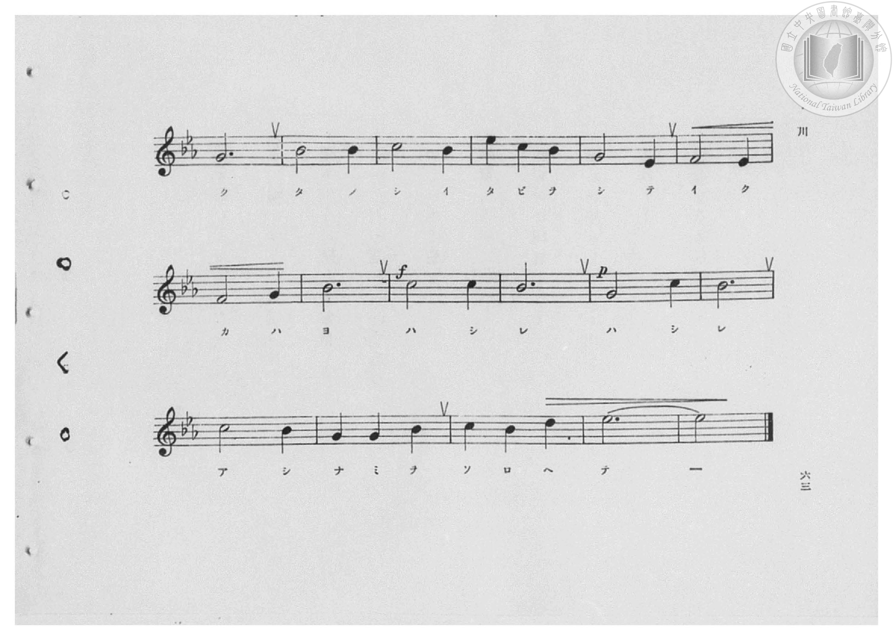
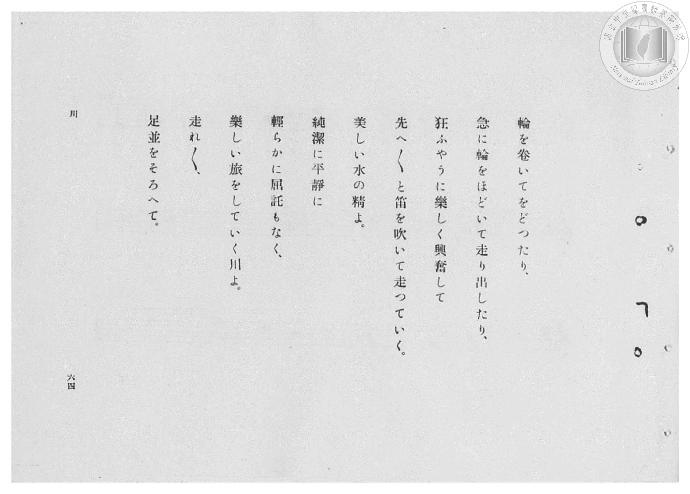
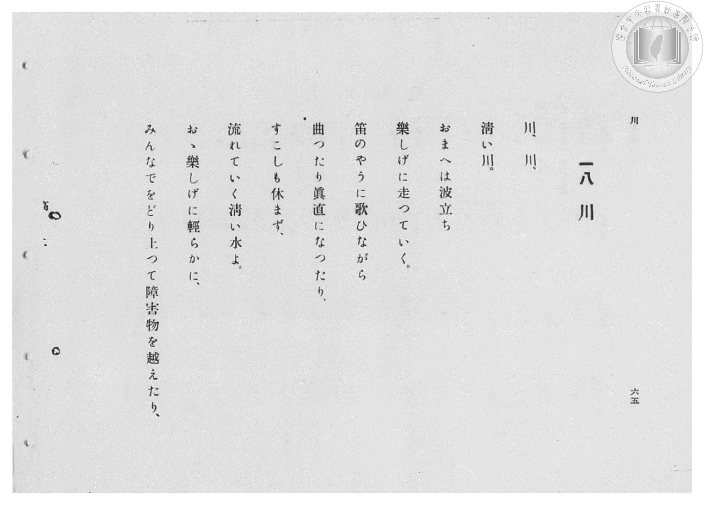

# 川

> Re:Shōka 使用 AI 協助辨識與重建樂譜，可能會有錯誤。歡迎回報。

- **鋼琴伴奏版**：<br><audio controls src="kawa.mp3"></audio>
- **NEUTRINO 歌聲合成版**：<br><audio controls src="kawa_neutrino.mp3"></audio>

- 臺灣總督府《公學校高等科唱歌》第二學年用（昭和十一年，索書號 0729 74）

## 說明

原書資訊與歌詞全文（對應 P060.jpg–P065.jpg，原書 pp. 58–63，第 18 首）：
調性與拍號：變ホ長調（E♭ 大調，3 降記號）
第一段：3/4 拍（♩=152，弱起 1 拍）
第二段：2/4 拍（♩=132，於 P062.jpg 第三小節轉拍，本檔以 <16*> 12 單位等時記譜）
第三段：3/4 拍（♩=152，於 P064.jpg 第三小節轉回 3/4 拍）


## 歌詞

```text
川、川、きよい川、
おまへは波だち、たのしげに走つていく。
笛のやうに歌ひながら、
まがつたり、まつすぐになつたり、
少しもやすまず流れていくきよい水よ。

おゝ、たのしげに、かろらかに、みんなでをどりあがつて、
しやうがいぶつをこえたり、わをまいてをどつたり、
きふにわをほどいて走りだしたり、
くるふやうに、たのしくこうふんして、
さきへ、さきへと笛をふいて走つていく。

うつくしい水のせいよ。
じゆんけつに、へいせいに、かろらかに、くつたくもなく、
たのしい旅をしていく。
川よ、走れ、走れ、あしなみをそろへて。
```

## ABC

<div class="abc-score" data-abc-src="kawa.abc" aria-label="五線譜載入中"></div>

[下載 ABC 原始檔](kawa.abc)

## TMD 檔案連結

- [主旋律 TMD 檔案](kawa.tmd) [[在 TMD Studio 編輯](https://tmdlang.github.io/Tmd-TS/#tmd=s7IKdvYPcrWy4qpTUCpJTLdSSM7PyUlNLsnMz7PKzk9PzM7Ojy_OyM9OVIKrKMvPKc1NBcqW5McbIYSL80uLklOtipMz8vNz4ktSK0qS8vOz0eXjCxLTU60CDMwMcMoY4pTBsA0uY4xTxgSnjClCpqAovyw1LzEP6P6Cosy8ktQUsAcQClLLMlNSQdLFyYl58WWpRZlpmakpSGGSWlQMCjKoFSVFiXnFyUWZBaBwRKjKLyrJyE8vSizIqLTKyCwuyS_KTE7Mic9OzEMK3pKMVGDo5iWWlBalooump0K1I5uZmZ6ZZ1WaB3JgCdRZWloKT7fPVdDS4lK0VTA0NeKyt1Vw1eGyMdY3sQPpfNG-63nj4uc79j6fu_jprjmPG7qetq55unbHswULX66e8Xxt5_PlE59O2fhsbc_jhu7na9Y82dUDlH26c8vzKSve7-l4NmPt00k9T3sbn-xoAAq-39PzfMuiZ7N3vJg5X8HA3MhSwdzk_Z5OJS4ufS0FW2oBLgUFhad980HWbG5_saLrRUc70H0vVs572rri2bR2oLOebuh91t6pAEpcelkF6Y8aJoNiGcQEuhCiVaGgQE_B1AIoZWYMcvaaNQqGFgovl00Duvf9nlkgO16s2v-sYTnI9O5eoIeAoi_WdT1unv1y6nagFNAa10cz1yo8XbIczOsxVng5s_fFihlgpZ0gA0DhtaPh2bqtQK3AAFcAmgPU9WjmSltgTIBcsmfji63bFQwhEnAtu3ogWoxQtRiDtDybtgfkLSOQXyDmdz7d0P98fcOLvZ1gtT3P5qx5tmrKk91LFWwMzbTsFAyNFJ5OW_dkby8wMp_NbAI5cO0cZAd24nYg1DYTbLY9nT1PAa6nkwscKdvnPm5ohJCPG3sfN3U8bmyBcEHSjxu7Hjfue9y443Hj-mebFz1uXPC4cSFY6fzHjeseN05_3DjpcePqF1s3PG5c8rhxGVDz48b-xw1NEKfOBilqAgq1ARWBEmTjpseNqx439jxu6oTbADQeKAHUPf9xUxfYbKAIkDvzceMEoDawBoQs2NEbJoKsbmoCmw1UB9Qw69nWxsdNQINgboB55tmGLSAG0EkwDzVBPIviA7BI9-MmoKZOEAMqsv9x02SwA5Y_bgIqWwlyQ2MTzMHL4H4AOgbiS6AEkLENJA3SANQMdAPMY039YEGga4FqlkFNRPMbyN2NW0H2Q1XvBisCaQCFMsh-YBwAXY2iB6gU6Oat8LBG9SAwMIAOAYoDFQAZQBGEy6eCLdwB1gBjN64ARR3IcqBDYDajxS9EN9BMoDDQfKCZ4JAG2QiM9RZokIMVzXjc1Aa2GBhrQNUQxwFtARoFVooz9IHmggMH5D1goAOjAWg11N1wz7U8m94KdivYW8jpD5SMQc5oBAccsDREMMCRCNQANBIYxUDNQJUQrwNDBqyZ8jIPChS09Lm4vBPLEwMSi0oMrQIyE_PyHWp0DWuqQdYo2Fho2YEZ2IpbRHGkoAHMuDoK0Hyug1ZOwssWBWDJAc7tmlgMAzoEZFGNgoGCLhhX56bVKpjGA1k1wBINImYM5plCeWYQuTggBYIQLkgSBBFKQRBkQA3YAh_DGgWQoSD8uGk1WNXj5n48ImuhIiugZj1uWgIRAasFizTvQdIFUbMKbCPUT0ZgQSMwXQN2GogFdhRUThfsVJiDTVF4MDmQBxE8kCkQU5G99rh5HtRJM6DOAYl1gUXmg8kGqFgj3Kn7oSJ9UP52IN4EFeuGexFqVtP2x80tcME2qCAoRJBCAuZvkA9hsEahGhih0NgCUmAWUvRB-RBPmkFjE5UHCQ6gQixRjQiBpvUotj5ungr11wqoH0FiwBJwGdzNIE-CNEJEQAHyuHkSUtCBxNYA2SuhYtAgBouBwgKkFxSIENNQYh57nGGLeZgcxNUwOUiKweSBTMCIeaSYadoJddcGdF82A5scCGWwuAc5GinMwNohKjZDRbbDDVoE1QOKdEiEQ62DeRrmFdQ8iC0Rw2MfYi8aF6YWwsOel2GxAXLELpgP4SJroCIgGuJ49BQL8zBaogHneiQ-eu5H9yokZlDSO5ITQTkPYn0rmnEQlbWIQtgIVggbwMpgUKsLfyEMbuApaAAbosCmmAK0madgbAYtboENL0Tz7dn6fkQT7umEDmD77Tkw4IxMoIrBpTe4yIaU3uC2Gt4CGzl-YbEOImEyZnAZEAQV3MiZFZbwkFmQvATKrIiEByqSEMURCIKrBmwlLIIGhTXMUpiz4M5DcgSkIH_cvBaaySEVAcI6iCng6gAal4-bNyMKh-Z2hEOQQwOEYWkYkZphNMhR6AkFVOxCjOwEk6AwedwEynDQdNi0Br34hbkMYhSs4EUpVeFlJsQQWLRgUYQcKMCCHrmUBOclSPp_3DwN4SKoc0BuhxQWEFWQBA6KS0xHwXyOGTaoacgUJWxg6QPm2cfNsDyLGnKI8gCSx0HBhFIeI0cEwgkwR1XnFgDbHWjuQY8jYPygl6IIB0IaGBCZtbDqB1YCo0QTcn0AgqipFtZOQJFBcgjM-8ien41iAjQZIVXPsBSDUkWDDAdZZoLsY3jwIOdedCeAGgWwKgCUT6EpFtzIgMYMRBwtiBBmIacNIxABZplD7YaYAXMBSAQsDXMWeq0PdUozKD9DAh4lDaM0aKAugmgANQvQ2i6gwIDFAkpSQHEOMo2SeeDWwGOpaTOqS6aCyhCYHKJ2xYghWCkCChNQIoXxa8AiIIwlkyM5ZSvYgrVgw2cASUirFiEKcgtI_HFzB5hEbi7BEhZa8WaGUu-BSFgJbIxSB6InF5jRoCIE5k9YoxnasgQpg0iBlaHUyxDjkCpLY4zKknCHBTQ8gaXDAh-TAHoBUhMijfIoPN864emGffirQVC4IghEYwDS2EPO4miNPaS4AqUPSMEC8TlqUoL2O7A0JyBNd7S4gpUZ5hD3wLiorTJIagQ1zRHJ2QxTHlgmIlp1iLod0we74W6D9onQ-wbojR-gih2Pm5chZ4aN4DBAzq1Qlc3A3jrcOKBVIB6GMozqBlys4OwoQowmup2O0WoAeWwt1HmQtgPIbbBuJJoHEKUBZscBFuHg9jVEDah9gVFZQIwi2KqGl5E4fIPWjMZoACM6NNA-E2ZChBahk8EktMeIVpKhJACID9E7h4TTIxZ5pPSIRR5rJME6w2ipD6nPDnI6cm-BSBW4-3ogjIggEAtUXGP0c2As9LYxPCHA7UXuyMMCfC-YtxZMgspxRAmKbj6kxQwsP3XtFOCDPtE-hrEKSAJG6ALGMAFlLgA)]
- [鋼琴伴奏 TMD 檔案](kawa_piano.tmd) [[在 TMD Studio 編輯](https://tmdlang.github.io/Tmd-TS/#tmd=s7IKdvYPcrWy4qpTUCpJTLdSSM7PyUlNLsnMz7PKzk9PzM7Ojy_OyM9OVIKrKMvPKc1NBcqW5McbIYSL80uLklOtipMz8vNz4ktSK0qS8vOz0eXjCxLTU60CDMwMcMoY4pTBsA0uY4xTxgSnjClCpqAovyw1LzEP6P6Cosy8ktQUsAcQClLLMlNSQdLFyYl58WWpRZlpmakpSGGSWlQMCrKCzMS8_PjEoqLEvPTU3NQ8JCOQBK0SM-MTk5PzcwsS8zJRVeUXlWTkpxclFmRUWmVkFpfkF2UmJ-bEZyfmIcVASQbQGKu8xJLSolR00fRUqHZkMzPTM_OsShIzy4GOz09Ly0zOTMxR4tLSUni6fe77PR0vu_c8n7DlyZ4tT5f2P-_seL-nU0FLi0vRVsHQ1IjL3lbBVYfLxljfxA5k4ov2Xc8bFz_fsff53MVPd8153ND1tHXN07U7ni1Y-HL1jOdrO58vn_h0ysZna3seN3Q_X7Pmya4eoOzTnVueT1kBtOrZjLVPJ_U87W18sqMBKPh-T8_zLYuezd7xYuZ8BQNzI0sFcxOg9UpcXJ55JUX5VgGg8AzycKgxqKnmUgACGwstOzCjRqE6N61WwVBBV8EAiI2BuEbBFEiCIEikhqsWxRQfHKYUAA2JB6o3BREg42qAfG3TeG0QG8Uw78TyxIDEohJDhLN0DTFNBKkHYbD7wKYCTcRwJohnBpGLg1oE4cL8gOojsMPAFvgY1iiADAXhx02rwaoeN_fjEVkLFVkBNetx0xKICFgtWKR5D5IuiJpVYBuhfjICCxqB6Rqw00AsSGhB5IABiORgUxQeTA7kQQQPZArEVGSvPW6eB3XSDKhzQGJdYJH5YLIBKtYId-p-qEgflL8diDdBxbrhXoSa1bT9cXMLXLANKggKEaSQgPkblgZAEJhWQAkOEltACsxCij4oH-JJM2hsovIgwQFUiCWqESHQtB7F1sfNU6H-WgH1I0hsyeOmZXA3gzwJ0ggRAQXI4-ZJSEEHElsDZK-EikGDGCwGCguQXlAgQkxDiXnscYYt5mFyEFfD5CApBpMHMgEj5pFipmkn1F0b0H3Z3IWsDBb3IEcjhRlYO0TFZqjIdrhBi6B6QJEOiXCodTBPw7yCmgexJWJ47EPsRePC1EJ42PMyLDZAjtgF8yFcZA1UBERDHI-eYmEeRks04FyPxEfP_ehehcQMSnpHciIo56E6EWYcRCVm6QgqbvGVjuBSFUfpC-ObQAtP3ALoOhBBCwxukIA5XApTG0EF6Hyw9SAmWAJZHmIArNAgYAxOY02wcQn5HmopbrcR6VkMBdgFENqI9S4hlxEIDuzeRQ96SJ0NZGFNk0ZYGhKGZvA0iZzBYdkeRMJkzOAyIAhpDyBKa1jJg8zaD6GBpTWi5AHVSYj6CAQhoYilikXQIK_BLIU5C-48JEdAavLHzWuhpTykJYCwDmIKyEJYZn7cvBlROzS3IxyCHBogDCvEEMUZjAY5Cr2kANW7ECM7wSQoTB43gUpciBnAIg29_oW5DGIULIJRqlV4pQkxBBYtWBQhBwqwpkeuJsGFKaQAfNw8DeEiqHNAbofUFhBVkBIOFJeYjoL5HDNsUNOQKUrYwNIHzLOPm2GFNmrIISoESCEPCiaUChk5IhBOgDmqOhdYqqKnafQ4AsYPejWKcCCkhQmRWQtrf8CqYJRoQm4QgCBqqoU1FFFkkBwC8z6y52ejmABNRkjtM1iKQWmjgQwHWQYqMuA-hgcPcu5FdwKoVQhrA4DyKTTFgluZ0JiBiKMFEcIs5LRhBCLALHOo3RAzYC4AiYClYc5Cb_ZBndIMys-QgEdJwygtWqiLIBpA7UK0xisoMGCxgJIUUJyDTKNkHrg18Fhq2ozqkqmgMgQmh2heYcQQrBQBhQkokcL4NWAREMaSyZGcshVswVqw4TOAJLgYQxIFuQUk_ri5A0wit5dhCQuteDNDafiASFgJbIzSCEJPLjCjQUUIzJ-wXhO0awFSBpECK0NpmEGMw6yZUDqnSDUTZvsIvRKGsCF1JopCRDWFUZWjsaDyIA1Y7MJezSMaJOiVNrL9iNAjpB-XL3A4AWY4NhfgMQClaYHiWkTpSVoQYIQiQg16KGM1BM3LxHmDiKBEFUTYgr25iD1RoZkBswA5TYFl4TGC3EoFs8EdPUyjUPyBFgLYAxRb0kbKRcZ4B4oQ5sJ8ByTBUY3CQ4xtYMn44HIPUmFCcjRqEQkdUMHST4KMSaCVQbC6EOpPGBe1uwnWAR5zQBTTZpjywBIC0V1FtFkxfbAb5jbYYA_6oAd6rw6oYsfj5mXIhfxGcBgg10JQlc0zkIwDWgXiYSjDaEaBq0ucI2AQo4kegMBoDYM8thbqPEibGOQ22PgYmgcQtRzmiAgswsEDBxA1oHYzRiMIYhTB4QJ43Y_DN2jjAxg9e7i7YINBmAkR2jSYDCahQ2FoNTRKAoD4EH3Ui3B6xCKPlB6xyGONJNgoH1rqQxqMBDkdeRiESBW4B7FAGBFBIBaoGYIxgANjoff54AkBbi_yCCUswPeCeWvBJKh9gmgZoJsPKZoxSzQ8g9YY3XPc_WrsCpBLR1DSg6pCmIujv46_f07k4Awex-EY5CF1gIOS0Qmk-hKPPSgVKmWjGgS9T-QoD0ZzAtMerFMbunYK4KkSBSADPpAX7WMYiyxghC5gDBNQ5gIA)]

## 分析

```text
================================================================================
📊 TMD Song Profile: [ 川 ]
================================================================================
⏱  Duration:       1:50 (110.1s), 93 measures total
🎼 Key & Tempo:    首調基準 E,, != 152.0 BPM, <3/4>
   - 分析範圍：      由實際發聲的音符與和弦推測調性；播放脈絡另行呈現
🎤 人聲音域:    A#3 (MIDI 58) – F5 (MIDI 77) [跨度: 19 個半音 / 1.6 個八度, 難度: challenging]
   - 最低音:  A#3 in [KawaPart1[L1] #1 @ m.1, 0:00]
   - 最高音: F5 in [KawaPart2[L1] #1 @ m.53, 1:01]
   - 適合: soprano, mezzo-soprano, contralto, tenor, baritone, bass
🏛  結構:      KawaPart1[L1] (41.4s) -> KawaPart2[L1] (28.4s) -> KawaPart3[L1] (40.3s)
⚡ 編曲密度:        Peak 1 軌道同時演奏
🗝  調性診斷：       D# 調性不明確（純淨自然大調，未偵測到可信轉調）
   - 風格氣質:    純淨自然大調（陽光明朗、易唱易記，無明顯調外色彩）
   - 轉調歷程:    全曲維持單一推測調性（未偵測到可信轉調）
   - 核心骨幹音:  A#, D#, C, G, F
   - 調性數值:    D# 調性不明確 [相關度: 0.83, 穩定度: Ambiguous, 自然音純度: 100.0%]
   - 候選調性 (K-S): D# 大調 (0.83), A# 大調 (0.80), G 小調 (0.63)
   - 五度圈歷程:   -3 -> -2 -> -3
   - 各段落調性細節:
     • [KawaPart1[L1] #1]: D# 大調 (r: 0.83, 自然音純度: 100.0%)
     • [KawaPart2[L1] #1]: A# 調性不明確 (r: 0.76, 自然音純度: 97.8%, 調外音: G#)
     • [KawaPart3[L1] #1]: D# 調性不明確 (r: 0.81, 自然音純度: 100.0%)

  [ 五度圈游移軌跡 ]
               C  
         F            G  
     [Bb]*              D  
     [Eb]*              A  
         Ab           E  
            Db       B  
               F# 
     (* = active key center)

  [ 十二半音累積音高分佈 ]
     C  : ████████████████          18.6%
     C# :                            0.0%
     D  : █                          1.5%
     D# : ██████████████████        21.1%
     E  :                            0.0%
     F  : ████████████              13.9%
     F# :                            0.0%
     G  : █████████████             15.8%
     G# :                            0.6%
     A  :                            0.0%
     A# : ████████████████████████  28.6%
     B  :                            0.0%
--------------------------------------------------------------------------------
Assignment 軌道音域：
  - Piano         : A#3 – F5 (19 個半音 / 1.6 個八度, 226 個音符)
================================================================================
```


## 原書掃描頁


















