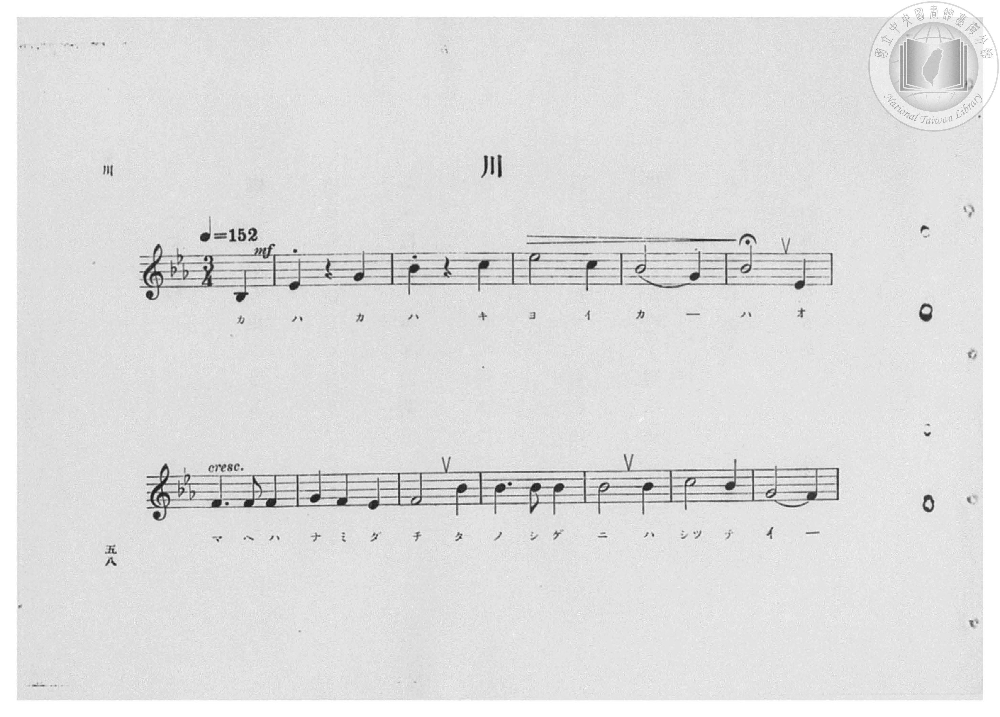
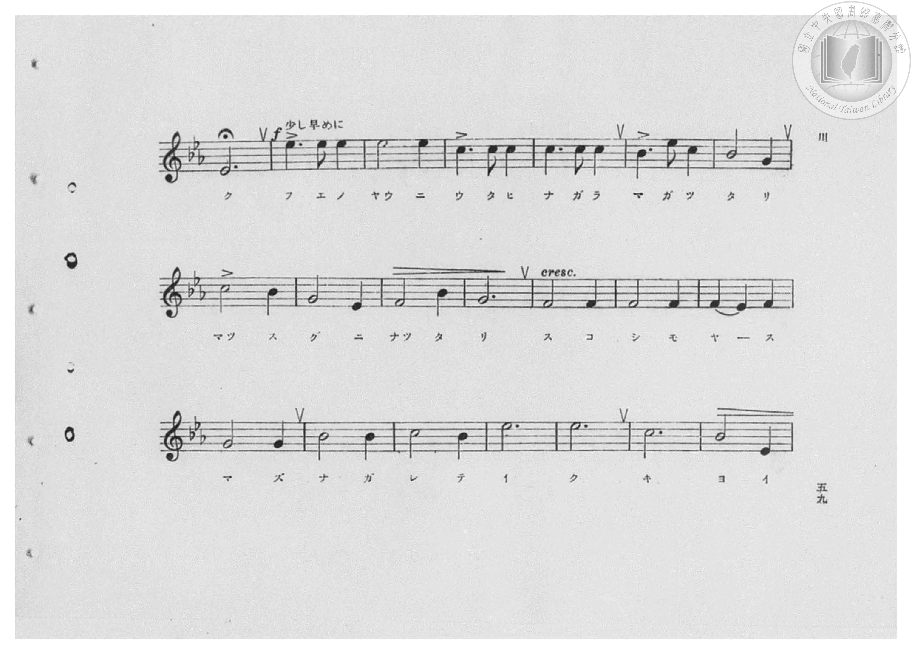
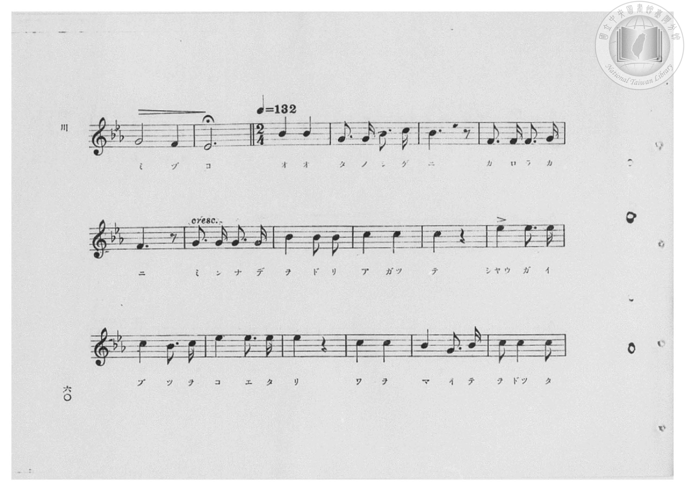
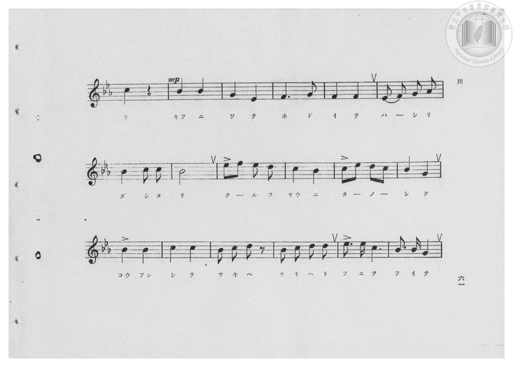
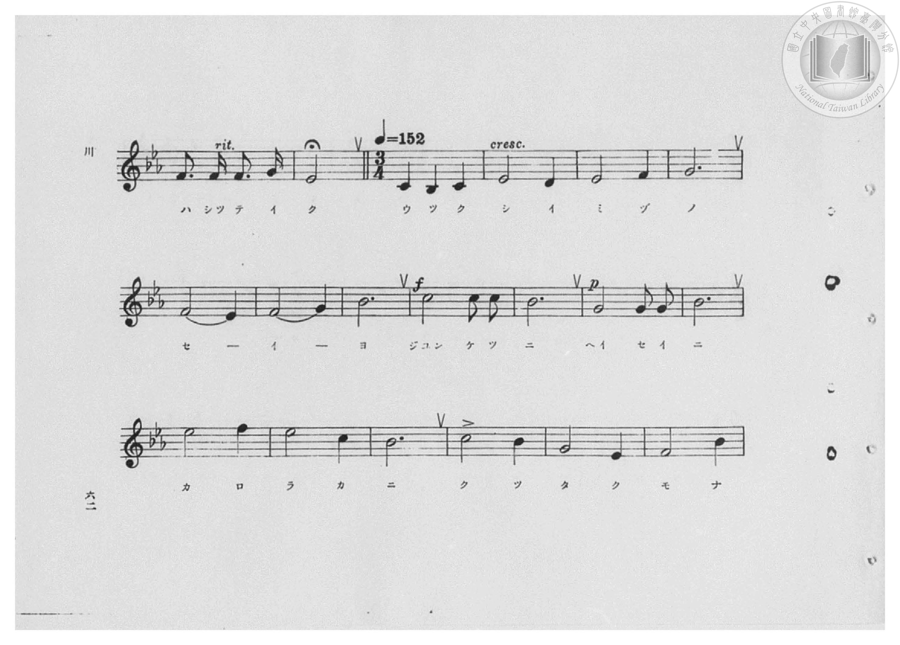
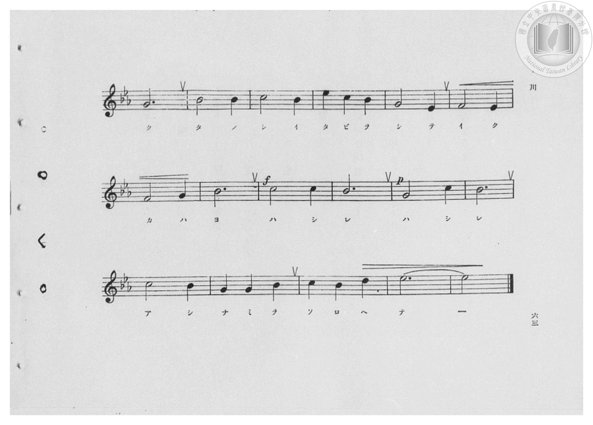
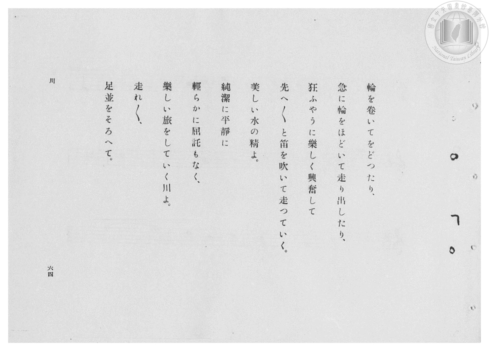
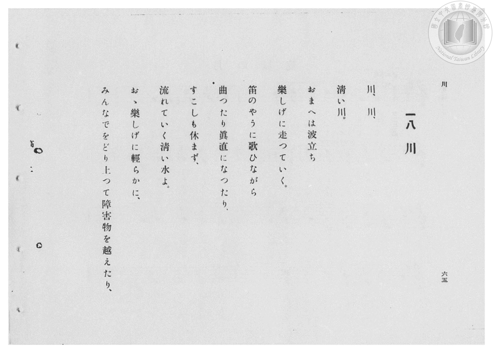

# 川

> Re:Shōka 使用 AI 協助辨識與重建樂譜，可能會有錯誤。歡迎回報。

- **鋼琴伴奏版**：<br><audio controls src="kawa.mp3"></audio>

- 臺灣總督府《公學校高等科唱歌》第二學年用（昭和十一年，索書號 0729 74）

## 說明

原書資訊與歌詞全文（對應 P060.jpg–P065.jpg，原書 pp. 58–63，第 18 首）：
調性與拍號：變ホ長調（E♭ 大調，3 降記號）
第一段：3/4 拍（♩=152，弱起 1 拍）
第二段：2/4 拍（♩=132，於 P062.jpg 第三小節轉拍，本檔以 <16*> 12 單位等時記譜）
第三段：3/4 拍（♩=152，於 P064.jpg 第三小節轉回 3/4 拍）


## 歌詞

```text
川、川、きよい川、
おまへは波だち、たのしげに走つていく。
笛のやうに歌ひながら、
まがつたり、まつすぐになつたり、
少しもやすまず流れていくきよい水よ。

おゝ、たのしげに、かろらかに、みんなでをどりあがつて、
しやうがいぶつをこえたり、わをまいてをどつたり、
きふにわをほどいて走りだしたり、
くるふやうに、たのしくこうふんして、
さきへ、さきへと笛をふいて走つていく。

うつくしい水のせいよ。
じゆんけつに、へいせいに、かろらかに、くつたくもなく、
たのしい旅をしていく。
川よ、走れ、走れ、あしなみをそろへて。
```

## ABC

<div class="abc-score" data-abc-src="kawa.abc" aria-label="五線譜載入中"></div>

[下載 ABC 原始檔](kawa.abc)

## TMD 檔案連結

- [主旋律 TMD 檔案](kawa.tmd) [[在 TMD Studio 編輯](https://tmdlang.github.io/Tmd-TS/#tmd=s7IKdvYPcrWy4qpTUCpJTLdSSM7PyUlNLsnMz7PKzk9PzM7Ojy_OyM9OVIKrKMvPKc1NBcqW5McbIYSL80uLklOtipMz8vNz4ktSK0qS8vOz0eXjCxLTU60CDMwMcMoY4pTBsA0uY4xTxgSnjClCpqAovyw1LzEP6P6Cosy8ktQUsAcQClLLMlNSQdLFyYl58WWpRZlpmakpSGGSWlQMCjKoFSVFiXnFyUWZBaBwRKjKLyrJyE8vSizIqLTKyCwuyS_KTE7Mic9OzEMK3pKMVGDo5iWWlBalooump0K1I5uZmZ6ZZ1WSmFkOdFl-WlpmcmZijhKXlpbC0-1zFbS0uBRtFQxNjbjsbRVcdbhsjPVN7ECaX7Tvet64-PmOvc_nLn66a87jhq6nrWuert3xbMHCl6tnPF_b-Xz5xKdTNj5b2_O4ofv5mjVPdvUAZZ_u3PJ8yor3ezqezVj7dFLP097GJzsagILv9_Q837Lo2ewdL2bOVzAwN7JUMDd5v6dTiYtLX0vBllqAS0FB4WnffJA1m9tfrOh60dEOdN-LlfOetq54Nq0d6KynG3qftXcqgNKXXlZB-qOGyaCIBjGBLoRoVSgo0FMwtQBKmRmDnL1mjYKhhcLLZdOA7n2_ZxbIjher9j9rWA4yvbsX6CGg6It1XY-bZ7-cuh0oBbTG9dHMtQpPlywH83qMFV7O7H2xYgZYaSfIAFB47Wh4tm4rUCswwBWA5gB1PZq50hYYEyCX7Nn4Yut2BUOIBFzLrh6IFiNULcYgLc-m7QF5ywjkF4j5nU839D9f3_BibydYbc-zOWuerZryZPdSBRtDMy07BUMjhafT1j3Z2wuMzGczm0AOXDsH2YGduB0Itc0Em21PZ89TgOvp5AJHyva5jxsaIeTjxt7HTR2PG1sgXJD048aux437HjfueNy4_tnmRY8bFzxuXAhWOv9x47rHjdMfN0563Lj6xdYNjxuXPG5cBtT8uLH_cUMTxKmzQYqagEJtQEWgBNm46XHjqseNPY-bOuE2AI0HSgB1z3_c1AU2GygC5M583DgBqA2sASELdvSGiSCrm5rAZgPVATXMera18XET0CCYG2CeebZhC4gBdBLMQ00Qz6L4ACzS_bgJqKkTxICK7H_cNBnsgOWPm4DKVoLc0NgEc_AyuB-AjoH4EigBZGwDSYM0ADUD3QDzWFM_WBDoWqCaZVAT0fwGcnfjVpD9UNW7wYpAGkChDLIfGAdAV6PoASoFunkrPKxRPQgMDKBDgOJABUAGUATh8qlgC3eANcDYjStAUQeyHOgQmM1o8QvRDTQTKAw0H2gmOKRBNgJjvQUa5GBFMx43tYEtBsYaUDXEcUBbgEaBleIMfaC54MABeQ8Y6MBoAFoNdTfccy3PpreC3Qr2FnL6AyVjkDMawQEHLA0RDHAkAjUAjQRGMVAzUCXE68CQAWumvMyDAgUtfS4u78TyxIDEohJDq4DMxLx8hxqDmmqQLQo2Flp2YAa20hZRGiloAPOtjgI0m-ugFZPwokUBWHCAM7smFsOA7gBZVKNgoKALxtW5abUKpvFAVg2wQIOIGYN5plCeGUQuDkiBIIQLkgRBhFIQBBlQA7bAx7BGAWQoCD9uWg1W9bi5H4_IWqjICqhZj5uWQETAasEizXuQdEHUrALbCPWTEVjQCEzXgJ0GYoEdBZXTBTsV5mBTFB5MDuRBBA9kCsRUZK89bp4HddIMqHNAYl1gkflgsgEq1gh36n6oSB-Uvx2IN0HFuuFehJrVtP1xcwtcsA0qCAoRpJCA-RvkQxisUagGRig0toAUmIUUfVA-xJNm0NhE5UGCA6gQS1QjQqBpPYqtj5unQv21AupHkBiwAFwGdzPIkyCNEBFQgDxunoQUdCCxNUD2SqgYNIjBYqCwAOkFBSLENJSYxx5n2GIeJgdxNUwOkmIweSATMGIeKWaadkLdtQHdl83AFgdCGSzuQY5GCjOwdoiKzVCR7XCDFkH1gCIdEuFQ62CehnkFNQ9iS8Tw2IfYi8aFqYXwsOdlWGyAHLEL5kO4yBqoCIiGOB49xcI8jJZowLkeiY-e-9G9CokZlPSO5ERQzoNY34pmHERlLaIMNsIog0GNLvyFMLh9p6ABbIcCW2IK0FaegrEZtLgFtrsQrbdn6_sRLbinEzqAzbfnwIAzMoEqBpfe4CIbUnqDm2p4C2zk-IXFOoiEyZjBZUAQVHAjZ1ZYwkNmQfISKLMiEh6oSEIURyAIrhqwlbAIGhTWMEthzoI7D8kRkIL8cfNaaCaHVAQI6yCmgKsDaFw-bt6MKBya2xEOQQ4NEIalYURqhtEgR6EnFFCxCzGyE0yCwuRxEyjDQdNh0xr04hfmMohRsIIXpVSFl5kQQ2DRgkURcqAAC3rkUhKclyDp_3HzNISLoM4BuR1SWEBUQRI4KC4xHQXzOWbYoKYhU5SwgaUPmGcfN8PyLGrIIcoDSB4HBRNKeYwcEQgnwBxVnVsAbHeguQc9joDxg16KIhwIaWBAZNbCqh9YCYwSTcj1AQiiplpYOwFFBskhMO8je342ignQZIRUPcNSDEoVDTIcZJkJso_hwYOce9GdAGoUwKoAUD6FplhwIwMaMxBxtCBCmIWcNoxABJhlDrUbYgbMBSARsDTMWei1PtQpzaD8DAl4lDSM0qCBugiiAdQsQGu7gAIDFgsoSQHFOcg0SuaBWwOPpabNqC6ZCipDYHKI2hUjhmClCChMQIkUxq8Bi4AwlkyO5JStYAvWgg2fASQhrVqEKMgtIPHHzR1gErm5BEtYaMWbGUq9ByJhJbAxSh2InlxgRoOKEJg_YY1maMsSpAwiBVaGUi9DjEOqLI3J6LCARiewdFjgQxJAL0BqQqRBHoXnWyc83bAPfzUIClcEgWgMQBp7yFkcrbGHFFeg9AEpWCA-R01K0H4HluYEpOmOFlewMsMc4h4YF7VVBkmNoKY5IjmbYcoDy0REqw5Rt2P6YDfcbdA-EXrfAL3xA1Sx43HzMuTMsBEcBsi5FaqyGdhZhxsHtArEw1CGUd2AixWcHUWI0US30zFaDSCPrYU6D9J2ALkN1o1E8wCiNMDsOMAiHNy-hqgBtS8wKguIUQRb1fAyEodv0JrRGA1gRIcG2mfCTIjQInQymIT2GNFKMpQEAPEheueQcHrEIo-UHrHIY40kWGcYLfUh9dlBTkfuLRCpAndfD4QREQRigYprjH4OjIXeNoYnBLi9yB15WIDvBfPWgklQOY4oQdHNh7SYgeWnrp0CfMwn2scwVgFJwAhdwBgmoMwFAA)]
- [鋼琴伴奏 TMD 檔案](kawa_piano.tmd) [[在 TMD Studio 編輯](https://tmdlang.github.io/Tmd-TS/#tmd=s7IKdvYPcrWy4qpTUCpJTLdSSM7PyUlNLsnMz7PKzk9PzM7Ojy_OyM9OVIKrKMvPKc1NBcqW5McbIYSL80uLklOtipMz8vNz4ktSK0qS8vOz0eXjCxLTU60CDMwMcMoY4pTBsA0uY4xTxgSnjClCpqAovyw1LzEP6P6Cosy8ktQUsAcQClLLMlNSQdLFyYl58WWpRZlpmakpSGGSWlQMCrKCzMS8_PjEoqLEvPTU3NQ8JCOQBK0SM-MTk5PzcwsS8zJRVeUXlWTkpxclFmRUWmVkFpfkF2UmJ-bEZyfmIcVASQbQGKu8xJLSolR00fRUqHZkMzPTM_OsShIzy4GOz09Ly0zOTMxR4tLSUni6fe77PR0vu_c8n7DlyZ4tT5f2P-_seL-nU0FLi0vRVsHQ1IjL3lbBVYfLxljfxA5k4ov2Xc8bFz_fsff53MVPd8153ND1tHXN07U7ni1Y-HL1jOdrO58vn_h0ysZna3seN3Q_X7Pmya4eoOzTnVueT1kBtOrZjLVPJ_U87W18sqMBKPh-T8_zLYuezd7xYuZ8BQNzI0sFcxOg9UpcXJ55JUX5VgGg8AzycKgxqKnmUgACGwstOzCjRqE6N61WwVBBV8EAiI2BuEbBFEiCIEikhqsWxRQfHKYUAA2JB6o3BREg42oUog3jtU3jtQ1j0Y3zTixPDEgsKjHE6zCQchAGOxBsbA0Wd4J4ZhC5OKg9EC7ME6heArsMbIGPYY0CyFAQfty0GqzqcXM_HpG1UJEVULMeNy2BiIDVgkWa9yDpgqhZBbYR6icjsKARmK4BOw3EggQXRA4YgkgONkXhweRAHkTwQKZATEX22uPmeVAnzYA6ByTWBRaZDyYboGKNcKfuh4r0QfnbgXgTVKwb7kWoWU3bHze3wAXboIKgEEEKCZi_QT6EQWBiAaU4SGwBKTALKfqgfIgnzaCxicqDBAdQIZaoRoRA03oUWx83T4X6awXUjyCxJY-blsHdDPIkSCNEBBQgj5snIQUdSGwNkL0SKgYNYrAYKCxAekGBCDENJeaxxxm2mIfJQVwNk4OkGEweyASMmEeKmaadUHdtQPdlcxeyMljcgxyNFGZg7RAVm6Ei2-EGLYLqAUU6JMKh1sE8DfMKah7ElojhsQ-xF40LUwvhYc_LsNgAOWIXzIdwkTVQERANcTx6ioV5GC3RgHM9Eh8996N7FRIzKOkdyYmgnAexvhXNOIhKzMIRR3kLKxzBZSrW0hfBN4GWnbgF0HUgQhYY2iABc7gUpjaCCtD5YOtBTLAEsjzEAFiZQcAYnMaaYOMS8j3UUtxuI9KzGAqwCyC0EetdQi4jEBzYvYse9NA6G1ZjYyRKIyw1tqEZPFUi53BYvgeRMBkzuAwIQtoDiOIaVvQgs_ZDaGBxjSh6QJUSokICQUg4YqljETTIczBLYc6COw_JEZCq_HHzWmgxD2kKIKyDmAKyEJabHzdvRlQPze0IhyCHBgjDSjFEeQajQY5CLypAFS_EyE4wCQqTx02gIhdiBrBMQ6-AYS6DGAWLYpR6FV5rQgyBRQsWRciBAqzqketJcGkKKQEfN09DuAjqHJDbIdUFRBWkiAPFJaajYD7HDBvUNGSKEjaw9AHz7ONmWKmNGnKIGgFSyoOCCaVGRo4IhBNgjqrOBZar6GkaPY6A8YNejyIcCGliQmTWwhogsDoYJZqQWwQgiJpqYS1FFBkkh8C8j-z52SgmQJMRUgMNlmJQGmkgw0GWgQoNuI_hwYOce9GdAGoWwhoBoHwKTbHgZiY0ZiDiaEGEMAs5bRiBCDDLHGo3xAyYC0AiYGmYs9DbfVCnNIPyMyTgUdIwSpMW6iKIBlDDEK31CgoMWCygJAUU5yDTKJkHbg08lpo2o7pkKqgMgckh2lcYMQQrRUBhAkqkMH4NWASEsWRyJKdsBVuwFmz4DCAJLsaQREFuAYk_bu4Ak8gNZljCQivezFBaPiASVgIbo7SC0JMLzGhQEQLzJ6zbBO1bgJRBpMDKUFpmEOMwayaU5hJSzYTZQkKvhiFsSK2JohBRTWFU5mgsqDxIAxa7sFf0iCYJerWNbD8i9Ajpx-ULHE6AGY7NBXgMQGlcoLgWUXqSFgQYoYhQgx7KWA1B8zJx3iAiKFEFEbZgbzBiT1RoZsAsQE5TYFl4jCC3U8FscE8P0ygUf6CFAPYAxZa0kXKRMd4RGYS5MN8BSXBUo_AQgxtYMj643INUmJAcjVpEQkdUsHSUIIMSaGUQrC6E-hPGRe1vgnWABx0QxbQZpjywhED0VxFtVkwf7Ia7DTragz7qgd6tA6rY8bh5GXIhvxEcBsi1EFRl8wwk44BWgXgYyjCaUeDqEucQGMRookcgMFrDII-thToP0iYGuQ02QIbmAUQthzkkAotw8MgBRA2o3YzRCIIYRXC8AF734_AN2gABRtce7i7YaBBmQoQ2DSaDSehYGFoNjZIAID5EH_YinB6xyCOlRyzyWCMJNsyHlvqQRiNBTkceByFSBe5RLBBGRBCIBWqGYIzgwFjofT54QoDbizxECQvwvWDeWjAJap8gWgbo5kOKZswSDc-wNUYHHXfPGrsC5NIRlPSgqhDm4uix4--hEzk8g8dxOIZ5SB3ioGR8Aqm-xGMPSoVK2bgGtcZ5MJoT6ApwTm7o2imAp0sUgAz4WF60D0ghQsAIXcAYJqDMBQA)]

## 分析

```text
================================================================================
📊 TMD Song Profile: [ 川 ]
================================================================================
⏱  Duration:       1:51 (111.3s), 94 measures total
🎼 Key & Tempo:    首調基準 E,, != 152.0 BPM, <3/4>
   - 分析範圍：      由實際發聲的音符與和弦推測調性；播放脈絡另行呈現
🎤 人聲音域:    A#3 (MIDI 58) – F5 (MIDI 77) [跨度: 19 個半音 / 1.6 個八度, 難度: challenging]
   - 最低音:  A#3 in [KawaPart1[L1] #1 @ m.1, 0:00]
   - 最高音: F5 in [KawaPart2[L1] #1 @ m.53, 1:01]
   - 適合: soprano, mezzo-soprano, contralto, tenor, baritone, bass
🏛  結構:      KawaPart1[L1] (42.6s) -> KawaPart2[L1] (28.4s) -> KawaPart3[L1] (40.3s)
⚡ 編曲密度:        Peak 1 軌道同時演奏
🗝  調性診斷：       D# 調性不明確（推測轉調經歷 1 次）
   - 風格氣質:    純淨自然大調（陽光明朗、易唱易記，無明顯調外色彩）
   - 轉調歷程:    D# 調性不明確起奏 ➔ [KawaPart2[L1]] 轉至 A# 大調 (+7 半音 / 五度圈 +1 步)
   - 核心骨幹音:  A#, D#, C, G, F
   - 調性數值:    D# 調性不明確 [相關度: 0.83, 穩定度: Ambiguous, 自然音純度: 100.0%]
   - 候選調性 (K-S): D# 大調 (0.83), A# 大調 (0.80), G 小調 (0.63)
   - 五度圈歷程:   -3 -> -2 -> -3
   - 各段落調性細節:
     • [KawaPart1[L1] #1]: D# 大調 (r: 0.85, 自然音純度: 100.0%)
     • [KawaPart2[L1] #1]: A# 大調 (r: 0.77, 自然音純度: 97.8%, 調外音: G#)
     • [KawaPart3[L1] #1]: D# 調性不明確 (r: 0.81, 自然音純度: 100.0%)

  [ 五度圈游移軌跡 ]
               C  
         F            G  
     [Bb]*              D  
     [Eb]*              A  
         Ab           E  
            Db       B  
               F# 
     (* = active key center)

  [ 十二半音累積音高分佈 ]
     C  : ████████████████          18.6%
     C# :                            0.0%
     D  : █                          1.5%
     D# : ██████████████████        21.1%
     E  :                            0.0%
     F  : ████████████              13.9%
     F# :                            0.0%
     G  : █████████████             15.8%
     G# :                            0.6%
     A  :                            0.0%
     A# : ████████████████████████  28.6%
     B  :                            0.0%
--------------------------------------------------------------------------------
Assignment 軌道音域：
  - Piano         : A#3 – F5 (19 個半音 / 1.6 個八度, 226 個音符)
================================================================================
```


## 原書掃描頁


















