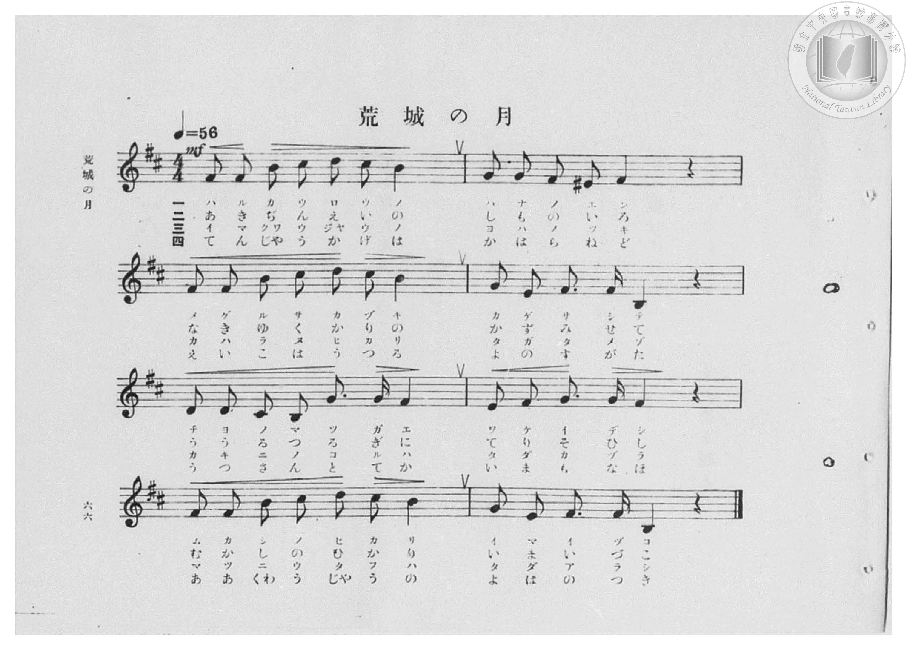
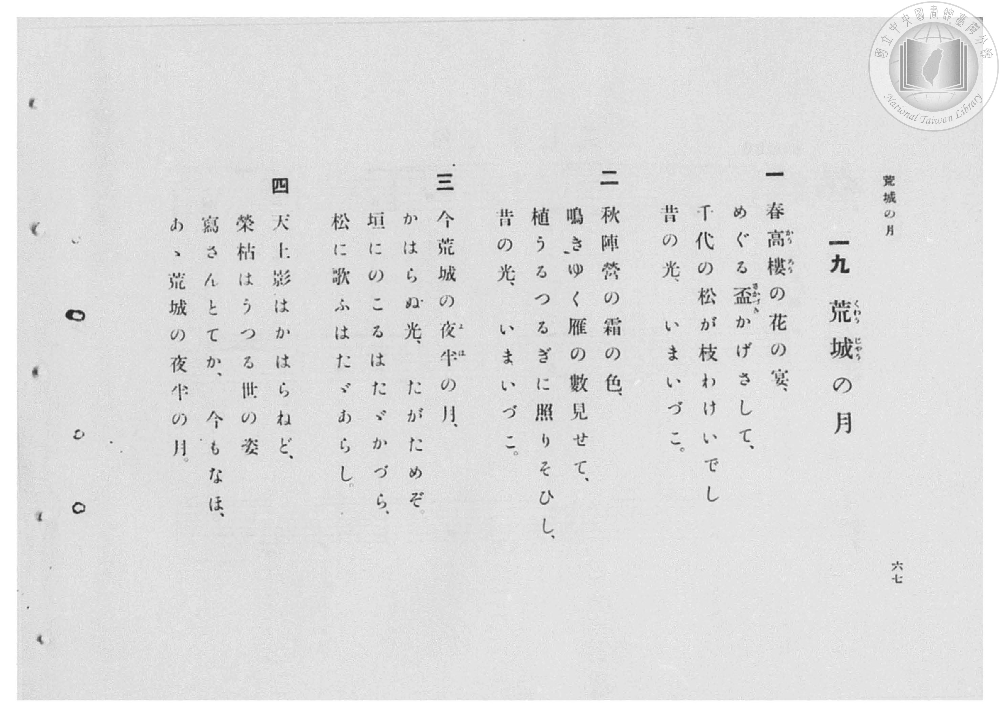

# 荒城の月

> Re:Shōka 使用 AI 協助辨識與重建樂譜，可能會有錯誤。歡迎回報。

- **鋼琴伴奏版**：<br><audio controls src="kojo_no_tsuki.mp3"></audio>

- 臺灣總督府《公學校高等科唱歌》第二學年用（昭和十一年，索書號 0729 74）

## 說明

原書資訊與歌詞全文（對應 P073.jpg，書頁 p. 50，參考教材第 10 首）：
速度與表情：ユツクリト
調性與拍號：ろ短調四分之四拍子（B 小調 4/4 拍，關係調 D 大調）
出處：（中學唱歌）


## 歌詞

```text
一
春高樓（かうろう）の花の宴
めぐる盃（さかづき）影（かげ）さして
千代の松が枝分け出でし
昔の光（ひかり）今いづこ

二
秋陣營の霜（しも）の色
啼（な）き行く雁の數みせて
ううる劍（つるぎ）に照（て）りそひし
昔の光今いづこ

三
今荒城（くわうじやう）の夜半（よは）の月
かはらぬ光誰（た）が爲ぞ
垣に殘るはたゞ葛（かづら）
松に唄ふはたゞ嵐（あらし）

四
天上（てんじやう）影は變らねど
榮枯（えいこ）はうつる世の姿
うつさんとてか今も尚ほ
嗚呼（あゝ）荒城の夜半の月
```

## ABC

<div class="abc-score" data-abc-src="kojo_no_tsuki.abc" aria-label="五線譜載入中"></div>

[下載 ABC 原始檔](kojo_no_tsuki.abc)

## TMD 檔案連結

- [主旋律 TMD 檔案](kojo_no_tsuki.tmd) [[在 TMD Studio 編輯](https://tmdlang.github.io/Tmd-TS/#tmd=s7IKdvYPcrWy4qpTUCpJTLdSSM7PyUlNLsnMz7PKzk9PzM7Ojy_OyM9OVIKrKMvPKc1NBcqW5McbIYSL80uLklOtipMz8vNz4ktSK0qS8vOzEfIFRfllqXmJeUA1BUWZeSWpKWBF6AbEFySmp1oFGJhZIGRSyzJTUkEai5MT8-LLUosy0zJTUxDy-UUlGfnpRYkFGZVWGZnFJflFmcmJOfHZiXnIzk4tKgb5CmpNSVFiXnFyUWYByKsIVSUZqUC_5SWWlBalooumJeZm5lQiW5uZnplnlZufl1QKDCNMidTMrEykkNDSUnjRO-np_L7HjeuezelQ0NLiUrRVMDXjsrdVcOHKTq20VXDK5bIx0TexAxn1on3X88bFz3fsfT538dNdcx43dD1tXfN07Y5nCxa-XD3j-drO58snPp2y8dnanscN3c_XrHmyqwco-3TnludTVrzf0_Fsxtqnk3qe9jY-2dEAFHy_p-f5lkXPZu94MXO-goG5kaWCucn7PZ1KXFz6Wgq21AJcCgoKT_vmg6zZ3P5iRdeLjnag-16snPe0dcWzae1AZz3d0PusvVMhwMDcWC-rIB3oLKDilwsaFQr0FEwNgNyn_c0vGpqfTZ35bO4EoK8UDA0UXi6bBnTq-z2zQMa_bJj_dNcyoMEvFq541twKFH3cvOxxc8vjpvWPm1c9bu4AKXqxav-zhuUg27t7gR4GKWrqfT5_LVD86ezZTzvanuzsBjKAsk_XTgC6yknh6YZ-oKQCMPAVgKJAd7ycPufJ_iaQmIvC0yXLgQygG8D-a9_1YuZUoJFAfU92rAWFOTgWQNIgeWB4g6hnM5YCo-nZislAZY8bux83tgGdACSByoDx_6JrI5B8um4LSOnjpsbHjRMeN3U_n90MVj0VrGHp40agQzqf7t0IM2ISWDNQdvrjxmVgt_Q2P9m9GJSe5u573NjzbN5coN8eN04EuvFx43KgOohLpoDsagWGINCYTSCTmrqAJj3Z3fW4sQVsz2SIy3f1gKjny7tfzlz8vH0-UNfLOXPAuqY_bmqCurxzE9jmqXvAEqvAor0vFvY8bux_ORvokXXPpu543Lj_ceNsqCNBXgf5vvtpF9A_QD1LgOzHjX1gnaufty4HCy4DcZuALpoLdiOqyzGdugMcF0BxSJYCG9H_uKkfbNmMx01AxdCgfrpkztNeoH87HjcB1ayHCALzH8RpQIesf9wEFFoDtObFqg1gg4AJBijS87wD6JB5YN_OAwby6mfrgAaDNTTOf9w078XE2bCIWQo0Apo8wDGx-ukUoAO2wpU-3QpKZY8bm8BWTYclFWASBFNLVj7ZAXZh47LHTZOR3Q-MfKAhL9Z1gTWufdy4EmzHsnXP5gF9AtQAREClwEQGlAZaBvQ8KHSf7JgG8vny_fDwXwJKNyCzV4AsaewGhWhT09MNsx437ga7YfqspxMhUQp05FygefCyChKAiECjvJiAAgUtfS4u7_ysfL_8kOLS7EyrgMzEvHyHGoOaapA9CjaGZlp2YBa2MkoBVObtaACmPAUNI1D-fb6-QQdesGhi0QC0DmRYjUJ1blqtgrGCLhibAbE5EBvGQRkgARCsUTABkiAMUmakDmWAoAFMCdhAH8MaYCCvB_KBQQ8iGyFkG1ikF8FuXAc3Gqq-cRVcHBiXYPWToWriUe0wAulpAquDmLgIrhqqs7EFw47pYDUQXRA7wGrAbsJihzFID8SUfWASlKOQnA9Kl9h90wRxAcRPEJuWwN2KxSYTkE3LkHyAZjQkACfBDYV5CCIOCepOMHstmFyJYQ3-dLOrh5x0Q2SSMYIqA5FmMBdhSTJNjWC3TwD7BuKzqUi-X4oSgAjfQ0IFpBJET4cGJK4kA0lg4CTTBAlbSIyCzWrqArORkwyy3fuhdszGbQc4yWDGyhowuQnNJpgd88HiPWASxAbJNwLZ87DbAU4syEkckmQgiQ3iJ3BiA4chaoKEJMWZUH_0wO0jPqXs6CQnpRgCTQZhc5A14DQAShggElaE1MCTCboMtsJlIdh_yH6CZFCQv2E-A8nCfA-J44nwMAPRy8GpBXdKgYQkpNCCxChyqAIrbCBejbADmn0hKWguVM0m3HYgpRRwagSbBfMNpNAD2YWa3yEpZQGYhLljKTSV4UopSCkCkp-gRcwKqP5lcLMgdiAVeOCiEsRbBcS7MezAm1KAlflgKFMa4GEFLf6hIYwrLyIX97CUAgxhaIxgTSm0tgOcUhDpG5ZSIPEKSRFbwSSulAKNRWAqwZkawSkFUjFCSPKrOog7sVV1tVxcunYKSC2caB_DWAV0ISNMIWNMIROwkDIXAA)]
- [鋼琴伴奏 TMD 檔案](kojo_no_tsuki_piano.tmd) [[在 TMD Studio 編輯](https://tmdlang.github.io/Tmd-TS/#tmd=s7IKdvYPcrWy4tLSUnjRO-np_L7Hjeuezel4v6fjZfee5xO2PNmz5enS_uedQJFOBS0tLkVbBVMzLntbBReu7NRKWwWnXC4bE30TO646BaUX7bueNy5-vmPv87mLn-6a87ih62nrmqdrdzxbsPDl6hnP13Y-Xz7x6ZSNz9b2PG7ofr5mzZNdPUDZpzu3PJ-yAmjhsxlrn07qedrb-GRHA1Dw_Z6e51sWPZu948XM-QoG5kaWCuYmQEcocXF552fl--WHFJdmZ1oFZCbm5Qd5ONQY1FRzKQCBjaGZlh2Ypa-lYIsOFEDW7mh4sbBHQcNI4emG_ufrG3QUAgzMjfWyCtI1sWjQ0gcbVqNQnZtWq2CsoAvGZkBsDsSGcVAGSAAEaxRMgCQIg5QZqUMZIGgAUwI20MewRuFx43og_3FTN4hshJBtYJFeBLtxHdxoqPrGVXDxx40dYPWToWriUe0wAulpAquDmLgIrhqqs7EFw47pYDUQXRA7wGrAbsJihzFID8SUfWCy_3FTP5LzZzxugshi-KYJ4gKInyA2LYG7FYtNJiCbliH5AM1oSABOghsK8xBEHBLUnWD2WjC5EsMa_OlmVw856YbIJGMEVQYizWAuwpJkmhrBbp8A9g3EZ1ORfL8UJQARvoeECkgliJ4ODUhcSQaSwMBJpgkStpAYBZvV1AVmIycZZLv3Q-2YjdsOcJLBjJU1YHITmk0wO-aDxXvAJIgNkm8EsudhtwOcWJCTOCTJQBIbxE_gxAYOQ9QECUmKM6H-6IHbR3xK2dFJTkoxBJoMwuYga8BpAJQwQCSsCKmBJxN0GWyFy0Kw_5D9BMmgIH_DfAaShfkeEscT4WEGopeDUwvulAIJSUihBYlR5FB93NgHxKsRdkCzLyQFzYWq2YTbDqSUAk6NYLNgvoEUeiC7UPM7JKUsAJMwdyyFpjJcKQUpRUDyE7SIWQHVvwxuFsQOpAIPXFSCeKuAeDeGHXhTytPZswdDmdIADyto8Q8NYVx5Ebm4h6UUYAhDYwRrSqG1HeCUgkjfsJQCiVdIitgKJnGlFGgsAlMJztQITimQihFCkl_VQdyJraqrxdLA8UFu4JhA2zc1wDiNV4g2i9c2jlUwBjFN1eO1zeNjQcUERMIQImEA9QABHSARkAKEckOQErAxMI1AJsR0k3htM6BGMo0HelLXTgHJn9E-QJPRhYwwhYAmowuZgIWUuQA)]

## 分析

```text
================================================================================
📊 TMD Song Profile: [ 荒城の月 ]
================================================================================
⏱  Duration:       2:17 (137.1s), 32 measures total
🎼 Key & Tempo:    首調基準 D, != 56.0 BPM, <4/4>
   - 分析範圍：      由實際發聲的音符與和弦推測調性；播放脈絡另行呈現
🎤 人聲音域:    B3 (MIDI 59) – D5 (MIDI 74) [跨度: 15 個半音 / 1.2 個八度, 難度: moderate]
   - 最低音:  B3 in [KojoNoTsuki[L1] #1 @ m.4, 0:15]
   - 最高音: D5 in [KojoNoTsuki[L1] #1 @ m.1, 0:02]
   - 適合: soprano, mezzo-soprano, contralto, tenor, baritone, bass
🏛  結構:      KojoNoTsuki[L1] (34.3s) -> KojoNoTsuki[L2] (34.3s) -> KojoNoTsuki[L3] (34.3s) -> KojoNoTsuki[L4] (34.3s)
⚡ 編曲密度:        Peak 1 軌道同時演奏
🗝  調性診斷：       B 小調（純淨自然小調，未偵測到可信轉調）
   - 風格氣質:    純淨自然小調（陰鬱抒情、旋律集中，無明顯調外色彩）
   - 轉調歷程:    全曲維持單一推測調性（未偵測到可信轉調）
   - 核心骨幹音:  F#, B, G, C#, D
   - 調性數值:    B 小調 [相關度: 0.78, 穩定度: Moderate, 自然音純度: 98.2%]
   - 候選調性 (K-S): B 小調 (0.78), B 大調 (0.65), F# 大調 (0.59)
   - 五度圈歷程:   +5 -> +5 -> +5 -> +5
   - 各段落調性細節:
     • [KojoNoTsuki[L1] #1]: B 小調 (r: 0.78, 自然音純度: 98.2%, 調外音: F)
     • [KojoNoTsuki[L2] #1]: B 小調 (r: 0.78, 自然音純度: 98.2%, 調外音: F)
     • [KojoNoTsuki[L3] #1]: B 小調 (r: 0.78, 自然音純度: 98.2%, 調外音: F)
     • [KojoNoTsuki[L4] #1]: B 小調 (r: 0.78, 自然音純度: 98.2%, 調外音: F)

  [ 五度圈游移軌跡 ]
               C  
         F            G  
      Bb               D  
      Eb               A  
         Ab           E  
            Db      [B ]*
               F# 
     (* = active key center)

  [ 十二半音累積音高分佈 ]
     C  :                            0.0%
     C# : █████████                 12.5%
     D  : ███████                    8.9%
     D# :                            0.0%
     E  : ████                       5.4%
     F  : █                          1.8%
     F# : ████████████████████████  32.1%
     G  : ███████████               14.3%
     G# :                            0.0%
     A  :                            0.0%
     A# :                            0.0%
     B  : ███████████████████       25.0%
--------------------------------------------------------------------------------
Assignment 軌道音域：
  - Piano         : B3 – D5 (15 個半音 / 1.2 個八度, 192 個音符)
================================================================================
```


## 原書掃描頁






