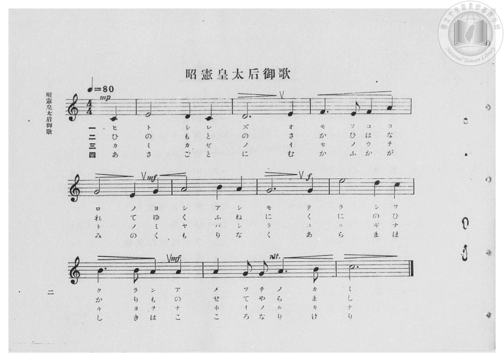
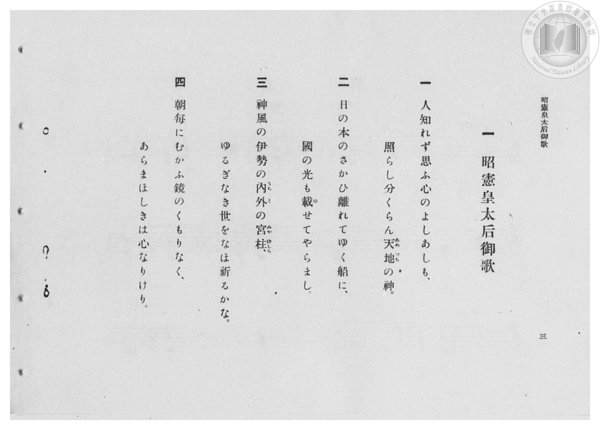

# 昭憲皇太后御歌

> Re:Shōka 使用 AI 協助辨識與重建樂譜，可能會有錯誤。歡迎回報。

- **鋼琴伴奏版**：<br><audio controls src="shoken_kotaigo_gyoka.mp3"></audio>

- 詞：昭憲皇太后
- 臺灣總督府《公學校高等科唱歌》第二學年用（昭和十一年，索書號 0729 74）

## 說明

原書資訊與歌詞全文（對應 P004.jpg–P005.jpg，原書 pp. 2–3，第 1 首）：
調性與拍號：ハ長調（C 大調，無升降記號）4/4 拍（弱起 1 拍），速度 ♩=80


## 歌詞

```text
一
人知れず思ふ心のよしあしも、
照らし分くらん天地（あめつち）の神。

二
日の本のさかひ離れてゆく船に、
國の光も載（の）せてやらまし。

三
神風の伊勢の内（うち）外（と）の宮柱（みやばしら）、
ゆるぎなき世をなほ祈るかな。

四
朝毎にむかふ鏡のくもりなく、
あらまほしきは心なりけり。
```

## ABC

<div class="abc-score" data-abc-src="shoken_kotaigo_gyoka.abc" aria-label="五線譜載入中"></div>

[下載 ABC 原始檔](shoken_kotaigo_gyoka.abc)

## TMD 檔案連結

- [主旋律 TMD 檔案](shoken_kotaigo_gyoka.tmd) [[在 TMD Studio 編輯](https://tmdlang.github.io/Tmd-TS/#tmd=s7IKdvYPcrWy4qpTUCpJTLdSSM7PyUlNLsnMz7PKzk9PzM7Ojy_OyM9OVIKrKMvPKc1NBcqW5McbIYSL80uLklOtipMz8vNz4ktSK0qS8vOz0eXjCxLTU60CDAxMEDIFRfllqXmJeUDdBUWZeSWpKWDtCAWpZZkpqSDp4uTEvPiy1KLMtMzUFCQXpRYVgxwMtaKkKDGvOLkoswDkC4Sq_KKSjPz0osSCjEqrjMzikvyizOTEnPjsxDwkz5VkpAL9lpxalJqbn1eJLp6bX5SYg2xiZnpmnlVJYmY50F35aWmZyZkgeS0thWcz1j5r2_R8VvvTJaueTuh7um_hs7U9ClpaXIq2ChYGXPa2Cs5cNib6JnYgw16snPd-zyw0LWBrXrTvet64-PmOvc_nLn66a87jhq6nrWuert3xbMHCl6tnPF_b-Xz5xKdTNgLNftzQ_XzNmie7eoCyT3dueT5lxfs9HUAjn07qedrb-GRHA1Dw_Z6e51sWPZu948XM-QoG5kaWCuYm7_d0KnFx6Wsp2FILcCkoKDztmw-yZnP7ixVdLzrage4D-vFp64pn09qBznq6ofdZe6cCKBXoZRWkP2qYDGSagphAF0K0KhQU6CkYAWWMQY5es0bBUOHlsmlAxwIDCmTBi1X7nzUsBxnd3Qv0DVD0cXP_y6nbgeJAC5wVni5ZDmb2PG9Z-LS3_eXM3hcrZoAVdgJDXQGoC-SOPRtfbN0ONBrMBRrd87Jh_tNdyxQezVxpC4wlkEXAkANTu3Y9n7_0cVPP48ZZzxrmPm7c-nR_8-PGdY-bOh43Tn_c2AQim5oeNzSCVD9vXf64qRMo9LSj7XFjP4jdNPnpkpVP52wAWgtS3dT4uHHJ48aFQGuBpjxfOu9xQxPEvl09IOrZ9KVA8Wdz1oDsaJz6uLH7ceOml7MXgV2w7HETyNgXHTsfN66GWvl0DlDFuqetQJuaXoD8ArRmHdj02WANLWAH7QM5E2bTjk6wW5fOe7loBVDxkz1dT7sXgQxpawVrB9oBct_TJcBwB3KBCQrk1qfr1j2bvxEssh9kbOMGsNeBNnZCnQJyXRPQNX2PG1c9bux9smPa46ZJYPbu50s7wFJAtArmjqezZ4N9PGfus_VALasfNzWAFWx92b8Q7Htg-AEDrAtsQj_MDlAYQjy0GxwBvY8b14OjZBVY6UQQCbQAqJTyFA0FClr6XFzBwMIwNc87H5jp0_PdK4Elo1VAZmJevkONQU01yDoFGwstOzADW6ZSAGXSHQ0vFvYoaCAnPwVtBWOFpxv6n69v0IFnDIRiTSwmAV0DsqVGwUBBF46rcwtqFYyAjBqgebpgCOJBREAkDIJkaxRMwGwTMG0KEgEb6WNYoxAP5MHw4-ZJYNWPmzuguh83bQeLr4GIN-1CMvlx0yqo6kUQfvNUoNhmsAyIhNphhGZH4yaIrsZ1cHOawOIr0MTBco1ToaLdUP4mIF4PZoFth9hhjGZH02qoy-bD7QCJPG7aAxXvQ_HHEqjvdkP90QdkLwOzGhF2mKD7A-RqkMtALoS4bQqKP0A2IuxoQPPHVij7cWMP2A78KWlXDzglmWBPOmBZvEkHFOew1FCdm1YLSQQKZlBhcyAGsREKQbAars44DipkBGIYgghECnrcvBbmS3C4Pm6GhgA47UB8D0ohED4ivcD0tEFFV8JVQ9IcKJYRaQhYIMLDGRw3TVB9jf1w8a1gEuQajPAHq0IWhaQzaGqEpyKklA_1CygFgcRBaQQiPgHFLzBXQ-RALgOJwm1pAtvS3IWwBZiOgCUqmiugrgPnBIg-kA5oGkfyI0QPNOU1dcJF9oFJUPollJJ2dIJTEq5CCCSLNyWBkgoowYCSCzglQdINJCWZAiGIZQ4UAacSGAQVWUgppgkUt6BwWQnEkBIDlCZAIbcQKtMCzn3QWADmXuTcDIKgPIiUOmD5ChhusPIEFLIgmdnQMFoGlAGaCg41UIiB5KZjNxGUEpogqRqUmh83g1IJNBaBNNREYLkBLivAsQ1zI0gNFhPBsQ6xDViHwcuwyVA3gmiQGSCZVfDYnwiOZUwTa7m4dO0UMGuoaB_DWAUcMkY4ZYxxypiAZZS5AA)]
- [鋼琴伴奏 TMD 檔案](shoken_kotaigo_gyoka_piano.tmd) [[在 TMD Studio 編輯](https://tmdlang.github.io/Tmd-TS/#tmd=s7IKdvYPcrWy4qpTUCpJTLdSSM7PyUlNLsnMz7PKzk9PzM7Ojy_OyM9OVIKrKMvPKc1NBcqW5McbIYSL80uLklOtipMz8vNz4ktSK0qS8vOz0eXjCxLTU60CDAxMEDIFRfllqXmJeUDdBUWZeSWpKWDtCAWpZZkpqSDp4uTEvPiy1KLMtMzUFCQXpRYVgxxckJmYlx-fWFSUmJeempuah2QEkqBVYmZ8YnJyfm5BYl4mqqr8opKM_PSixIKMSquMzOKS_KLM5MSc-OzEPCT_l2QAjbFKTi1Kzc3Pq0QXz80vSsxBNjEzPTPPqiQxsxzo9Py0tMzkTJC8lpbCsxlrn7Vtej6r_emSVU8n9D3dt_DZ2p73ezpedu95PmHLkz1bni7tf97Z8X5Pp4KWFpeirYKFAZe9rYIzl42JvokdyIYXK-e93zMLzRyw3S_adz1vXPx8x97ncxc_3TXncUPX09Y1T9fueLZg4cvVM56v7Xy-fOLTKRuBFj5u6H6-Zs2TXT1A2ac7tzyfsgLoBKCRTyf1PO1tfLKjASj4fk_P8y2Lns3e8WLmfAUDcyNLBXMToLOUuLiCgUkjNc87H-i_9Hz3SmA6sQoARUKQh0ONQU01lwIQ2Fho2YEZNQoGCrpwXJ1bUKtgBGTUKBgDSRAE8SAiIBIGQbI1CiZgtgmYNgWJgI30MaxRiAfyYPhx8ySw6sfNHVDdj5u2g8XXQMSbdiGZ_LhpFVT1Igi_eSpQbDNYBkRC7TBCs6NxE0RX4zq4OU1g8RVo4mC5xqlQ0W4ofxMQrwezwLZD7DBGs6NpNdRl8-F2gEQeN-2Biveh-GMJ1He7of7oA7KXgVmNCDtM0P0BcjXIZSAXQtw2BcUfIBsRdjSg-WMrlP24sQdsBzSOQZEDi7bq3LRaSGwpmEGFzYEYxEYoBMFquDrjOKiQEYhhCCIQUf24eS3MOeAAeNwMdSo4kiHOBEUlhI-IWJieNqjoSrhqSOIARQcish83gTwE8SQ4EJug-hr74eJbwSTINRgBBVaFLApJENBkA49upCQK9QsoqkHioMiEiE9A8QvM1RA5kMtAonBbmsC2NHchbAFG-OPG_WiugLoOnGQh-kA6oIkRyY8QPdAk0tQJF9kHJkEJDR7loDgFxSwoXsFRDolgSJSbAiGIZQ4UAUcnDIIKAaSobQJFAsgDK4EYkgdBkQfy4kKoTAs4PUODC5gfkPMHCIJSNVI0wlIq0IOwHAoKApDMbKhnlgFlgKaCvQfyGkhuOnYTQVHWBEl-oGT3uBkUndDgBtJQE4E5EZz7wNECcyNIDRYTwdEDse1xYy-8VJgMdSOIBpkBklkFj6aJ4OjANLEWd2Hsg1wYmyAVxiAILoZN4-NBsROvEG0YC-ZEm8bHgrIojAliAKWBxTBIxAQoAlUM8QpcL5ACJwCoWqDSWAUjIGWUi2EcOMuj22sGEoAaaQxSbRwP1AmyFGwsiAFWD0EgFchWG0DCQddOATMoon2AanDIGOGUMcYpA_QYUEaZCwA)]

## 分析

```text
================================================================================
📊 TMD Song Profile: [ 昭憲皇太后御歌 ]
================================================================================
⏱  Duration:       2:12 (132.0s), 44 measures total
🎼 Key & Tempo:    首調基準 C, != 80.0 BPM, <4/4>
   - 分析範圍：      由實際發聲的音符與和弦推測調性；播放脈絡另行呈現
🎤 人聲音域:    D4 (MIDI 62) – E5 (MIDI 76) [跨度: 14 個半音 / 1.2 個八度, 難度: moderate]
   - 最低音:  D4 in [ShokenKotaigoGyoka[L1] #1 @ m.1, 0:02]
   - 最高音: E5 in [ShokenKotaigoGyoka[L1] #1 @ m.8, 0:21]
   - 適合: soprano, mezzo-soprano, contralto, tenor, baritone, bass
🏛  結構:      ShokenKotaigoGyoka[L1] (33.0s) -> ShokenKotaigoGyoka[L2] (33.0s) -> ShokenKotaigoGyoka[L3] (33.0s) -> ShokenKotaigoGyoka[L4] (33.0s)
⚡ 編曲密度:        Peak 1 軌道同時演奏
🗝  調性診斷：       G 大調（流行色彩大調，未偵測到可信轉調）
   - 風格氣質:    流行大調（略帶和弦色彩音與裝飾副屬和弦）
   - 轉調歷程:    全曲維持單一推測調性（未偵測到可信轉調）
   - 核心骨幹音:  G, A, D, E, C
   - 調性數值:    G 大調 [相關度: 0.83, 穩定度: High, 自然音純度: 92.5%]
   - 候選調性 (K-S): G 大調 (0.83), C 大調 (0.68), E 小調 (0.63)
   - 五度圈歷程:   +1 -> +1 -> +1 -> +1
   - 各段落調性細節:
     • [ShokenKotaigoGyoka[L1] #1]: G 大調 (r: 0.83, 自然音純度: 92.5%, 調外音: F)
     • [ShokenKotaigoGyoka[L2] #1]: G 大調 (r: 0.83, 自然音純度: 92.5%, 調外音: F)
     • [ShokenKotaigoGyoka[L3] #1]: G 大調 (r: 0.83, 自然音純度: 92.5%, 調外音: F)
     • [ShokenKotaigoGyoka[L4] #1]: G 大調 (r: 0.83, 自然音純度: 92.5%, 調外音: F)

  [ 五度圈游移軌跡 ]
               C  
         F           [G ]*
      Bb               D  
      Eb               A  
         Ab           E  
            Db       B  
               F# 
     (* = active key center)

  [ 十二半音累積音高分佈 ]
     C  : ███████████               10.0%
     C# :                            0.0%
     D  : ███████████████████       17.5%
     D# :                            0.0%
     E  : ████████████████          15.0%
     F  : ████████                   7.5%
     F# :                            0.0%
     G  : ████████████████████████  22.5%
     G# :                            0.0%
     A  : ████████████████████      18.7%
     A# :                            0.0%
     B  : █████████                  8.7%
--------------------------------------------------------------------------------
Assignment 軌道音域：
  - Piano         : D4 – E5 (14 個半音 / 1.2 個八度, 124 個音符)
================================================================================
```


## 原書掃描頁






