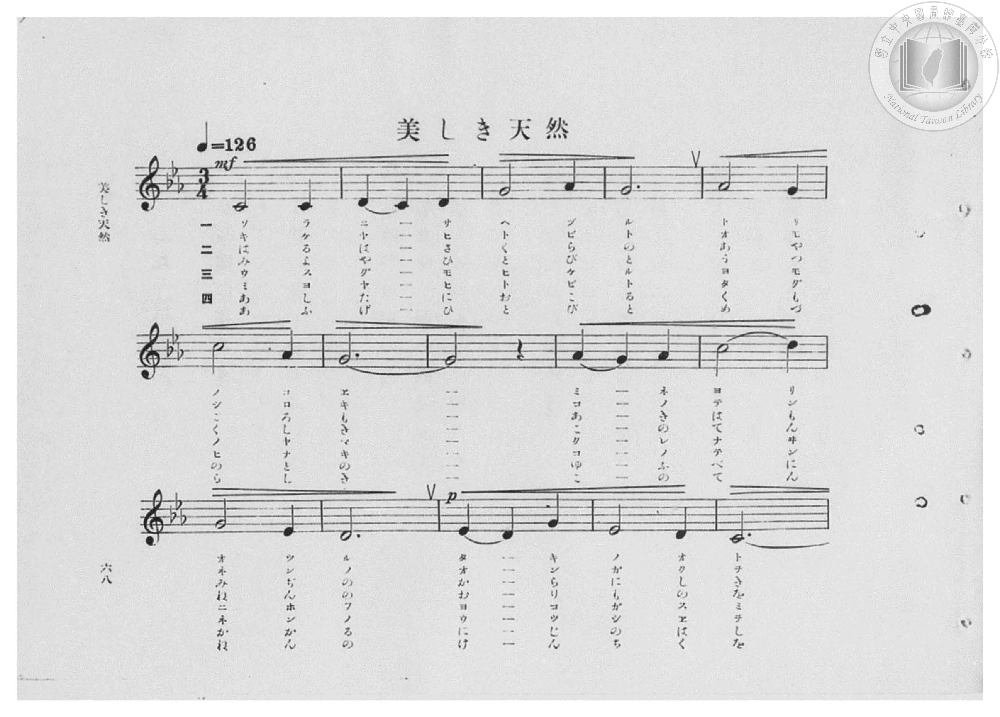
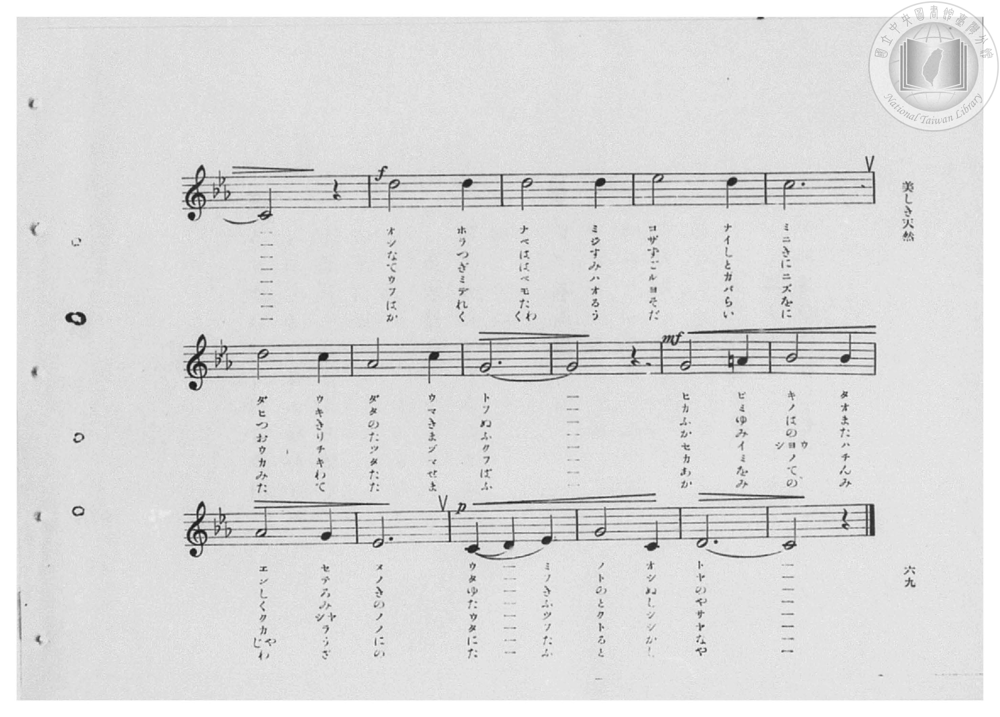
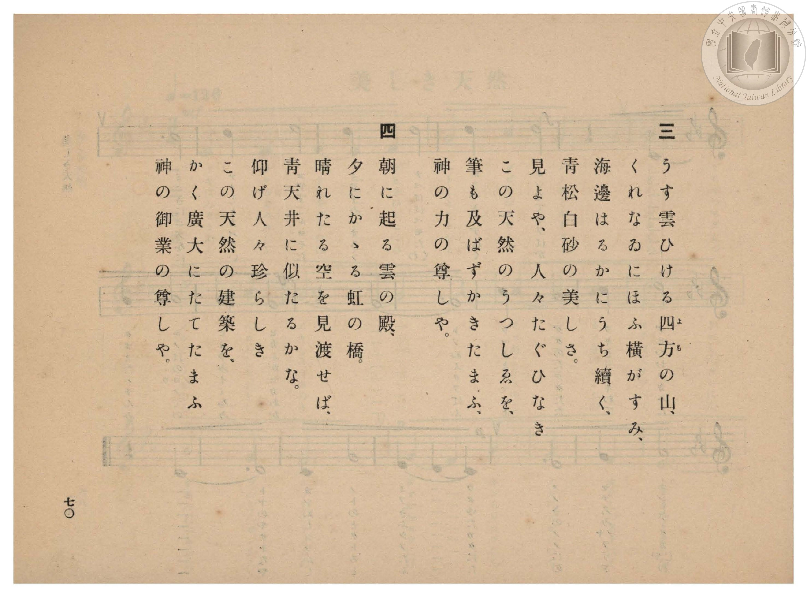
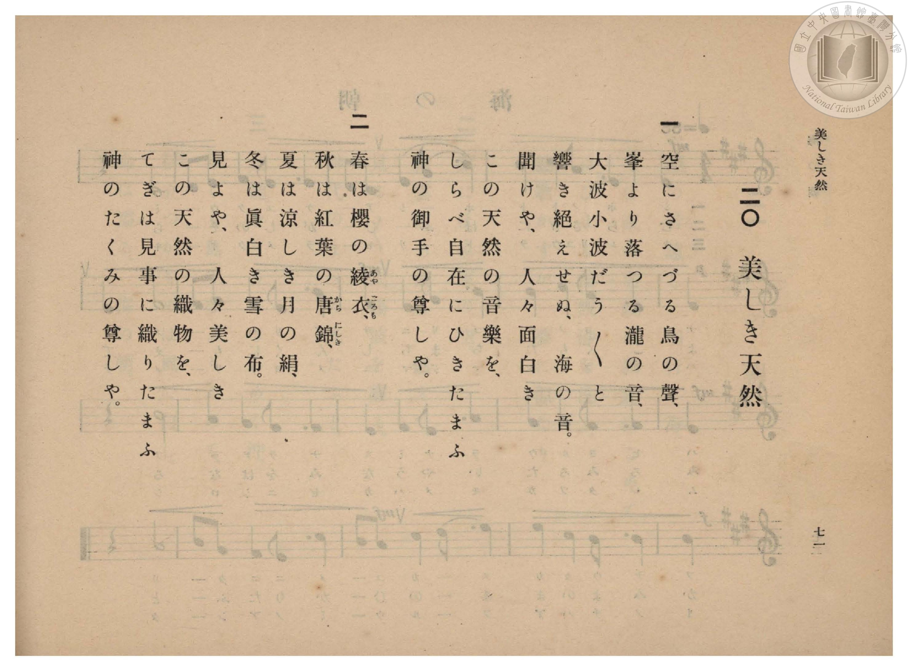

# 美しき天然

> Re:Shōka 使用 AI 協助辨識與重建樂譜，可能會有錯誤。歡迎回報。

- **鋼琴伴奏版**：<br><audio controls src="utsukushiki_tennen.mp3"></audio>

- 詞：武島羽衣
- 曲：田中穗積
- 臺灣總督府《公學校高等科唱歌》第二學年用（昭和十一年，索書號 0729 74）

## 說明

原書資訊與歌詞全文（對應 P070.jpg–P073.jpg，原書 pp. 68–71，第 20 首）：
調性與拍號：ハ短調（c 小調，3 降記號）3/4 拍，速度 ♩=126


## 歌詞

```text
一
空にさへづる鳥の聲、
峯より落つる瀧の音、
大波小波だう〳〵と
響き絶えせぬ、海の音。
聞けや、人々面白き
この天然の音樂を、
しらべ自在にひきたまふ
神の御手の尊しや。

二
春は櫻の綾（あや）衣（ごろも）、
秋は紅葉の唐錦（からにしき）、
夏は涼しき月の絹、
冬は眞白き雪の布。
見よや、人々美しき
この天然の織物を、
てぎは見事に織りたまふ
神のたくみの尊しや。

三
うす雲ひける四方（よも）の山、
くれなゐにほふ橫がすみ、
海邊はるかにうち續く、
青松白砂の美しさ。
見よや、人々たぐひなき
この天然のうつしゑを、
筆も及ばずかきたまふ、
神の力の尊しや。

四
朝に起る雲の殿、
夕にかゝる虹の橋。
晴れたる空を見渡せば、
青天井に似たるかな。
仰げ人々珍らしき
この天然の建築を、
かく廣大にたてたまふ
神の御業の尊しや。
```

## ABC

<div class="abc-score" data-abc-src="utsukushiki_tennen.abc" aria-label="五線譜載入中"></div>

[下載 ABC 原始檔](utsukushiki_tennen.abc)

## TMD 檔案連結

- [主旋律 TMD 檔案](utsukushiki_tennen.tmd) [[在 TMD Studio 編輯](https://tmdlang.github.io/Tmd-TS/#tmd=s7IKdvYPcrWy4qpTUCpJTLdSSM7PyUlNLsnMz7PKzk9PzM7Ojy_OyM9OVIKrKMvPKc1NBcqW5McbIYSL80uLklOtipMz8vNz4ktSK0qS8vOz0eXjCxLTU60CDMwNcMoY4pTBsA0uY4yQKSjKL0vNS8wDuqWgKDOvJDUF7BiEgtSyzJRUkHRxcmJefFlqUWZaZmoKkv9Si4pB3odaUVKUmFecXJRZAAoThKr8opKM_PSixIKMSquMzOKS_KLM5MSc-OzEPKSgKslIBYZUXmJJaVEqstbM9Mw8q9zUzKxMpIDS0lJ4vq_vceP0x429T5esfN6yTUFLi0vRVsHQyIzL3lbBVYcrO7XSVsE5l8vGWN_EDmTei5Xz3u-Z9Wztsqebtz3ft_fFwsVga57N3gQUfj5lw5Mda5-vnP58ZS9Y-EX7rueNi5_v2Pt87uKnu-Y8buh62rrm6dodzxYsfLl6xvO1nc-XT3w6ZeOztT2PG7qfr1nzZFcPUPbpzi3Pp6x4v6fj2Yy1Tyf1PO1tfLKjASj4fk_P8y2Lns3e8WLmfAVg5FgqmJu839OpxMWlr6VgSy3ApaCg8LRvPsiaze0vVnS96GgHug_o76etK55Nawc66-mG3mftnQqgNKWXVZD-qGEyKEGAmEAXQrQqFBToKZhZAKXMDUHOXrNGwchA4eWyaUD3AgMKZMeLVfufNSwHmd7dC_QQUPRxc__z-WuB4kA7khWebugHM3uMFV7O7H2xYgZYUScwIhSAOoDiLxvmP921TOHRzJW2oAgDmQkMJxD1fOWux42rHzdOfdy443Hj0sdN3S83L33cuO5F46bHDY1gD25e_7ip43FT14sJex83LgGqeN6wHKji5fzNMBVLlj_bvAjoCCD5uHHB48a2xw1Aua2PG1eApF_O3w9MNc-3bnvc2PG4cfbjxjVAfc-2boeZ0QT2YuO8x40THze1AOWe7Nr1uKH15dxFz2cCbewFST9unAxUDkl5EH3PVjQ9bpoEdQEoYTZ1Pm7c-aJ91dM5K8A-2gTU-rhx_uPGfY8bt4K9uhRoxbqn-xY-6-wGMTZ0gbUBbWyChMiuHhD1bAbQ_-ufrd4NVPN82z5gAD9uBFrVAgxQYBIGc6c8bup93NQEFIHa_3w50MT1z7e0vpgIdMW6p1MmvOxZBlbaDXYX0DmgnIPQ8HRJP8iSbXsgEs_mAJWue751J0y6bQ3IvDnzICHwcvYqkKk7mmGBtQxoLDBKEIEFz5xYAuv5zinPO1ciB9ayx41A5euBxjzZBXT4aqAKYPxiCSywENClwAjEEl47OiHGtT1unPlyNjC8gQgYhd1PZ89-Nm0nyPsgR4KDCah940a4_f2Pm3oeN6563DQBHDTAkN76bCWQARScCbIMog6YRF6CXAVMfkBHgtwJtmrh811Adf1QRS_nTno2dx8wmJ4vaAL5FRoOU3GGFNhLQHuBbgUGKrbwAtuyBOxXoG9gofZ8bRvQL0_7gQ7a8LhxFthBiPQFUwRJYl3ARI4ZXsBgAXtrzlygV14A0z8wr4FCbd2zdTAvP10CzIdAbwIdPRco_WLmTpD0ym6ob57N3AIOufmgTAjMuE2TgP57tmMhOFdtQIQI0CtPdoFMerIHmMBAqsHOXQU15sluoA8mQRNOPzAlA-MHR9p5unvX8_WdyGkHaE7_092LgXke7FKg_4GpCWsuW7oWPRSA0pQXulCgoKXPxRVaUlyaXVqckZmdGZKal5eaZxWQmZiX71BjUFMNsk3BxkLLDszAVuwrgKqRHQ0vFvYoaJiCCtHn6xt04GU1QlYTi1ag7SBjaxSqc9NqFcziFXTBEMyoUTAHUWA2mFWjYAyVN0HhgWANWAwEQaI1YFN9DGsUHjfthYo_bl4JVve4uRvM2wMim7ZCxWbAVbVCRVajmP64uQOuYhXCBiOQDWthMk0boWqXIGxonoShfzKaCNSGJpC5EBWLEDYYA2Ua18NtALkdJgK1oXEqVKwfrqoTKrIO1YbGJriKFoQNJiCZ_XAZkKtArgGpgNmwCap_BUxV42Y0EZgNbXAVoDCA2mAKMm8Z3IadUBs2oPoXGlaoIYkeC3AXIIeRGUhmPlwGpIb8WECEBMh9UBvMUUKvcTrUtyA7YWEEcilIrAuuCmoDOM6QwwgRTyAToTZYoNoATZeNIHeTHAtNjXAVS8E24M-7u3rw5V2wLN68awa1DVuuhLEMwDyQCpA8RCVMnzkiFEA5trkPHj5Q_zWDUgOmmZAyARLzsHjuhYoh0gl6bt0Ol1kLDS0QjdN0sBtgpoNcBjIdnsqbwS5EyqlT4G6HugQcxzhNB8c4LH6hOpByO1L6AOdSeMqBp0CQHtymg1IgzHRQWQASQ-RDcPpE5FBEuINzDkhkHt6QQSqDmtdAdcBTfzNS7gHnT3jeBquhYriD8yaspIPkBcyyD910kEmwkIHlNVC5BDEDnJcR-RJcnlI73AnUp8BWMjBPmuGoT0GykF6QIUxQwRCqFm9eheVOQ7CrwNUqwhvVBbVgCbAwuB4Fc0EQWgHDa2hUf4NzN1Kdi6jJwPUMZjkOLmVhdTAoHaDme3CexSibUUIZkaPBeR4pVSCZBLMNZB4sLUHVNIFSLMQ2UDoG6QKVr3htA-dweP3QCK21MGpZ5PYFrCaG-Z-oFISU40FhA3EltDZBt60JqYZoguUsRD0CTX1gVXhtA5cAsJrqcfNsiL5mUNsCyTZwuQqzDTMkoTU7vC7GaRu4RCAcb6A8A4s3aEpCKr9hbQSC8QYuIeB-A7NAJqHXy6A4guVaUHsQtVyBphJw_OG1DVyTE4y3xokI2-BqFsJtA5X0hOINbwkC7CaBSxAT5BIEXlhAWuTgQRJgMQKr-fG30IENdFBNDYLgGhuNZxiHwoVV7mCHYy0aYEkMUWWAkg2s6IeIQBM0aoLCWpnDGvcz4QG_A2raNrgIrFpDiXikrA13G6TxilwVN4LMBYnMgotgzchIWRde4DdCqy8k00CFCEgE3lyAV1soBSW25jMslBA-bYYmFngh-7gJ2hjF5lNw1oNl68fN7VCVoMIMohdW-CKaUBMgIk27ME0DZy1Eg6UH6gt4YxzeYZkLF4EWiahJGynrIDIq1F-ggQ5EywdUc4MEF8BFoCUDWtARaPNOwaxfEbmDcJsXlvZByRzR94Tw8LWAwf1ceDdWHSxmCuWCaOR2cAM8yECRj10ETw2J0uaC9UXWwk0AJ0GkWhTR9wKpAamF13TgdiBmbYBmGzjRQdTDkihajY6U1UAZDBJ7vRC1SCUtTARWr2C1Ddxqg5gNSxGI7LUPYRsoK8KTGryGRCRQiFok87DbhkiUsKyLcC_Yt1izKqgfBgoHUAqFiEBHF8BtDtwhuRvuXmhB1LQdmB-RTQZnDUSGRoQ9LWIP4g-kDI_oI8OyKCI8ocV6I6x3jz08ESMR0J459n4JuEBAmA1N9VSNPUg-wF-Xtq7FV1qAW-N4SwuUsSkFIxS3ojS6Ic1yWPlAWqMbXl6Dkw8oAkGlMUIfanMKRxbFX6QgFReIOhqa_TAab0hNfHDSQzYbUnODRGAFAU7bwMUFrNEF71ajNZ9RO3QwNYhIhnZP8XUKsXaz0ZML1DaUgR9Y9xExLANtGYCH0PDaBi4uELUnMJPDmijEtISRNEJF8OQCbGUFvNFEo6gDlxUzEOGAqLzRuoMoTW9YKxCjwQ5vn-G0ENxZR8TeNKg-6sdeLReXrp0Cxrh5tI9hrAJ2CSNcEsa4JExwSZjikjDDJWGOS8ICLKHMBQA)]
- [鋼琴伴奏 TMD 檔案](utsukushiki_tennen_piano.tmd) [[在 TMD Studio 編輯](https://tmdlang.github.io/Tmd-TS/#tmd=s7IKdvYPcrWy4qpTUCpJTLdSSM7PyUlNLsnMz7PKzk9PzM7Ojy_OyM9OVIKrKMvPKc1NBcqW5McbIYSL80uLklOtipMz8vNz4ktSK0qS8vOz0eXjCxLTU60CDMwNcMoY4pTBsA0uY4yQKSjKL0vNS8wDuqWgKDOvJDUF7BiEgtSyzJRUkHRxcmJefFlqUWZaZmoKkv9Si4pB3i_ITMzLj08sKkrMS0_NTc1DMgJJ0CoxMz4xOTk_tyAxLxNVVX5RSUZ-elFiQUalVUZmcUl-UWZyYk58dmIeUmiWZACNscpLLCktSkXWmpmemWeVm5qZlYkUllpaCs_39T1unP64sffpkpXPW7a939PxsnvP8wlbnuzZ8nRp__POjvd7OhW0tLgUbRUMjcy47G0VXHW4slMrbRWcc7lsjPVN7ECWvFg57_2eWc_WLnu6edvzfXtfLFwMtvvZ7E1A4edTNjzZsfb5yunPV_aChV-073reuPj5jr3P5y5-umvO44aup61rnq7d8WzBwperZzxf2_l8-cSnUzY-W9vzuKH7-Zo1T3b1AGWf7tzyfMoKoAOfzVj7dFLP097GJzsagILv9_Q837Lo2ewdL2bOVwBGqqWCuQnQ0UpcXKElxaXZpcUZmdmZIal5eal5VgGgOAjycKgxqKnmUgACGwstOzCjRqE6N61WwSxeQRcMwYwaBXMQBWaDWTUKxlB5ExQeCNaAxUAQJFoDNtXHsEbhcdNeqPjj5pVgdY-bu8G8PSCyaStUbAZcVStUZDWK6Y-bO-AqViFsMALZsBYm07QRqnYJwobmSRj6J6OJQG1oApkLUbEIYYMxUKZxPdwGkNthIlAbGqdCxfrhqjqhIutQbWhsgqtoQdhgApLZD5cBuQrkGpAKmA2boPpXwFQ1bkYTgdnQBlcBCgOoDaYg85bBbdgJtWEDqn-hYYUakuixAHcBchiZgWTmw2VAasiPBURIgNwHtcEcJfQap0N9C7ITFkYgl4LEuuCqoDaA4ww5jBDxBDIRaoMFqg3QdNkIcjfJsdDUCFexFGwDNJOZQYWxZR8YzwDMA6kAiUBUwvSZI5wLylrNfXCPQB3SDIo25OgCORwEIdkXEkmwKOmFiiGiFD1jbYfLrIV6DETjMR_sDpj5INeB1MCTZDPYlUjZagrc_VC3gCMEj_ngCIJFB1QPUuZEik5wpoJHNDzBgPTgMx-UZGDmgzIvSAyRccAJCpGlEOEPTuogkXkEwgep2GheA1UDT7DNSAkenKXg2RGshqrhD85QsOIJkoCxFFgY5oPMgoUPLIuAihOIKeAsiMhO4GKQ-uEPzUywDGMIVgauoBAmVxfUgiXAwuAaCcwFQWhVBq_rIBrgXHD-Q6q-EJUCuMjGLBLBBRasOgPFD2rOBOcpzGIO1eeIPAfOlUixhWQWzD6QibA4hqppAqUliH2gFAbSBSqsCNgHzoPw4rYRWglgVFrI1TWsYoOFAZExi5QnQSGEFJuY9jUhFblNsHSPKJihqQKsioB94DwKK_wfN8-GqgRV18g6QWkfZh9meEIrS3j1hsc-cJ4lHH-g9AyLP2iaQippYRUvEfEHzsNw_4FZILPQqztQXMHyFKiZhZrzoekFHI8E7ANXkQTjr3Eiwj64moVw-0BlMuH4g7VKgY1SUKUHguDKD41nGIfChdWTYDOx5mFYGkCUuaB4hZWcEBFomkONcay1IqxBOxMeJjugpm2Di8BqBpRYQcp_cLdBGmzI9VkjyFyQyCy4CNbchpS74GVlI7T0RzINlNNBIvBaF17qo5Ro2JqMsFBC-LQZGo_w0vBxE7QBhs2n4JwBy3ePm9uhKkElDkQvrJREtEUmQESadmGaBk73iFq_B-oLeAMU3kifCxeBlluoqQ4pVSNyEdRfjf2PmxDNB1C1BxJcABeBZly0oIMmW1giBaVHRMcIwsPX6gN3wuB9LHWwmCmUC6KR234NcL-BYgm7CN46B8hHtC9gTeW1cDPAqQWpXkJ0DUBqQGrhNQe41YOtZEVvPcDTCjw9odWTSPkClBsgQd0LUYtUZsFEYKU0DvvALRSI6bAIROSGfQj7QDkHnjLgdQ4iPUHUIpmHyz5EKoLlNYSbwT7GmrdAnQWQaaAkBRGBdoHBdTm-8NwNdzO07GjaDsxCyGaDUzMiDyJigDaxCPELUi5FdOZg-QoRqtCyuBHWDcUVqohOM7QTib1FDs7HCNOheYDKsQjJFdBsjjLioWCEYixKAxTSRIVlbBIboPAiERzdIAeDCjwkD6A0KHBkLEKFAVJGR1SE0EyD0YBBavCCEwuy6ZDqESQCy8B47ANndFjDA94JRG9KonQ6YGoQUQLtRuHvumDtFKJHL1QnyqgCrJOD6PNDq2Dw-AwB-8AZHVFRATMnrDVATJsQSSNUBG_KxZbL4S0UmkUhOJfPQIQGoq5E6yahNENhjS6Mxiu8OYTHSnDXEhGL06A6aRGLtTiHUX1wDKMCs71ZPDjPg3uekKxuDBaBiEPYoPwOV2WErMocqgosZATmmCBph4QBVhlsBiALQdoYEI0QLVCLkc0yRbEFl1dQ7ED4GdmfaJqxCCGJgCCi3IM1hJCswhJEUCFibIGNGCDphjmS7HCszkWNaohBMJWQYARL4IsxiDIU_1A1NIHpV9dOASMJR_sYxipglzDCJWGMS8IEl4QpLgkzXBLmuCQswBLKXAA)]

## 分析

```text
================================================================================
📊 TMD Song Profile: [ 美しき天然 ]
================================================================================
⏱  Duration:       6:05 (365.7s), 256 measures total
🎼 Key & Tempo:    首調基準 E,, != 126.0 BPM, <3/4>
   - 分析範圍：      由實際發聲的音符與和弦推測調性；播放脈絡另行呈現
🎤 人聲音域:    C4 (MIDI 60) – D#5 (MIDI 75) [跨度: 15 個半音 / 1.2 個八度, 難度: moderate]
   - 最低音:  C4 in [UtsukushikiTennen[L1] #1 @ m.1, 0:00]
   - 最高音: D#5 in [UtsukushikiTennen[L1] #1 @ m.19, 0:25]
   - 適合: soprano, mezzo-soprano, contralto, tenor, baritone, bass
🏛  結構:      UtsukushikiTennen[L1] (45.7s) -> UtsukushikiTennen[L2] (45.7s) -> UtsukushikiTennen[L3] (45.7s) -> UtsukushikiTennen[L4] (45.7s) -> UtsukushikiTennen[L5] (45.7s) -> UtsukushikiTennen[L6] (45.7s) -> UtsukushikiTennen[L7] (45.7s) -> UtsukushikiTennen[L8] (45.7s)
⚡ 編曲密度:        Peak 1 軌道同時演奏
🗝  調性診斷：       C 小調（純淨自然小調，未偵測到可信轉調）
   - 風格氣質:    純淨自然小調（陰鬱抒情、旋律集中，無明顯調外色彩）
   - 轉調歷程:    全曲維持單一推測調性（未偵測到可信轉調）
   - 核心骨幹音:  G, C, D, G#, D#
   - 調性數值:    C 小調 [相關度: 0.76, 穩定度: Moderate, 自然音純度: 98.9%]
   - 候選調性 (K-S): C 小調 (0.76), G 大調 (0.65), C 大調 (0.63)
   - 五度圈歷程:   +0 -> +0 -> +0 -> +0 -> +0 -> +0 -> +0 -> +0
   - 各段落調性細節:
     • [UtsukushikiTennen[L1] #1]: C 小調 (r: 0.76, 自然音純度: 98.9%, 調外音: A)
     • [UtsukushikiTennen[L2] #1]: C 小調 (r: 0.76, 自然音純度: 98.9%, 調外音: A)
     • [UtsukushikiTennen[L3] #1]: C 小調 (r: 0.76, 自然音純度: 98.9%, 調外音: A)
     • [UtsukushikiTennen[L4] #1]: C 小調 (r: 0.76, 自然音純度: 98.9%, 調外音: A)
     • [UtsukushikiTennen[L5] #1]: C 小調 (r: 0.76, 自然音純度: 98.9%, 調外音: A)
     • [UtsukushikiTennen[L6] #1]: C 小調 (r: 0.76, 自然音純度: 98.9%, 調外音: A)
     • [UtsukushikiTennen[L7] #1]: C 小調 (r: 0.76, 自然音純度: 98.9%, 調外音: A)
     • [UtsukushikiTennen[L8] #1]: C 小調 (r: 0.76, 自然音純度: 98.9%, 調外音: A)

  [ 五度圈游移軌跡 ]
              [C ]*
         F            G  
      Bb               D  
      Eb               A  
         Ab           E  
            Db       B  
               F# 
     (* = active key center)

  [ 十二半音累積音高分佈 ]
     C  : ██████████████████████    25.0%
     C# :                            0.0%
     D  : ██████████████████        20.7%
     D# : ████████                   8.7%
     E  :                            0.0%
     F  : ███                        3.3%
     F# :                            0.0%
     G  : ████████████████████████  27.2%
     G# : ██████████                10.9%
     A  : █                          1.1%
     A# : ███                        3.3%
     B  :                            0.0%
--------------------------------------------------------------------------------
Assignment 軌道音域：
  - Piano         : C4 – D#5 (15 個半音 / 1.2 個八度, 416 個音符)
================================================================================
```


## 原書掃描頁










