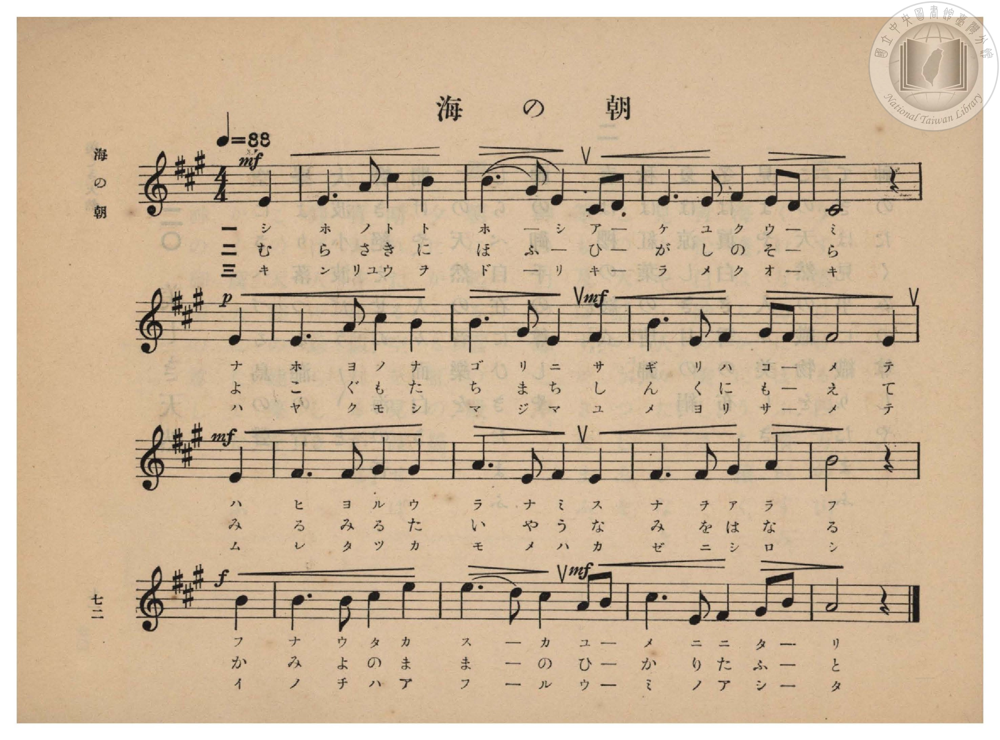
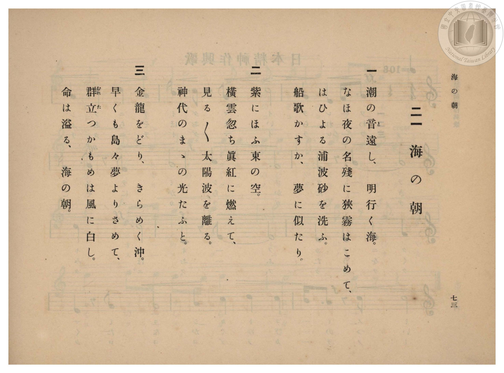

# 海の朝

> Re:Shōka 使用 AI 協助辨識與重建樂譜，可能會有錯誤。歡迎[回報](https://github.com/TMDLang/reshoka/issues)。

- **鋼琴伴奏版**：<br><audio controls src="umi_no_asa.mp3"></audio>
- **NEUTRINO 歌聲合成版**：<br><audio controls src="umi_no_asa_neutrino.mp3"></audio>

- 臺灣總督府《公學校高等科唱歌》第二學年用（昭和十一年，索書號 0729 74）

## 說明

原書資訊與歌詞全文（對應 P074.jpg–P075.jpg，原書 pp. 72–73，第 21 首）：
調性與拍號：イ長調（A 大調，3 升記號）4/4 拍（弱起 1 拍），速度 ♩=88


## 歌詞

```text
一
潮の音（と）遠し、明行く海。
なほ夜の名殘に狹霧はこめて、
はひよる浦波砂を洗ふ。
船歌かすか、夢に似たり。

二
紫にほふ東の空。
橫雲忽ち眞紅に燃えて、
見る〳〵太陽波を離る。
神代のまゝの光たふと。

三
金龍をどり、きらめく沖。
早くも島々夢よりさめて、
群立（むれた）つかもめは風に白し。
命は溢る、海の朝。
```

## ABC

<div class="abc-score" data-abc-src="umi_no_asa.abc" aria-label="五線譜載入中"></div>

[下載 ABC 原始檔](umi_no_asa.abc)

## TMD 檔案連結

- [主旋律 TMD 檔案](umi_no_asa.tmd) [[在 TMD Studio 編輯](https://tmdlang.github.io/Tmd-TS/#tmd=s7IKdvYPcrWy4qpTUCpJTLdSSM7PyUlNLsnMz7PKzk9PzM7Ojy_OyM9OVIKrKMvPKc1NBcqW5McbIYSL80uLklOtipMz8vNz4ktSK0qS8vOz0eXjCxLTU60CDMxNcMqYImQKivLLUvMS84DmFhRl5pWkpoANRihILctMSQVJFycn5sWXpRZlpmWmpiC5NbWoGOQVqBUlRYl5xclFmQUg_yFU5ReVZOSnFyUWZFRaZWQWl-QXZSYn5sRnJ-YhebskIxXo6-JUDKG8xJLSolRk0zLTM_OsSvNATiuBOkhLS-HZ1u2PG9c9mzNXQUuLS9FWwcKCy95WwZHLxkTfxA6k-0X7rueNi5_v2Pt87uKnu-Y8buh62rrm6dodzxYsfLl6xvO1nc-XT3w6ZeOztT2PG7qfr1nzZFcPUPbpzi3Pp6x4v6fj2Yy1Tyf1PO1tfLKjASj4fk_P8y2Lns3e8WLmfAUDcyNLBXOT93s6lbi49LUUbKkFuBQUFJ72zQdZs7n9xYquFx3tQPe9WDnvaeuKZ9Pagc56uqH3WXunAijK9bIK0h81TAbFMYgJdCFEq0JBgZ6CuRFQytwY5Ow1axSMDBVeLpsGdO_7PbNAdrxYtf9Zw3KQ6d29QA8BRR83LXk5dTtQHGiHo8LTJcvBzB5jhae9QIfMACvqBAatAlAHyBl7Nr7Yul3BEMIFGtvzsmH-013LFB7NXGkLjAqQJcCAA1HP9q4DRtTL-ZuB2h43AoO282XjgseN0x83ND6b0fdiYc_jxn5QZDY0gVQ_blz1uHH30yVzgHqeTuh9tm7G48bVz7t3vpyz_HHj-seNkx83NT5uXAbUDFENFNr0uKnjcVP3s63Lnm1e9HxB0-OmSc-2TH_cuBVq5IuOnaBIbux-3DgTRDY0Pl2yCGjqkz17HjfOf9zUBVIHdvCuHhD1fMtqoCzQFUAjns3dCHTI85W7oGY9W7n65exNT_fvfdy48Pmcec-3tIKc1978uBHoN5irXizrBrrnccPmxw1bny5Z9XLmXqDDgK56ORtIAsXBJj1fOu_J7sVAwx837nvcNBfk3dZOkHuA7m5cAXfSjk4Q9bJ94st9vUAjHjeuBDsYGAZAbic4MPqfbZoGc970lUD-46amp5u3PW5oBfkTFDZdjxunooTb831Lnq_uBkVIU8PjJmDYgGL3ceMSUPA0AQMQqHT9y0UrQH6bCfQqMK7Axj-dCOSsf7YL4o1GeBaESlOe_qFAQUufiys0N9Mv37E40SogMzEv36HGoKYaZImCjaGZlh2YhS3nKYBy8o4GYLJS0EBOpAraCiYKTzf0P1_foAPPPQjFmlhMAjoCZEuNgoGCLhii09W5abUKpvFQXg2CCYKGQGwMZRvBlcBYIGgOUg7XYwximICIGrC1PoY1CjA5dPpx03a4iY-bZyOZ-bi5D0x2wPkwFqbKPSgmPW5aBBeFusAInwsaEOY2dSKb2zgVTPbC-asRKht3o6jcCrcRwt-E7gJjfC5Yi-SzzSg-W_W4eRlYCYiECIGMhilGcS4kGJpXoRgLcwQ0AaBELJhjBhMB8yDRBolCZAhPKAXI6QQevY-bNqK4BOLm9XCXgPkQlwDp-WiGwwOiuQvVZGC0PW7sQTa5cTqYXAfnz0U2GSX6UIMYnnjg0fG4eSWKmxeiuRkUjgiTQWGJ3c39cJPxZ-VdPeCsjCPvgmXx5l2K8iQ4g8OjGlUlajIA6wPzahCCKErh5mFLCGg5cwWYBOVkCB8ewcAg3YKiEhLc3TB-EyhHwVTCohtZJSzYHzeBcgwicYGiERk-bm6DsxBRhUhek5HVNk4Am9gE58OSKkglssnAqg5MwsQgCRPmXlQzQbYiyg6I6XD3NsISJkI9PKs37kd1LzjRLkFWC06uj5tB5R2Ej1yazkNRuQOsEiYGyaIwlSg-g8YZohhBlG2EwncB3L0EarVOfFkBLIs3K6CkSzAHnGpBEM6oAecRGMRS1EEU4TEKph81t4AgvDQEZgJ47kPKA5NQwgcSnoj4Rw551CIIlDsQxePjpp1IKmE5B6ISXL-A6zkIH2YOSCWo1kKGiKIKJoOU_ptgOQ6sApziEGKo6b8FWWUTiPe4ER73jbD0AlIJS7cQlaDQADa2sKlEsR3FrY0wGeS0vwbFXLBbm2GuetyEVDvDcwTE3-CiHanEQFLZBKuzISpBtiK1JJrXIqmEiWK4tQmWJwmk-6ezZ-NJ9xBZvOkeOR2C2LAawBTuShgLBE2QVIDLa1CCBmkD1u9IyrAU_xBFyPkHBNEbjcgpHiV1Qqp7cPxghjcsTUPCF9Jyg-cNSMMBa1kDjRukGgIS_zC1sFSFHjtodRS4zEdNn6ASGLlJASrZoa6Fs5Fci6QSqZWHlGIhpoLzMjz_ILcQQWpBZQIRrgWneljtCXFDI5hEpGVYSkfP-bDmIGq5g70RBm1rI8oTtDIfOY9gd20tF5eunQKso6MAZCtzAQA)]
- [鋼琴伴奏 TMD 檔案](umi_no_asa_piano.tmd) [[在 TMD Studio 編輯](https://tmdlang.github.io/Tmd-TS/#tmd=s7IKdvYPcrWy4qpTUCpJTLdSSM7PyUlNLsnMz7PKzk9PzM7Ojy_OyM9OVIKrKMvPKc1NBcqW5McbIYSL80uLklOtipMz8vNz4ktSK0qS8vOz0eXjCxLTU60CDMxNcMqYImQKivLLUvMS84DmFhRl5pWkpoANRihILctMSQVJFycn5sWXpRZlpmWmpiC5NbWoGOSVgszEvPz4xKKixLz01NzUPCQjkAStEjPjE5OT83MLEvMyUVXlF5Vk5KcXJRZkVFplZBaX5BdlJifmxGcn5iGFTEkG0Bir4lQMobzEktKiVGTTMtMz86xKEjPLgc7OT0vLTM5MzFHi0tJSeLZ1--PGdc_mzH2_p-Nl957nE7Y82bPl6dL-550d7_d0KmhpcSnaKlhYcNnbKjhy2Zjom9iBTH3Rvut54-LnO_Y-n7v46a45jxu6nrauebp2x7MFC1-unvF8befz5ROfTtn4bG3P44bu52vWPNnVA5R9unPL8ykrgBY9m7H26aSep72NT3Y0AAXf7-l5vmXRs9k7Xsycr2BgbmSpYG4CtFyJiys0N9Mv37E40SoAFKBBHg41uoY11VwKQGBjaKZlB2bVKBgo6IIhOl2dm1arYBoP5dUgmCBoCMTGULYRXAmMBYLmIOVwPcYghgmIqAFb62NYowCTQ6cfN22Hm_i4eTaSmY-b-8BkB5wPY2Gq3INi0uOmRXBRqAuM8LmgAWFuUyeyuY1TwWQvnL8aobJxN4rKrXAbIfxN6C4wxueCtUg-24zis1WPm5eBlYBIiBDIaJhiFOdCgqF5FYqxMEdAEwBKxII5ZjARMA8SbZAoRIbwhFKAnE7g0fu4aSOKSyBuXg93CZgPcQmQno9mODwgmrtQTQZG2-PGHmSTG6eDyXVw_lxkk1GiDzWI4YkHHh2Pm1eiuHkhmptB4YgwGRSW2N3cDzcZWxiTmnnAOREeJ6gqUeMLrA_Mq0EIoiiFm4ctxtCy0AowCcpyED48JoB-34KiEhIu3TB-Eyjpw1TC4gVZJSx8HjeBkjYiFYDCGxk-bm6DsxBhikgHk5HVNk4Am9gE58PSFEglssmPG_eBSZgYJAXB3ItqJshWRCaHmA53byMsBSHUw_Nk435U94JT1xJkteB09bgZVDBB-MjF3jwUlTvAKmFikLwEU4niM2icIfI7ohAiFL4L4O6FplmUBATmgJMXCMIZNeDEDINYCg-IIjxGwfSjJmsQhJcvwNQKzyZIiXUSikcgHkdEFHIQoWZqUDJGFDiPm3YiqYQlcYhKcIkNrjkgfJg5IJWgegAZIjI_TAYpoTbBsgZYBThpIMRQE2oLssomEO9xIzySGmERC1IJS2AQlaDQeNwIL6qQVaLYjuLWRpgMciJdg2Iu2K3NMFc9bkKq7-BJF-JvcGGJlLWRVDbBakGISpCtSHVz81oklTBRDLc2wTIPPIEiJxgQG1ammsKNg7FA0ARJBbgEBKU8kDZg1YakDEuBClGEnNBBEL29hJw0UZIRpKYDByRmwMASHyQgII0WeCKG1JlYcy80EJHKXEhEwdTCoh89GNFKfXApipqQQGUacm0KKiuhroWzkVyLpBKpgYOUtCCmgjMdPKEjN45AakGZlwjXgpMnrD6CuKERTCISHSxJomdRWEsItYDA3v6ANjMRGR-tFEVOzNhdW4ve-vZBaX2bIDW-IbAG3IoyjFeINowFUabx8eBWA1DAND4WzACKQoIBmBQh6kyAokZghVABsEmoarCbBdKJJIQwCERGG8XnQpQhTAOpiDaB6gbrQXEFyG2oasAicMXIDoO2PqAyUEPApoEsB1JmyF4CGQrxAIofgQGsa6cAC-NoH6AECt8IjW8M5itzAQA)]

## 分析

```text
================================================================================
📊 TMD Song Profile: [ 海の朝 ]
================================================================================
⏱  Duration:       0:46 (46.4s), 17 measures total
🎼 Key & Tempo:    首調基準 A, != 88.0 BPM, <4/4>
   - 分析範圍：      由實際發聲的音符與和弦推測調性；播放脈絡另行呈現
🎤 人聲音域:    C#4 (MIDI 61) – E5 (MIDI 76) [跨度: 15 個半音 / 1.2 個八度, 難度: moderate]
   - 最低音:  C#4 in [UmiNoAsa #1 @ m.3, 0:07]
   - 最高音: E5 in [UmiNoAsa #1 @ m.14, 0:37]
   - 適合: soprano, mezzo-soprano, contralto, tenor, baritone, bass
🏛  結構:      UmiNoAsa (46.4s)
⚡ 編曲密度:        Peak 1 軌道同時演奏
🗝  調性診斷：       E 大調（純淨自然大調，未偵測到可信轉調）
   - 風格氣質:    純淨自然大調（陽光明朗、易唱易記，無明顯調外色彩）
   - 轉調歷程:    全曲維持單一推測調性（未偵測到可信轉調）
   - 核心骨幹音:  E, B, F#, C#, A
   - 調性數值:    E 大調 [相關度: 0.90, 穩定度: High, 自然音純度: 97.5%]
   - 候選調性 (K-S): E 大調 (0.90), B 大調 (0.68), A 大調 (0.62)
   - 五度圈歷程:   +4
   - 各段落調性細節:
     • [UmiNoAsa #1]: E 大調 (r: 0.90, 自然音純度: 97.5%, 調外音: D)

  [ 五度圈游移軌跡 ]
               C  
         F            G  
      Bb               D  
      Eb               A  
         Ab          [E ]*
            Db       B  
               F# 
     (* = active key center)

  [ 十二半音累積音高分佈 ]
     C  :                            0.0%
     C# : ████████████              13.1%
     D  : ██                         2.5%
     D# :                            0.0%
     E  : ████████████████████████  27.0%
     F  :                            0.0%
     F# : █████████████████         18.9%
     G  :                            0.0%
     G# : ███████                    8.2%
     A  : █████████                  9.8%
     A# :                            0.0%
     B  : ██████████████████        20.5%
--------------------------------------------------------------------------------
Assignment 軌道音域：
  - Piano         : C#4 – E5 (15 個半音 / 1.2 個八度, 62 個音符)
================================================================================
```


## 原書掃描頁






