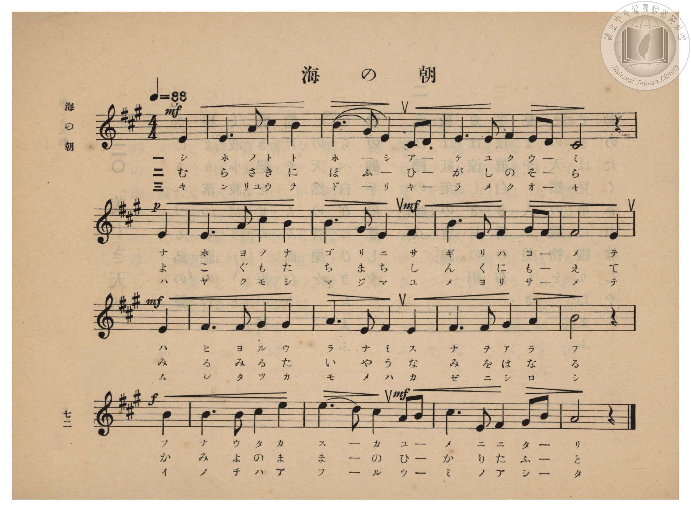
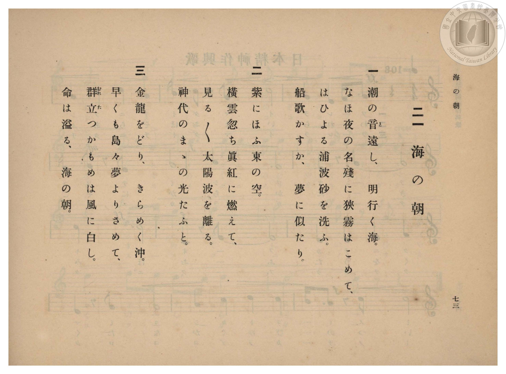

# 海の朝

> Re:Shōka 使用 AI 協助辨識與重建樂譜，可能會有錯誤。歡迎回報。

- **鋼琴伴奏版**：<br><audio controls src="umi_no_asa.mp3"></audio>

- 臺灣總督府《公學校高等科唱歌》第二學年用（昭和十一年，索書號 0729 74）

## 說明

原書資訊與歌詞全文（對應 P074.jpg–P075.jpg，原書 pp. 72–73，第 21 首）：
調性與拍號：イ長調（A 大調，3 升記號）4/4 拍（弱起 1 拍），速度 ♩=88


## 歌詞

```text
一
潮の音（と）遠し、明行く海。
なほ夜の名殘に狹霧はこめて、
はひよる浦波砂を洗ふ。
船歌かすか、夢に似たり。

二
紫にほふ東の空。
橫雲忽ち眞紅に燃えて、
見る〳〵太陽波を離る。
神代のまゝの光たふと。

三
金龍をどり、きらめく沖。
早くも島々夢よりさめて、
群立（むれた）つかもめは風に白し。
命は溢る、海の朝。
```

## ABC

<div class="abc-score" data-abc-src="umi_no_asa.abc" aria-label="五線譜載入中"></div>

[下載 ABC 原始檔](umi_no_asa.abc)

## TMD 檔案連結

- [主旋律 TMD 檔案](umi_no_asa.tmd) [[在 TMD Studio 編輯](https://tmdlang.github.io/Tmd-TS/#tmd=s7IKdvYPcrWy4qpTUCpJTLdSSM7PyUlNLsnMz7PKzk9PzM7Ojy_OyM9OVIKrKMvPKc1NBcqW5McbIYSL80uLklOtipMz8vNz4ktSK0qS8vOz0eXjCxLTU60CDMxNcMqYImQKivLLUvMS84DmFhRl5pWkpoANRihILctMSQVJFycn5sWXpRZlpmWmpiC5NbWoGOQVqBUlRYl5xclFmQUg_yFU5ReVZOSnFyUWZFRaZWQWl-QXZSYn5sRnJ-YhebskIxXo6-JUDKG8xJLSolRk0zLTM_OsShIzy4Fuyk9Ly0zOTMxR4tLSUni2dfvjxnXP5sxV0NLiUrRVsLDgsrdVcOSyMdE3sQMZ8KJ91_PGxc937H0-d_HTXXMeN3Q9bV3zdO2OZwsWvlw94_nazufLJz6dsvHZ2p7HDd3P16x5sqsHKPt055bnU1a839PxbMbap5N6nvY2PtnRABR8v6fn-ZZFz2bveDFzvoKBuZGlgrnJ-z2dSlxc-loKttQCXAoKCk_75oOs2dz-YkXXi452oPterJz3tHXFs2ntQGc93dD7rL1TARTrelkF6Y8aJoOiGcQEuhCiVaGgQE_B3AgoZW4McvaaNQpGhgovl00Duvf9nlkgO16s2v-sYTnI9O5eoIeAoo-blrycuh0oDrTDUeHpkuVgZo-xwtNeoENmgBV1AoNWAagD5Iw9G19s3a5gCOECje152TD_6a5lCo9mrrQFRgXIEmDAgahne9cBI-rl_M1AbY8bgUHb-bJxwePG6Y8bGp_N6HuxsOdxYz8oMhuaQKofN6563Lj76ZI5QD1PJ_Q-WzfjcePq5907X85Z_rhx_ePGyY-bGh83LgNqhqgGCm163NTxuKn72dZlzzYver6g6XHTpGdbpj9u3Ao18kXHTlAkN3Y_bpwJIhsany5ZBDT1yZ49jxvnP27qAqkDO3hXD4h6vmU1UBboCqARz-ZuBDrk-cpdULOerVz9cvamp_v3Pm5c-HzOvOdbWkHOa29-3Aj0G8xVL5Z1A93zuGHz44atT5esejlzL9BhQFe9nA0kgeJgk54vnfdk92Kg4Y8b9z1umgvybmsnyD1AdzeugDtpRyeIetk-8eW-XqARjxtXgh0MDAMgtxMcGP3PNk2DOW_6SiD_cVPT083bHje0gvwJCpuux41TUcLt-b4lz1d3gyKkqeFxEzBsQLH7uHEJKHiagAEIVLr-5aIVIL_NBHoVGFdg459OBHLWP9sF8UYjPAtCpSlP_1CgoKXPxRWam-mX71icaBWQmZiX71BjUFMNskTBxtBMyw7MwpbzFEA5eUcDMFkpaCAnUgVtBROFpxv6n69v0IHnHoRiTSwmAR0BsqVGwUBBFwzR6erctFoF03gorwbBBEFDIDaGso3gSmAsEDQHKYfrMQYxTEBEDdhaH8MaBZgcOv24aTvcxMfNs5HMfNzcByY74HwYC1PlHhSTHjctgotCXWCEzwUNCHObOpHNbZwKJnvh_NUIlY27UVRuhdsI4W9Cd4ExPhesRfLZZhSfrXrcvAysBERChEBGwxSjOBcSDM2rUIyFOQKaAFAiFswxg4mAeZBog0QhMoQnlALkdAKP3sdNG1FcAnHzerhLwHyIS4D0fDTD4QHR3IVqMjDaHjf2IJvcOB1MroPz5yKbjBJ9qEEMTzzw6HjcvBLFzQvR3AwKR4TJoLDE7uZ-uMn4s_KuHnBWxpF3wbJ48y5FeRKcweFRjaoSNRmA9YF5NQhBFKVw87AlBLScuQJMgnIyhA-PYGCQbkFRCQnubhi_CZSjYCph0Y2sEhbsj5tAOQaRuEDRiAwfN7fBWYioQiSvychqGyeATWyC82FJFaQS2WRgVQcmYWKQhAlzL6qZIFsRZQfEdLh7G2EJE6EentUb96O6F5xolyCrBSfXx82g8g7CRy5N56Go3AFWCRODZFGYShSfQeMMUYwgyjZC4bsA7l4CtVonvqwAlsWbFVDSJZgDTrUgCGfUgPMIDGIp6iCK8BgF04-aW0AQXhoCMwE89yHlgUko4QMJT0T8I4c8ahEEyh2I4vFx004klbCcA1EJrl_A9RyEDzMHpBJUayFDRFEFk0FK_02wHAdWAU5xCDHU9N-CrLIJxHvcCI_7Rlh6AamEpVuISlBoABtb2FSi2I7i1kaYDHLaX4NiLtitzTBXPW5Cqp3hOQLib3DRjlRiIKlsgtXZEJUgW5FaEs1rkVTCRDHc2gTLkwTS_dPZs_Gke4gs3nSPnA5BbFgNYAp3JYwFgiZIKsDlNShBg7QB63ckZViKf4gi5PwDguiNRuQUj5I6IdU9OH4wwxuWpiHhC2m5wfMGpOGAtayBxg1SDQGJf5haWKpCjx20Ogpc5qOmT1AJjNykAJXsUNfC2UiuRVKJ1MpDSrEQU8F5GZ5_kFuIILWgMoEI14JTPaz2hLihEUwi0jIspaPnfFhzELXcwd4Ig7a1EeUJWpmPnEewu7aWi0vXTgHW0Yn2MYxVQOEbofGNwXxlLgA)]
- [鋼琴伴奏 TMD 檔案](umi_no_asa_piano.tmd) [[在 TMD Studio 編輯](https://tmdlang.github.io/Tmd-TS/#tmd=s7IKdvYPcrWy4qpTUCpJTLdSSM7PyUlNLsnMz7PKzk9PzM7Ojy_OyM9OVIKrKMvPKc1NBcqW5McbIYSL80uLklOtipMz8vNz4ktSK0qS8vOz0eXjCxLTU60CDMxNcMqYImQKivLLUvMS84DmFhRl5pWkpoANRihILctMSQVJFycn5sWXpRZlpmWmpiC5NbWoGOSVgszEvPz4xKKixLz01NzUPCQjkAStEjPjE5OT83MLEvMyUVXlF5Vk5KcXJRZkVFplZBaX5BdlJifmxGcn5iGFTEkG0Bir4lQMobzEktKiVGTTMtMz86xKEjPLgc7OT0vLTM5MzFHi0tJSeLZ1--PGdc_mzH2_p-Nl957nE7Y82bPl6dL-550d7_d0KmhpcSnaKlhYcNnbKjhy2Zjom9iBTH3Rvut54-LnO_Y-n7v46a45jxu6nrauebp2x7MFC1-unvF8befz5ROfTtn4bG3P44bu52vWPNnVA5R9unPL8ykrgBY9m7H26aSep72NT3Y0AAXf7-l5vmXRs9k7Xsycr2BgbmSpYG4CtFyJiys0N9Mv37E40SoAFKBBHg41BjXVXApAYGNopmUHZtUoGCjogiE6XZ2bVqtgGg_l1SCYIGgIxMZQthFcCYwFguYg5XA9xiCGCYioAVvrY1ijAJNDpx83bYeb-Lh5NpKZj5v7wGQHnA9jYarcg2LS46ZFcFGoC4zwuaABYW5TJ7K5jVPBZC-cvxqhsnE3isqtcBsh_E3oLjDG54K1SD7bjOKzVY-bl4GVgEiIEMhomGIU50KCoXkVirEwR0ATAErEgjlmMBEwDxJtkChEhvCEUoCcTuDR-7hpI4pLIG5eD3cJmA9xCZCej2Y4PCCau1BNBkbb48YeZJMbp4PJdXD-XGSTUaIPNYjhiQceHY-bV6K4eSGam0HhiDAZFJbY3dwPNxlbGJOaecA5ER4nqCpR4wusD8yrQQiiKIWbhy3G0LLQCjAJynIQPjwmgH7fgqISEi7dMH4TKOnDVMLiBVklLHweN4GSNiIVgMIbGT5uboOzEGGKSAeTkdU2TgCb2ATnw9IUSCWyyY8b94FJmBgkBcHci2omyFZEJoeYDndvIywFIdTD82TjflT3glPXEmS14HT1uBlUMEH4yMXePBSVO8AqYWKQvARTieIzaJwh8juiECIUvgvg7oWmWZQEBOaAkxcIwhk14MQMg1gKD4giPEbB9KMmaxCEly_A1ArPJkiJdRKKRyAeR0QUchChZmpQMkYUOI-bdiKphCVxiEpwiQ2uOSB8mDkglaB6ABkiMj9MBimhNsGyBlgFOGkgxFATaguyyiYQ73EjPJIaYRELUglLYBCVoNB43AgvqpBVotiO4tZGmAxyIl2DYi7Yrc0wVz1uQqrv4EkX4m9wYYmUtZFUNsFqQYhKkK1IdXPzWiSVMFEMtzbBMg88gSInGBAbVqaawo2DsUDQBEkFuAQEpTyQNmDVhqQMS4EKUYSc0EEQvb2EnDRRkhGkpgMHJGbAwBIfJCAgjRZ4IobUmVhzLzQQkcpcSETB1MKiHz0Y0Up9cCmKmpBAZRpybQoqK6GuhbORXIukEqmBg5S0IKaCMx08oSM3jkBqQZmXCNeCkyesPoK4oRFMIhIdLEmiZ1FYSwi1gMDe_oA2MxEZH60URU7M2F1bi9749kFufJsgtb0hsAbciDKMV4g2jAVRpvHx4EYDUMA0PhbMAIpCQgGYEiHqTICiRmCFUAGwSahqsJsF0okkhDAIREYbxedClCFMA6mINoHqButBcQXIbahqwCJwxcgOgzY-oDJQQ8CmgSwHUmbIXgIZCvEAih-B4atrpwAL4mgfoAQK3wiNbwzmK3MBAA)]

## 分析

```text
================================================================================
📊 TMD Song Profile: [ 海の朝 ]
================================================================================
⏱  Duration:       2:19 (139.1s), 51 measures total
🎼 Key & Tempo:    首調基準 A, != 88.0 BPM, <4/4>
   - 分析範圍：      由實際發聲的音符與和弦推測調性；播放脈絡另行呈現
🎤 人聲音域:    C#4 (MIDI 61) – E5 (MIDI 76) [跨度: 15 個半音 / 1.2 個八度, 難度: moderate]
   - 最低音:  C#4 in [UmiNoAsa[L1] #1 @ m.3, 0:07]
   - 最高音: E5 in [UmiNoAsa[L1] #1 @ m.14, 0:37]
   - 適合: soprano, mezzo-soprano, contralto, tenor, baritone, bass
🏛  結構:      UmiNoAsa[L1] (46.4s) -> UmiNoAsa[L2] (46.4s) -> UmiNoAsa[L3] (46.4s)
⚡ 編曲密度:        Peak 1 軌道同時演奏
🗝  調性診斷：       E 大調（純淨自然大調，未偵測到可信轉調）
   - 風格氣質:    純淨自然大調（陽光明朗、易唱易記，無明顯調外色彩）
   - 轉調歷程:    全曲維持單一推測調性（未偵測到可信轉調）
   - 核心骨幹音:  E, B, F#, C#, A
   - 調性數值:    E 大調 [相關度: 0.90, 穩定度: High, 自然音純度: 97.5%]
   - 候選調性 (K-S): E 大調 (0.90), B 大調 (0.68), A 大調 (0.62)
   - 五度圈歷程:   +4 -> +4 -> +4
   - 各段落調性細節:
     • [UmiNoAsa[L1] #1]: E 大調 (r: 0.90, 自然音純度: 97.5%, 調外音: D)
     • [UmiNoAsa[L2] #1]: E 大調 (r: 0.90, 自然音純度: 97.5%, 調外音: D)
     • [UmiNoAsa[L3] #1]: E 大調 (r: 0.90, 自然音純度: 97.5%, 調外音: D)

  [ 五度圈游移軌跡 ]
               C  
         F            G  
      Bb               D  
      Eb               A  
         Ab          [E ]*
            Db       B  
               F# 
     (* = active key center)

  [ 十二半音累積音高分佈 ]
     C  :                            0.0%
     C# : ████████████              13.1%
     D  : ██                         2.5%
     D# :                            0.0%
     E  : ████████████████████████  27.0%
     F  :                            0.0%
     F# : █████████████████         18.9%
     G  :                            0.0%
     G# : ███████                    8.2%
     A  : █████████                  9.8%
     A# :                            0.0%
     B  : ██████████████████        20.5%
--------------------------------------------------------------------------------
Assignment 軌道音域：
  - Piano         : C#4 – E5 (15 個半音 / 1.2 個八度, 186 個音符)
================================================================================
```


## 原書掃描頁






