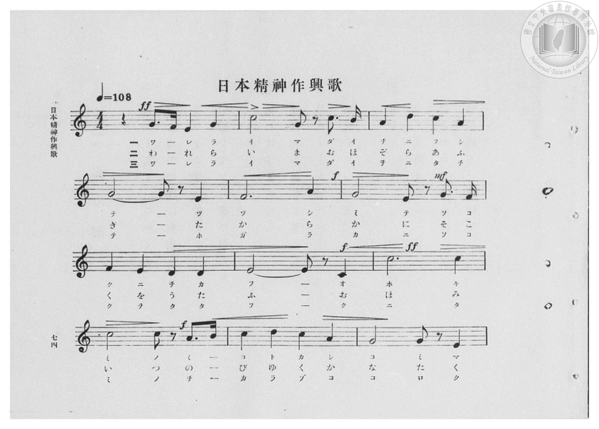
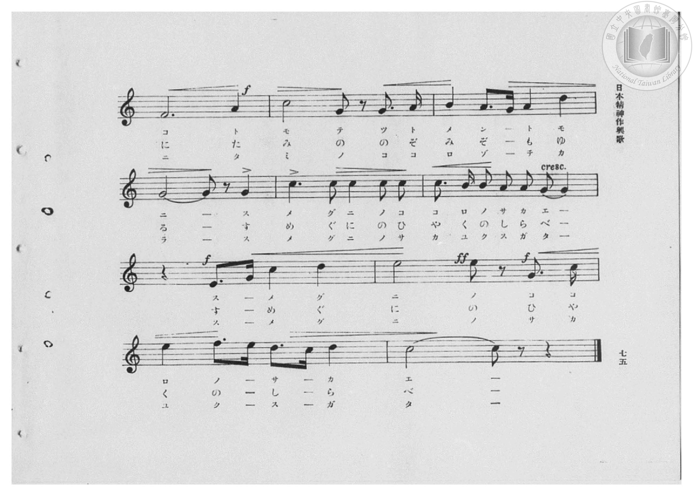
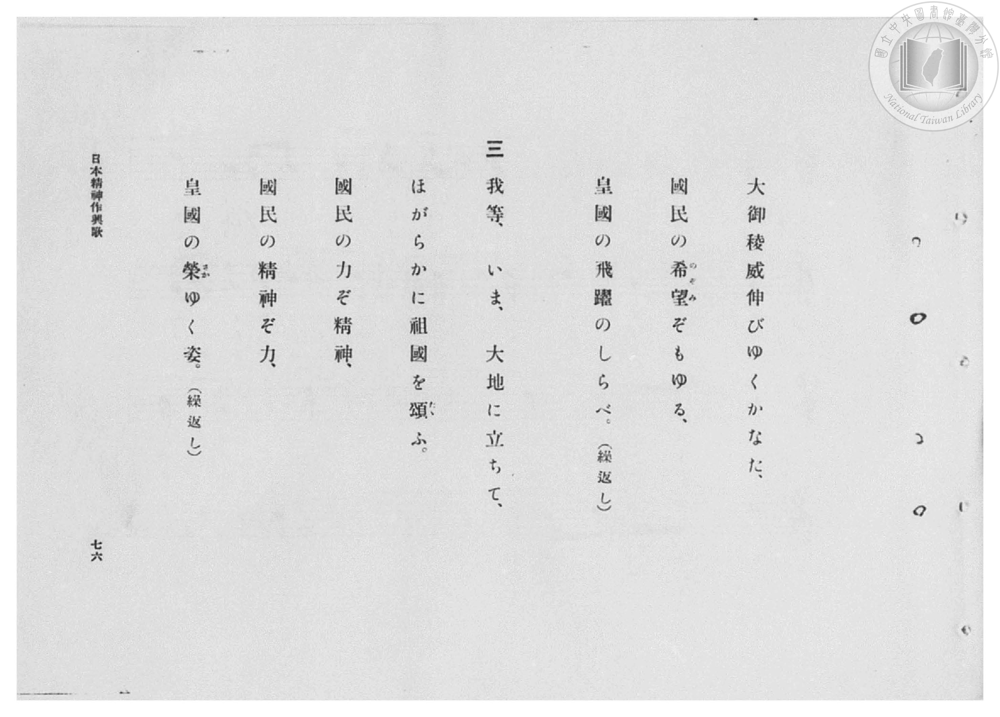
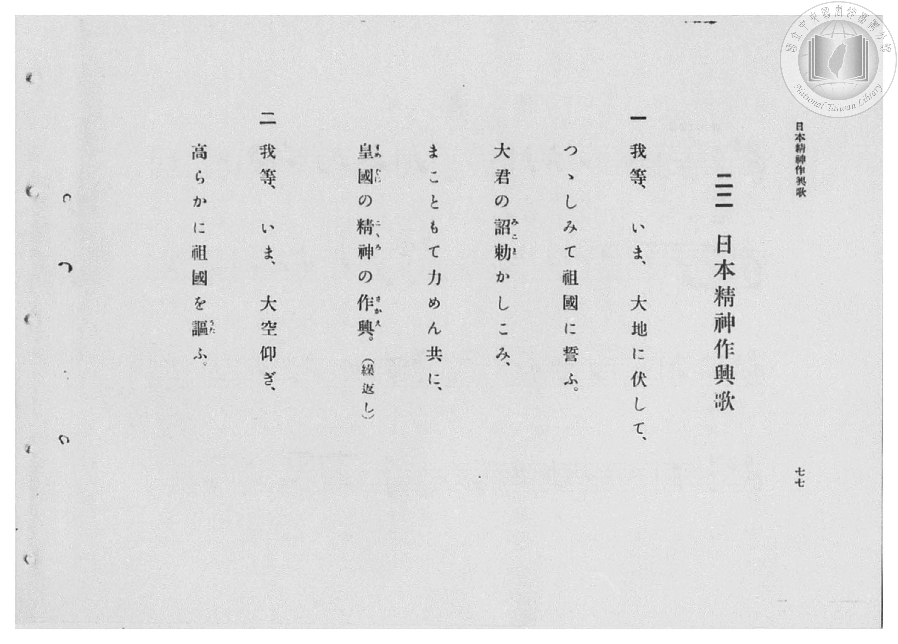

# 日本精神作興歌

> Re:Shōka 使用 AI 協助辨識與重建樂譜，可能會有錯誤。歡迎回報。

- **鋼琴伴奏版**：<br><audio controls src="nippon_seishin_sakkoka.mp3"></audio>

- 臺灣總督府《公學校高等科唱歌》第二學年用（昭和十一年，索書號 0729 74）

## 說明

原書資訊與歌詞全文（對應 P076.jpg–P079.jpg，原書 pp. 74–77，第 22 首）：
調性與拍號：ハ長調（C 大調，無升降記號）4/4 拍，速度 ♩=108


## 歌詞

```text
一
我等、いま、大地に伏して、
つゝしみて祖國に誓ふ。
大君の詔勅（みこと）かしこみ、
まこともて力めん共に、
皇國（すめくに）の精神（こゝろ）の作興（さかえ）。（繰返し）

二
我等、いま、大空仰ぎ、
高らかに祖國を謳（うた）ふ。
大御稜威（おほみいつ）伸びゆくかなた、
國民の希望（のぞみ）ぞもゆる、
皇國の飛躍のしらべ。（繰返し）

三
我等、いま、大地に立ちて、
ほがらかに祖國を頌（たゝ）ふ。
大御代（おほみよ）の力ぞ精神、
國民の精神ぞ力、
皇國の榮（さか）ゆく姿。（繰返し）
```

## ABC

<div class="abc-score" data-abc-src="nippon_seishin_sakkoka.abc" aria-label="五線譜載入中"></div>

[下載 ABC 原始檔](nippon_seishin_sakkoka.abc)

## TMD 檔案連結

- [主旋律 TMD 檔案](nippon_seishin_sakkoka.tmd) [[在 TMD Studio 編輯](https://tmdlang.github.io/Tmd-TS/#tmd=s7IKdvYPcrWy4qpTUCpJTLdSSM7PyUlNLsnMz7PKzk9PzM7Ojy_OyM9OVIKrKMvPKc1NBcqW5McbIYSL80uLklOtipMz8vNz4ktSK0qS8vOz0eXjCxLTU60CDMzNcMqY45SxwCljiZApKMovS81LzAO6paAoM68kNQXsGISC1LLMlFSQdHFyYl58WWpRZlpmagqS_1KLikHeh1pRUpSYV5xclFkAChOEqvyikoz89KLEgoxKq4zM4pL8oszkxJz47MQ8pKAqyUgFhlRBYklRZn5JZnEusvbM9Mw8q5LETGDogkK4PDE-NzEzLycxD-gULS2FZ9OXPpuz5vmmfc-Xznuyd86Ljo5na3sUtLS4FG0VDA0suOxtFZy5bEz0TexAZr5o3_W8cfHzHXufz138dNecxw1dT1vXPF2749mChS9Xz3i-tvP58olPp2wEGvG4ofv5mjVPdvUAZZ_u3PJ8yor3ezqezVj7dFLP097GJzsagILv9_Q837Lo2ewdL2bOVzAwN7JUMDd5v6dTiYtLX0vBllqAS0FB4WnffJA1m9tfrOh60dEOdN-LlfOetq54Nq0d6KynG3qftXcqgFKLXlZB-qOGyaCoBjGBLoRoVSgo0AO6Dihlbg5y9po1CkZGCi-XTQO69_2eWSA7Xqza_6xhOcj07l6gh4Cij5v7X07dDhQH2uGs8HTJcjCz53nLwqe97S9n9r5YMQOssBMYvApAXUC5lw3zn-5apvBo5kpbUOiDzAWGFYh61jERGL6PGxofN7Y8btwHZAANfDpnw-PG1U_29D9unP64cRlQEKT0ceOSx01zwUL7gaLPl057OqcbqO7FqsmPG7c-bmgCBwlQ94TZjxvXvVg55Wl3K9CJYNVAFcCY6nzcCNQA1A_k7oebug8i_bipCWjq067Zj5saHzdNftq6EWg2VNHzWe1Au8CGzQRJNwJdthps3jpIGgNLTQY5rwnoX5A4JNWBxaeCrQWygf5sAoo837nhxf4pQIcARSBhsasHZ1g8X7nryW5gcPRBnQJMkI-bIB5ZDQ2Cpkkv1mwG29T2uBEU8KjBsW_h8xVznq5oBKvoety4GxwiQBuWAJU-2bPjcePmx01AnUA_AQ1dBTQCahXQ7GcbJgL98nRHz7M5s8H61z1unAfUD7ZkHijIgDqbulGCCajo5eLZL3b1glVPB7t2Jy6f7-gkkAqerwYauBA5FQDd34MZBC8X9IAdOB8YCViC4MnuxSj-bwJHB9BrwPhunAeJRHRvQ0Ub54EUofnw2bJ18LgFmQQOwKfLgakKw59AbZRndyhQ0NLn4vLLLCjIzwtOBRZ-mXnBoEomO9EqIDMxL9-hxqCmGmShgo2hmZYdmIWt0FEAFWI7Gl4s7FHQMFZ4uqH_-foGHXhJgZDVxKIV6AKQsTUKBgq6YFidllarYApmGisYQQUhfF2gMsM4KBMGwQIgzVAZozigKjOoJJCDpAoEYTI1YGt9DGsU4qEij5vXQ-k9QLwGLroSbvfjpiVolj9ungckQSY8bm6AiADVAFU2N8JVdMNZU2Gspu2orjBCckVTP8IVTT1w0U6EKxpb0F3RuA_misYuqMhusEqQ61D1P25sgrO2orrCmI5h0bQfLgaTrQFnYdwJbFcPvgQGlsWbwGBpCAZBfFC6MYb7yQRNBQzC0wwwccLSJgKC9IPMqc6FS5ogJa_HzW0YAbUHHlCwqASpQ49WuHpEcgGqmo9hGsh8sGlNe6HqNyMlLGBZj9v-RphpIHWwyMG0HznxoasClppw0-ZCRSYjJSn8_p-NMLkJlsww7EdJdiDbUGVBLsL0P4HSqhNvaQWSxZuYYEkFlnhgBRWMroHLwCA8mQBTiSFcFUZxBoPgYhAui5ScmiA5E7VkgecwePCAAh5W3mAJ-KZVSOpgkYAR8E1rUe0HJydI-QSSnQRjNcKiGDVBwcoXLPZDyymIut247G-ElRJIyQnJ_5vgLoGXJnAWIf_DTAGpw53wEfbjTU5PZ8_Gk5wgsniTE-5aDZxckGo2uEo8VRtGEQWSQSnqkEonzPIEVF5AcidEDhRsoIDfDFfRAQ8gWHJDKaPgKhFmgkyCmAmrkpCTFGaFBqpcIAllHbIbGuFuaEIkOXiChJdNIJWwBI4wE-4GYPmE4gZwKYUvHCDZCxYOcD_Dy6XHTaAKGMKCuRB7OKyFmYlIgISqvSmYScuchHYVrkoNlLAQKQYjAcJqR0hSMgMqMYfKQDSZYraxkAspdJ8jQgCWdkBhvghDFl6XQWtDkHqQyoVwFRCTIQ0TeDqEm4StoMJwA6JYAboUlhYQsqAUh5L2gM0okHnwQgbarII00eDNKXiKRE5VRBQt-NMeNCTBdRo0_UD4kBQHCQcsxT-BAqt1Lb5URX5jCpGi4MkCBMEcuAiCB1dmHAdhgfSDMCixYTbVMcMTuUjfCbcbkV4gobIBrBJRXYJCFxKyiLQKCluYDKjigoTl46YVcFuQ3AJKX0143NI4E-GWJljsgNU0TgCT8DIEnMYeN4KqMpBaaKoHpl2YzHSwK0AtMGC_F5tbwOkMVhJRI1xAvkeUc4-bl0FLK4hJkHYaJP0iu4VAe6v5_V7gWNJqYLoCjvnAO7QKGiY4yrVOkHrCFSei11gLrd0QBROswMJSuoFbV-AEB6tjIQkaqBCzigXyIUaZ4TMSXmPDnISlhwmNCkimhRdp4GiARRBmoiJYFIBVwIojSJsLwkZqC4KTMaq5sAQCcx2Wvig0GUNMgxcy4CQMNReekOHmIhWfkPYZKFGjtBuRqnRI8obZgNzNgCVagu5F7rVSGL7QsAOGG0jlMrh-pL4wsg3wDgsofGHFOT731nJx6dopYBtvifYxjFXAKWeER84YLKfMBQA)]
- [鋼琴伴奏 TMD 檔案](nippon_seishin_sakkoka_piano.tmd) [[在 TMD Studio 編輯](https://tmdlang.github.io/Tmd-TS/#tmd=s7IKdvYPcrWy4qpTUCpJTLdSSM7PyUlNLsnMz7PKzk9PzM7Ojy_OyM9OVIKrKMvPKc1NBcqW5McbIYSL80uLklOtipMz8vNz4ktSK0qS8vOz0eXjCxLTU60CDMzNcMqY45SxwCljiZApKMovS81LzAO6paAoM68kNQXsGISC1LLMlFSQdHFyYl58WWpRZlpmagqS_1KLikHeL8hMzMuPTywqSsxLT81NzUMyAknQKjEzPjE5OT-3IDEvE1VVflFJRn56UWJBRqVVRmZxSX5RZnJiTnx2Yh5SaJZkAI2xKkgsKcrML8kszkXWnpmemWdVkpgJjABQJJQnxucmZublJOYBXaulpfBs-tJnc9Y837Tv-dJ5T_bOedHR8Wxtz_s9HS-79zyfsOXJni1Pl_Y_7-x4v6dTQUuLS9FWwdDAgsveVsGZy8ZE38QOZNGL9l3PGxc_37H3-dzFT3fNedzQ9bR1zdO1O54tWPhy9YznazufL5_4dMpGoLmPG7qfr1nzZFcPUPbpzi3Pp6wA2vRsxtqnk3qe9jY-2dEAFHy_p-f5lkXPZu94MXO-goG5kaWCuQnQdiUuLr_MgoL8vOBUoFcy84JBqSo70SoAFMBBHg41BjXVXApAYGNopmUHZtUoGCjogmF1WlqtgimYaaxgBBWE8HWBygzjoEwYBAuANENljOKAqsygkkAOkioQhMnUgK31MaxRiIeKPG5eD6X3APEauOhKuN2Pm5agWf64eR6QBJnwuLkBIgJUA1TZ3AhX0Q1nTYWxmrajusIIyRVN_QhXNPXARTsRrmhsQXdF4z6YKxq7oCK7wSpBrkPV_7ixCc7aiuoKYzqGRdN-uBhMtoYLmhJgkQ2DID4ogo3hlpugqYBBeOQCUxEsESEgSD_InOpcuKQJUjp43NyG4aM9cB_BwhykDj384eoR8QpUNR_DNJD5YNOa9kLVb0ZKAY8b-3Db3wgzDaQOFoqY9iOnEnRVjxtXw02bCxWZjBT3-P0_G2FyEyw9YNiPkj5AtqHKglyE6X9orMPiFBbLsKwPo2vgMjAIj09gdBrCVWEUEDAILljgskjx3gRJ66h5FZ5m4f4AhRAsB2MJoaZVSOpgoYURQk1rUe0Hxzskx4NkJ8FYjbC4QI15WI7FYj8050PU7cZlfyMs3yHFO5L_N8FdAs-fcBYh_8NMAanDnUIR9kPjHXeBDo5XpEIdrhJPqY6R6UEyKIUHUn7HzKGgHAhJ7xA5kP9AIbQZrqID7hNYukDJ9XCVCDNBJkHMhJXGyHGPWZaDylVIjK5DdkMj3A1NiLQBTznw3A5SCUuJCDPhbgDmeBQ3gPM9vnCA5ANYOMD9DM_pj5tAdQ-EBXMh9nBYCzMTkVLQ8z46BKUARNRipBRYxQCJczOgEnOoDESTKWY7ADnbozsR4VRYJIMCZxGGLLwYh1YEIPUglQvhKiAmQypPeIKBm4Qt62O4AZFRgS6FRRpCFpQ0UBIJsKoHmQfPttCqH9KMgFf58KSDHP1EZFb8iQQakuDiHBrRED4kaUDCAUuBSqjCR0Q9PP5AEMyBiyB4cGXGcRAWSD8Ig1IFZrsP0-PIpdlOuN2IiIU4fwNYJaKmAAUDJAgQiQoUCDAZUJkN8fTjphVwW5DcAkoITXjc0jgT4ZYmWDCC1TROAJPwXAlODI8bQaU4SC00eQITGUxmOtgVoFbC40aQDzHcAk4QsLxNjXAB-R5RcjxuXgbN_xCTIG0JSEJDdgtGn6AWWoAjsjQsq2MpF8A1PTgFwKoRSAoDKsSsRYB8iFFm-IyEV0owJ2HpP0DDBpLc4YUBOFxgIYYZywQzEVgFLCND6n8IG6ldAk5XqObCYgzmOiw9DWi6gpgGz57gNAU1F56y4OYiFTyQtgIolaG0YZBqLUh6g9mA3DaFpSKC7kXuk1AYvtCwA4YbSOUyuH6kng6yDfBWLih8YQUhPvfW4uv1-iD3ek2QOr3gzohhvIJpPAQD0168QrRhLIgCImDdGK9gBGYCGZBAARaYQIXRpvGxYAZMVbRJLIgCKUMzA1bLgnk4LcKqB1MN1EqYNSAuxGAka3A7BUk70FdY_QPWBZSMNsqNBdEgdSACYiBSKAADDxJ2QDEUH8FDBUgANWLzsQEkwnTtFLDFWbQPUBVOOSM8csZgOWUuAA)]

## 分析

```text
================================================================================
📊 TMD Song Profile: [ 日本精神作興歌 ]
================================================================================
⏱  Duration:       2:26 (146.7s), 66 measures total
🎼 Key & Tempo:    首調基準 C, != 108.0 BPM, <4/4>
   - 分析範圍：      由實際發聲的音符與和弦推測調性；播放脈絡另行呈現
🎤 人聲音域:    C4 (MIDI 60) – E5 (MIDI 76) [跨度: 16 個半音 / 1.3 個八度, 難度: moderate]
   - 最低音:  C4 in [NipponSeishinSakkoka[L1] #1 @ m.8, 0:17]
   - 最高音: E5 in [NipponSeishinSakkoka[L1] #1 @ m.18, 0:38]
   - 適合: soprano, mezzo-soprano, contralto, tenor, baritone, bass
🏛  結構:      NipponSeishinSakkoka[L1] (48.9s) -> NipponSeishinSakkoka[L2] (48.9s) -> NipponSeishinSakkoka[L3] (48.9s)
⚡ 編曲密度:        Peak 1 軌道同時演奏
🗝  調性診斷：       C 大調（純淨自然大調，未偵測到可信轉調）
   - 風格氣質:    純淨自然大調（陽光明朗、易唱易記，無明顯調外色彩）
   - 轉調歷程:    全曲維持單一推測調性（未偵測到可信轉調）
   - 核心骨幹音:  C, G, D, A, E
   - 調性數值:    C 大調 [相關度: 0.92, 穩定度: High, 自然音純度: 100.0%]
   - 候選調性 (K-S): C 大調 (0.92), A 小調 (0.71), G 大調 (0.68)
   - 五度圈歷程:   +0 -> +0 -> +0
   - 各段落調性細節:
     • [NipponSeishinSakkoka[L1] #1]: C 大調 (r: 0.92, 自然音純度: 100.0%)
     • [NipponSeishinSakkoka[L2] #1]: C 大調 (r: 0.92, 自然音純度: 100.0%)
     • [NipponSeishinSakkoka[L3] #1]: C 大調 (r: 0.92, 自然音純度: 100.0%)

  [ 五度圈游移軌跡 ]
              [C ]*
         F            G  
      Bb               D  
      Eb               A  
         Ab           E  
            Db       B  
               F# 
     (* = active key center)

  [ 十二半音累積音高分佈 ]
     C  : ████████████████████████  28.1%
     C# :                            0.0%
     D  : ██████████████            16.2%
     D# :                            0.0%
     E  : ████████                   9.1%
     F  : ████████                   9.1%
     F# :                            0.0%
     G  : ███████████████           17.5%
     G# :                            0.0%
     A  : █████████████             14.7%
     A# :                            0.0%
     B  : █████                      5.3%
--------------------------------------------------------------------------------
Assignment 軌道音域：
  - Piano         : C4 – E5 (16 個半音 / 1.3 個八度, 249 個音符)
================================================================================
```


## 原書掃描頁










