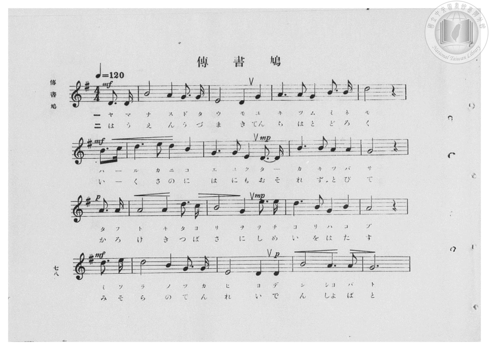
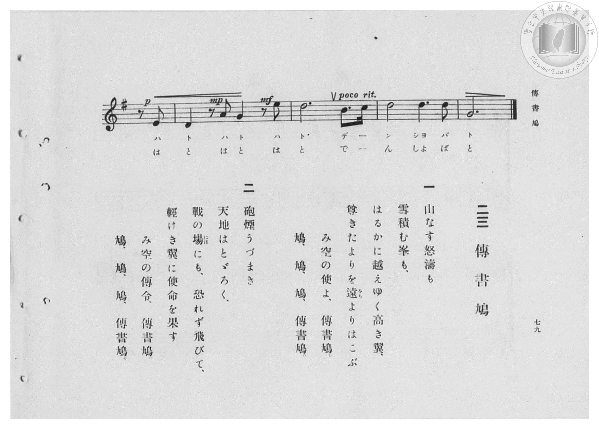

# 傳書鳩

> Re:Shōka 使用 AI 協助辨識與重建樂譜，可能會有錯誤。歡迎回報。

- **鋼琴伴奏版**：<br><audio controls src="denshobato.mp3"></audio>

- 臺灣總督府《公學校高等科唱歌》第二學年用（昭和十一年，索書號 0729 74）

## 說明

原書資訊與歌詞全文（對應 P080.jpg–P081.jpg，原書 pp. 78–79，第 23 首）：
調性與拍號：ト長調（G 大調，1 升記號）4/4 拍（弱起 1 拍），速度 ♩=120


## 歌詞

```text
一
山なす怒濤も雪積む峯も、
はるかに越えゆく高き翼、
尊きたよりを遠（をち）よりはこぶ
み空の使よ、傳書鳩。
鳩、鳩、鳩、傳書鳩。

二
砲煙うづまき天地はとゞろく、
戰の場（には）にも、恐れず飛びて、
輕けき翼に使命を果す
み空の傳令、傳書鳩。
鳩、鳩、鳩、傳書鳩。
```

## ABC

<div class="abc-score" data-abc-src="denshobato.abc" aria-label="五線譜載入中"></div>

[下載 ABC 原始檔](denshobato.abc)

## TMD 檔案連結

- [主旋律 TMD 檔案](denshobato.tmd) [[在 TMD Studio 編輯](https://tmdlang.github.io/Tmd-TS/#tmd=s7IKdvYPcrWy4qpTUCpJTLdSSM7PyUlNLsnMz7PKzk9PzM7Ojy_OyM9OVIKrKMvPKc1NBcqW5McbIYSL80uLklOtipMz8vNz4ktSK0qS8vOz0eXjCxLTU60CDCwMcMoYImQKivLLUvMS84DmFhRl5pWkpoANRihILctMSQVJFycn5sWXpRZlpmWmpiC5NbWoGOQVqBUlRYl5xclFmQUg_yFU5ReVZOSnFyUWZFRaZWQWl-QXZSYn5sRnJ-YhebskIxXo66TMopRidMHczJzMksSiSmQTM9Mz86xKEjPLge7KT0vLTM5MzFHi0tJSeNq0-dnsHS83r1TQ0uJStFUwNDLgsrdVcOeyMdE3sQOZ8KJ91_PGxc937H0-d_HTXXMeN3Q9bV3zdO2OZwsWvlw94_nazufLJz6dsvHZ2p7HDd3P16x5sqsHKPt055bnU1a839PxbMbap5N6nvY2PtnRABR8v6fn-ZZFQCtfzJyvYGBuZKlgbvJ-T6cSF5e-loIttQCXgoLC0775IGs2t79Y0fWiox3ovhcr5z1tXfFsWjvQWU839D5r71QARb1eVkH6o4bJoLgGMYEuhGhVKCjQUzC3AEqZW4KcvWaNgpGxwstl04Dufb9nFsiOF6v2P2tYDjK9uxfoIaDo4-aOl1O3A8WBdrgrPF2yHMzsMVR42gt0yAywok5g0CoAdYCcsWfji63bFQwhXKCxPS8b5j_dtUzh0cyVtqC4ANkCDDmwhzZufNy46nHjzGcNk57tX_K4qenl7FXPV_Y-bmp4unk9kPu4oRGk7nEjkNP9uBGIVr_Y1vW4seNxU9vjxn5gbD1u7H2-fw9U3dMNQLnex43zHzcBVXQ9bpr0snEB0E1AxuPGhUDXQMWBxjVOfty4DWL2_ucrdz1uXPdk736QdEMjPAE9bmgCqQCzGpFJFBVg_-zqAVHPF2x63jrzcSPQbUsfN-4DuuXpkpVP52wAW7jicdO8x01A1_VDXfusAyix7ukCYArqAHoMqAjkQiAD7O9njRMeN_U8bpz1cvHsx42bHzcug2p7sWfq48aJUH83rgY6--nEvUAfPps3BxiSKF4CuvPJ7iWkewmogvIUCwUKWvpcXC6pecBCLimxJN8qIDMxL9-hxqCmGmSNgo2hmZYdmIUttyiAct-OhhcLexQ0kBOWgraCCTC2-5-vb9CBp3iEYk0sJgGdAbKlRsFAQRcM0enq3LRaBdN4MNssHqjQECoBgzA-hDYCqgAqQ1UC1Y5QWwO21MewRgEmg04_bl4CpecBTXzc3IVm5OOmnXCVnVCR_SCVTcvQVTYvgrNgclD7jfDY37gbSreBTG3swLB_MlxlG5ReCla5D11lYy-ctQyhrQacQ4A6jJDUgtiwMDKGkjUKpmgmokQNRJkpUpA-blqLbH1zC5hcAOfPh9K94ICFBQ4MIiKgH0rvQQouYHmB4rX1YHIFnL8SQjeBzW6EmIDF7EaQm2Bm40_mu3rAyRxHugbL4k3XZkj2g9iwwISEGzAecEZAdW5BLSwtG6JFA4gNMwG7SSAIjyigQRA5YPZAxFPzaiS1j5tAvMfN3XD-Zri5j5tgIQwJNVAyftwECnuIyv1QcWBoQs1BmLoWLAMJbxBrApKpW9HcC48fuIlTUeIeOT4fN04Fk-vgfJi9IJUwtyFkgMU3nA_JzI8b54Jd0YOidhaYRKQopFBoRM_aiPQECTVwuiOQnnZ04ktPYFm86Qk9jmF8SOowAaqApQcYRE1PYKYZWnICaUHN93iTE7hIhhmElJ4wC6m1cBYsRleAc_0qdJXNm9BYj5sbwSpRUx5IH6xkQEujzdPQzESUJNASp2kvSmqaiO4GpIISWvg3bgDHOyiloaqEpbXHjdOhZoNdCy1XYK6bBFYBzyeNEHdA0tJMXK5thIYUKHXiT0tPZ8_Gk5YgsnjTEnrBDot6SFIAlTm4q1JQmQLnYCY69EINs96GQVCqAhkGtgo5NUHKcqTwbO6Ds6DlN7CsAakEhTOqSnj-bW6HO_FxMyy1wNU1bUdPYKDiCVtShkGQIyEJECkpNUFaAEjmIBVLkEIDVPGiFzYQeXjR2Lgc4VR4NY1QNx3YDEYR2ABRCi-rsDoVnPoI1nFTMNMRuItCZNsNng7AcQkqZpDrMYggsMgAlT2YiQ4GISkIVIChq0Cv-PCnJXAIYimUEDGHTQxfnMMSEbSCo1YyQnIouDyCmYCIN2xi-GIcloRgNTGVEhHEobVcXLp2CoguQ7SPYawCmogRWESZCwA)]
- [鋼琴伴奏 TMD 檔案](denshobato_piano.tmd) [[在 TMD Studio 編輯](https://tmdlang.github.io/Tmd-TS/#tmd=s7IKdvYPcrWy4qpTUCpJTLdSSM7PyUlNLsnMz7PKzk9PzM7Ojy_OyM9OVIKrKMvPKc1NBcqW5McbIYSL80uLklOtipMz8vNz4ktSK0qS8vOz0eXjCxLTU60CDCwMcMoYImQKivLLUvMS84DmFhRl5pWkpoANRihILctMSQVJFycn5sWXpRZlpmWmpiC5NbWoGOSVgszEvPz4xKKixLz01NzUPCQjkAStEjPjE5OT83MLEvMyUVXlF5Vk5KcXJRZkVFplZBaX5BdlJifmxGcn5iGFTEkG0BirpMyilGJ0wdzMnMySxKJKZBMz0zPzrEoSM8uBTs9PS8tMzkzMUeLS0lJ42rT52ewdLzevfL-n42X3nucTtjzZs-Xp0v7nnR3v93QqaGlxKdoqGBoZcNnbKrhz2Zjom9iBjH3Rvut54-LnO_Y-n7v46a45jxu6nrauebp2x7MFC1-unvF8befz5ROfTtn4bG3P44bu52vWPNnVA5R9unPL8ykrgDY9m7H26aSep72NT3Y0AAXf7-l5vmUR0B0vZs5XMDA3slQwNwHarsTF5ZKaB0wSSYkl-VYBoHAN8nCoMaip5lIAAhtDMy07MKtGwUBBFwzR6erctFoF03gw2yweqNAQKgGDMD6ENgKqACpDVQLVjlBbA7bUx7BGASaDTj9uXgKl5wFNfNzchWbk46adcJWdUJH9IJVNy9BVNi-Cs2ByUPuN8NjfuBtKt4FMbezAsH8yXGUblF4KVrkPXWVjL5y1DKGthgsa8EZIakFsWBgZQ8kaBVM0E1GiBqLMFClIHzetRba-uQVMLoDz50PpXnDAwgIHBhER0A-l9yAF1-PGhSheWw8mV8D5KyF0E9jsRogJWMxuBLkJZjY0HMyQFILYMF9DPAgMMJwhVZ1bUAtLdIZo4QViw0zAbhIIwkMUaBBEDpiOEQHavBpJ7eMmEO9xczecvxlu7uMmWFBAvAdKb4-bQIEEUbkfKg70NtQchKlrwTKQgAGxJiCZuhXNvfCAhJs4FSWSkAP-ceNUMLkOzofZC1IJcxtC5nFTE5wPyXWPG-eCXdGDonYWmEREPVIoNKLnQUTEQ0INnECwZQAQhPEh0WgCVAGLOBhEjXgw0wwt3kFaUHMS3ngHF3Iwg5AiHjPbr4WzYEG_ApyPVqGrbN6Exnrc3AhWiZpEQPpgeQ0tMTVPQzMTkTehebhpL0q0T0R3A1LRAy1OGzeAIwiUJFBVwhLF48bpULPBroXmVJjrJoFVwBN0I8QdkEificu1jdCQAiUjWKSjl2mwOILEGSgX465FQLkUzsFMHejFBGaVBYOg6AcZBrYKOdohxRiSx5v74Cxo0QXMvSCVoABBVQnPEc3tcCc-boZFK1xd03b0lADK8NjSHAyCHAlJKUhx3gSp_JDMQcrokGwIqnPQsy9EHl7YNC5HOBVeQyHUTX_chOwoUCKCRDmyBzCcCk4miAiHRRg40EEZF7kIhwgCMyEoN2OmDhiERDWoSEBXgV7m4490sFexZHNEEGMTwxc5sNiGlu3Uim8kh4JzOMwERABjE8MXNbC4hlVCVIptiENrMdubPsjtTROk5iYE1oAzoGG8QrRhLIgyjQe1MU2AZLRJfCyYCxSFBAEoEQHFTYHiUA1IImDDoMrg2jGVAUVAssDkAbcSj0FwQRAD4jSEPhLMQVeE4j8Uc-HakTWhOsgAKoTqOlAooYpgNQYYQ7p2CohIivYByqGJGIFFlLkA)]

## 分析

```text
================================================================================
📊 TMD Song Profile: [ 傳書鳩 ]
================================================================================
⏱  Duration:       1:24 (84.0s), 42 measures total
🎼 Key & Tempo:    首調基準 G, != 120.0 BPM, <4/4>
   - 分析範圍：      由實際發聲的音符與和弦推測調性；播放脈絡另行呈現
🎤 人聲音域:    D4 (MIDI 62) – E5 (MIDI 76) [跨度: 14 個半音 / 1.2 個八度, 難度: moderate]
   - 最低音:  D4 in [Denshobato[L1] #1 @ m.1, 0:01]
   - 最高音: E5 in [Denshobato[L1] #1 @ m.6, 0:10]
   - 適合: soprano, mezzo-soprano, contralto, tenor, baritone, bass
🏛  結構:      Denshobato[L1] (42.0s) -> Denshobato[L2] (42.0s)
⚡ 編曲密度:        Peak 1 軌道同時演奏
🗝  調性診斷：       D 調性不明確（純淨自然大調，未偵測到可信轉調）
   - 風格氣質:    純淨自然大調（陽光明朗、易唱易記，無明顯調外色彩）
   - 轉調歷程:    全曲維持單一推測調性（未偵測到可信轉調）
   - 核心骨幹音:  D, G, A, B, E
   - 調性數值:    D 調性不明確 [相關度: 0.84, 穩定度: Ambiguous, 自然音純度: 99.3%]
   - 候選調性 (K-S): D 大調 (0.84), G 大調 (0.83), B 小調 (0.60)
   - 五度圈歷程:   +2 -> +2
   - 各段落調性細節:
     • [Denshobato[L1] #1]: D 調性不明確 (r: 0.84, 自然音純度: 99.3%, 調外音: C)
     • [Denshobato[L2] #1]: D 調性不明確 (r: 0.84, 自然音純度: 99.3%, 調外音: C)

  [ 五度圈游移軌跡 ]
               C  
         F            G  
      Bb              [D ]*
      Eb               A  
         Ab           E  
            Db       B  
               F# 
     (* = active key center)

  [ 十二半音累積音高分佈 ]
     C  : █                          0.7%
     C# :                            0.0%
     D  : ████████████████████████  29.1%
     D# :                            0.0%
     E  : ██████████                12.3%
     F  :                            0.0%
     F# :                            0.0%
     G  : ███████████████████       22.5%
     G# :                            0.0%
     A  : ████████████████          19.5%
     A# :                            0.0%
     B  : █████████████             15.9%
--------------------------------------------------------------------------------
Assignment 軌道音域：
  - Piano         : D4 – E5 (14 個半音 / 1.2 個八度, 142 個音符)
================================================================================
```


## 原書掃描頁






