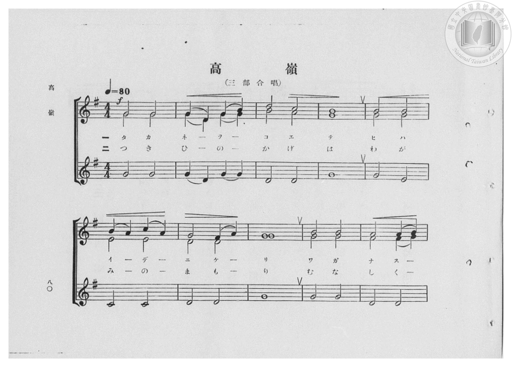
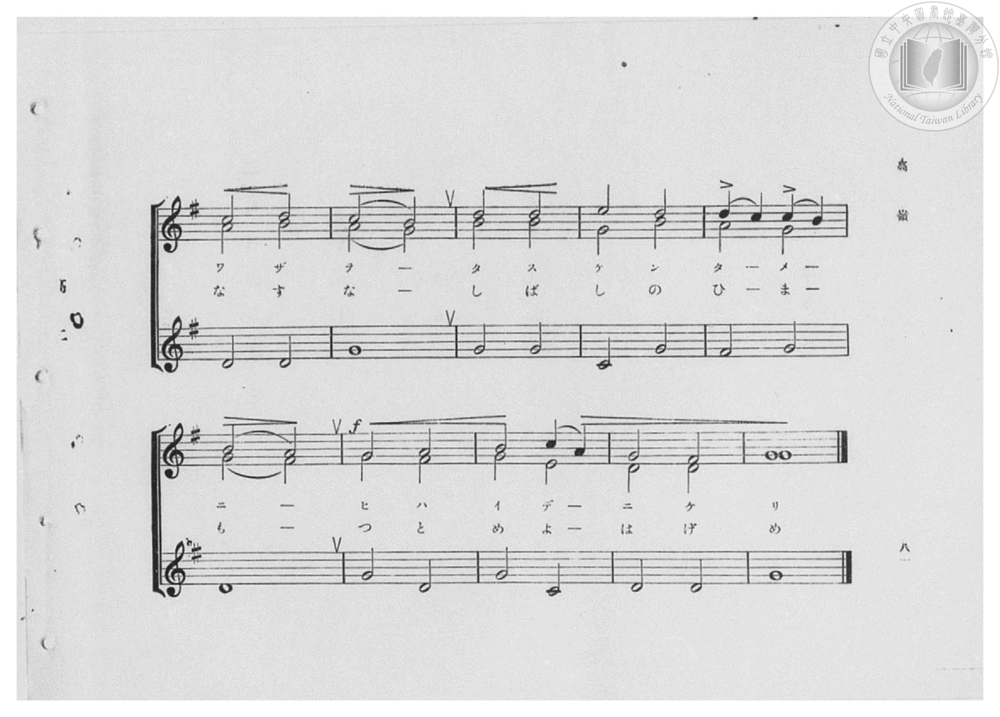
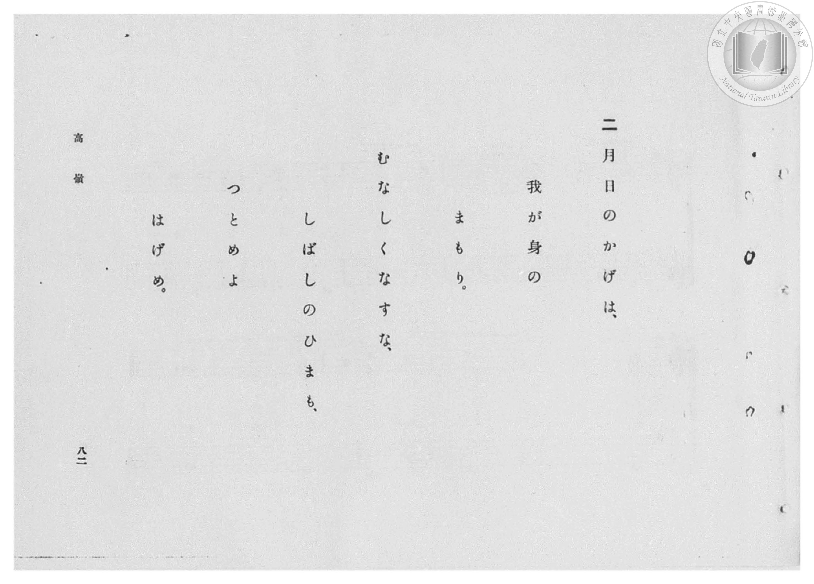
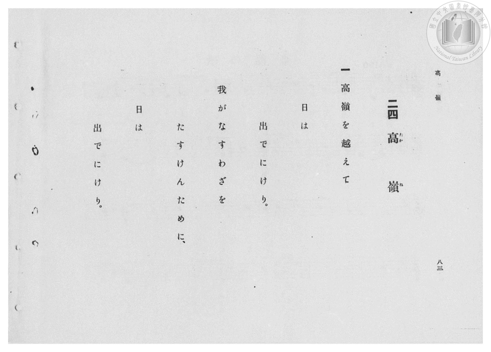

# 高嶺

> Re:Shōka 使用 AI 協助辨識與重建樂譜，可能會有錯誤。歡迎回報。

- **鋼琴伴奏版**：<br><audio controls src="takane.mp3"></audio>

- 出處：小學唱歌集
- 臺灣總督府《公學校高等科唱歌》第二學年用（昭和十一年，索書號 0729 74）

## 說明

原書資訊與歌詞全文（對應 P118.jpg–P119.jpg，書頁 pp. 41–42，高二重音第 6 首）：
調性與拍號：ト長調（1 升記號）、4/4 拍（落付イテ 𝅗𝅥=80，三部重音合唱）
出處註記：小學唱歌集


## 歌詞

```text
一
高嶺を越えて日は出でにけり
我がなすわざをたすけんために
日は出でにけり

二
月日のかげは我が身のまもり
むなしくなすなしばしのひまも
つとめよはげめ
```

## ABC

<div class="abc-score" data-abc-src="takane.abc" aria-label="五線譜載入中"></div>

[下載 ABC 原始檔](takane.abc)

## TMD 檔案連結

- [主旋律 TMD 檔案](takane.tmd) [[在 TMD Studio 編輯](https://tmdlang.github.io/Tmd-TS/#tmd=s7IKdvYPcrWy4qpTUCpJTLdSSM7PyUlNLsnMz7PKzk9PzM7Ojy_OyM9OVIKrKMvPKc1NBcqW5McbIYSL80uLklOtipMz8vNz4ktSK0qS8vOz0eXjCxLTU60CDCyQdBYU5Zel5iXmAXUXFGXmlaSmgLUjFKSWZaakgqSLkxPz4stSizLTMlNTkFyUWlQMcjDUipKixLzi5KLMApAvEKryi0oy8tOLEgsyKq0yMotL8osykxNz4rMT85A8V5KRCvRbXmJJaVEqstbM9Mw8q9zUzKxMJK9paSm8XD3j6bZdClpaXIq2CoZmBlz2tgruXDYm-iZ2IN1P23e9mDn1_Z5ZTzf0P1274-mUjc_W9ryc3QY2-kX7rueNi5_v2Pt87uKnu-Y8buh62roGqOrZgoVAY5-v7Xy-fCJEx-OG7udr1jzZ1QMyY-eW51NWvN_T8WzG2qeTep72Nj7Z0QAUfL-n5_mWRc9m73gxc76CgbmRpYK5yfs9nUpcXPpaCrbUAlwKCgpP--aDrNnc_mJF14uOdqD7Xqyc97R1xbNp7UBnPd3Q-6y9UyHA0NBCL6sg_VHDZCDTEsQEuhCo7-WCRoWCAj0FE0OglIkRUBDoWaDXXrb3vpy_GehNBTOFl8umAZ0ODDaQdS9W7X_WsBxkUXcv0G9A0cfNHS-nbgeKA60zVHjaC3TIDLBM5-OGRmDQKwBVAqVeTNj7ZPeMx01LHje3KXyY2zodiJfaWhgArXyyo_Nl8wqIlU8ndABDGagZ7DdwhL1YsRtoJGa0cYGUAIMbREFi_nHTpBfbuh43djxuXPZs-tLHjeuBJjxuXP64cfXjxomPm7pASp91THzc2PO4cdXjxpmPm_ofN04DanvcOB_EBSmaDGI3NQL1gFVjNQZs864esII5HWA16x43dj9uBBq0HmLBi11AxUDBfY-bmqA2P25qAFs7_XEj0Fqw_VDuBjAJVL0JogGsunHJ48YVIJc0Af2zHmR2UyNIgvJ0AwUKWvpcXL6JwLwUkJmYl2_oUGNQUw2yQcHGRMsOzMCWWhVAqX9Hw4uFPRAGMO4UNEwVgLHzfH2DDjytaWLRCbQQZGqNgqGCLhjDWMZAlgmQZQwWMwKSIFgD5oPFwPp8DGuAgbgfyH_ctBos_7i5F8Rr3gTEe0D8ps1g2RVQ2Ta4SY-bJ4FV9iNMMwKJtoDVr0VR0wc3DWTL46ZNUFmQXphp68Eya8Cm4Q-qXT0UBZUxMDhMgBgSVObxcCZaCIFDzQgUkkhhtQTsk8fN7TAfNXeD3b0Rzl-F3U9AXheYtxOiEinE5kPNhIdS8zxwqC3CauYCsBzILJB7toPNXA81k0AS66Qo3EDBgQgYSGJDBBYisYHC1wgojxRs0IDYBvUCKPpBDoZ4AZL8dkJ5G8FyoEQHkYMEzUKMQIMFJlLQwk0EB0rzBBReHzxBQkycR0yQPZ09G0-QgYt9AkkNlIJguRLCAomhJD-YNDiCkcIMnLBgfkLObOBkCOJhJkKIWnhyQQqvRSimgTNpcweUtxDMWwE3DWQLIpOCZCGm1SKXbkZklW7AmpDC0s0sHkgAUxdSKgQHIiR_wFXiKd8gCYB6JRxa7qVuGUdegAEDSRdC1CiYgigwgVzMIYIUHHpAAiXHwlMYxOE40hcJRRxyHoQVb5imUaFwIy_AwIGAFB7QsEOEElgAQwFVijgQD5TJqFO8gXigACa6aMMWYISLNrTCC4mJL9mRWLzhTXwkFm6I3EiwaDMmr-EGanRTp2jDnWXRk93QLtzICzITUBiACcKFG5I81Qo31ACjrGgjHFiIVhtZgUUogMDhiFSuoVWeWIo1qIeoUqjBzKJykYYtqAgXaeBQQoQPUqDhS2xoRRqW3EVmgQYzicziTNdOAVSiKQBpZS4A)]
- [鋼琴伴奏 TMD 檔案](takane_piano.tmd) [[在 TMD Studio 編輯](https://tmdlang.github.io/Tmd-TS/#tmd=s7IKdvYPcrWy4qpTUCpJTLdSSM7PyUlNLsnMz7PKzk9PzM7Ojy_OyM9OVIKrKMvPKc1NBcqW5McbIYSL80uLklOtipMz8vNz4ktSK0qS8vOz0eXjCxLTU60CDCyQdBYU5Zel5iXmAXUXFGXmlaSmgLUjFKSWZaakgqSLkxPz4stSizLTMlNTkFyUWlQMcjDUipKixLzi5KLMApAvEKryi0oy8tOLEgsyKq0yMotL8osykxNz4rMT85A8l1gE1JyempuaV2JVkJmYlx-fmJycn1uQmJcJEkMoLMkAKrLKSywpLUpFtiMzPTPPKjc1MysTKQy0tBRerp7xdNuu93s6XnbveT5hy5M9W54u7X_e2fF-T6eClhaXoq2CoZkBl72tgjuXjYm-iR3IyKftu17MnPp-z6ynG_qfrt3xdMrGZ2t7Xs5uA9v3on3X88bFz3fsfT538dNdcx43dD1tXQNU9WzBQqBdz9d2Pl8-EaLjcUP38zVrnuzqAZmxc8vzKSuAzng2Y-3TST1Pexuf7GgACr7f0_N8y6Jns3e8mDlfwcDcyFLB3AToNCUuLt9EoIcCQEFh6FBjUFPNpQAENiZadmCGvpaCLTpQANm2o-HFwh4I42XzCgUNUwWgJ56vb9BRCDA0tNDLKkjXxKJTSx9sao2CoYIuGMNYxkCWCZBlDBYzApIgWAPmg8XA-nwMaxQeN-0H8h83rQbLP27uBfGaNwHxHhC_aTNYdgVUtg1u0uPmSWCV_QjTjECiLWD1a1HU9MFNA9nyuGkTVBakF2baerDMGrBp-INqVw9FQWUMDA4TIIYElXk8nIkWQuBQMwKFJFJYLQH75HFzO8xHzd1gd2-E81dh9xOQ1wXm7YSoRAqx-VAz4aHUPA8caouwmrkALAcyC-Se7WAz10PNJJDEOikKN1BwIAIGktgQgYVIbKDwNQLKIwUbNCC2Qb0Ain6QgyFegCS_nVDeRrAcKNFB5CBBsxAj0GCBiRS0cBPBgdI8AYXXB0-QEBPnERNkT2fPxhNklkQkNVAKguVKCAskhpL8YNLgCEYKM3DCgvkJObOBkyGIh5kIIWrhyQUpvBahmAbOpM0dUN5CMG8F3DSQLYhMCpKFmFaLXLoZkVW67eqhtHQziwcSwNSFlArBgQjJH3CVeMo3SAKgXgmHlnupW8aRF2DAQNKFEDUKpiAKTCAXc4ggBYcekEDJsfAUBnE4jvRFQhGHnAdhxRumaVQo3MgLMHAgIIUHNOwQoQQWwFBAlSIOxANlMuoUbyAeKICJLtqwBRjhog2t8EJi4kt2JBZveBMfiYUbIjcSLNqMyWu4dVKtaMOdZdGT3dAu3MgLMhNQGIAJwoUbkjzVCjfUAKOsaCMcWIhWG1mBRSiAwOGIVK6hVZ5YijWoh6hSqMHMonKRhi2oCBdp4FBChA9SoOFLbGhFGpbcRWaBBjOJ4uLMxwNLeQb0ATi6ob6JB5YswNIHjEAehfgU5m2kgIHUfYgMBUpBkPyIrBimFawcSSfUOhRF8NAnQiPEFhRTUB2D4VYUAwk5EhRuunYKoKCL9jGMVYCzjcBsZS4A)]

## 分析

```text
================================================================================
📊 TMD Song Profile: [ 高嶺 ]
================================================================================
⏱  Duration:       0:30 (30.0s), 20 measures total
🎼 Key & Tempo:    首調基準 G, != 160.0 BPM, <4/4>
   - 分析範圍：      由實際發聲的音符與和弦推測調性；播放脈絡另行呈現
🎤 人聲音域:    F#4 (MIDI 66) – C5 (MIDI 72) [跨度: 6 個半音 / 0.5 個八度, 難度: easy]
   - 最低音:  F#4 in [Main #1 @ m.7, 0:09]
   - 最高音: C5 in [Main #1 @ m.3, 0:03]
   - 適合: soprano, mezzo-soprano, contralto, tenor, baritone, bass
🏛  結構:      Main (30.0s)
⚡ 編曲密度:        Peak 3 軌道同時演奏
🗝  調性診斷：       G 大調（純淨自然大調，未偵測到可信轉調）
   - 風格氣質:    純淨自然大調（陽光明朗、易唱易記，無明顯調外色彩）
   - 轉調歷程:    全曲維持單一推測調性（未偵測到可信轉調）
   - 核心骨幹音:  G, D, B, A, F#
   - 調性數值:    G 大調 [相關度: 0.89, 穩定度: High, 自然音純度: 100.0%]
   - 候選調性 (K-S): G 大調 (0.89), G 小調 (0.63), E 小調 (0.58)
   - 五度圈歷程:   +1
   - 各段落調性細節:
     • [Main #1]: G 大調 (r: 0.89, 自然音純度: 100.0%)

  [ 五度圈游移軌跡 ]
               C  
         F           [G ]*
      Bb               D  
      Eb               A  
         Ab           E  
            Db       B  
               F# 
     (* = active key center)

  [ 十二半音累積音高分佈 ]
     C  : ███                        5.8%
     C# :                            0.0%
     D  : ████████                  14.2%
     D# :                            0.0%
     E  : ████                       6.7%
     F  :                            0.0%
     F# : █████                      9.2%
     G  : ████████████████████████  43.7%
     G# :                            0.0%
     A  : █████                      9.6%
     A# :                            0.0%
     B  : ██████                    10.8%
--------------------------------------------------------------------------------
Assignment 軌道音域：
  - Piano1        : F#4 – C5 (6 個半音 / 0.5 個八度, 45 個音符)
  - Piano2        : D4 – A4 (7 個半音 / 0.6 個八度, 40 個音符)
  - Piano3        : C4 – G4 (7 個半音 / 0.6 個八度, 37 個音符)
================================================================================
```


## 原書掃描頁










