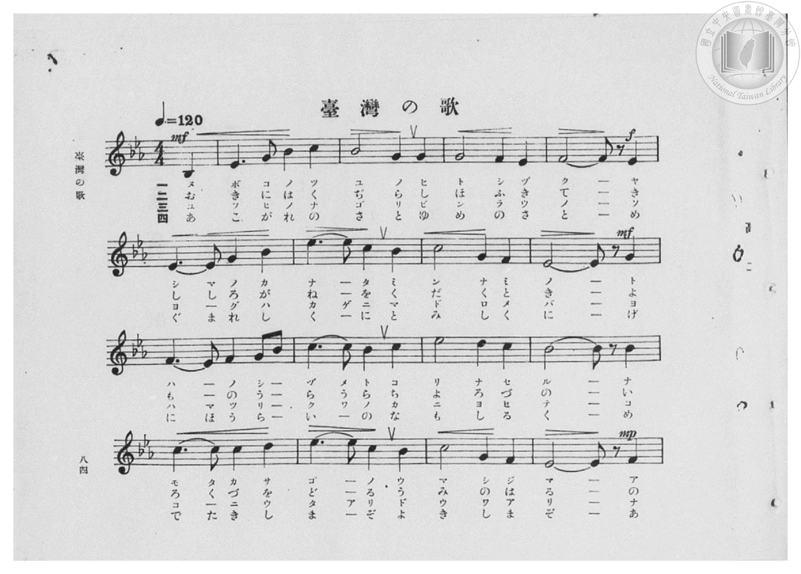
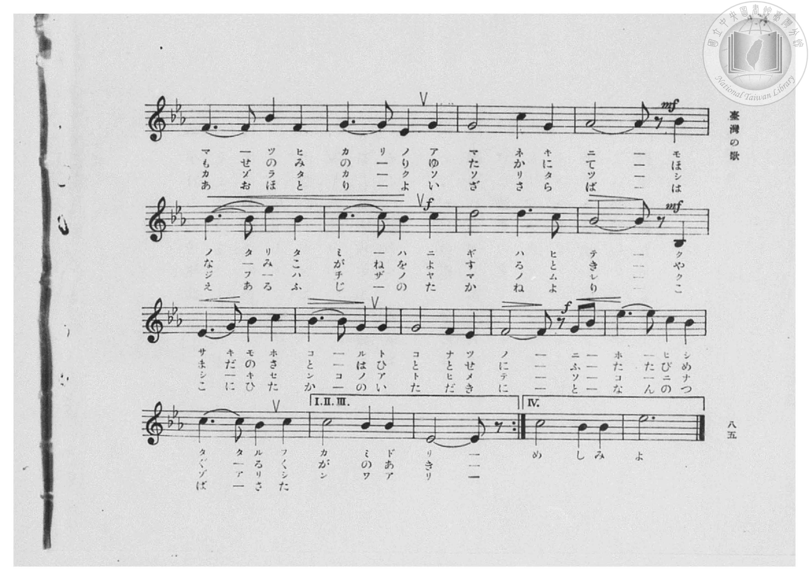
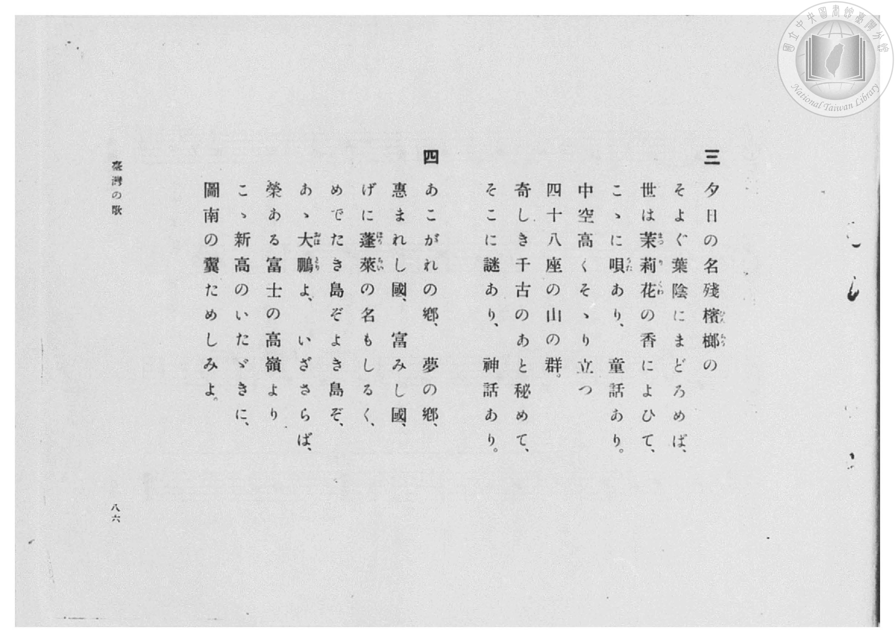
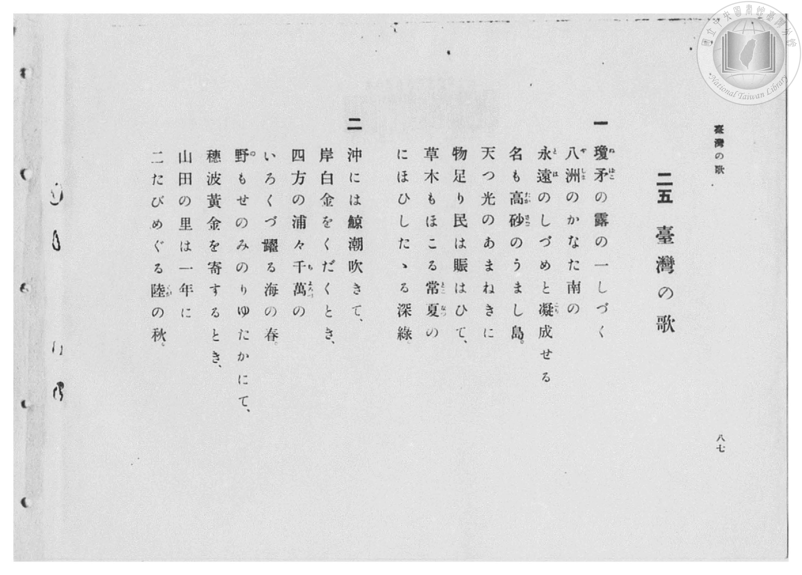

# 臺灣の歌

> Re:Shōka 使用 AI 協助辨識與重建樂譜，可能會有錯誤。歡迎回報。

- **鋼琴伴奏版**：<br><audio controls src="taiwan_no_uta.mp3"></audio>

- 詞：內田隆（昭和4年臺灣教育會選歌）
- 曲：信時潔
- 臺灣總督府《公學校高等科唱歌》第二學年用（昭和十一年，索書號 0729 74）

## 說明

原書資訊與歌詞全文（對應 P056.jpg – P058.jpg，書頁 pp. 21–23，高一第二學期第 9 首）：
調性與拍號：變ホ長調（降 E 大調，3 降記號）、4/4 拍（♩=120，弱起第 4 拍進入）


## 歌詞

```text
一　瓊矛（ぬぼこ）の露（つゆ）の一（ひと）しづく
八洲（やしま）のかなた南（みんなみ）の
とはの鎭（しづ）めと凝（こ）り成（な）せる
名（な）も高砂（たかさご）のうまし島（じま）
天（あま）つ光（ひかり）のあまねきに
物足（ものた）り民（たみ）は賑（にぎ）はひて
草木（くさき）も誇（ほこ）る常夏（とこなつ）の
にほひしたたる深綠（ふかみどり）

二　沖（おき）には鯨（くぢら）潮（しほ）吹（ふ）きて
岸白金（きししろがね）を碎（くだ）くとき
四方（よも）の浦々（うらうら）千萬（ちよろづ）の
いろくづ躍（をど）る海（うみ）の春（はる）
野（の）もせのみのりゆたかにて
穗波黃金（ほなみこがね）を寄（よ）するとき
山田（やまだ）の里（さと）は一年（ひととせ）に
二（ふ）たびめぐる陸（くが）の秋（あき）

三　夕日（ゆふひ）の名殘（なごり）檳榔（びんらう）の
そよぐ葉蔭（はかげ）にまどろめば
世（よ）は茉莉花（まつりくゎ）の香（か）に醉（ゑ）ひて
こゝに唄（うた）あり童話（どうわ）あり
中空高（なかぞらたか）くそゝり立（た）つ
四十八座（しじふはちざ）の山（やま）の群（むれ）
奇（く）しき千古（せんこ）の跡（あと）祕（ひ）めて
そこに謎（なぞ）あり神話（しんわ）あり

四　あこがれの鄕（さと）夢（ゆめ）の鄕（さと）
惠（めぐ）まれし國（くに）富（と）みし國（くに）
げに蓬萊（ほうらい）の名（な）もしるく
めでたき島（しま）ぞ佳（よ）き島（しま）ぞ
あゝ大鵬（おほとり）よいざさらば
榮（はえ）ある富士（ふじ）の高嶺（たかね）より
こゝ新高（にひたか）のいたゞきに
圖南（となん）の翼（つばさ）ためしみよ
```

## ABC

<div class="abc-score" data-abc-src="taiwan_no_uta.abc" aria-label="五線譜載入中"></div>

[下載 ABC 原始檔](taiwan_no_uta.abc)

## TMD 檔案連結

- [主旋律 TMD 檔案](taiwan_no_uta.tmd) [[在 TMD Studio 編輯](https://tmdlang.github.io/Tmd-TS/#tmd=s7IKdvYPcrWy4qpTUCpJTLdSSM7PyUlNLsnMz7PKzk9PzM7Ojy_OyM9OVIKrKMvPKc1NBcqW5McbIYSL80uLklOtipMz8vNz4ktSK0qS8vOz0eXjCxLTU60CDCzMKJMpKMovS81LzAPaWFCUmVeSmgK2EqEgtSwzJRUkXZycmBdfllqUmZaZmoLki9SiYpAnoVaUFCXmFScXZRaAfI5QlV9UkpGfXpRYkFFplZFZXJJflJmcmBOfnZiHFCAlGanA8CjISUxORdaZmZ6ZZ1WSmAkMPlAQlifG5yZm5uUk5iG5AqGqHOjK_LS0zOTMxBwlLi0thRftu543Ln7cuO7Z2h4FLS0uRVsFQyMDLntbBVcdLhsTfRM7kCkvVs57v2fW09blz6dseDmr7f2ejmcz1j6d1GPydOcWiAnPps580bTp2Zzml407gEa939MJtv7Z7E1AjU_2L3w2s-nZ3ilgMYiG5zv2Pp-7-OmuOY8bup62rnm6dsezBQtfrp7xfG3n8-UTn07ZCDTlcUP38zVrnuzqAcoCbXo-ZQXc5qe9jU92NAAF3-_peb5l0bPZO17MnK9gYG5kqWBuAradS19LwZZagEtBQeFp33yQNZvbX6zoetHRDnQfMFietq54Nq0d6KynG3qftXcqBBiYmullFaQrPGqYDOJYgDhANwJ1vlzQqFBQoKdgZAiUMzIGCgK9C_QE3IvP5swHshUsFV4umwb0AjDgQNa-WLX_WcNykIXdvUA_AkVfrOt63Dz75dTtQCmgzS9n9iq4KjxdshzM7TFWAAq8WDEDrLbzcUMjMBIVgHqBKh_NXGkLjF2goqd7Nr7Yuh1kG1juZcOmp61Lgcq5QDYC3fS4oeH55K7n82cDdT1uXPO4cc_jxskg4xrXvZwDjFKg4JLHTcCEABIBqgeLbHrcCIwgoMj0x41LHzf2gwOtdfWzLWANTS1giX0QPY8bux83rnrcOP9p73Sw5v2PmyaDRYB-ACkAaQaa97hxPcjOvrVgRSCDQdJNjUCpp-1zwYJgdzV1PeuYAOauAuuf_bipG2z_BJDHoaJNTaAEtqAJLDIf7ISpjxunwFzUBnQd0I6nm7eBFcyAOBZsypKVYKEmmPuXPG0Fxg_Ez91Ay2FGgBQ8blz7uLH3ceNqkM7nnStfbNsM9j9QDqgCHClA126YCHMFxMPrX2yGiKx-3NgHEQGbvgycBno7n80BJX5gqILdDPQUyDsvVoGS3uPG3bBQ6H66Y8fTJf1gQWDYQUJ0CXKIAo0HqgYaDAxLoOXzgXqebd_4fNsCsJ6t4EDZ_7hxJcRTkPSwC5gTG55tAiZKoJIuqO0gk9a_XA931aLHTcAg6Xy2dx0sqnYDuU8n7IQYDNYCDBWwf55u2vF85t6X7RAfA0WBqqc_bgIyeoChB_bJpOeLgMEAMRroNqBmIAPopV6w_tmzn00DG9wECliI_55tXfa4oRWspw3oFggJckJv84sJa8DiC8HqgdaAUxEsSFrAQkDjl77YBU4tTZOAAQAJz2dbt0NNhCXMZzOAmoEi64Gy0OTxsh3iVKDPQbECSn2gqAYG4zpgMALzCSy1AYMM7P_nK6c_27zo5e5mWBAAowSU9MExhgiCp-tbIH4E2zwTaCFSEGzcCCyMYRkLmOgggbTuZTuw8AWaCEwkkMy4HlZOQnMoGAHzNSgGobGLFENAd24GZ68JQNteztwBiwJQiQ40_flyoJ8hGQGUCKDFBbCUaXi6ZOqz6eCQAXkXmI6AmR6kA5gBn62bAcmDwLwGSVbPVm1-tgyY74CCQNsmQ2ILOUrmgiKqccKLiZ0vpkCyPjA3AH0_CZbygB4GJtFesFM3QFwBTp7QsFr_oqfzRV_ni66NYM1A1cDiCphy-x83QTLXupfLZoKlQHEINPFlGzg_NwGjA8iF5TtQfDTNBUo_nQKOCVAyAGdgYAA0dT1fvfTFSogFK8GpDZjvoFIQF619vnIXsMSBeR7o_nlgr4ISAyxJA30KRECzIAELMX0JNJEDazlgAfp013JYlgKWScCgBYbFwseNoDoCFMAbwU4ApwJoJO0D5nigSMPjJlC0gc1aCikoIC4EGtQLzBVP-8HqQGUlMNlBi_cX2xfCYhiUfp4vnQpJObBiFxouwEAB6ln9Yg0k5QN9B2whwMJl6TxYuAAzNTAEkcIF6jFgggFbAU7uTcAUv-5lC8QiaLp9umQRNC01NUIjDFUByKBnzeBSC5xcwYr2gc2a_nQOJDCBwbsaZNZ6SAqH5AdgJkNXAPESMNOvfjF5zYsJwBQKyZKQYgQY89CEjFyTgP0GjFFwLQd2wnJwxPbCqg94XTfvyV5IBQBJmlgUQOwHhs9cYC3-ciukrAKmVqATVkArF1B2AMbwNJD_QY4Cp_lnyyBlLTA9QMwGGtEN9O3TxUBfQUpzYOIDB97qGU-37YLVOEBnQ0oYoKPASRWSzp9N2wBLrcAcBswD8HQKLMyAlgPrinmImu3pnGmwuhtYoKwCRjQ09e3fAxZcAnQk0LXQUgUUQEAPA2v5DpBmyltkUKCgpc_FFQZsZacaGhmbWIXlZyanOtToGtZUg6xRsLHQsgMzahQMFHThsDo3rVbBNB7IqlEwBIsYK5gCSTOwCIgFEYPgGjAJgkZADFJfA2ZBoIFCNdAwsCjYJh_DGgWQyTAIbD6BdQDbUFD-ZCBeB2Ytgcg0tcHVQsQ3QXWsgItPB5NLoeL9cNPjgbpbEHYbodvdBdXRC-WvBuL1YBbIDJDMIpjapk64TSDx3XAztoJJkAkg8WXIdkNEIXYbo9kN9hVIB0g_xFcw_62CykyBqwW5E1gZQMNjMpqbYCaBdCPsnouw2wTd301QHRCTgKUM0KweMAtkBkhmKlwtKJThrm1qhItD3ApShxwXkDAHqaoBl2bwJGQITiagxAMUiYOqBaUoiBCIBUtVoNQD0wZNQ6AUCU5s8EQEiQqQE_bBHdMNdQwoACFy88HkfvSAA6uAi6MFHMgriASDsGc60ARQhIKCC6JvLcy8pklgcViiWQC3ByQCNRGezGCB1IGwB5g4IHyQ6gnwRAjzD8h0WAKF-BgivhJuP9hdkGAHim_AZQ8wIYDMh4cbNNJhiRqWcWD2wNwNCidYGCD7E6QKEW4gV8IjHVICGIJpUOkBi2EzpJIEngzM4UKwwgUU6eCEgRTfiCwHiW2Yq0HZHuJ7aGIFJ2tQiIKyDXJ8z4aKg8IV4W5wdkPEdxMocyDbA0v6oMwG4cMy3kKoDCTm4PEAL4hQ0xVSQQSKb3Acw9IvqKiDuBccD5BSC9kRsKQAC3JgWwwsDisLUcsdcAAgRTlEFygIId6BeAAkg24PtOxBCgRwlIODDLNsRcnnsAgG0aAYJSufF9RChBHxDnUKKC9DggFR6MALSNSYAucP5PQ6A00cEkjgQhAp3kFxB0ndkBiE5GrUfAaxH2YPIl9A7AfFKGb6AhepSPEOK3RBlQ04MsClFEgGHujQAh9kL0gcXgE2QcoTaPENT98Y6Rgc6cuRwg2SLmE5BhE-88CmgksIqCrkcIOVMyBV2MINOIZkCmpiIGd5I3BEQ6IW0jAwBkcxalMBlAwgIiZws6HFPHq2RzgWnEngKR4SyKBAgAU_rFZD6FgLJkHewiiuwMkKM9uDCgmYeejVAzRa4DU3KNogeiDJAmQ-Zl4EFVvI0Q91NzBQYcUILPphyQZWbYBrcCiNnCxg6kHhgbAHHLlI0Q_zDyh8QG6AF-eIYhEc8dCCCUhPg9sPymCIMgKlOoEkclieh5TXppCcjpzDIeU8qO0HKdhBBQIIQmgztKIeqcWJFPOQcAcnYDSfIzIepKKEhXwfijgktWDGCLj6QqrgEc0FkLnw6gNczUNSEbSCh2eUmfAQhMXmCiwVPHqBDyqGIKohbUZocQGuRkD8abCUB9GJkpKhYdHUAI5BiMuw-Acc87CGRBO8wALZh-oCSArHTHlrofZ0YClgILUKSquO0o4BuGmAFOWQZicoICEZEpp9oJYjghzRNkFv00E7DWh1LziBIEU5JGBBLTVcDVlY0sLsbEDaGNC2BFobCBzQSFEOazsC_QPWAWmDorobtfBC2AOyGdGmQ03CqI171DoFrA9L1ELsgSUtROEFaq3iKCShbWFYlEOqcyCFXp8jteqwNtggToJVPxCrIfkaKX0iRQ-SCnCvBxEMkMYrIhkgpX2kyhVWJiD6UpAqDJInIGUJenkJKQVAEYTW_4SWf6AkAu1QQNs9tYi-tWteCqx3bYDZuYY1ekCBBO0BwUPZANz1Rg42RIxBiiNoKwAlMyIVleAAgxUI6KkJFKtY9ID7G4gchbtVAdED86gJyd6ENQAhPkXxJ1JXEtLagPXSYK1piAug9uvaKcDHMRSQOEAXwbkg5wE5ylwA)]
- [鋼琴伴奏 TMD 檔案](taiwan_no_uta_piano.tmd) [[在 TMD Studio 編輯](https://tmdlang.github.io/Tmd-TS/#tmd=s7IKdvYPcrWy4qpTUCpJTLdSSM7PyUlNLsnMz7PKzk9PzM7Ojy_OyM9OVIKrKMvPKc1NBcqW5McbIYSL80uLklOtipMz8vNz4ktSK0qS8vOz0eXjCxLTU60CDCzMKJMpKMovS81LzAPaWFCUmVeSmgK2EqEgtSwzJRUkXZycmBdfllqUmZaZmoLki9SiYpAnoVaUFCXmFScXZRaAfI5QlV9UkpGfXpRYkFFplZFZXJJflJmcmBOfnZiHFCCJRUDN6am5qXklVgWZiXn58YnJyfm5BYl5mSAxhMKSDKAiq4KcxORUZCsy0zPzrEoSM4HhDArr8sT43MTMvJzEPCTnIlSVA72Tn5aWmZyZmKPEpaWl8KJ91_PGxY8b1z1b2_N-T8fL7j3PJ2x5smfL06X9zzs73u_pVNDS4lK0VTA0MuCyt1Vw1eGyMdE3sQMZ_WLlvPd7Zj1tXf58yoaXs9qAup_NWPt0Uo_J051bIMY-mzrzRdOmZ3OaXzbuAJvfCXbTs9mbgBqf7F_4bGbTs71TwGIQDc937H0-d_HTXXMeN3Q9bV3zdO2OZwsWvlw94_nazufLJz6dshFoyuOG7udr1jzZ1QOUBdr0fMoKuM1Pexuf7GgACr7f0_N8y6Jns3e8mDlfwcDcyFLB3ARsO1cYMOZSDY2MrQJAYR3k4VCja1hTzaUABDYWWnZgRo2CgYIuHFbnptUqmMYDWTUKhmARYwVTIGkGFgGxIGIQXAMmQdAIiEHqa8AsCDRQqAYaBhYF2-RjWKMAMhkGHzeuAet43LgHyp8MxOvArCUQmaY2uFqI-CaojhVw8elgcilUvB9uejxQdwvCbiN0u7ugOnqh_NVAvB7MApkBklkEU9vUCbcJJL4bbsZWMAkyASS-DNluiCjEbmM0u8G-AukA6Yf4Cua_VVCZKXC1IHc-btwMDY_JaG6CmQTSjbB7LthuaPRCotEQHFWgCASKxEHVgmIVIgRiwWIWFIMwbdB4BKUKcITDIxISHCAn7IM7vhvqGJAnIHLzweR-dMeDVcDF0RwPilpEpCHsmQ40ARSojxt7oPrWwgNjElgcFnEL4PaARKAmwqMaljg6EPYAIwjCB6meAE8IMP-ATIclEoiPIeIr4faD3dXUCBXfgMUeaGRAcochmAblLFjImyHlMnj0mMOFYBkPFBngCEOKB0RyhMQCLJmCsgTEVZAQAGUvSDyAkhRyPMyGioP8i4gHcFJExENTE5o90KQHTogQPixRLoTKQEIUHj7wTIoa30iZFBQP4LCHpStQMQBxLzhzQ3I0siNgUQSKGIhVE8HisHICNU-CAwAWFbCAB9GgkCYrXxTUQoQR8QENJ1DahzjvceNUqGPgmRo1BMHpCZbGQeQMNHGI40HmIscHJDWD0jgkZCG5ADVdQuyH2QPKb8j2g0IaM95BcsjxAcm1kAISZBIkV4Nk4CkCWkiB7AWJwwvtJkj-A7scKd0hpy-UfGEEDnVIOENqFmNweCPXNcbgOIGImMANhJZR6HkDEbLglARPFhAfg1wECwuoG5F0rAWToFBGTmCQPI0eF7A4nw03D71sg4YRvOgHhSFEDySOQOZjJlhQ3kaOC6i7G-fB8xosLmBxCCvzwFUAlEaOI5h6UHgg7AGXGbC4gBQ2ppDsgJwNIIUUqFKHlEqgXAOCENoMrZxCakogxQgkPMC5A81FiNQJKX1hIdKHIg6JRcyQApf9SLUGog4CmQsv-8B1ByR2obUGpHwGisyEhxQslFdgqTXQSytQXoWohjQGoHkKXAaC-NNgKQKiEyWFQcOiqQGcOyAuQ_UPShVOaUsMXN8gRQWoWIIkcUgChiY3aGAhggJRgaJX4NBWGlqBDo44pKiAeBhULcMyB6xARLTiIFGO2bqDVFzQCgo1E4IDHDkqYA0FoH_AOiANDlR3o2Z2hD0gmxEVOGrSQm1NQeoIIIVeSSBV4VhrZ7AV8NoZkv8h-QASyEjeAQcbkgpw8w_hvAkwM6E6kdI-UokNy0OIRuU8qGgTPO-h5HtYXQfyBrShCA8HA3AvAdljiAIHksGghT9KIY-U-cFegiVx9Hjoxa4H3CxDpEXclQlETy16h8eIcH8H7CsF43htcEEF9He8tqGCoTYoMxlqg6oXYCCAeXBJOIUIHnOQXohJYCZmkCFbAWFBDYEYDrIEVpdBWBALzICK4BJQHSbx2mBLkI2EWActcCGOg1oLUw2zFsaH-xPkZG0jqCVQJrr_IYUNiDYCs4Ey6lDfaiMXMlAuzG6Y00E0hA2xB9VISvwLbH1B5KA2Qr0KpMAsqD5YBwisGR55purwoAFSYJtBvgYxYG5BKUBBgYtiGSxdgGhoiEE9h-xtkDi4GwyNaEgIgiAwMEChCA1OjMDEnniomj4h3XNwKoD7CVIIgGhoxCASKJJrgW5FCSxErMFTE5yBGXEQr2FkVx8ixicgvjCMB5kItBxiKhIXRcYkHhSx8WAXwOwH8kFMkDAklpHcBuKYgDjGEEkwGxSeoOwKD0NYUMHthjDNESZCjQNZDzILZhhE3AhuGoSEmwQxC9USoBKEShQOdjmIJQj_gkwEWQiyFqYJ6idYdkCyDepfkCGwYABqgzsQZCh1_KRthBTq6HyQZgQPyAbHBihuoNECtB3CBOpVh7DhskjKgI4Cmgs1Bql8hIqixSMo-iBRh-45kChYEbjhC5WEG4w3dFHTy8CkWair47Wh2uFxDdYIT6vAgATygSREM9hF6MFoBAptIIGIAaABENuR1EEloVIgj0FTGpQBCQqkYIAGAVgEtWgwGawDl7CGC6xv3ANtv0N7z_DGNbwJC-v3gdtwEHHsTWFILwPc0qP1AB6kGQkeaIE6HtY4hY2iwhqQsPb_frg4ZKACNuCG2i4HD0PQcMALYhuoaQ0dkAB3hUEy6KND0IYv0tAV2N3gZjOyP7EEOo1GhxqXQx0CatX3wp2E2i8EtdMR_VKQKuRAh40-QlrzsECHjEjQdjQFNsoBGjUB9WvgCQMxogh2NXRMD0hPg7sdlM4REYUyQgrpM9Nl9AE2xgvqASH1uoA0oh8PSTrzoeKIbs5auA_Rux9oA4u06a0jD8NBupKYToQ4HRb4IHmIOGhAHMdQFnS4nZTeLbaOIixvQNyPGuiQoRhQTw5tdgeaDECJA-Fa1EISkuRB5Q5IHDagDHE7lppitMc32uODR9Nojw8jfVKvxwcKLJROH5RCOBHubXiuQ8-tox2-0Q4fVPNoh2-EdPjQigNdOwXYIFC0j2GsAgrfCI1vjOCbQFUrcwEA)]

## 分析

```text
================================================================================
📊 TMD Song Profile: [ 臺灣の歌 ]
================================================================================
⏱  Duration:       1:08 (68.0s), 34 measures total
🎼 Key & Tempo:    首調基準 E,, != 120.0 BPM, <4/4>
   - 分析範圍：      由實際發聲的音符與和弦推測調性；播放脈絡另行呈現
🎤 人聲音域:    A#3 (MIDI 58) – D#5 (MIDI 75) [跨度: 17 個半音 / 1.4 個八度, 難度: challenging]
   - 最低音:  A#3 in [Verse1234 #1 @ m.1, 0:01]
   - 最高音: D#5 in [Verse1234 #1 @ m.7, 0:12]
   - 適合: soprano, mezzo-soprano, contralto, tenor, baritone, bass
🏛  結構:      Verse1234 (60.0s) -> Verse123End (4.0s) -> Verse4End (4.0s)
⚡ 編曲密度:        Peak 1 軌道同時演奏
🗝  調性診斷：       D# 大調（推測轉調經歷 2 次）
   - 風格氣質:    純淨自然大調（陽光明朗、易唱易記，無明顯調外色彩）
   - 轉調歷程:    D# 大調起奏 ➔ [Verse123End] 轉至 C 小調 (-3 半音 / 五度圈 +3 步) ➔ [Verse4End] 轉至 D# 大調 (+3 半音 / 五度圈 -3 步)
   - 核心骨幹音:  A#, D#, C, G, F
   - 調性數值:    D# 大調 [相關度: 0.85, 穩定度: Moderate, 自然音純度: 100.0%]
   - 候選調性 (K-S): D# 大調 (0.85), C 小調 (0.75), A# 大調 (0.74)
   - 五度圈歷程:   -3 -> +0 -> -3
   - 各段落調性細節:
     • [Verse1234 #1]: D# 大調 (r: 0.85, 自然音純度: 100.0%)
     • [Verse123End #1]: C 小調 (r: 0.56, 自然音純度: 100.0%)
     • [Verse4End #1]: D# 大調 (r: 0.76, 自然音純度: 100.0%)

  [ 五度圈游移軌跡 ]
              [C ]*
         F            G  
      Bb               D  
     [Eb]*              A  
         Ab           E  
            Db       B  
               F# 
     (* = active key center)

  [ 十二半音累積音高分佈 ]
     C  : █████████████████████     21.0%
     C# :                            0.0%
     D  : ████                       4.2%
     D# : ██████████████████████    22.1%
     E  :                            0.0%
     F  : ████████████              11.8%
     F# :                            0.0%
     G  : ███████████████           15.3%
     G# : ██                         1.9%
     A  :                            0.0%
     A# : ████████████████████████  23.7%
     B  :                            0.0%
--------------------------------------------------------------------------------
Assignment 軌道音域：
  - Voice         : A#3 – D#5 (17 個半音 / 1.4 個八度, 106 個音符)
================================================================================
```


## 原書掃描頁










