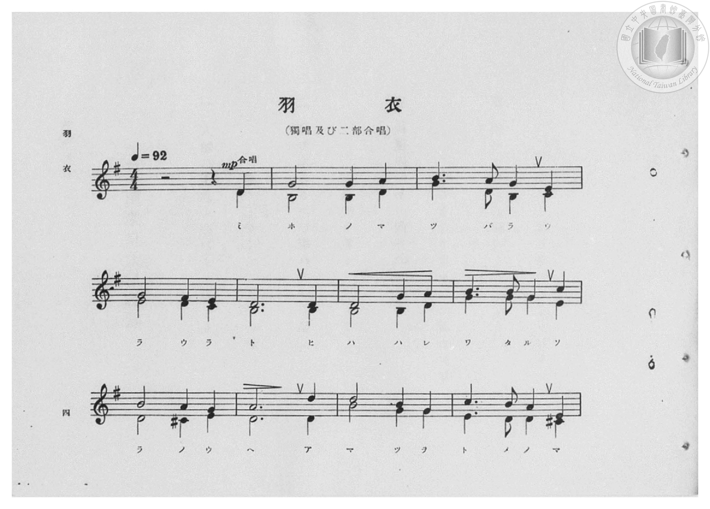
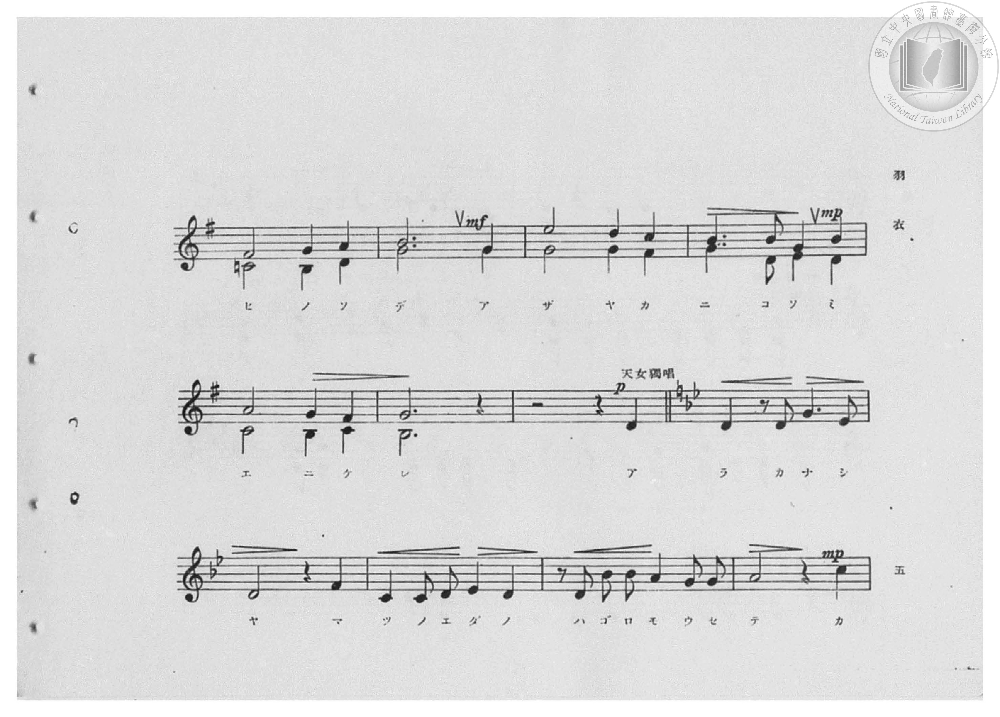
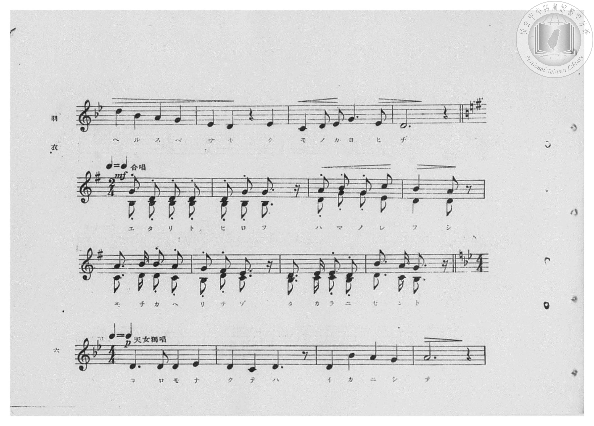
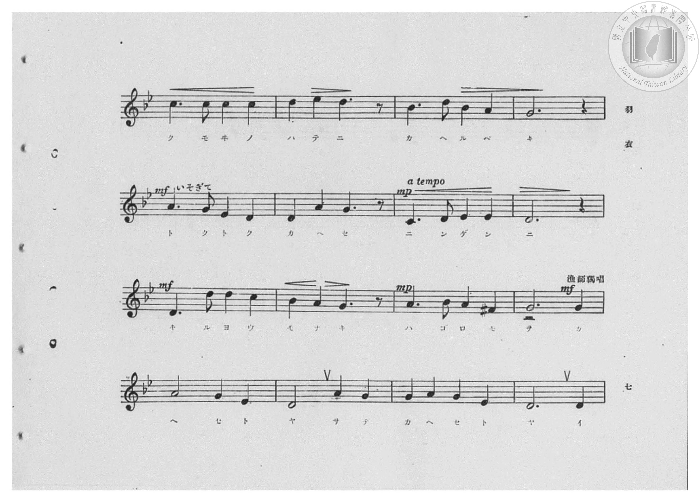
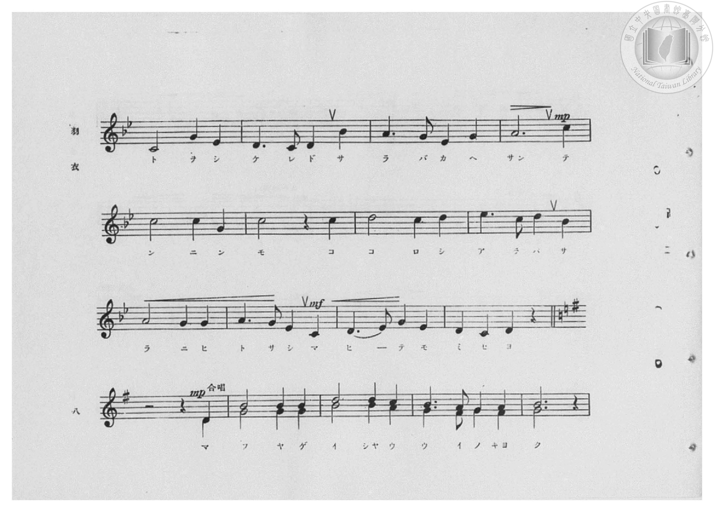
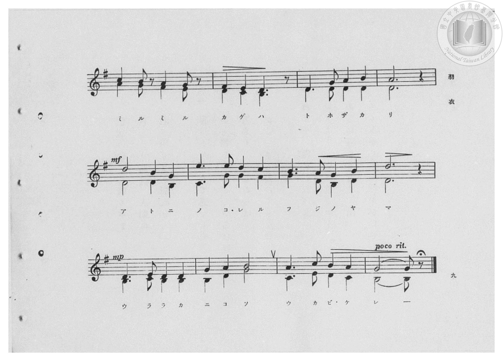
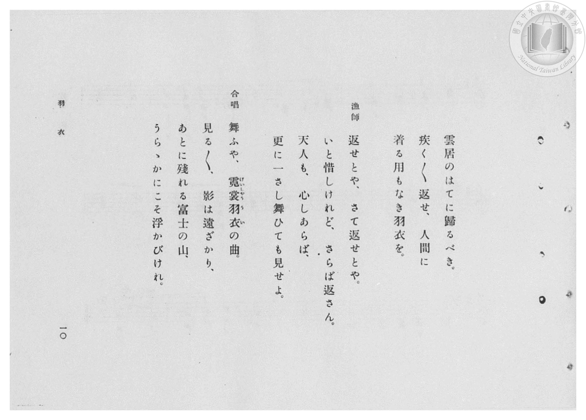
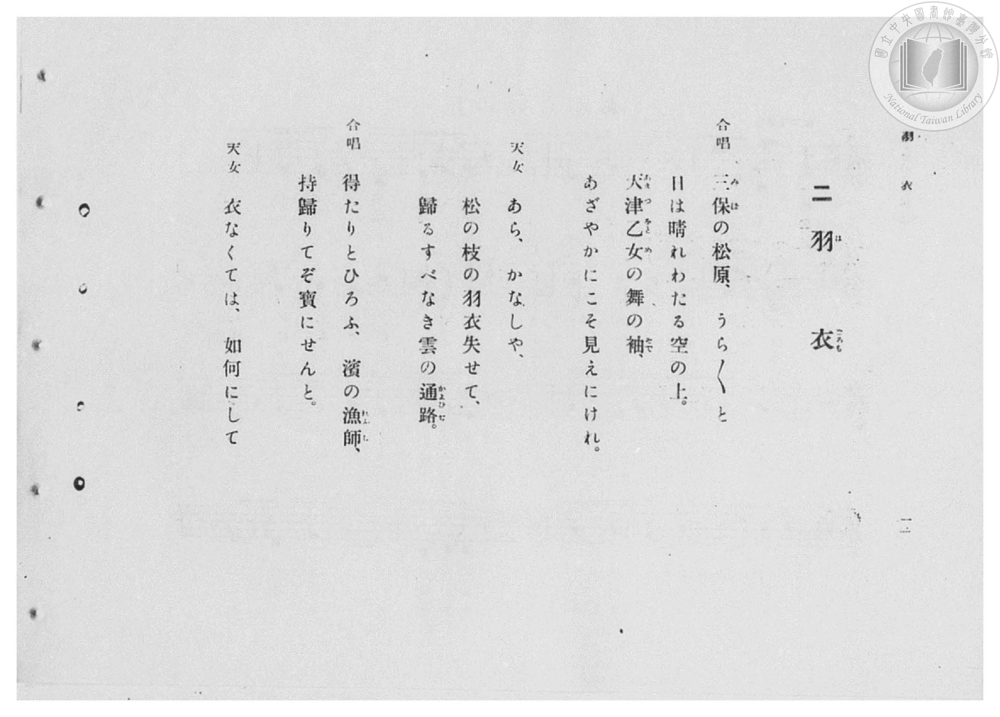

# 羽衣

> Re:Shōka 使用 AI 協助辨識與重建樂譜，可能會有錯誤。歡迎回報。

- **鋼琴伴奏版**：<br><audio controls src="hagoromo.mp3"></audio>
- **NEUTRINO 歌聲合成版**：<br><audio controls src="hagoromo_neutrino.mp3"></audio>

- 臺灣總督府《公學校高等科唱歌》第二學年用（昭和十一年，索書號 0729 74）

## 說明

原書資訊與歌詞全文（對應 P006.jpg–P013.jpg，原書 pp. 4–11，第 2 首）：
調性與拍號：
- 第一段（合唱，P006.jpg–P007.jpg）：ト長調（G 大調）4/4 拍，♩=92（二部合唱）
- 第二段（天女獨唱，P007.jpg–P008.jpg）：轉ト短調（g 小調，2 降記號）4/4 拍
- 第三段（合唱，P008.jpg）：轉回ト長調（G 大調）2/4 拍（二部合唱）
- 第四段（天女獨唱・漁師獨唱，P008.jpg–P010.jpg）：轉ト短調（g 小調）4/4 拍
- 第五段（合唱，P010.jpg–P011.jpg）：轉回ト長調（G 大調）4/4 拍（二部合唱）


## 歌詞

```text
合唱
三保（みほ）の松原、うら〳〵と
日は晴れわたる空の上。
天津乙女（あまつをとめ）の舞の袖（そで）、
あざやかにこそ見えにけれ。

天女
あら、かなしや、
松の枝の羽衣失せて、
歸るすべなき雲の通路（かよひぢ）。

合唱
得たりとひろふ、濱の漁師（れふし）、
持歸りてぞ寶にせんと。

天女
衣なくては、如何にして
雲居のはてに歸るべき。
疾く〳〵返せ、人間に
着る用もなき羽衣を。

漁師
返せとや、さて返せとや。
いと惜しけれど、さらば返さん。
天人も、心しあらば、
更に一さし舞ひても見せよ。

合唱
舞ふや、霓裳羽衣（げいしやううい）の曲。
見る〳〵、影は遠ざかり、
あとに殘れる富士の山、
うらゝかにこそ浮かびけれ。
```

## ABC

<div class="abc-score" data-abc-src="hagoromo.abc" aria-label="五線譜載入中"></div>

[下載 ABC 原始檔](hagoromo.abc)

## TMD 檔案連結

- [主旋律 TMD 檔案](hagoromo.tmd) [[在 TMD Studio 編輯](https://tmdlang.github.io/Tmd-TS/#tmd=s7IKdvYPcrWy4qpTUCpJTLdSSM7PyUlNLsnMz7PKzk9PzM7Ojy_OyM9OVIKrKMvPKc1NBcqW5McbIYSL80uLklOtipMz8vNz4ktSK0qS8vOz0eXjCxLTU60CDAzMEDIFRfllqXmJeUDdBUWZeSWpKWDtCAWpZZkpqSDp4uTEvPiy1KLMtMzUFCQXpRYVgxwMtaKkKDGvOLkoswDkC4Sq_KKSjPz0osSCjEqrjMzikvyizOTEnPjsxDwkz5VkpAL9lpafk52TX5SKLp6XWFKKLAo0Ij0zz6o0D-S-EqirtLQUnu_b-2LhYgUtLS5FWwVLIy57WwV3LhsTfRM7kNYX7bueNy5-vmPv87mLn-6a87ih62nrmqdrdzxbsPDl6hnP13Y-Xz7x6ZSNz9b2PG7ofr5mzZNdPUDZpzu3PJ-y4v2ejmcz1j6d1PO0t_HJjgag4Ps9Pc-3LHo2e8eLmfMVDMyNLBXMTd7v6VTi4tLXUrClFuBSUFB42jcfZM3m9hcrul50tAPd92LlvKetK55Nawc66-mG3mftnQqgqNXLKkh_1DA5wMDQGMQEuhCiVaGgQE_BBChjaAhy9Zo1CkYKL5dNA7r2_Z5ZIBterNr_rGE5yOzuXqB3oKK6CqBA2NHwbN1WkD0TOoCBA9SPYpOBOcQmkEmPmzteTt0ONAuo2l3h6ZLlYGYnMPgVgOYCdT6audLW0ggoCwzZl80rYCZ2Iizb1QO1bMnKp0s3P-9dAbcSbA_ESguElS_2dgJtfT5_LcTWdIWnG_rBzB6gD2f2vlgxA-wdmBuQfNWJ6StUc5_OnofDQ0YwD-H0x9PZszH98bh597M9jU93rEb2FthOSJwZEOEtTI_smoLhEYhJEEMNifQTPJIw_AROgWAeiAUMuCf75wKVPW7c_7hxN1DB48Z1z-buAya0xw2NjxvbHjd1Pm7Y_Lhh6-PGFSANz6Yvfdy4_tnMLY-beh439T9unP-4qfv5yl1AbU92dD1uaAKbv2Tlsy1Ln-ycCQwssNlNjxv3PW5c8rhpEtCYx02NEHtedMwDkYuAKReoZu7jxuUg8YZGkBFgPdMeN7U8bux-3Lj6ceNkoIoXy4BsoFIgdyLIfqBtUOuAFsF0gRwMdDlQ5arHjdNBJkBMBPoK5Ld5QHvWQQqWp0s2Pm6c_bhxGUzF2h1AzzxunPm4cSdYd-_L2ZuAql82zHqxfT3Ykd2Pm4AkUHAR2KlQ--HB-XTfdHCIdIG8CVTW1Pu4cSvQ9Gf7gTatgyQXkDlAtwPFG6cj_PuspxFsPVDnsseN856u3wb25uzHTUCPr8D0KdD5YCcCYwCofj3QlKfLmp7snQrWBXTEMpAioPOfbmwF2gxSAVK3GuZFoP96oZH1fBowXPohkfxi_xSQnQ2NT3btejkNaPNqsIq5DaBIngKMOWCkgMIFEn6g6IQ6DOI1sMMgRoCiGRTyjxuBTlqGKgi29nEjMGpXPGueA3YuODobV0I1AKOwcQNYD5A9GZGogK4COQHo1_3NYG3g2G7cAAvD2VuALgaWcGBLp4OTFzCqlgH1gFMOMDA7MOMMrGwrxLUv50x-sXgzxHfg-AamV6AzwakImBdAqAWaR4ApA-IukNHAIIVkEqDT9gKjev3LxgWg5AtKL8BMgUjRwFSx-tm6GeDM0_10fc_TxcDoWvd040a4InCOawImUkSyf7YVGIFA7mZEsgcqpbwyggIFLX0uroDEohJD54z8otJiq4DMxLx8Q4cag5pqkEUKNhZadmAGtpoQuVKZBQlVBQ0sdQq0PnixsEdHAVZQKQCLKU0sRgIdBLKuRsEAWCrCcHVuQa2CaTyQVaNgCCRBEEQbgUWMwXwjsIgZWBHYCB_DGgUQD4YfN88HK3_cPBtqxOPmPjA5DyreAhWdAMQrQaymZWDToC6C2WwOMg1iEcRRMAh1IVwMuxNNUFwIsQlsL9g2CB8k3oFk8uPmSVDRfrgIiPW4eQ1UfD3UjP1A9moway-y2yEOgDgH5IgaMAvucIi7oTyQWogakFNBfJBatJBFcjckFCFhBeTNQHZ30yKoKCiMIapBofy4eROKLx83L0SNDZi7wWGNLSwhsDo3rRbqVjMkv4CDGKrQGCwPTkEgAWQfgMIU2QfgEAPy2rH5oGkbXPUSsDgolEGqu6HqNkNNgKYzmA9g4QxyBdg3iIQEgqDkjeSmphVwW0DmPm7aCLUFFM8wCImJWiw51whLzsWdlYxhgQtmoOQvIAcsaIKIdaSEDWZApBCGwA3Ca7AhejZFMtZEHUk5tpwFi3qQEdBYh6gCykPcBDYBZjDYhdidgZF8kIsVaN6GhwSYjxRwWI3HFhyQyIVGlFFwfk4-GQUstCE9C7kBCi5m0crWZ3NWIzWqoWUzuMyFNTpJK3MR6QRMGYAoSJCY6cQjRxBItTlQCFxiQIMCFGpgIagRYN3GOiAEKYIMkbIGPF2iFo0ohTe8IAEVO_Hg7Pe4uQus_XHTdrAMKFvCsgdqoQ7K4KCs9bi5AcoDyQFNARaij5u2AOm1QAyyAVSMPW7aDdbZhmweJLvDMjWokAF6Bbk8RfIuyD8QLjRAoKGBNfSwFALgIhRWjO8Es2dCfQPy8eOmtXBXgYp9kDjY7WBfgsIFUoiACjiQXBOSTShFB1KKJFxwgN0IJpEhNUQQvqeeaVAfGuNq1hiaEWzXQLqVyO0aRMba1fN-7zygEtQmDbQ3qWABym_P1zcAu3DP1vcD0wiECzQJ2It93rRLwdBM4em0dU_29uLNjfDSCZxW0AhYEQjyMCQnwaptUCZCru6x1TCgdgIogawCk6A6GFIbgjICiJwK1g1Kp7B2Big7wWpoUF0EUwPJfrCEhVLnGYOdAcshiFYTxMnQDAAUAQuCucjNJLAqpDwBSuEgaxuheRGWSyBeAOXVx037EM4GexCSb6GNOWiFuhtqDrC6hjY-gOqxphfkPAFPL9BoARfz-Akkb8IiC-FTEISXFWgVCrwygxuF4EIMhZoPFEFTAxZD2A7zlgl5VQ9s7AOl6kEb-0DNGEAdwCyBNAgCzUqkVUPwqgcRFrDiFBESUAXwMEYrjpGbt-g5YDM0CcALfXCxCpIBFafQxARtaUMSE6LFB0tGoDSPXElA1CLlAUjb2QRMQ9qjoErDDORKSEMbHJEgLkgA7nr8rUNoKx_o6sfNG8AsSFUGy6UQl0NapBCXg9wMySzQCgVWlYArEawuBydwSPgZotbiYAoWxhAfQOpteGRBlKPEFg6_wFr-QD9BSyBYZYacvaHZFVISQVvaoKzbBOo_gFgQ30NkcPkFlpaQ-wbIqQXJJ9CSC9JKwdJcR7QYkWIFEpKg8IVUvYi-ECJ1wVQhylSQGKTpAYlRiA6Qv2AQpdEBzKQY-c6SiHynichXyF0RjChCZB1YVwurMmg8Y7ZXIA4GRRckOpFbZI-btoLFQckTWwRj6oDoAvEQGQrmBCzugrQ4oYUAzKOwxItZIGBpbCL625A4gOdwcA8MUus9bu6EewbRAwaPFyB5CaRnKyRpwn0C8Tlq0QBJisgdbUgeQRQWMDWQ7jm46AAJwBufyK6HWQctn-A5A1JtwpqLUFFoCQiv7-F-hVWyK8G-gvsVW18WOVRhIQ3OHdCOEKx-h7Z7cRTg6IUCYlAB4g3YsAessNgKdSyifQ_pxD9u3gMv_mBZaT5YByR9gbIlJNViVom4277IkEyRUdNGTSNgGjRFmpI9BAudOELqqiAqAeSaATyDRIUhWFjvAkSDx9TgpRX64BukKY85boea7UGmwjAiY8P7F9DxNuiIIbhSAIs3bX_cvBjMgFa3YBpSb8CG9NY-bl4OlYS0nSAQo6VmDHQSpM4DNQUQfRX0ViZIBayzhSi2Mb0ELX2ATQLQKAOCDa_9oA0YpEYmfCh0NlAWNNiIGGIE9XGwOh3SvIHKwHpbsLFQM0hNARZBjg7UKMPidmg1AKuXIWUxyB2gMIVUI7BOIMyFkMh63LQDFvLgSEMe-MXidkQzHxjWiK4togUCSzKwesYEyY_IrTJwrCG5H5oOwNUYZCAfebAWUv1BBmshpiNSDqgJNxnMwjbwCqplkHqLKDmWtKFX5OFGSE2KnKmQfQgMGowxSfRYg4QPKBRgiRaeYBEdRJRUDOtXYRtsRTYX3t6FORaqAdoYQx7NRbgX0mODCMIH8DFNBo3Iw5tviH4ztHsL7zhDoghqIcx0HIPP0D6vrp0C0tB4tI9hrAJUCDzkhSwA7fEjC4GbBsgC0HiGCSlzAQA)]
- [鋼琴伴奏 TMD 檔案](hagoromo_piano.tmd) [[在 TMD Studio 編輯](https://tmdlang.github.io/Tmd-TS/#tmd=s7IKdvYPcrWy4qpTUCpJTLdSSM7PyUlNLsnMz7PKzk9PzM7Ojy_OyM9OVIKrKMvPKc1NBcqW5McbIYSL80uLklOtipMz8vNz4ktSK0qS8vOz0eXjCxLTU60CDAzMEDIFRfllqXmJeUDdBUWZeSWpKWDtCAWpZZkpqSDp4uTEvPiy1KLMtMzUFCQXpRYVgxxckJmYlx-fWFSUmJeempuah2QEkqBVYmZ8YnJyfm5BYl4mqqr8opKM_PSixIKMSquMzOKS_KLM5MSc-OzEPCT_l2QAjbFKy8_JzskvSkUXz0ssKUUWBRqRnplnVZKYWQ50e35aWmZyZmKOEpeWlsLzfXtfLFz8fk_Hy-49zydsebJny9Ol_c87O97v6VTQ0uJStFWwNOKyt1Vw57Ix0TexAxn5on3X88bFz3fsfT538dNdcx43dD1tXfN07Y5nCxa-XD3j-drO58snPp2y8dnanscN3c_XrHmyqwco-3TnludTVgAtejZj7dNJPU97G5_saAAKvt_T83zLomezd7yYOV_BwNzIUsHcBGi5EhdXQGJRiaFzRn5RabFVAChUDR1qdA1rqrkUgMDGQssOzKhRMFDQhePq3IJaBdN4IKtGwRBIgiCINgKLGIP5RmARM7AisBE-hjUKIB4MP26eD1b-uHk21IjHzX1gch5UvAUqOgGIV4JYTcvApkFdBLPZHGQaxCKIo2AQ6kK4GHYnmqC4EGIT2F6wbRA-SLwDyeTHzZOgov1wERDrcfMaqPh6qBn7gezVYNZeZLdDHABxDsgRNWAW3OEQd0N5ILUQNSCngvggtWghi-RuSChCwgrIm4Hs7qZFUFFQGENUg0L5cfMmFF8-bl6IGhswd4PDGltYQmB1blot1K1mSH4BBzFUoTFYHpyCQALIPgCFKbIPwCEG5LVj80HTNrjqJWBxUCiDVHdD1W2GmgBNZzAfwMIZ5AqwbxAJCQRByRvJTU0r4LaAzH3ctBFqCyieYRASE7VY8pIRaXnJGBa6YAZKBgNywIImNMxQ8IwCZkBsQrgJ7i687jTElu3plKng7jdRR3IXtiIBlmZBboUmV4gqoDzE82AT6J69wGGOPWAhECmDIRe80NIPnlTAfKSURe9MhuoPbCmJuvnMxwM5o5kgZTQQhAZEPCiE4hWiDWPBlGl8LIqACUgBPCVBFcAZyCrJM8oIyIDoRDEdwzAgBQpAIMsEqgSkE8M4LO6AJA6QGFw7zDEwVWZADjg4QMrgkYVkF4ZfDBBBbhScn5NPfCMBUa6BKQMQBUmhZjqQYEBKC-ZAIXAVB00woEQMFoIaAdZtrANCkDrTEKksh5ejqHU5SuEIz5qgjBwPTsqPm7ugyXg7WAaUxGHpDLXQBGUWUBp93NwA5YHkgKYAC6jHTVuA9FogBtkAKhgeN-0G62xDNg-SdeBFFShv6AAJRAMAybsg_0C40ACBhgbW0MOSm8CFEqyI3Almz4T6BuTjx01r4a4CFakgcbDbwb4EhQskN4IKC5BcE5JNKHkQKUHgz4HARAROD-BkFZ8LTeggBlpuACmEpkegJIgFTs9w5SA1YBF0XbA2IYZCkBmwfIZqOh43wDxojNYwNoB50NAM7kN4kQyOETQCVsGAogiSXmGtOVBSRW4FYisQQTUdKBpWgUlQ3QEpv0HJDUROhUYJrM6EJFpYzQIqOmFqIIkcFn0oTSFjsDNg6RDRmIY4GZrMgCJgQTAXufUMVoWU8kDpCGRtIzTFw9IixAugHPG4aR_C2WAPQnIHtEkCLf93Q80BVjDQShNUYGGLFmAbC2e0gKsc_ASSN2GRhfAptDqlb-ygVKHwBgncwQguxOlQXwBF0NSAxRB-HNBIAhUP8FhClA6wGgul7oNmXURthKXqg1RqyCJgvTC7TVBqKrjFiIoKXjkhQhhW4CLCF6oAnj7QCmzkHht6-tgMDRl4tQAueEEyoAIXGsbQdi4kjBHtK1joglIEcjWCKH5hSQQSyWAa0sUCVStmIFdC-o7g5AHiggTgrsff4YG2sYGufty8AcyCVHawNAxxOaT9B3E5yM2QNAStcmCVDbiawepycLxDws8QtZ4HU7AwhvgAUrPDIwuiHCW2cPgF1toG-gmaP2HVHXKqh6ZiSD6FtmtBKboJ1GYHsZBbvLj8AktLyN1d5NSC5BNoqQtpx2DpgSKa-EixAglJUPhCKmdE_wORumCqECUOSAzSOIHEKEQHyF8wiNYsQe4cY4QwIuXDOv9YlUGjCbNBArEPFNqQ2EBucj1u2goWB6UubPGDqQOiC8TD7HVgcRekSQnNwzCPwtIeZn7G0ppEdFYhQQjPoOC-CqRIf9zcCfcMotMI7nAjeQmkZyskZcF9AvE5as6GpCTkoR9IEkfkdZgayIAROOeDBOCtS2TXw6yDFi_whA2pDGDtQagotACDV2Zwv8KqjpVgX8H9ii0BIYcqLKTBiRvaH4Q1LaANWxzlL3qeRvTDId6AjRnA8vpWqGMRDXhIj_dx8x546QXLCfPBOiDpC5SrIKkWsw7BVXsR26IluvmK2vSFsJC0Q7pjqMYhd9gQalDLJuRaEs2JUCOhZSw223E4FVF14_I9stE4O9QYTibkWqLEcIUqLcxEDitUUZS4QjISm3uI9D2kLUKEK6GJ2JSCkX1Y7wREg4dq4UUO-pgupCuAORyMmndBpsIwInfCW8DQESboSBm4ZIfk6O2PmxeDGdAqD0xDCn_YINbax83LoZKQ9guiSEMpU42BToJUXKCARPR10Ft6IBWwzhqi7MX0ErQIAVbLoLEABBtehUEbEUgNPfgQ4GygLGh4DTGoBmp-Y3U6JBtDZWC9NdgQuxmkuAeLIEcHapRhcTu0LIdVrpACFeQOUJhC6gJYNwXmQkhkPW7aAQt5cKSBZGADnljcjmhqA8Ma0TVGNCNgSQZWWZgg-RG5ZQSONST3Q9MBuC6CDGcjD09C6jDI8CTEdETKATWjJoNZ2MYZQVUFUkcGJQ-ROKKPPEgLqQ-RcxWyF4FhgzGSO5hyEaJ-B0UDLNfAcwyi74mSjWCdK2xj8fTNSsi1FlQCPmgDbzoiz14g4gXSPYQIwifA6J-hkPITos-PGMiAjgTARzIgaR7qMZgvcEzqDHy-ImcEHzxagGVYHjbkhzLyjdHIgCpEbY6hV7GEGmxoAxgQJ2AdfYfahTZwgW4arEWJ6kGoK7BMDeAarte1U0CaJIn2AUpChcBjtsgC0HEaZCFw0xdZABpVMCFlLgA)]

## 分析

```text
================================================================================
📊 TMD Song Profile: [ 羽衣 ]
================================================================================
⏱  Duration:       3:28 (208.7s), 80 measures total
🎼 Key & Tempo:    首調基準 G, != 92.0 BPM, <4/4>
   - 分析範圍：      由實際發聲的音符與和弦推測調性；播放脈絡另行呈現
🎤 人聲音域:    C4 (MIDI 60) – E5 (MIDI 76) [跨度: 16 個半音 / 1.3 個八度, 難度: moderate]
   - 最低音:  C4 in [Part2Solo[L1] #1 @ m.21, 0:52]
   - 最高音: E5 in [Part1Chorus[L1] #1 @ m.14, 0:33]
   - 適合: soprano, mezzo-soprano, contralto, tenor, baritone, bass
🏛  結構:      Part1Chorus[L1] (44.3s) -> Part2Solo[L1] (26.1s) -> Part3Chorus[L1] (10.4s) -> Part4Solo[L1] (83.5s) -> Part5Chorus[L1] (44.3s)
⚡ 編曲密度:        Peak 2 軌道同時演奏
🗝  調性診斷：       G 大調（推測轉調經歷 2 次）
   - 風格氣質:    流行大調（略帶和弦色彩音與裝飾副屬和弦）
   - 轉調歷程:    G 大調起奏 ➔ [Part2Solo[L1]] 轉至 D 小調 (-5 半音 / 五度圈 +1 步) ➔ [Part5Chorus[L1]] 轉至 G 大調 (+5 半音 / 五度圈 -1 步)
   - 核心骨幹音:  D, G, B, A, C
   - 調性數值:    G 大調 [相關度: 0.92, 穩定度: High, 自然音純度: 93.1%]
   - 候選調性 (K-S): G 大調 (0.92), D 大調 (0.71), B 小調 (0.61)
   - 五度圈歷程:   +1 -> +2 -> +5 -> +1 -> +1
   - 各段落調性細節:
     • [Part1Chorus[L1] #1]: G 大調 (r: 0.94, 自然音純度: 98.4%, 調外音: C#)
     • [Part2Solo[L1] #1]: D 小調 (r: 0.66, 自然音純度: 85.9%, 調外音: D#)
     • [Part3Chorus[L1] #1]: B 調性不明確 (r: 0.80, 自然音純度: 88.1%, 調外音: C)
     • [Part4Solo[L1] #1]: G 調性不明確 (r: 0.64, 自然音純度: 83.5%, 調外音: D#, A#)
     • [Part5Chorus[L1] #1]: G 大調 (r: 0.90, 自然音純度: 100.0%)

  [ 五度圈游移軌跡 ]
               C  
         F           [G ]*
      Bb              [D ]*
      Eb               A  
         Ab           E  
            Db      [B ]*
               F# 
     (* = active key center)

  [ 十二半音累積音高分佈 ]
     C  : ███████████               11.4%
     C# :                            0.5%
     D  : ████████████████████████  26.0%
     D# : ████                       4.1%
     E  : ████                       4.8%
     F  :                            0.2%
     F# : ██                         2.2%
     G  : ███████████████████       20.8%
     G# :                            0.0%
     A  : ███████████               11.8%
     A# : ██                         2.1%
     B  : ███████████████           16.2%
--------------------------------------------------------------------------------
Assignment 軌道音域：
  - Piano1        : C4 – E5 (16 個半音 / 1.3 個八度, 257 個音符)
  - Piano2        : B3 – B4 (12 個半音 / 1.0 個八度, 124 個音符)
================================================================================
```


## 原書掃描頁


















