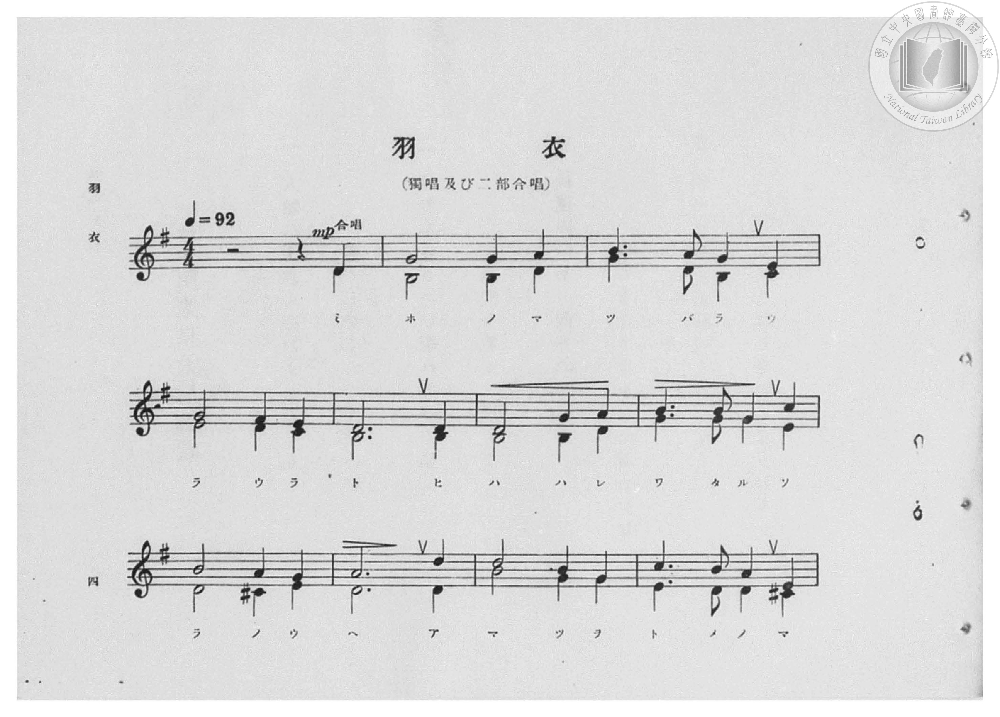
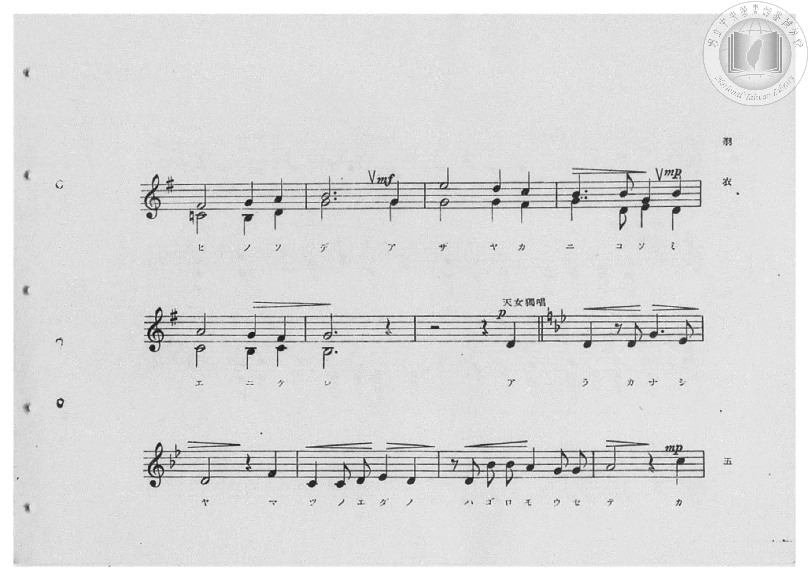
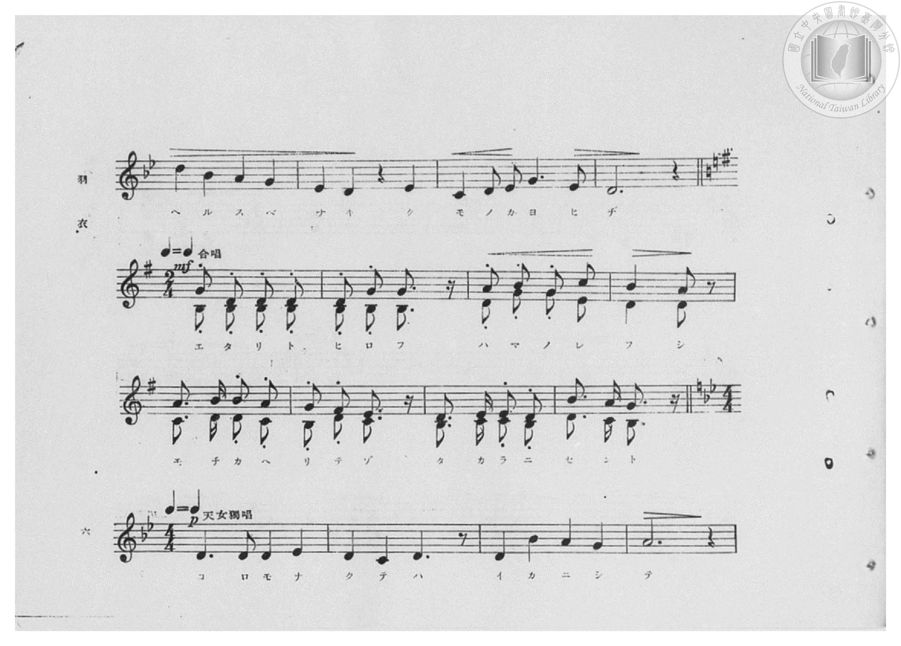
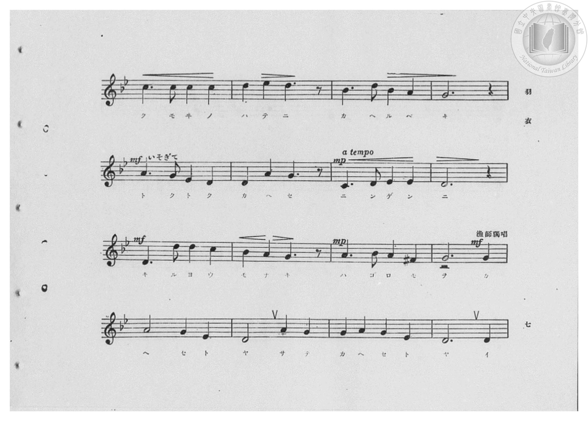
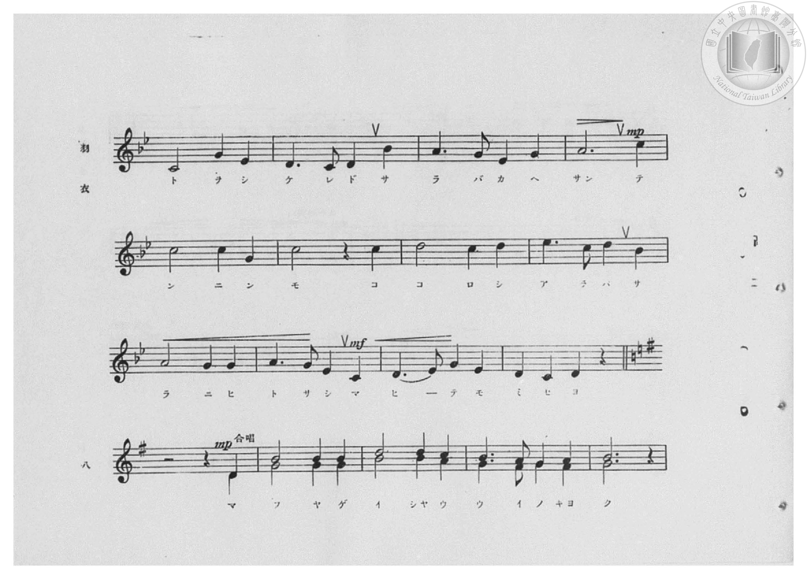
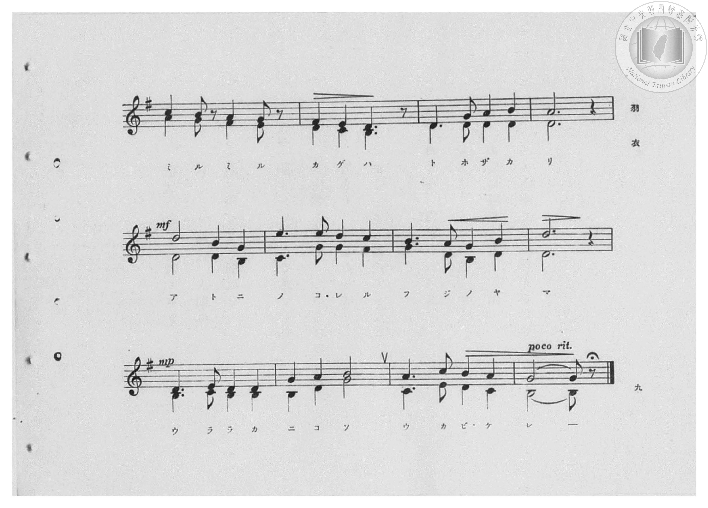
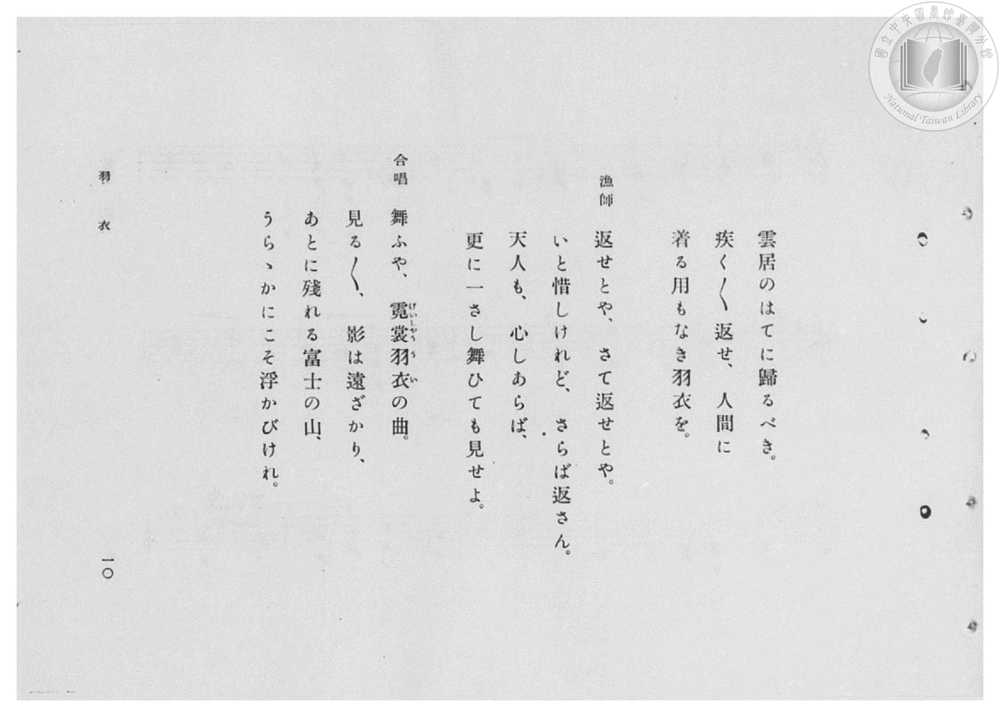
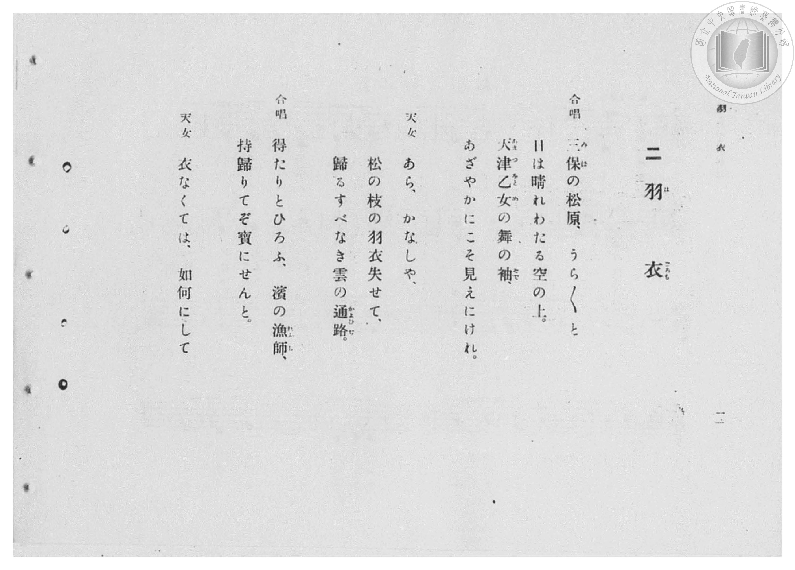

# 羽衣

> Re:Shōka 使用 AI 協助辨識與重建樂譜，可能會有錯誤。歡迎回報。

- **鋼琴伴奏版**：<br><audio controls src="hagoromo.mp3"></audio>

- 臺灣總督府《公學校高等科唱歌》第二學年用（昭和十一年，索書號 0729 74）

## 說明

原書資訊與歌詞全文（對應 P006.jpg–P013.jpg，原書 pp. 4–11，第 2 首）：
調性與拍號：
- 第一段（合唱，P006.jpg–P007.jpg）：ト長調（G 大調）4/4 拍，♩=92（二部合唱）
- 第二段（天女獨唱，P007.jpg–P008.jpg）：轉ト短調（g 小調，2 降記號）4/4 拍
- 第三段（合唱，P008.jpg）：轉回ト長調（G 大調）2/4 拍（二部合唱）
- 第四段（天女獨唱・漁師獨唱，P008.jpg–P010.jpg）：轉ト短調（g 小調）4/4 拍
- 第五段（合唱，P010.jpg–P011.jpg）：轉回ト長調（G 大調）4/4 拍（二部合唱）


## 歌詞

```text
合唱
三保（みほ）の松原、うら〳〵と
日は晴れわたる空の上。
天津乙女（あまつをとめ）の舞の袖（そで）、
あざやかにこそ見えにけれ。

天女
あら、かなしや、
松の枝の羽衣失せて、
歸るすべなき雲の通路（かよひぢ）。

合唱
得たりとひろふ、濱の漁師（れふし）、
持歸りてぞ寶にせんと。

天女
衣なくては、如何にして
雲居のはてに歸るべき。
疾く〳〵返せ、人間に
着る用もなき羽衣を。

漁師
返せとや、さて返せとや。
いと惜しけれど、さらば返さん。
天人も、心しあらば、
更に一さし舞ひても見せよ。

合唱
舞ふや、霓裳羽衣（げいしやううい）の曲。
見る〳〵、影は遠ざかり、
あとに殘れる富士の山、
うらゝかにこそ浮かびけれ。
```

## ABC

<div class="abc-score" data-abc-src="hagoromo.abc" aria-label="五線譜載入中"></div>

[下載 ABC 原始檔](hagoromo.abc)

## TMD 檔案連結

- [主旋律 TMD 檔案](hagoromo.tmd) [[在 TMD Studio 編輯](https://tmdlang.github.io/Tmd-TS/#tmd=s7IKdvYPcrWy4qpTUCpJTLdSSM7PyUlNLsnMz7PKzk9PzM7Ojy_OyM9OVIKrKMvPKc1NBcqW5McbIYSL80uLklOtipMz8vNz4ktSK0qS8vOz0eXjCxLTU60CDAzMEDIFRfllqXmJeUDdBUWZeSWpKWDtCAWpZZkpqSDp4uTEvPiy1KLMtMzUFCQXpRYVgxwMtaKkKDGvOLkoswDkC4Sq_KKSjPz0osSCjEqrjMzikvyizOTEnPjsxDwkz5VkpAL9lpafk52TX5SKLp6XWFKKLAo0Ij0zz6okMbMc6LD8tLTM5MzEHCUuLS2F5_v2vli4WEFLi0vRVsHSiMveVsGdy8ZE38QOpPtF-67njYuf79j7fO7ip7vmPG7oetq65unaHc8WLHy5esbztZ3Pl098OmXjs7U9jxu6n69Z82RXD1D26c4tz6eseL-n49mMtU8n9TztbXyyowEo-H5Pz_Mti57N3vFi5nwFA3MjSwVzk_d7OpW4uPS1FGypBbgUFBSe9s0HWbO5_cWKrhcd7UD3vVg572nrimfT2oHOerqh91l7pwIodvWyCtIfNUwOMDA0BjGBLoRoVSgo0FMwAcoYGoJcvWaNgpHCy2XTgK59v2cWyIYXq_Y_a1gOMru7F-gdqKiuAigQdjQ8W7cVZM-EDmDgAPWj2GRgDrEJZNLj5o6XU7cDzQKqdld4umQ5mNkJDH4FoLlAnY9mrrS1NALKAkP2ZfMKmImdCMt29UAtW7Ly6dLNz3tXwK0E2wOx0gJh5Yu9nUBbn89fC7E1XeHphn4wswfow5m9L1bMAHsH5gYkX3Vi-grV3Kez5-HwkBHMQzj98XT2bEx_PG7e_WxP49Mdq5G9BbYTEmcGRHgL0yO7pmB4BGISxFBDIv0EjyQMP4FTIJgHYgED7sn-uUBljxv3P27cDVTwuHHds7n7gAntcUPj48a2x02djxs2P27Y-rhxBUjDs-lLHzeufzZzy-OmnsdN_Y8b5z9u6n6-chdQ25MdXY8bmsDmL1n5bMvSJztnAgMLbHbT48Z9jxuXPG6aBDTmcVMjxJ4XHfNA5CJgygWqmfu4cTlIvKERZARYz7THTS2PG7sfN65-3DgZqOLFMiAbqBTInQiyH2gb1DqgRTBdIAcDXQ5Uuepx43SQCRATgb4C-W0e0J51kILl6ZKNjxtnP25cBlOxdgfQM48bZz5u3AnW3fty9iag6pcNs15sXw92ZPfjJiAJFFwEdirUfnhwPt03HRwiXSBvApU19T5u3Ao0_dl-oE3rIMkFZA7Q7UDxxukI_z7raQRbD9S57HHjvKfrt4G9OftxE9DjKzB9CnQ-2InAGACqXw805emypid7p4J1AR2xDKQI6PynG1uBNoNUgNSthnkR6L9eaGQ9nwYMl35IJL_YPwVkZ0Pjk127Xk4D2rwarGJuAyiSpwBjDhgpoHCBhB8oOqEOg3gN7DCIEaBoBoX840agk5ahCoKtfdwIjNoVz5rngJ0Ljs7GlVANwChs3ADWA2RPRiQqoKtATgD6dX8zWBs4ths3wMJw9hagi4ElHNjS6eDkBYyqZUA94JQDDMwOzDgDK9sKce3LOZNfLN4M8R04voHpFehMcCoC5gUQaoHmEWDKgLgLZDQwSCGZBOi0vcCoXv-ycQEo-YLSCzBTIFI0MFWsfrZuBjjzdD9d3_N0MTC61j3duBGuCJzjmoCJFJHsn20FRiCQuxmR7IFKKa-MoEBBS5-LKyCxqMTQOSO_qLTYKiAzMS_f0KHGoKYaZJGCjYWWHZiBrSZErlRmQUJVQQNLnQKtD14s7NFRgBVUCsBiShOLkUAHgayrUTAAloowXJ1bUKtgGg9k1SgYAkkQBNFGYBFjMN8ILGIGVgQ2wsewRgHEg-HHzfPByh83z4Ya8bi5D0zOg4q3QEUnAPFKEKtpGdg0qItgNpuDTINYBHEUDEJdCBfD7kQTFBdCbALbC7YNwgeJdyCZ_Lh5ElS0Hy4CYj1uXgMVXw81Yz-QvRrM2ovsdogDIM4BOaIGzII7HOJuKA-kFqIG5FQQH6QWLWSR3A0JRUhYAXkzkN3dtAgqCgpjiGpQKD9u3oTiy8fNC1FjA-ZucFhjC0sIrM5Nq4W61QzJL-Aghio0BsuDUxBIANkHoDBF9gE4xIC8dmw-aNoGV70ELA4KZZDqbqi6zVAToOkM5gNYOINcAfYNIiGBICh5I7mpaQXcFpC5j5s2Qm0BxTMMQmKiFkvONcKSc3FnJWNY4IIZKPkLyAELmiBiHSlhgxkQKYQhcIPwGmyInk2RjDVRR1KOLWfBoh5kBDTWIaqA8hA3gU2AGQx2IXZnYCQf5GIFmrfhIQHmIwUcVuOxBQckcqERZRScn5NPRgELbUjPQm6AgotZtLL12ZzVSI1qaNkMLnNhjU7SylxEOgFTBiAKEiRmOvHIEQRSbQ4UApcY0KAAhRpYCGoEWLexDghBiiBDpKwBT5eoRSNK4Q0vSEDFTjw4-z1u7gJrf9y0HSwDypaw7IFaqIMyOChrPW5ugPJAckBTgIXo46YtQHotEINsABVjj5t2g3W2IZsHye6wTA0qZIBeQS5PkbwL8g-ECw0QaGhgDT0shQC4CIUV4zvB7JlQ34B8_LhpLdxVoGIfJA52O9iXoHCBFCKgAg4k14RkE0rRgZQiCRccYDeCSWRIDRGE76lnGtSHxriaNYZmBNs1kG4lcrsGkbF29bzfOw-oBLVJA-1NKliA8tvz9Q3ALtyz9f3ANALhAk0C9mKfN-1SMDRTeDpt3ZO9vXhzI7x0AqcVNAJWBII8DMlJsGoblImQq3tsNQyonQBKIKvAJKgOhtSGoIwAIqeCdYPSKaydAcpOsBoaVBfB1ECyHyxhodR5xmBnwHIIotUEcTI0AwBFwIJgLnIzCawKKU-AUjjI2kZoXoTlEogXQHn1cdM-hLPBHoTkW2hjDlqh7oaaA6yuoY0PoHqs6QU5T8DTCzRawMU8fgLJm7DIQvgUBOFlBVqFAq_M4EYhuBBDoeYDRdDUgMUQtsO8ZUJe1QMb-0CpetDGPlAzBlAHMEsgDYJAsxJp1RC86kGEBaw4RYQEVAE8jNGKY-TmLXoO2AxNAvBCH1ysgmRAxSk0MUFb2pDEhGjxwZIRKM0jVxIQtUh5ANJ2NgHTkPYoqNIwA7kS0tAGRySICxKAux5_6xDayge6-nHzBjALUpXBcinE5ZAWKcTlIDdDMgu0QoFVJeBKBKvLwQkcEn6GqLU4mIKFMcQHkHobHlkQ5SixhcMvsJY_0E_QEghWmSFnb2h2hZRE0JY2KOs2gfoPIBbE9xAZXH6BpSXkvgFyakHyCbTkgrRSsDTXES1GpFiBhCQofCFVL6IvhEhdMFWIMhUkBml6QGIUogPkLxhEaXQAMylGvrMkIt9pIvIVclcEI4oQWQfW1cKqDBrPmO0ViINB0QWJTuQW2eOmrWBxUPLEFsGYOiC6QDxEhoI5AYu7IC1OaCEA8ygs8WIWCFgam4j-NiQO4Dkc3AOD1HqPmzvhnkH0gMHjBUheAunZCkmacJ9AfI5aNECSInJHG5JHEIUFTA2kew4uOkAC8MYnsuth1kHLJ3jOgFSbsOYiVBRaAsLre7hfYZXsSrCv4H7F1pdFDlVYSINzB7QjBKvfoe1eHAU4eqGAGFSAeAM27AErLLZCHYto30M68Y-b98CLP1hWmg_WAUlfoGwJSbWYVSLuti8yJFNk1LRR0wiYBk2RpmQPwUInjpC6KohKALlmAM8gUWEIFta7ANHgMTV4aYU--AZpymOO26Fme5CpMIzI2PD-BXS8DTpiCK4UwOJN2x83LwYzoNUtmIbUG7AhvbWPm5dDJSFtJwjEaKkZA50EqfNATQFEXwW9lQlSAetsIYptTC9BSx9gkwA0yoBgw2s_aAMGqZEJHwqdDZQFDTYihhhBfRysToc0b6AysN4WbCzUDFJTgEWQowM1yrC4HVoNwOplSFkMcgcoTCHVCKwTCHMhJLIeN-2AhTw40pAHfrG4HdHMB4Y1omuLaIHAkgysnjFB8iNyqwwca0juh6YDcDUGGchHHqyFVH-QwVqI6YiUA2rCTQazsA28gmoZpN4iSo4lbegVebgRUpMiZypkHwKDBmNMEj3WIOEDCgVYooUnWEQHESUVw_pV2AZbkc2Ft3dhjoVqgDbGkEdzEe6F9NgggvABfEyTQSPy8OYbot8M7d7CO86QKIJaCDMdx-AztM-ra6eANDQe7WMYqwAVAg95IQtAe_zIQuCmAbIANJ5hQspcAA)]
- [鋼琴伴奏 TMD 檔案](hagoromo_piano.tmd) [[在 TMD Studio 編輯](https://tmdlang.github.io/Tmd-TS/#tmd=s7IKdvYPcrWy4qpTUCpJTLdSSM7PyUlNLsnMz7PKzk9PzM7Ojy_OyM9OVIKrKMvPKc1NBcqW5McbIYSL80uLklOtipMz8vNz4ktSK0qS8vOz0eXjCxLTU60CDAzMEDIFRfllqXmJeUDdBUWZeSWpKWDtCAWpZZkpqSDp4uTEvPiy1KLMtMzUFCQXpRYVgxxckJmYlx-fWFSUmJeempuah2QEkqBVYmZ8YnJyfm5BYl4mqqr8opKM_PSixIKMSquMzOKS_KLM5MSc-OzEPCT_l2QAjbFKy8_JzskvSkUXz0ssKUUWBRqRnplnVZKYWQ50e35aWmZyZmKOEpeWlsLzfXtfLFz8fk_Hy-49zydsebJny9Ol_c87O97v6VTQ0uJStFWwNOKyt1Vw57Ix0TexAxn5on3X88bFz3fsfT538dNdcx43dD1tXfN07Y5nCxa-XD3j-drO58snPp2y8dnanscN3c_XrHmyqwco-3TnludTVgAtejZj7dNJPU97G5_saAAKvt_T83zLomezd7yYOV_BwNzIUsHcBGi5EhdXQGJRiaFzRn5RabFVAChUDR1qDGqquRSAwMZCyw7MqFEwUNCF4-rcgloF03ggq0bBEEiCIIg2AosYg_lGYBEzsCKwET6GNQogHgw_bp4PVv64eTbUiMfNfWByHlS8BSo6AYhXglhNy8CmQV0Es9kcZBrEIoijYBDqQrgYdieaoLgQYhPYXrBtED5IvAPJ5MfNk6Ci_XAREOtx8xqo-HqoGfuB7NVg1l5kt0McAHEOyBE1YBbc4RB3Q3kgtRA1IKeC-CC1aCGL5G5IKELCCsibgezupkVQUVAYQ1SDQvlx8yYUXz5uXogaGzB3g8MaW1hCYHVuWi3UrWZIfgEHMVShMVgenIJAAsg-AIUpsg_AIQbktWPzQdM2uOolYHFQKINUd0PVbYaaAE1nMB_AwhnkCrBvEAkJBEHJG8lNTSvgtoDMfdy0EWoLKJ5hEBITtViykhFJWckYFrhgBkr-AnLAgiaIWEdK2GAGRAphCNwgvAYbomdTJGNN1JGUY8tZsKgHGQGNdYgqoDzETWATYAaDXYjdGRjJB7lYgeZteEiA-UgBh9V4bMEBiVxsEeXjgRRTJkgxBYJQq-JBbohXiDaMBVOm8bEoAiYgBfAghCqAM5BVkmeUEZAB0YliOoZhQAoUFkCWCVQJSCeGcVjcAQl-kBhcO8wxMFVmQA44OEDK4OGOZBeGXwwQIW4UnJ-TT3Qdg8gXYMoAREGSgJkOJBSQYtUcKAQuIaFRD0olYCGoEWDdxjogBClyDZGKAng-RK0KUCoreMEJKmbjwcXN4-YusPbHTdvBMqBiCFYcoFZioAINVJQ8bm6A8kByQFOAlcbjpi1Aei0Qg2wAFduPm3aDdbYhmwcp3mCFGKhQBXoFuf5A8i7IPxAuNECgoYE19LAUeuAqA1Zt7QSzZ0J9A_Lx46a1cFeBqjmQONjtYF-CwgVSaIIKdJBcE5JNKEUlUnogXFCC3QgmkSE1RBC-p55pmD7EW8IAMwk4wYOzTXwuNCODGGi5HaQQmt-AkiAWOL_ClYPUgEXQdcHaTBgKQWbAyhFU0_G4AeY_Y1ztRkMzuA_hhTo4yaERsJoDFG6QDAlr7YDyInIrCVvFDGpegdLZKjAJarpAGhGg_AQip4J1g3wJa56BciWsYQOqwmFqILkYlj5RmgrGYGfAMhqisQlxMjQfAUXAgmAucusSrAopa4EyCsjaRmiWhmU2iBdAWf5x0z6Es8EehGR_aBsY2g7ZDTUH2MqBttlABTK2aEHOWujRAq4d8RNI3oRFFsKnIAgvctDqYXgbAG4UggsxFGo-UARNDVgMYTtWb-HIT7A6DKU2hCZ2RP2EpTKEVHPIImC9MLtNCNVd8PoK4XNYGYzwN1QBPETRynDkPgB6et8MjXB4TQEui0EyoDIYmnSg3RFI0kE0i2GJBpTCkWsWiFqkFA_pYJiAaUijHVTTmIFcCemNgKMNxAUJwF2PvwkN7QoBXf24eQOYBan_YHkS4nJIsx3icpCbIVkDWgvB6h9wzYPV5eB4h4SfIWrVD6ZgYQzxAaSyh0cWRDlKbOHwC6x7BPQTtLyB1YDImRmaOSHlDrQ7AsqoTaBOFogF8T1EBpdfYGkJuQOFnFqQfAItpyBNGyx9GkSzGilWICEJCl9IfY3oMCJSF0wVogQFiUHaK5AYhegA-QsG0VoqyN0tjBBGpHxYdxKrMmg0YbZRIPaBQhsSG8itsMdNW8HioNSFLX4wdUB0gXiI_ABzAhZ3QVqZ0DwM8ygs7WHmZywNTMSYAiQI4RkU3MuEVFGPmzvhnkH08sFjIkheAunZCklZcJ9AfI6asyEpCXkwAZLEEXkdpgYyBAHO-SABeIMT2fUw66DFCzxhQ-o4WBMRKgotwOCVM9yvsBpxJdhXcL9iS0DIoQoLaXDihnb2YJUxtK2Lo_xFz9OIgROIN2BDO7C8vhXqWESbHjJQ8bh5D7z0guWE-WAdkPQFylWQVItZh-Bu7yJDMkVGTRs1jYBpmCkSV3uK2F4J0V0Q1O4LhIWkHTJkgGoc8qACQg1qbYncbkNzItRIaK2PzXYcTkU0JnH5HtlonIM-GE4m5FqixHCFKi3MRA4rVFGUuEIyEpt7iPQ9pHVMhCuhidiU_MkLWAcTRINHo-F1IPqwNaQ3hznijVqZgEyFYUR1Ae9iQkeqoWPt4KYGWLxp--PmxWAGtA0GpiGtEdhg-NrHzcuhkpAGNQRiNN-NgU6CtKRA4YjorqJ3PUAqYP1tRGMA00vQOg3YTgSNVyHY8DYVtFWL1POATyLMBsqChukRg_Ogbi5Wp0NyMVQG1uGGzSKYQdofYBHk6ECNMixuhzYuYK09SA0PcgcoTCGNE9g4AMyFkMh63LQDFvLgSEOeMsHidkTfDxjWiNENRLsWlmRgrRcTJD8iN9XBsYbkfmg6ADeOIFNgyNMckEYVZJoDYjoi5YDa9ZPBLGxTFqC2C9KAAUoWIm3SAnmgHtI-Q85UyD4EBg3GaD56rEHCBxQKsEQLT7CIMQKUVAzrbGObpkA2F94JgjkWqgHaxEeeB0G4F9KNhwjCp74wTQbNZcE7BYihE-gIB3zsBBJFUAthpuOYtsFVvpExUQEeAsEy-wAb-UMZ4Meop6AKUWt09FKaUJ2PNioDcQLWSQaoXWijMeimwRolqB6EugLLDAiuWQldOwWkqaBoH6AkVAg8cossAB18QhYCt56QBaAxBRNS5gIA)]

## 分析

```text
================================================================================
📊 TMD Song Profile: [ 羽衣 ]
================================================================================
⏱  Duration:       3:28 (208.7s), 80 measures total
🎼 Key & Tempo:    首調基準 G, != 92.0 BPM, <4/4>
   - 分析範圍：      由實際發聲的音符與和弦推測調性；播放脈絡另行呈現
🎤 人聲音域:    C4 (MIDI 60) – E5 (MIDI 76) [跨度: 16 個半音 / 1.3 個八度, 難度: moderate]
   - 最低音:  C4 in [Part2Solo[L1] #1 @ m.21, 0:52]
   - 最高音: E5 in [Part1Chorus[L1] #1 @ m.14, 0:33]
   - 適合: soprano, mezzo-soprano, contralto, tenor, baritone, bass
🏛  結構:      Part1Chorus[L1] (44.3s) -> Part2Solo[L1] (26.1s) -> Part3Chorus[L1] (10.4s) -> Part4Solo[L1] (83.5s) -> Part5Chorus[L1] (44.3s)
⚡ 編曲密度:        Peak 2 軌道同時演奏
🗝  調性診斷：       G 大調（推測轉調經歷 2 次）
   - 風格氣質:    流行大調（略帶和弦色彩音與裝飾副屬和弦）
   - 轉調歷程:    G 大調起奏 ➔ [Part2Solo[L1]] 轉至 D 小調 (-5 半音 / 五度圈 +1 步) ➔ [Part5Chorus[L1]] 轉至 G 大調 (+5 半音 / 五度圈 -1 步)
   - 核心骨幹音:  D, G, B, A, C
   - 調性數值:    G 大調 [相關度: 0.92, 穩定度: High, 自然音純度: 93.1%]
   - 候選調性 (K-S): G 大調 (0.92), D 大調 (0.71), B 小調 (0.61)
   - 五度圈歷程:   +1 -> +2 -> +5 -> +1 -> +1
   - 各段落調性細節:
     • [Part1Chorus[L1] #1]: G 大調 (r: 0.94, 自然音純度: 98.4%, 調外音: C#)
     • [Part2Solo[L1] #1]: D 小調 (r: 0.66, 自然音純度: 85.9%, 調外音: D#)
     • [Part3Chorus[L1] #1]: B 調性不明確 (r: 0.80, 自然音純度: 88.1%, 調外音: C)
     • [Part4Solo[L1] #1]: G 調性不明確 (r: 0.64, 自然音純度: 83.5%, 調外音: D#, A#)
     • [Part5Chorus[L1] #1]: G 大調 (r: 0.90, 自然音純度: 100.0%)

  [ 五度圈游移軌跡 ]
               C  
         F           [G ]*
      Bb              [D ]*
      Eb               A  
         Ab           E  
            Db      [B ]*
               F# 
     (* = active key center)

  [ 十二半音累積音高分佈 ]
     C  : ███████████               11.4%
     C# :                            0.5%
     D  : ████████████████████████  26.0%
     D# : ████                       4.1%
     E  : ████                       4.8%
     F  :                            0.2%
     F# : ██                         2.2%
     G  : ███████████████████       20.8%
     G# :                            0.0%
     A  : ███████████               11.8%
     A# : ██                         2.1%
     B  : ███████████████           16.2%
--------------------------------------------------------------------------------
Assignment 軌道音域：
  - Piano1        : C4 – E5 (16 個半音 / 1.3 個八度, 257 個音符)
  - Piano2        : B3 – B4 (12 個半音 / 1.0 個八度, 124 個音符)
================================================================================
```


## 原書掃描頁


















