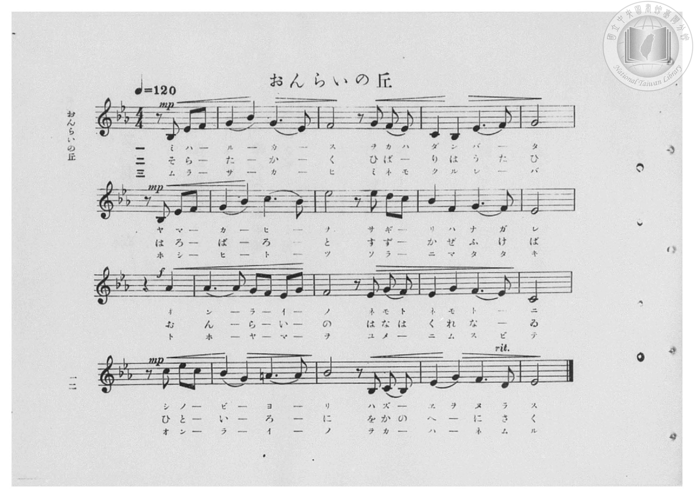
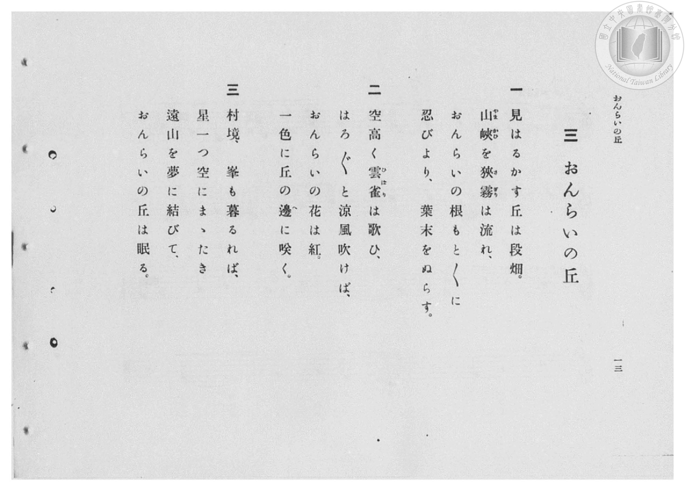

# おんらいの丘

> Re:Shōka 使用 AI 協助辨識與重建樂譜，可能會有錯誤。歡迎[回報](https://github.com/TMDLang/reshoka/issues)。

- **鋼琴伴奏版**：<br><audio controls src="onrai_no_oka.mp3"></audio>
- **NEUTRINO 歌聲合成版**：<br><audio controls src="onrai_no_oka_neutrino.mp3"></audio>

- 臺灣總督府《公學校高等科唱歌》第二學年用（昭和十一年，索書號 0729 74）

## 說明

原書資訊與歌詞全文（對應 P014.jpg–P015.jpg，原書 pp. 12–13，第 3 首）：
調性與拍號：變ホ長調（E♭ 大調，3 降記號）4/4 拍，速度 ♩=120


## 歌詞

```text
一
見はるかす丘は段畑。
山峽（やまかひ）を狹霧（さぎり）は流れ、
おんらいの根もと〳〵に
忍びより、葉末をぬらす。

二
空高く雲雀（ひばり）は歌ひ、
はろ〳〵と涼風吹けば、
おんらいの花は紅。
一色に丘の邊（へ）に咲く。

三
村境、峯も暮るれば、
星一つ空にまゝたき
遠山を夢に結びて、
おんらいの丘は眠る。
```

## ABC

<div class="abc-score" data-abc-src="onrai_no_oka.abc" aria-label="五線譜載入中"></div>

[下載 ABC 原始檔](onrai_no_oka.abc)

## TMD 檔案連結

- [主旋律 TMD 檔案](onrai_no_oka.tmd) [[在 TMD Studio 編輯](https://tmdlang.github.io/Tmd-TS/#tmd=s7IKdvYPcrWy4qpTUCpJTLdSSM7PyUlNLsnMz7PKzk9PzM7Ojy_OyM9OVIKrKMvPKc1NBcqW5McbIYSL80uLklOtipMz8vNz4ktSK0qS8vOz0eXjCxLTU60CDAxNEDIFRfllqXmJeUDdBUWZeSWpKWDtCAWpZZkpqSDp4uTEvPiy1KLMtMzUFCQXpRYVgxwMtaKkKDGvOLkoswDkC4Sq_KKSjPz0osSCjEqrjMzikvyizOTEnPjsxDwkz5VkpAL9lpdYUlqUii5akJOYjCQI1J-emWdVmgdyXAnUSVpaCo8bux43TX7c1Pm4seVx47onO2YoaGlxKdoqGBoZcNnbKrjqcNmY6JvYgQx60b7reePi5zv2Pp-7-OmuOY8bup62rnm6dsezBQtfrp7xfG3n8-UTn07Z-Gxtz-OG7udr1jzZ1QOUfbpzy_MpK97v6Xg2Y-3TST1Pexuf7GgACr7f0_N8y6Jns3e8mDlfwcDcyFLB3OT9nk4lLi59LQVbagEuBQWFp33zQdZsbn-xoutFRzvQfS9WznvauuLZtHags55u6H3W3qkAimW9rIL0Rw2TgUxTEBPoQohWhYICPWCAAKUMjUHOXrNGwVjh5bJpQOe-3zMLZMWLVfufNSwHGd7dC_QPUPTFuq7HzbNfTt0OlALa4vpo5lqFp0uWg3k9QN0ze1-smAFW2gkMXwWgPqD4y4b5T3ctU3g0c6UtKPxBJgMDC2zBsu7HjesfNwFJIJoJjCcg99m6rc-nTnzc0AT25caNTzfvBVr1uAkYk_vA6jYBTX_cNOl5986Xc5aDpBqnPm7se9zUBRIH6t_a-LgJGFmNIP1oKeHZgp2Pm5oeN6543LD5ccPWx42rwZbs733cuPlxE9CSLqC-FxM7n81ZDbThceMasM6ZIMeAnb2rB0Q9X7kLmDQeN_a_nL3p5ewGsBM2PW7cgHACMLEARWBOAPqwF2bhimfb9rxctOLphJ2PGyeC9GB154uujUBtz7e0QoMBGF4vOoFWrAYH0bqXIIuAlu4AW7f66SSgVD_ckTs6QdSzuROfLmoGGv90M9D-pmez1oHCGRgwcDufzZgPNPdx4xKgf4CmgIK3ae7jxvmPG3tB0i8bFwBDHxgMT5csAko_3zoBFEiNy7C7GBJ3z-csANkCcTTl6RwKFLT0ubj884oSM_3y_bMTrQIyE_PyHWoMaqpB1ijYWGjZgRnYspgCKMsCQ29hj4KGicLTDf3P1zfowPMFQlYTi1agtSBjaxQMFKpzC2oVTOMVDBWMgLnEFIh1geJGQL4uEBoA-SB2jYJZPJALVKcLlTECioHUQlRB6BqwqT6GNQrxCo-b5wNxPxDvAeLVELppNdj0x007wXyQHpDKTWAZkGqgXHMDUPRx82YwOQGsBqQWpGs_1B6QK5DsMwLb1zgXqKITYk8jyG4Q3Q2xrxHiDqh9jUD7GjfATe0C2dC4Hky2QewD6gfp2oTdPmOI_xYA8Uqov7ai-q95Eor_QK7pBeJFYPvANgFDBESuQfYf1LfI9uGP_V09-GIfLEti7JuB3W-qYBgHjVggwxwoChIDxbkuNM5BsQ9JB7hifwkQz4OHCiQVTIKGDjD8EaEDCrumdfAwWAUOj34wCYoZIN20BiwDCStcsb8eqA4UxqBYh8QtiA-J_RUosT8TiGfB7AOnkMeNc8DkVmjsTwTLbMAb-7OB5m-H-wtCd0D914Liv73wdAKSA9sHDBmQvyDpGUSD0sVaEmN_RyfevA-SJRD7ugrVabUKJkAahEEkKE-D8juIBEc_XAQS8yBRUMyDSwPsUQ_yECQSQVkYkbhhWQWUMECB1QcJHmDGAMkuAgcfiAfSsQhMwoITpBoUbNijHhRh4CzcNBnZPnhRAIkMYEEOjf714MhdBUkywIIBpLMHbArI1VD7miBZEVvUw1wGSgLI_oP5C5rogYkc4r9lYNmFSP4AFR0gW3dC7ZsMxJCCh8iofzp7Np6oh8gSk_HNQNnbDFzom6iDHQOkQBkdFLPAUgEYy0ASFN-Q9ACOd1BSIJD5wRmjD-pjkO9A9Aqk2ASFNCR0gAVz0y54GG4Eh9vjZnB8gFIMvKKogdqDK_uDinRINofHOCz7g8VAxS0kOwIzKzDTg9IDKB3sQJIHNreQqgqcNkIKAGAaB6VwiH8QaRvhR1D6Rq3eIH6EVYmQlA6qRCBy2G2s5eLStVNANBEUgDxlLgA)]
- [鋼琴伴奏 TMD 檔案](onrai_no_oka_piano.tmd) [[在 TMD Studio 編輯](https://tmdlang.github.io/Tmd-TS/#tmd=s7IKdvYPcrWy4qpTUCpJTLdSSM7PyUlNLsnMz7PKzk9PzM7Ojy_OyM9OVIKrKMvPKc1NBcqW5McbIYSL80uLklOtipMz8vNz4ktSK0qS8vOz0eXjCxLTU60CDAxNEDIFRfllqXmJeUDdBUWZeSWpKWDtCAWpZZkpqSDp4uTEvPiy1KLMtMzUFCQXpRYVgxxckJmYlx-fWFSUmJeempuah2QEkqBVYmZ8YnJyfm5BYl4mqqr8opKM_PSixIKMSquMzOKS_KLM5MSc-OzEPCT_l2QAjbHKSywpLUpFFy3ISUxGEgTqT8_MsypJzCwHOjw_LS0zOTMxR4lLS0vhcWPX46bJj5s6Hze2PG5c92THjPd7Ol5273k-YcuTPVueLu1_3tnxfk-ngpYWl6KtgqGRAZe9rYKrDpeNib6JHciCF-27njcufr5j7_O5i5_umvO4oetp65qna3c8W7Dw5eoZz9d2Pl8-8emUjc_W9jxu6H6-Zs2TXT1A2ac7tzyfsgJo1bMZa59O6nna2_hkRwNQ8P2enudbFj2bvePFzPkKBuZGlgrmJkDrlbi4_POKEjP98v2zE60CQOEb5OFQY1BTzaUABDYWWnZgRo2CgUJ1bkGtgmm8gqGCkYKxgikQ6wLFjYB8XSA0APJB7BoFs3ggF6hOFypjBBQDqYWogtA1YFN9DGsU4hUeN88H4n4g3gPEqyF002qw6Y-bdoL5ID0glZvAMiDVQLnmBqDo4-bNYHICWA1ILUjXfqg9IFcg2WcEtq9xLlBFJ8SeRpDdILobYl8jxB1Q-xqB9jVugJvaBbKhcT2YbIPYB9QP0rUJu33GEP8tAOKVUH9tRfVf8yQU_4Fc0wvEi8D2gW0ChgiIXIPsP6hvke3DGU1mYItMFQzjoDEAZJgDRUFioMjRhUYOKJogEYYrmpYA8Ty48yHRNQnqDWBAIbwB8mTTOrhjV4Ed3g8mQUEIpJvWgGUgnsIVTeuB6kCBAYoeSCSA-JBoWoESTTOBeBbMPnBUPm6cAya3QqNpIlhmA95omg00fzvcXxC6A-q_FhT_7YVHKEgObB8wZED-giQ8EA2KwLW4o0lXoTqtVsEESIMwiATlElAOApHgeIKLQKIIJAqKInD-wh5HIJshoQ3KFIjkAkt8oBgE-aoP4g9gUgPJLgL7E8QD6VgEJmH-BqkG-Q97HIFCFpwpmiYj2wfPXJBQAxZ_0HhaD46FVZC4BWY1kM4esCkgV0PtA-rCFUcwl4HiCtl_MH9BUycwNUL8twwsuxDJH6DMCLJ1J9S-yUAMycq4spIZKMOYgcs7E3WwLiAFyjqgKADmM2B0AElQxEAiDhxBoDgjkJ3ASa0P6jSQM0D0CqRgBwUJxBvAMqlpFzxwQUkflN3AAQeKWngZWQO1B1eGApVmkIwDjxpYhgKLgUoaSAIHJn9gNgJFHCjCdiDJP26cilRK4rQRkqWAiRGUFCH-QSRChB9BCRG1ZIdEKKw2gCRJUPkJkcNuYy1mLeaDXIuZoNdihsAYileINowFlYLxYA6cbwLkQ8UgAlCGARBCPIdmDEgDXBWcDzIi2jQeLAJi4zIHVAgApUE42gSoHK4O6gYUPthAUA0LZJrF52J1FMgkoBYjsJ0gEqQRSTPUPdi9BwxJXTsFRGBG-wCl0ESMMESMwSLKXAA)]

## 分析

```text
================================================================================
📊 TMD Song Profile: [ おんらいの丘 ]
================================================================================
⏱  Duration:       0:32 (32.0s), 16 measures total
🎼 Key & Tempo:    首調基準 E,, != 120.0 BPM, <4/4>
   - 分析範圍：      由實際發聲的音符與和弦推測調性；播放脈絡另行呈現
🎤 人聲音域:    A#3 (MIDI 58) – D#5 (MIDI 75) [跨度: 17 個半音 / 1.4 個八度, 難度: challenging]
   - 最低音:  A#3 in [OnraiNoOka #1 @ m.1, 0:00]
   - 最高音: D#5 in [OnraiNoOka #1 @ m.6, 0:10]
   - 適合: soprano, mezzo-soprano, contralto, tenor, baritone, bass
🏛  結構:      OnraiNoOka (32.0s)
⚡ 編曲密度:        Peak 1 軌道同時演奏
🗝  調性診斷：       D# 大調（純淨自然大調，未偵測到可信轉調）
   - 風格氣質:    純淨自然大調（陽光明朗、易唱易記，無明顯調外色彩）
   - 轉調歷程:    全曲維持單一推測調性（未偵測到可信轉調）
   - 核心骨幹音:  D#, G, F, A#, C
   - 調性數值:    D# 大調 [相關度: 0.92, 穩定度: High, 自然音純度: 97.1%]
   - 候選調性 (K-S): D# 大調 (0.92), C 小調 (0.70), A# 大調 (0.58)
   - 五度圈歷程:   -3
   - 各段落調性細節:
     • [OnraiNoOka #1]: D# 大調 (r: 0.92, 自然音純度: 97.1%, 調外音: A)

  [ 五度圈游移軌跡 ]
               C  
         F            G  
      Bb               D  
     [Eb]*              A  
         Ab           E  
            Db       B  
               F# 
     (* = active key center)

  [ 十二半音累積音高分佈 ]
     C  : █████████                 11.7%
     C# :                            0.0%
     D  : █                          1.0%
     D# : ████████████████████████  30.1%
     E  :                            0.0%
     F  : ████████████              15.5%
     F# :                            0.0%
     G  : ███████████████           18.4%
     G# : █████                      5.8%
     A  : ██                         2.9%
     A# : ████████████              14.6%
     B  :                            0.0%
--------------------------------------------------------------------------------
Assignment 軌道音域：
  - Piano         : A#3 – D#5 (17 個半音 / 1.4 個八度, 66 個音符)
================================================================================
```


## 原書掃描頁






