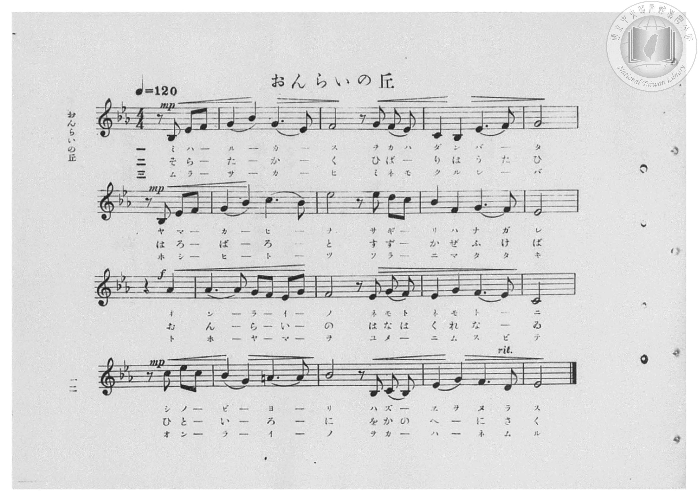
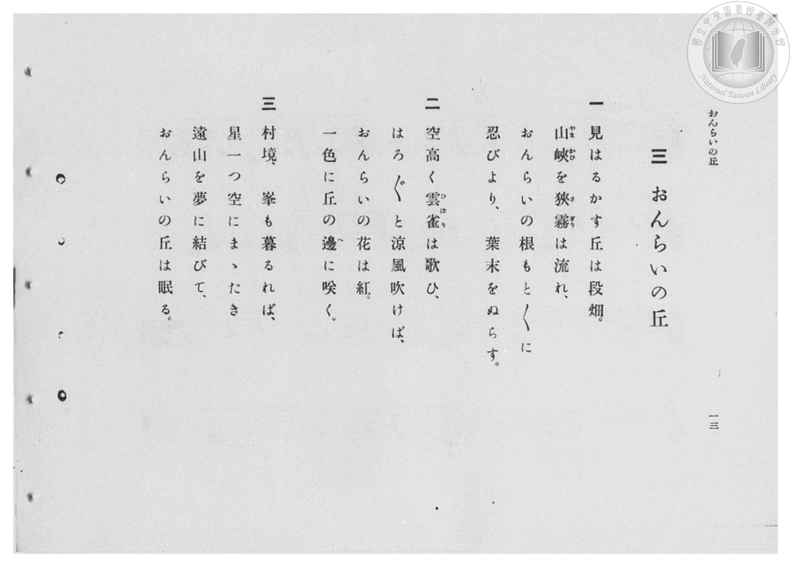

# おんらいの丘

> Re:Shōka 使用 AI 協助辨識與重建樂譜，可能會有錯誤。歡迎回報。

- **鋼琴伴奏版**：<br><audio controls src="onrai_no_oka.mp3"></audio>

- 臺灣總督府《公學校高等科唱歌》第二學年用（昭和十一年，索書號 0729 74）

## 說明

原書資訊與歌詞全文（對應 P014.jpg–P015.jpg，原書 pp. 12–13，第 3 首）：
調性與拍號：變ホ長調（E♭ 大調，3 降記號）4/4 拍，速度 ♩=120


## 歌詞

```text
一
見はるかす丘は段畑。
山峽（やまかひ）を狹霧（さぎり）は流れ、
おんらいの根もと〳〵に
忍びより、葉末をぬらす。

二
空高く雲雀（ひばり）は歌ひ、
はろ〳〵と涼風吹けば、
おんらいの花は紅。
一色に丘の邊（へ）に咲く。

三
村境、峯も暮るれば、
星一つ空にまゝたき
遠山を夢に結びて、
おんらいの丘は眠る。
```

## ABC

<div class="abc-score" data-abc-src="onrai_no_oka.abc" aria-label="五線譜載入中"></div>

[下載 ABC 原始檔](onrai_no_oka.abc)

## TMD 檔案連結

- [主旋律 TMD 檔案](onrai_no_oka.tmd) [[在 TMD Studio 編輯](https://tmdlang.github.io/Tmd-TS/#tmd=s7IKdvYPcrWy4qpTUCpJTLdSSM7PyUlNLsnMz7PKzk9PzM7Ojy_OyM9OVIKrKMvPKc1NBcqW5McbIYSL80uLklOtipMz8vNz4ktSK0qS8vOz0eXjCxLTU60CDAxNEDIFRfllqXmJeUDdBUWZeSWpKWDtCAWpZZkpqSDp4uTEvPiy1KLMtMzUFCQXpRYVgxwMtaKkKDGvOLkoswDkC4Sq_KKSjPz0osSCjEqrjMzikvyizOTEnPjsxDwkz5VkpAL9lpdYUlqUii5akJOYjCQI1J-emWdVkphZDnRVflpaZnJmYo4Sl5aWwuPGrsdNkx83dT5ubHncuO7JjhkKWlpcirYKhkYGXPa2Cq46XDYm-iZ2ILNetO963rj4-Y69z-cufrprzuOGrqeta56u3fFswcKXq2c8X9v5fPnEp1M2Plvb87ih-_maNU929QBln-7c8nzKivd7Op7NWPt0Us_T3sYnOxqAgu_39DzfsujZ7B0vZs5XMDA3slQwN3m_p1OJi0tfS8GWWoBLQUHhad98kDWb21-s6HrR0Q5034uV8562rng2rR3orKcbep-1dyqAIlovqyD9UcNkINMUxAS6EKJVoaBADxggQClDY5Cz16xRMFZ4uWwa0Lnv98wCWfFi1f5nDctBhnf3Av0DFH2xrutx8-yXU7cDpYC2uD6auVbh6ZLlYF4PUPfM3hcrZoCVdgLDVwGoDyj-smH-013LFB7NXGkLCn-QycDAAluwrPtx4_rHTUASiGYC4wnIfbZu6_OpEx83NIF9uXHj0817gVY9bgLG5D6wuk1A0x83TXrevfPlnOUgqcapjxv7Hjd1gcSB-rc2Pm4CRlYjSD9aSni2YOfjpqbHjSseN2x-3LD1ceNqsCX7ex83bn7cBLSkC6jvxcTOZ3NWA2143LgGrHMmyDFgZ-_qAVHPV-4CJo3Hjf0vZ296ObsB7IRNjxs3IJwATCxAEZgTgD7shVm44tm2PS8XrXg6YefjxokgPVjd-aJrI1Db8y2t0GAAhteLTqAVq8FBtO4lyCKgpTvA1q1-Ogko1Q935I5OEPVs7sSni5qBxj_dDLS_6dmsdaBwBgYM3M5nM-YDzX3cuAToH6ApoOBtmvu4cf7jxl6Q9MvGBcDQBwbD0yWLgNLPt04ABVLjMuwuhsTd8zkLQLZAHE15OocCBS19Li7_vKLETL98_-xEq4DMxLx8hxqDmmqQNQo2Flp2YAa2LKYAyrLA0FvYo6BhovB0Q__z9Q068HyBkNXEohVoLcjYGgUDhercgloF03gFQwUjYC4xBWJdoLgRkK8LhAZAPohdo2AWD-QC1elCZYyAYiC1EFUQugZsqo9hjUK8wuPm-UDcD8R7gHg1hG5aDTb9cdNOMB-kB6RyE1gGpBoo19wAFH3cvBlMTgCrAakF6doPtQfkCiT7jMD2Nc4FquiE2NMIshtEd0Psa4S4A2pfI9C-xg1wU7tANjSuB5NtEPuA-kG6NmG3zxjivwVAvBLqr62o_muehOI_kGt6gXgR2D6wTcAQAZFrkP0H9S2yffhjf1cPvtgHy5IY-2Zg95sqGMZBIxbIMAeKgsRAca4LjXNQ7EPSAa7YXwLE8-ChAkkFk6ChAwx_ROiAwq5pHTwMVoHDox9MgmIGSDetActAwgpX7K8HqgOFMSjWIXEL4kNifwVK7M8E4lkw-8Ap5HHjHDC5FRr7E8EyG_DG_myg-dvh_oLQHVD_taD4by88nYDkwPYBQwbkL0h6BtGgdLGWxNjf0Yk374NkCcS-rkJ1Wq2CCZAGYRAJytOg_A4iwdEPF4HEPEgUFPPg0gB71IM8BIlEUBZGJG5YVgElDFBg9UGCB5gxQLKLwMEH4oF0LAKTsOAEqQYFG_aoB0UYOAs3TUa2D14UQCIDWJBDo389OHJXQZIMsGAA6ewBmwJyNdS-JkhWxBb1MJeBkgCy_2D-giZ6YCKH-G8ZWHYhkj9ARQfI1p1Q-yYDMaTgITLqn86ejSfqIbLEZHwzUPY2Axf6JupgxwApUEYHxSywVADGMpAExTckPYDjHZQUCGR-cMbog_oY5DsQvQIpNkEhDQkdYMHctAsehhvB4fa4GRwfoBQDryhqoPbgyv6gIh2SzeExDsv-YDFQcQvJjsDMCsz0oPQASgc7kOSBzS2kqgKnjZACAJjGQSkc4h9E2kb4EZS-Uas3iB9hVSIkpYMqEYgcdhtrubh07RQQTYRoH8NYBTQRIwwRY7CIMhcA)]
- [鋼琴伴奏 TMD 檔案](onrai_no_oka_piano.tmd) [[在 TMD Studio 編輯](https://tmdlang.github.io/Tmd-TS/#tmd=s7IKdvYPcrWy4qpTUCpJTLdSSM7PyUlNLsnMz7PKzk9PzM7Ojy_OyM9OVIKrKMvPKc1NBcqW5McbIYSL80uLklOtipMz8vNz4ktSK0qS8vOz0eXjCxLTU60CDAxNEDIFRfllqXmJeUDdBUWZeSWpKWDtCAWpZZkpqSDp4uTEvPiy1KLMtMzUFCQXpRYVgxxckJmYlx-fWFSUmJeempuah2QEkqBVYmZ8YnJyfm5BYl4mqqr8opKM_PSixIKMSquMzOKS_KLM5MSc-OzEPCT_l2QAjbHKSywpLUpFFy3ISUxGEgTqT8_MsypJzCwHOjw_LS0zOTMxR4lLS0vhcWPX46bJj5s6Hze2PG5c92THjPd7Ol5273k-YcuTPVueLu1_3tnxfk-ngpYWl6KtgqGRAZe9rYKrDpeNib6JHciCF-27njcufr5j7_O5i5_umvO4oetp65qna3c8W7Dw5eoZz9d2Pl8-8emUjc_W9jxu6H6-Zs2TXT1A2ac7tzyfsgJo1bMZa59O6nna2_hkRwNQ8P2enudbFj2bvePFzPkKBuZGlgrmJkDrlbi4_POKEjP98v2zE60CQOEb5OFQY1BTzaUABDYWWnZgRo2CgUJ1bkGtgmm8gqGCkYKxgikQ6wLFjYB8XSA0APJB7BoFs3ggF6hOFypjBBQDqYWogtA1YFN9DGsU4hUeN88H4n4g3gPEqyF002qw6Y-bdoL5ID0glZvAMiDVQLnmBqDo4-bNYHICWA1ILUjXfqg9IFcg2WcEtq9xLlBFJ8SeRpDdILobYl8jxB1Q-xqB9jVugJvaBbKhcT2YbIPYB9QP0rUJu33GEP8tAOKVUH9tRfVf8yQU_4Fc0wvEi8D2gW0ChgiIXIPsP6hvke3DGU1mYItMFQzjoDEAZJgDRUFioMjRhUYOKJogEYYrmpYA8Ty48yHRNQnqDWBAIbwB8mTTOrhjV4Ed3g8mQUEIpJvWgGUgnsIVTeuB6kCBAYoeSCSA-JBoWoESTTOBeBbMPnBUPm6cAya3QqNpIlhmA95omg00fzvcXxC6A-q_FhT_7YVHKEgObB8wZED-giQ8EA2KwLW4o0lXoTqtVsEESIMwiATlElAOApHgeIKLQKIIJAqKInD-wh5HIJshoQ3KFIjkAkt8oBgE-aoP4g9gUgPJLgL7E8QD6VgEJmH-BqkG-Q97HIFCFpwpmiYj2wfPXJBQAxZ_0HhaD46FVZC4BWY1kM4esCkgV0Pta4IkbmxxBHMZKK6Q_QfzFzR1AlMjxH_LwLILkfwByowgW3dC7ZsMxJCsjCsrmYEyjBm4vDNRB-sCUqCsA4oCYD4DRgeQBEUMJOLAEQSKMwLZCZzU-qBOAzkDRK9ACnZQkEC8ASyTmnbBPbsR7MHHzeCAA0UtvIysgdqDK0OBSjNIxoFHDSxDgcVAJQ0kgQOTPzAbgSIOFGE7kOQfN05FKiVx2gjJUsDECEqKEP8gEiHCj6CEiFqyQ_wIqw0gSRJUfkLksNtYi1mL-SDXYibotZghMIbiFaINY0GlYDyYA-ebAPlQMYgAlGEAhBDPoRkD0gBXBeeDjIg2jQeLgNi4zAEVAkBpEI42ASqHq4O6AYUPNhBUwwKZZvG5WB0FMgmoxQhsJ4gEaUTSDHUPdu8BQ1LXTgERmNE-QCk0ESMMEWOwiDIXAA)]

## 分析

```text
================================================================================
📊 TMD Song Profile: [ おんらいの丘 ]
================================================================================
⏱  Duration:       1:36 (96.0s), 48 measures total
🎼 Key & Tempo:    首調基準 E,, != 120.0 BPM, <4/4>
   - 分析範圍：      由實際發聲的音符與和弦推測調性；播放脈絡另行呈現
🎤 人聲音域:    A#3 (MIDI 58) – D#5 (MIDI 75) [跨度: 17 個半音 / 1.4 個八度, 難度: challenging]
   - 最低音:  A#3 in [OnraiNoOka[L1] #1 @ m.1, 0:00]
   - 最高音: D#5 in [OnraiNoOka[L1] #1 @ m.6, 0:10]
   - 適合: soprano, mezzo-soprano, contralto, tenor, baritone, bass
🏛  結構:      OnraiNoOka[L1] (32.0s) -> OnraiNoOka[L2] (32.0s) -> OnraiNoOka[L3] (32.0s)
⚡ 編曲密度:        Peak 1 軌道同時演奏
🗝  調性診斷：       D# 大調（純淨自然大調，未偵測到可信轉調）
   - 風格氣質:    純淨自然大調（陽光明朗、易唱易記，無明顯調外色彩）
   - 轉調歷程:    全曲維持單一推測調性（未偵測到可信轉調）
   - 核心骨幹音:  D#, G, F, A#, C
   - 調性數值:    D# 大調 [相關度: 0.92, 穩定度: High, 自然音純度: 97.1%]
   - 候選調性 (K-S): D# 大調 (0.92), C 小調 (0.70), A# 大調 (0.58)
   - 五度圈歷程:   -3 -> -3 -> -3
   - 各段落調性細節:
     • [OnraiNoOka[L1] #1]: D# 大調 (r: 0.92, 自然音純度: 97.1%, 調外音: A)
     • [OnraiNoOka[L2] #1]: D# 大調 (r: 0.92, 自然音純度: 97.1%, 調外音: A)
     • [OnraiNoOka[L3] #1]: D# 大調 (r: 0.92, 自然音純度: 97.1%, 調外音: A)

  [ 五度圈游移軌跡 ]
               C  
         F            G  
      Bb               D  
     [Eb]*              A  
         Ab           E  
            Db       B  
               F# 
     (* = active key center)

  [ 十二半音累積音高分佈 ]
     C  : █████████                 11.7%
     C# :                            0.0%
     D  : █                          1.0%
     D# : ████████████████████████  30.1%
     E  :                            0.0%
     F  : ████████████              15.5%
     F# :                            0.0%
     G  : ███████████████           18.4%
     G# : █████                      5.8%
     A  : ██                         2.9%
     A# : ████████████              14.6%
     B  :                            0.0%
--------------------------------------------------------------------------------
Assignment 軌道音域：
  - Piano         : A#3 – D#5 (17 個半音 / 1.4 個八度, 198 個音符)
================================================================================
```


## 原書掃描頁






