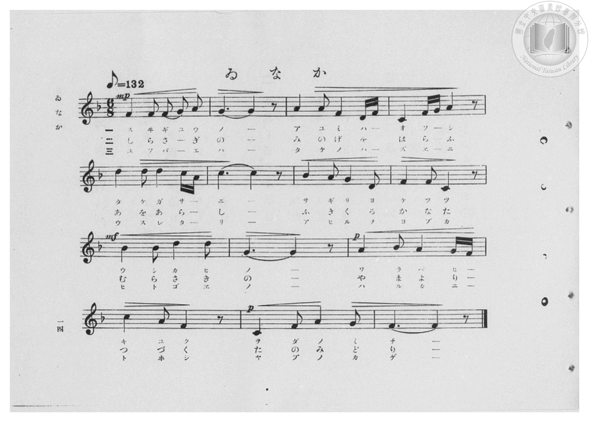
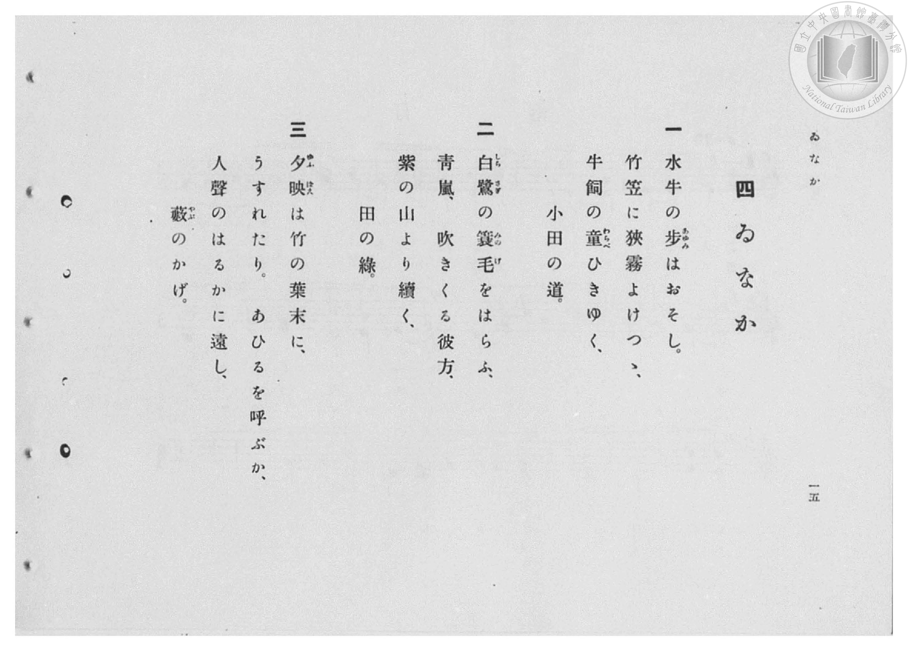

# ゐなか

> Re:Shōka 使用 AI 協助辨識與重建樂譜，可能會有錯誤。歡迎回報。

- **鋼琴伴奏版**：<br><audio controls src="inaka.mp3"></audio>

- 臺灣總督府《公學校高等科唱歌》第二學年用（昭和十一年，索書號 0729 74）

## 說明

原書資訊與歌詞全文（對應 P016.jpg–P017.jpg，原書 pp. 14–15，第 4 首）：
調性與拍號：ヘ長調（F 大調，1 降記號）6/8 拍，速度 ♪=132（附點四分音符 ♩.=66）


## 歌詞

```text
一
水牛の步（あゆみ）はおそし。
竹笠に狹霧よけつゝ、
牛飼の童（わらべ）ひきゆく、
小田の道。

二
白鷺（しらさぎ）の簑毛（みのげ）をはらふ、
青嵐、吹きくる彼方、
紫の山より續く、
田の綠。

三
夕映（ゆふばえ）は竹の葉末に、
うすれたり。あひるを呼ぶか、
人聲のはるかに遠し、
藪（やぶ）のかげ。
```

## ABC

<div class="abc-score" data-abc-src="inaka.abc" aria-label="五線譜載入中"></div>

[下載 ABC 原始檔](inaka.abc)

## TMD 檔案連結

- [主旋律 TMD 檔案](inaka.tmd) [[在 TMD Studio 編輯](https://tmdlang.github.io/Tmd-TS/#tmd=s7IKdvYPcrWy4qpTUCpJTLdSSM7PyUlNLsnMz7PKzk9PzM7Ojy_OyM9OVIKrKMvPKc1NBcqW5McbIYSL80uLklOtipMz8vNz4ktSK0qS8vOz0eXjCxLTU60CDAzNEDIFRfllqXmJeUDdBUWZeSWpKWDtCAWpZZkpqSDp4uTEvPiy1KLMtMzUFCQXpRYVgxwMtaKkKDGvOLkoswDkC4Sq_KKSjPz0osSCjEqrjMzikvyizOTEnPjsxDwkz5VkpAL9lpdYUlqUii5akJOYjCQI1J-emWdVkphZDnRVflpaZnJmYo4Sl5aWwuOmCY8bVz1u7FbQ0uJStFUwM-Oyt1Vw47Ix07ewAxnwon3X88bFz3fsfT538dNdcx43dD1tXfN07Y5nCxa-XD3j-drO58snPp2y8dnanscN3c_XrHmyqwco-3TnludTVrzf0_Fsxtqnk3qe9jY-2dEAFHy_p-f5lkXPZu94MXO-goG5kaWCucn7PZ1KXFz6Wgq21AJcCgoKT_vmg6zZ3P5iRdeLjnag-16snPe0dcWzae1AZz3d0PusvVMBFLt6WQXpjxomA5nmICbQhRCtCgUFegqGJkApQ1OQs9esUTBReLlsGtC57_fMAlnxYtX-Zw3LQYZ39wL9AxR93Dzj5dTtQHGgFW4KT5csBzN7DBVezux9sWIGWFEnMGQVgDqA4i8b5j_dtUzh0cxVtobGRkA9L2e2vNw97-ns2U872l7O3_x8DUhypZ6tmRlQHxfITmAwgqhnG7Y875z9uHHds7VLgfoeNzY9bmp73Ai0rPNx4_rHjV2PG-c-bpz-uKEJpPr56p3P1yx43Lj6effOl3OWP24Capj4uHHJ46a5jxsawSo6Z79cvAdo3vPVYPOa-h83AU3aCTZv0-PGXrDx_VDVTzf0P5-yAaj6ZeNkkBVgh-3qARs0c-_L7bvATpoONmLq48Y-sCnrnm-Y-Gz9bLDUfiD3ceMkkHjTJJCDQSq3Qk1_OXfS060TgJynE3aCbAZa29T9dO-eZ9N2wly7ZTXQgKcbN4J80tT1fFcPwm0Qhz3ftgDusB2dYDcvmfpsxgKw34A-2fq4EaisAxJcwOABankxsfPZHKC5q6EGPW4Eqpv5uAlo9nygJUDjQKEMDIymbqCjn04EhtY2YL6Bqn6ya9cLUEABvQX0TTdIonH1y0ZgoAMjAazixfRVYNtbgPogAQJWNAkaR5SneihQ0NLn4vLMS8xOtArITMzLd6gxqKkG2aBgY2imZQdmYctsCqDMu6PhxcIeBQ0TcBSvb9CB5xCErCYWrUArQcbWKFTnFtQqGCrogiGIBmEjIDYG4howCwZhbAOwDEgeBEE0RL9ZPJhRo2AaDzfPCK4OrAtsqY9hDbAU2wkVf9y8AUQ2rQOzl4HZIBKoprkPyfbHzXugLJDpIBMWwWXAuprnQ3n9ULUgNatgapr2gkUfN21HNgXiHiOgysbpcJWdILJxKtxOYH6AmNYIciNO9zTuh8mA1QETCtS8SQj3NK5HsgXsnsatmO4xBvkd5CeIPRCXTEC4p2kFNHz68YYP3D1NG8HykNBEDZ9dcN0bIe5p7kZxD_7Et6sHX-IDy-JNfGZQu0A0hG0KTXemSD6DsSHpzgTKA6mDpUhgygNJISdjeBpET3doodK0BsrbiggVeBhgD1dYjMHSLDyNNUPjBWwyRKQFTmJLc01wk0BpBcaHpQ1IioGlS6xugaceYLELJmEpAliiQVXA_AJsNIBJSC7BSG_gPAfRCcqZj5th4bIfKVxgPsUeLoj8CPZN82o4fxNUPyh8ICLTwGbDVBCT1nZ0gtOaMY6CDiRLoKBLq4UnHhCNnPjwFXTVwAISVoiB9EHYRpCyDilhIQIQVMQgPAcJDoLFWTO8aGheCSZnwnVDIwCRcJoa4HYhCitEMiBYVDXBEuTjxn1gUzqgpnWh2gUuiCDFGMgUkKrHTVvgfFAyJ-wveJIEJwhYuIAyGcwuvBEPbFvhiXiILN6IhxUfiIoKOWaR6ipY1EISAKI4gcnCNSJF-lq45yA1FywSYZ4HpXyIPCjKEEEFqa1AKhpxBx5SSbEEpqJxKZiEBSqsHIDlaljdg6iLQIkJ5NIuQvaAIxuSEEAqZoP9g1JbAkXh7oDkYIR_wNEKsgfmY2z21HJx6dopgJs60T6GsQoIjhEyxxjMUeYCAA)]
- [鋼琴伴奏 TMD 檔案](inaka_piano.tmd) [[在 TMD Studio 編輯](https://tmdlang.github.io/Tmd-TS/#tmd=s7IKdvYPcrWy4qpTUCpJTLdSSM7PyUlNLsnMz7PKzk9PzM7Ojy_OyM9OVIKrKMvPKc1NBcqW5McbIYSL80uLklOtipMz8vNz4ktSK0qS8vOz0eXjCxLTU60CDAzNEDIFRfllqXmJeUDdBUWZeSWpKWDtCAWpZZkpqSDp4uTEvPiy1KLMtMzUFCQXpRYVgxxckJmYlx-fWFSUmJeempuah2QEkqBVYmZ8YnJyfm5BYl4mqqr8opKM_PSixIKMSquMzOKS_KLM5MSc-OzEPCT_l2QAjbHKSywpLUpFFy3ISUxGEgTqT8_MsypJzCwHOjw_LS0zOTMxR4lLS0vhcdOEx42rHjd2v9_T8bJ7z_MJW57s2fJ0af_zzo73ezoVtLS4FG0VzMy47G0V3LhszPQt7ECmvmjf9bxx8fMde5_PXfx015zHDV1PW9c8Xbvj2YKFL1fPeL628_nyiU-nbHy2tudxQ_fzNWue7OoByj7dueX5lBVAi57NWPt0Us_T3sYnOxqAgu_39DzfsujZ7B0vZs5XMDA3slQwNwFarsTF5ZmXmJ1oFQAKzyAPhxqDmmouBSCwMTTTsgOzahSqcwtqFQwVdMEQRIOwERAbA3ENmAWDMLYBWAYkD4IgGqLfLB7MqFEwjYebZwRXB9YFttTHsAYYbjuh4o-bN4DIpnVg9jIwG0QC1TT3Idn-uHkPlAUyHWTCIrgMWFfzfCivH6oWpGYVTE3TXrDo46btyKZA3GMEVNk4Ha6yE0Q2ToXb-bgR5A6QGpAbcbqncT9MBqzuceMkqHmTEO5pXI9kC9g9jVsx3WMM8jvITxB7IC6ZgHBP0wpo-PTjDR-4e5o2guUhoYkaPrvgujdC3NPcjeIeaCoxgwqCaAjbFJpATJGcAGNDEogJlAdSB0s6wCQCkkJOb_DEgp5A0JzftAbK24pwPtyx2AMAFrSwxAVPDM3QAASbDBFpgZPYEkcT3CRQpML4sEiERC0sAWF1CzyaHzf2gklY1D1uAvkBpALmF2B5AiYhyRkjYYAzB0QnKAs9boaFy36kcIH5FHu4IDIO2DfNq-H8TVD9oPCBiEwDmw1TgZIoqnPTauGxDKKRUwm-oqMaWOTAigWQPgjbCFJ6IKUAhE9BmRbhCoi7CRYQzfDM1rwSTM6E64aGFCKGmxrgdiGyPyK-CGb-JljKedy4D2xKB9S0LlS7wFkbUjCATAGpety0Bc4HpUfC_oKnHXDMwcIFlBtgdkFjCJYhEWU0chQgFdOwOIDEFCKDwmThGpFiZy3cFZBCGxbaMFeC0hJEHhS2CD9BCmqQikbcvkTKe0tgKhqXgkmY72E5C5ZPYMUuohgGxTrIpV2E7AHHCiTGQCpmg_2DUlEAReHugOQJhH_A4Q-yB-ZjbPbUotTGPsi1sQVaZRyvYBwPihw4A1SjxisYgdkgFigugHEEkzYDCkE4EIUQNpAEq4MabQKUgCpEYiKZAlOPLA0yzRxiNZJKuBNQygEc5iMZgXA6KPVh8SbUPEwnoajH7ii4d4EBrWunAA7raB_DWAUExwiZYwzmKHMBAA)]

## 分析

```text
================================================================================
📊 TMD Song Profile: [ ゐなか ]
================================================================================
⏱  Duration:       1:54 (114.5s), 42 measures total
🎼 Key & Tempo:    首調基準 F, != 66.0 BPM, <6/8>
   - 分析範圍：      由實際發聲的音符與和弦推測調性；播放脈絡另行呈現
🎤 人聲音域:    C4 (MIDI 60) – D5 (MIDI 74) [跨度: 14 個半音 / 1.2 個八度, 難度: moderate]
   - 最低音:  C4 in [Inaka[L1] #1 @ m.4, 0:08]
   - 最高音: D5 in [Inaka[L1] #1 @ m.5, 0:10]
   - 適合: soprano, mezzo-soprano, contralto, tenor, baritone, bass
🏛  結構:      Inaka[L1] (38.2s) -> Inaka[L2] (38.2s) -> Inaka[L3] (38.2s)
⚡ 編曲密度:        Peak 1 軌道同時演奏
🗝  調性診斷：       F 大調（純淨自然大調，未偵測到可信轉調）
   - 風格氣質:    純淨自然大調（陽光明朗、易唱易記，無明顯調外色彩）
   - 轉調歷程:    全曲維持單一推測調性（未偵測到可信轉調）
   - 核心骨幹音:  F, G, A, C, D
   - 調性數值:    F 大調 [相關度: 0.89, 穩定度: High, 自然音純度: 100.0%]
   - 候選調性 (K-S): F 大調 (0.89), C 大調 (0.66), D 小調 (0.66)
   - 五度圈歷程:   -1 -> -1 -> -1
   - 各段落調性細節:
     • [Inaka[L1] #1]: F 大調 (r: 0.89, 自然音純度: 100.0%)
     • [Inaka[L2] #1]: F 大調 (r: 0.89, 自然音純度: 100.0%)
     • [Inaka[L3] #1]: F 大調 (r: 0.89, 自然音純度: 100.0%)

  [ 五度圈游移軌跡 ]
               C  
        [F ]*          G  
      Bb               D  
      Eb               A  
         Ab           E  
            Db       B  
               F# 
     (* = active key center)

  [ 十二半音累積音高分佈 ]
     C  : █████████████████         17.5%
     C# :                            0.0%
     D  : ███████████               11.7%
     D# :                            0.0%
     E  :                            0.0%
     F  : ████████████████████████  24.7%
     F# :                            0.0%
     G  : ███████████████████       19.5%
     G# :                            0.0%
     A  : ██████████████████        18.8%
     A# : ████████                   7.8%
     B  :                            0.0%
--------------------------------------------------------------------------------
Assignment 軌道音域：
  - Piano         : C4 – D5 (14 個半音 / 1.2 個八度, 150 個音符)
================================================================================
```


## 原書掃描頁






