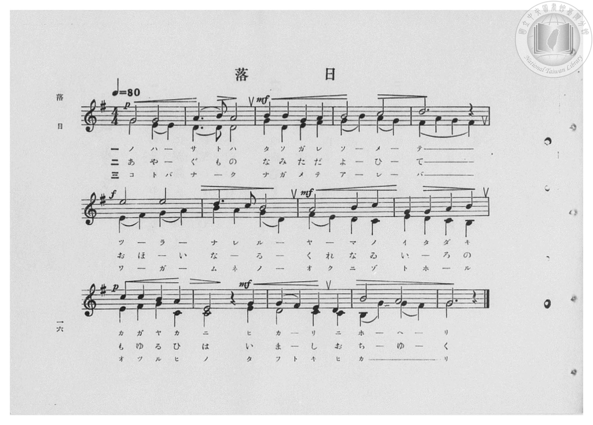
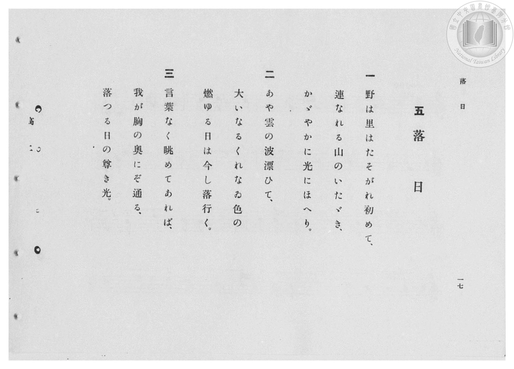

# 落日

> Re:Shōka 使用 AI 協助辨識與重建樂譜，可能會有錯誤。歡迎[回報](https://github.com/TMDLang/reshoka/issues)。

- **鋼琴伴奏版**：<br><audio controls src="rakujitsu.mp3"></audio>
- **NEUTRINO 歌聲合成版**：<br><audio controls src="rakujitsu_neutrino.mp3"></audio>

- 臺灣總督府《公學校高等科唱歌》第二學年用（昭和十一年，索書號 0729 74）

## 說明

原書資訊與歌詞全文（對應 P018.jpg–P019.jpg，原書 pp. 16–17，第 5 首）：
調性與拍號：ト長調（G 大調，1 升記號）4/4 拍，速度 ♩=80（二部合唱）


## 歌詞

```text
一
野は里はたそがれ初めて、
連なれる山のいたゞき、
かゞやかに光にほへり。

二
あや雲の波漂ひて、
大いなるくれなゐ色の
燃ゆる日は今し落行く。

三
言葉なく眺めてあれば、
我が胸の奥にぞ通る、
落つる日の尊き光。
```

## ABC

<div class="abc-score" data-abc-src="rakujitsu.abc" aria-label="五線譜載入中"></div>

[下載 ABC 原始檔](rakujitsu.abc)

## TMD 檔案連結

- [主旋律 TMD 檔案](rakujitsu.tmd) [[在 TMD Studio 編輯](https://tmdlang.github.io/Tmd-TS/#tmd=s7IKdvYPcrWy4qpTUCpJTLdSSM7PyUlNLsnMz7PKzk9PzM7Ojy_OyM9OVIKrKMvPKc1NBcqW5McbIYSL80uLklOtipMz8vNz4ktSK0qS8vOz0eXjCxLTU60CDAwtEDIFRfllqXmJeUDdBUWZeSWpKWDtCAWpZZkpqSDp4uTEvPiy1KLMtMzUFCQXpRYVgxwMtaKkKDGvOLkoswDkC4Sq_KKSjPz0osSCjEqrjMzikvyizOTEnPjsxDwkz5VkpAL9lpdYUlqUii5akpmbGp-fFp-SWIlsamZ6Zp5VaR7IiSVQh2lpKbyYsPfZ9KUKWlpcirYKFgZc9rYK7lw2JvomdiCtL9p3PW9c_HzH3udzFz_dNedxQ9fT1jVP1-54tmDhy9Uznq_tfL584tMpG5-t7Xnc0P18zZonu3qAsk93bnk-ZcX7PR3PZqx9OqnnaW_jkx0NQMH3e3qeb1n0bPaOFzPnKxiYG1kqmJu839OpxMWlr6VgSy3ApaCg8LRvPsiaze0vVnS96GgHuu_FynlPW1c8m9YOdNbTDb3P2jsVQLGrl1WQ_qhhMpBpCWICXQjRqlBQoKdgaAaUMjQHOXvNGgVThZfLpgGd-37PLJAVL1btf9awHGR4dy_QP0DRx80dL6duB4oDrXBXeLpkOZjZY6jwtBfojhlgRZ3AkFUA6gCKv2yY_3TXMoVHM1faWhgAtQDD7mXziqcTOoABClTIBbIEGG4g6mV73-PG9S_be4Dk48b5jxvnPm7sedzU87Rj7uOmxseNyx43NILVNSx-3LgKKPG4qfvpxo2PG9c9bmwBaWia97ixF6rocWM3iN8ElOh-3Lj6aWsnkHzcuPtx447HTV2PG5ogNu_qgShuAqp8OXsT0Kxnmxc929P0uBHIhlkI9CTYBqCdQLP6QTaD2BNedII0gFQ8b29-3NQGlAamMqDrn-zuetw4HZjoXiwEKu2H27ajExymKxpeTAQ6ZxVQ6vmcXVC_gZwAVLwBauezjolA379o3gG04elSoKFAx8972TAL5ASICqDxjxuXwOxc93QD0M5ekD-BtgGlKU9iUKCgpc_FFZSYXZqVWVJcahWQmZiXb-hQY1BTDbJGwcZCyw7MwJa6FUC5ZUcDMBgUNEwVnm7of76-QQeeJBGymli0Aq0FGVujUF1Qq2CooAuGMLpGwQhMG0NpkEh1blotUAAkCFEIkqoB80DQBK7QFMoCQQOQCNgiH8MahcfNfVDxx839cPWPm7ZCxTrQxPeDRJv2gsk1YBUgEiQDEoPoWYhQ39yGZHM8wmYjoFxjE0xHUwtCR-MEqFgTkL0OSXwVSLQRbH_jfDC5AGpzB8ycxk1I6pdht9kYpGMz3K0gvY-bQXaCXNsFFd0DVLMeyRcgcZh_Qb6D-Atk0iK4SSBZmHqIH5Dtxp9gdvWAE4wJ9gQDlsWfYIDpwAxqH4yGxboJPD1AEwws_YCEQUmkBpx0YMkHJIqcPGBR87h5JVqAQDz9uHk1kvgSuOp5YBKUuEDBBBKHJp7mBjB7LcIecGIAB3HjbjCJnBxA0Q6Lkm4kcVCiBJYfYPXgpNEEjUSwbpB6kFgvWB6UjJCivxkWtZAohbkdlJxAOnuRMgXI7RDTQXoeN4Nc8LhpH1QHJPHMRtgHDgtCkb2jE2_pAJIlWDqA4g2EQbEFyfRmoHQGgqD8DY5nUIxC4tYcJAdWYApOjfAUgShKYMUMzASkJNAE8hQs9UMiEuxNaHDA0vjj5knQAAOrhwYIOPDA6kDqQUEFCeQZSAEPiWLk3AJPFsBSAGQfKLdBoh-Sx0HRDItEsN3gSAeJgqIGanfjdDAJSlggGVipBDENORlhsRtcSkDcDklOED9BfQhPHmC7wckaJDoVyd_gpAFJ5FB9ELuRMwumv2sx6h2jgap3wMkFTAALEkjaAlJQFrwsAakGi4FVgtMZJC3BEiYkEYIlYFyIqtEaCO4_EDksaiB4GkBti8AiHlr4gBMOWpFkApFCEzBGTymjldFgrIxQ4x0alWAKBOH1EWphAlUIVQ2OaVgzBKkYgcHRKmkAqyRdOwV4raQA5ChzAQA)]
- [鋼琴伴奏 TMD 檔案](rakujitsu_piano.tmd) [[在 TMD Studio 編輯](https://tmdlang.github.io/Tmd-TS/#tmd=s7IKdvYPcrWy4qpTUCpJTLdSSM7PyUlNLsnMz7PKzk9PzM7Ojy_OyM9OVIKrKMvPKc1NBcqW5McbIYSL80uLklOtipMz8vNz4ktSK0qS8vOz0eXjCxLTU60CDAwtEDIFRfllqXmJeUDdBUWZeSWpKWDtCAWpZZkpqSDp4uTEvPiy1KLMtMzUFCQXpRYVgxxckJmYlx-fWFSUmJeempuah2QEkqBVYmZ8YnJyfm5BYl4mqqr8opKM_PSixIKMSquMzOKS_KLM5MSc-OzEPCT_l2QAjbHKSywpLUpFFy0BGhifnxafkliJbGpmemaeVUliZjnQ-flpaZnJmYk5SlxaWgovJux9Nn3p-z0dL7v3PJ-w5cmeLU-X9j_v7Hi_p1NBS4tL0VbBwoDL3lbBncvGRN_EDmTki_ZdzxsXP9-x9_ncxU93zXnc0PW0dc3TtTueLVj4cvWM52s7ny-f-HTKxmdrex43dD9fs-bJrh6g7NOdW55PWQG06NmMtU8n9TztbXyyowEo-H5Pz_Mti57N3vFi5nwFA3MjSwVzE6DlSlxcnnklRflWAaAgDfJwqDGoqeZSAAIbCy07MKNGoTq3oFbBWEEXDI2gdI2CIZQFggYgEa5aFNN8cJgGNMwwXsE0HmgAkDCNB7PNwWSNQrRhvLZpvLZhLDbDgxKzS7MyS4pLIRYY4jYfqhNG10CdbYzk_OrcNIivQBikECRVA_enCVyhKYZTQBb5GNYoPG7ug4o_bu6Hq3_ctBUq1oEmvh8k2rQXTK4BqwCRIBmQGETPQoT65jYkm-MRNhsB5RqbYDqaWhA6GidAxZqA7HVI4qtAoo1g-xvng8kFUJs7YOY0bkJSvwy7zcYgHZvhbgXpfdwMshPk2i6o6B6gmvVIvgCJw_wL8h3EXyCTFsFNAsnC1EP8gGw3LGaBEWYGlYDRsOgxgUccNGZhEQ0SBsUlJL3C4hkkihyPsDB83LwSzeUQ1z1uXo0kvgSueh6YBKUCkH9A4tBYbm4As9ci7AHHGjgsGneDSeR4A8UPLOy6kcRBqedxUw9YPSQOQbpAMiAapB4k3wuWAcU3Ujw1w-IAEvYwt4PiHaSzFyn1gtwONh0cb4-bQS543LQPqgMSy7MR9oHDAhErwPwGCmAQBgUrJBuZgWIOBEE5BhwhoKCHRAIwrwMjEEQAszxynsNXtsDjqglkOyw9QUIc7B6ou2Gp5nHzJKjPwOqhLgf7EqwOpB7kJ0hozEAKIUhcIKc_ePwB8xXIPlD6hcQTJNeA4gMW2mC74bEECkOo3Y3TwSQoBYBkYPkcYhpyfGOxG5zvIG6HxDvET1AfwuMRbDc4_YFEpyL5GxyHkNQI1QexGzlVY_obs8g1wlLk6msp2KIDBVCFtKPhxcIeBQ1Thacb-p-vb9BRADUH9LIK0hGymli0auljKcnByQVMAHM8JG2BKw-4--FpDCwGVglOZ5C0BEuYkEQIloBxIapGy3S4_0Akncp0nElnVw846ZhgTzpgWfxJB1RVwNMAau0Oi3ho4QNOOGhFkglECk3AGD2ljNYaZNYauIuMTrxFBkiWYJGBGu_QqARTIAivj1ALE6hCqGpwTMPaC0jFCAyOVkmDp0oirpthBuxmAGMVGOlAEhTr8QpGYFkwicQBRjSGLqgCFCkToBiQC0wwQBKLgciJBNqFQtGCph_JZCQmmrkQGahOUPGE5CdUTyC3zZAtgpgAVAHUhGYAyLkgAUimQDKMkE-Rgg5v703XTgHcO1QAMuBxGO0DUowiYIQuYAwWUOYCAA)]

## 分析

```text
================================================================================
📊 TMD Song Profile: [ 落日 ]
================================================================================
⏱  Duration:       0:42 (42.0s), 14 measures total
🎼 Key & Tempo:    首調基準 G, != 80.0 BPM, <4/4>
   - 分析範圍：      由實際發聲的音符與和弦推測調性；播放脈絡另行呈現
🎤 人聲音域:    D4 (MIDI 62) – E5 (MIDI 76) [跨度: 14 個半音 / 1.2 個八度, 難度: moderate]
   - 最低音:  D4 in [Rakujitsu #1 @ m.12, 0:35]
   - 最高音: E5 in [Rakujitsu #1 @ m.6, 0:15]
   - 適合: soprano, mezzo-soprano, contralto, tenor, baritone, bass
🏛  結構:      Rakujitsu (42.0s)
⚡ 編曲密度:        Peak 2 軌道同時演奏
🗝  調性診斷：       G 大調（純淨自然大調，未偵測到可信轉調）
   - 風格氣質:    純淨自然大調（陽光明朗、易唱易記，無明顯調外色彩）
   - 轉調歷程:    全曲維持單一推測調性（未偵測到可信轉調）
   - 核心骨幹音:  G, D, B, E, A
   - 調性數值:    G 大調 [相關度: 0.94, 穩定度: High, 自然音純度: 100.0%]
   - 候選調性 (K-S): G 大調 (0.94), E 小調 (0.79), D 大調 (0.62)
   - 五度圈歷程:   +1
   - 各段落調性細節:
     • [Rakujitsu #1]: G 大調 (r: 0.94, 自然音純度: 100.0%)

  [ 五度圈游移軌跡 ]
               C  
         F           [G ]*
      Bb               D  
      Eb               A  
         Ab           E  
            Db       B  
               F# 
     (* = active key center)

  [ 十二半音累積音高分佈 ]
     C  : ████████████              11.7%
     C# :                            0.0%
     D  : ██████████████            14.5%
     D# :                            0.0%
     E  : ██████████████            14.0%
     F  :                            0.0%
     F# : ███████                    7.5%
     G  : ████████████████████████  24.3%
     G# :                            0.0%
     A  : █████████████             13.6%
     A# :                            0.0%
     B  : ██████████████            14.5%
--------------------------------------------------------------------------------
Assignment 軌道音域：
  - Piano1        : D4 – E5 (14 個半音 / 1.2 個八度, 37 個音符)
  - Piano2        : B3 – B4 (12 個半音 / 1.0 個八度, 48 個音符)
================================================================================
```


## 原書掃描頁






