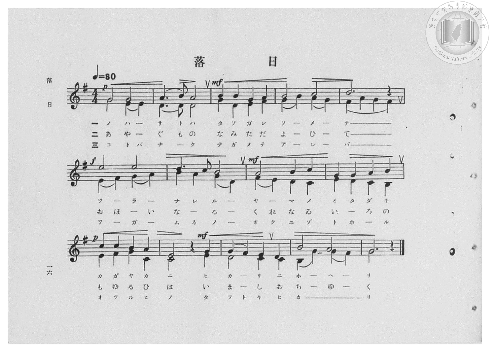
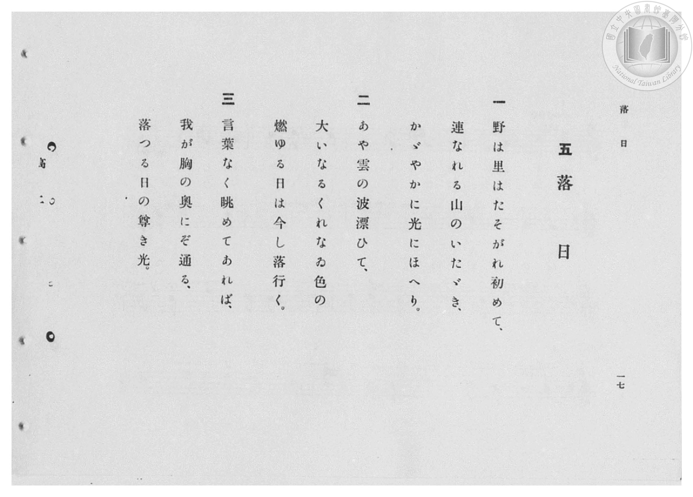

# 落日

> Re:Shōka 使用 AI 協助辨識與重建樂譜，可能會有錯誤。歡迎回報。

- **鋼琴伴奏版**：<br><audio controls src="rakujitsu.mp3"></audio>

- 臺灣總督府《公學校高等科唱歌》第二學年用（昭和十一年，索書號 0729 74）

## 說明

原書資訊與歌詞全文（對應 P018.jpg–P019.jpg，原書 pp. 16–17，第 5 首）：
調性與拍號：ト長調（G 大調，1 升記號）4/4 拍，速度 ♩=80（二部合唱）


## 歌詞

```text
一
野は里はたそがれ初めて、
連なれる山のいたゞき、
かゞやかに光にほへり。

二
あや雲の波漂ひて、
大いなるくれなゐ色の
燃ゆる日は今し落行く。

三
言葉なく眺めてあれば、
我が胸の奥にぞ通る、
落つる日の尊き光。
```

## ABC

<div class="abc-score" data-abc-src="rakujitsu.abc" aria-label="五線譜載入中"></div>

[下載 ABC 原始檔](rakujitsu.abc)

## TMD 檔案連結

- [主旋律 TMD 檔案](rakujitsu.tmd) [[在 TMD Studio 編輯](https://tmdlang.github.io/Tmd-TS/#tmd=s7IKdvYPcrWy4qpTUCpJTLdSSM7PyUlNLsnMz7PKzk9PzM7Ojy_OyM9OVIKrKMvPKc1NBcqW5McbIYSL80uLklOtipMz8vNz4ktSK0qS8vOz0eXjCxLTU60CDAwtEDIFRfllqXmJeUDdBUWZeSWpKWDtCAWpZZkpqSDp4uTEvPiy1KLMtMzUFCQXpRYVgxwMtaKkKDGvOLkoswDkC4Sq_KKSjPz0osSCjEqrjMzikvyizOTEnPjsxDwkz5VkpAL9lpdYUlqUii5akpmbGp-fFp-SWIlsamZ6Zp5VSWJmOdBt-WlpmcmZiTlKXFpaCi8m7H02famClhaXoq2ChQGXva2CO5eNib6JHUj3i_ZdzxsXP9-x9_ncxU93zXnc0PW0dc3TtTueLVj4cvWM52s7ny-f-HTKxmdrex43dD9fs-bJrh6g7NOdW55PWfF-T8ezGWufTup52tv4ZEcDUPD9np7nWxY9m73jxcz5CgbmRpYK5ibv93QqcXHpaynYUgtwKSgoPO2bD7Jmc_uLFV0vOtqB7nuxct7T1hXPprUDnfV0Q--z9k4FUATrZRWkP2qYDGRagphAF0K0KhQU6CkYmgGlDM1Bzl6zRsFU4eWyaUDnvt8zC2TFi1X7nzUsBxne3Qv0D1D0cXPHy6nbgeJAK9wVni5ZDmb2GCo87QW6YwZYUScwZBWAOoDiLxvmP921TOHRzJW2FgZALcCwe9m84umEDmCAAhVygSwBhhuIetne97hx_cv2HiD5uHH-48a5jxt7Hjf1PO2Y-7ip8XHjsscNjWB1DYsfN64CSjxu6n66cePjxnWPG1tAGprmPW7shSp63NgN4jcBJbofN65-2toJJB837n7cuONxU9fjhiaIzbt6IIqbgCpfzt4ENOvZ5kXP9jQ9bgSyYRYCPQm2AWgn0Kx-kM0g9oQXnSANIBXP25sfN7UBpYGpDOj6J7u7HjdOBya6FwuBSvvhtu3oBIfpioYXE4HOWQWUej5nF9RvICcAFW-A2vmsYyLQ9y-adwBteLoUaCjQ8fNeNswCOQGiAmj848YlMDvXPd0AtLMX5E-gbUBpypMYFCho6XNxBSVml2ZllhSXWgVkJublGzrUGNRUg6xRsLHQsgMzsKVuBVBu2dEADAYFDVOFpxv6n69v0IEnSYSsJhatQGtBxtYoVBfUKhgq6IIhjK5RMALTxlAaJFKdm1YLFAAJQhSCpGrAPBA0gSs0hbJA0AAkArbIx7BG4XFzH1T8cXM_XP3jpq1QsQ408f0g0aa9YHINWAWIBMmAxCB6FiLUN7ch2RyPsNkIKNfYBNPR1ILQ0TgBKtYEZK9DEl8FEm0E2984H0wugNrcATOncROS-mXYbTYG6dgMdytI7-NmkJ0g13ZBRfcA1axH8gVIHOZfkO8g_gKZtAhuEkgWph7iB2S78SeYXT3gBGOCPcGAZfEnGGA6MIPaB6NhsW4CTw_QBANLPyBhUBKpAScdWPIBiSInD1jUPG5eiRYgEE8_bl6NJL4ErnoemAQlLlAwgcShiae5Acxei7AHnBjAQdy4G0wiJwdQtMOipBtJHJQogeUHWD04aTRBIxGsG6QeJNYLlgclI6Tob4ZFLSRKYW4HJSeQzl6kTAFyO8R0kJ7HzSAXPG7aB9UBSTyzEfaBw4JQZO_oxFs6gGQJlg6geANhUGxBMr0ZKJ2BICh_g-MZFKOQuDUHyYEVmIJTIzxFIIoSWDEDMwEpCTSBPAVL_ZCIBHsTGhywNP64eRI0wMDqoQECDjywOpB6UFBBAnkGUsBDohg5t8CTBbAUANkHym2Q6IfkcVA0wyIRbDc40kGioKiB2t04HUyCEhZIBlYqQUxDTkZY7AaXEhC3Q5ITxE9QH8KTB9hucLIGiU5F8jc4aUASOVQfxG7kzILp71qMesdooOodcHIBE8CCBJK2gBSUBS9LQKrBYmCV4HQGSUuwhAlJhGAJGBeiih4lItxNqHUjzCHQzAD2CFoWMYFIoQkYE-NyamRvVJdDHQOmUHI4avRAFUJVg90KK9iRIgY1kwMTnK6dAjzNRfsYxiqgChihCxiDBZS5AA)]
- [鋼琴伴奏 TMD 檔案](rakujitsu_piano.tmd) [[在 TMD Studio 編輯](https://tmdlang.github.io/Tmd-TS/#tmd=s7IKdvYPcrWy4qpTUCpJTLdSSM7PyUlNLsnMz7PKzk9PzM7Ojy_OyM9OVIKrKMvPKc1NBcqW5McbIYSL80uLklOtipMz8vNz4ktSK0qS8vOz0eXjCxLTU60CDAwtEDIFRfllqXmJeUDdBUWZeSWpKWDtCAWpZZkpqSDp4uTEvPiy1KLMtMzUFCQXpRYVgxxckJmYlx-fWFSUmJeempuah2QEkqBVYmZ8YnJyfm5BYl4mqqr8opKM_PSixIKMSquMzOKS_KLM5MSc-OzEPCT_l2QAjbHKSywpLUpFFy0BGhifnxafkliJbGpmemaeVUliZjnQ-flpaZnJmYk5SlxaWgovJux9Nn3p-z0dL7v3PJ-w5cmeLU-X9j_v7Hi_p1NBS4tL0VbBwoDL3lbBncvGRN_EDmTki_ZdzxsXP9-x9_ncxU93zXnc0PW0dc3TtTueLVj4cvWM52s7ny-f-HTKxmdrex43dD9fs-bJrh6g7NOdW55PWQG06NmMtU8n9TztbXyyowEo-H5Pz_Mti57N3vFi5nwFA3MjSwVzE6DlSlxcnnklRflWAaAgDfJwqDGoqeZSAAIbCy07MKNGoTq3oFbBWEEXDI2gdI2CIZQFggYgEa5aFNN8cJgGNMwwXsE0HmgAkDCNB7PNwWSNQrRhvLZpvLZhLDbDgxKzS7MyS4pLIRYY4jYfqhNG10CdbYzk_OrcNIivQBikECRVA_enCVyhKYZTQBb5GNYoPG7ug4o_bu6Hq3_ctBUq1oEmvh8k2rQXTK4BqwCRIBmQGETPQoT65jYkm-MRNhsB5RqbYDqaWhA6GidAxZqA7HVI4qtAoo1g-xvng8kFUJs7YOY0bkJSvwy7zcYgHZvhbgXpfdwMshPk2i6o6B6gmvVIvgCJw_wL8h3EXyCTFsFNAsnC1EP8gGw3LGaBEWYGlYDRsOgxgUccNGZhEQ0SBsUlJL3C4hkkihyPsDB83LwSzeUQ1z1uXo0kvgSueh6YBKUCkH9A4tBYbm4As9ci7AHHGjgsGneDSeR4A8UPLOy6kcRBqedxUw9YPTgOm6ChDdYNUg8S6wXLg-IbKZ6aYXEACXuY20HxDtLZi5R6QW6HmA7S87gZ5ILHTfugOiCxPBthHzgsELECzG-gAAZhULBCspEZKOZAEJRjwBECCnpIJADzOjACQQQwyyPnOXxlCzyumkC2w9ITJMTB7oG6G5ZqHjdPgvoMrB7qcrAvwepA6kF-goTGDKQQgsQFcvqDxx8wX4HsA6VfSDxBcg0oPmChDbYbHDsgUVAYQu1unA4mQSkAJAPL5xDTkOMbi93gfAdxOyTeIX6C-hAej2C7wekPJDoVyd_gOISkRqg-iN3IqRrT35hFrhHBIhccr2ACmDUhiQBcysMtgicGsBhYJThBQCIdloIgqQUsAeNCVCGXBXC9qMU3TAM0dYEtREtzJhApNAFjFBuAnkK1AaoJTKEkbVTvQhVCVYPNhBU9SB5FTd2YIU1c7WkGrD2BNgAdACRBLohXMALLgkkkDtBSDF1QBShSJkAxIBfoeCCJxUDk7AhtGaBoQdOPZDISE81ciAxUJyhSkPyE6gnkIgfZIogJQBVATWgGgJwLEoBEEJJhhHyKFHR4GyW6dgrgRo8CkAGPw2gfkGIUASN0AWOwgDIXAA)]

## 分析

```text
================================================================================
📊 TMD Song Profile: [ 落日 ]
================================================================================
⏱  Duration:       2:06 (126.0s), 42 measures total
🎼 Key & Tempo:    首調基準 G, != 80.0 BPM, <4/4>
   - 分析範圍：      由實際發聲的音符與和弦推測調性；播放脈絡另行呈現
🎤 人聲音域:    D4 (MIDI 62) – E5 (MIDI 76) [跨度: 14 個半音 / 1.2 個八度, 難度: moderate]
   - 最低音:  D4 in [Rakujitsu[L1] #1 @ m.12, 0:35]
   - 最高音: E5 in [Rakujitsu[L1] #1 @ m.6, 0:15]
   - 適合: soprano, mezzo-soprano, contralto, tenor, baritone, bass
🏛  結構:      Rakujitsu[L1] (42.0s) -> Rakujitsu[L2] (42.0s) -> Rakujitsu[L3] (42.0s)
⚡ 編曲密度:        Peak 2 軌道同時演奏
🗝  調性診斷：       G 大調（純淨自然大調，未偵測到可信轉調）
   - 風格氣質:    純淨自然大調（陽光明朗、易唱易記，無明顯調外色彩）
   - 轉調歷程:    全曲維持單一推測調性（未偵測到可信轉調）
   - 核心骨幹音:  G, D, B, E, A
   - 調性數值:    G 大調 [相關度: 0.94, 穩定度: High, 自然音純度: 100.0%]
   - 候選調性 (K-S): G 大調 (0.94), E 小調 (0.79), D 大調 (0.62)
   - 五度圈歷程:   +1 -> +1 -> +1
   - 各段落調性細節:
     • [Rakujitsu[L1] #1]: G 大調 (r: 0.94, 自然音純度: 100.0%)
     • [Rakujitsu[L2] #1]: G 大調 (r: 0.94, 自然音純度: 100.0%)
     • [Rakujitsu[L3] #1]: G 大調 (r: 0.94, 自然音純度: 100.0%)

  [ 五度圈游移軌跡 ]
               C  
         F           [G ]*
      Bb               D  
      Eb               A  
         Ab           E  
            Db       B  
               F# 
     (* = active key center)

  [ 十二半音累積音高分佈 ]
     C  : ████████████              11.7%
     C# :                            0.0%
     D  : ██████████████            14.5%
     D# :                            0.0%
     E  : ██████████████            14.0%
     F  :                            0.0%
     F# : ███████                    7.5%
     G  : ████████████████████████  24.3%
     G# :                            0.0%
     A  : █████████████             13.6%
     A# :                            0.0%
     B  : ██████████████            14.5%
--------------------------------------------------------------------------------
Assignment 軌道音域：
  - Piano1        : D4 – E5 (14 個半音 / 1.2 個八度, 111 個音符)
  - Piano2        : B3 – B4 (12 個半音 / 1.0 個八度, 144 個音符)
================================================================================
```


## 原書掃描頁






