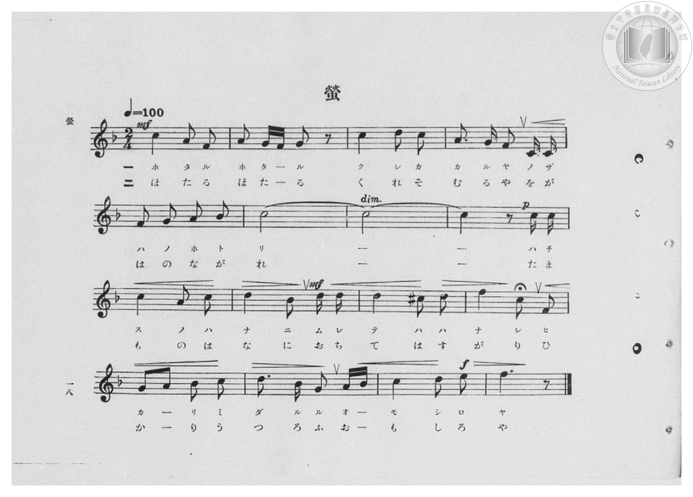
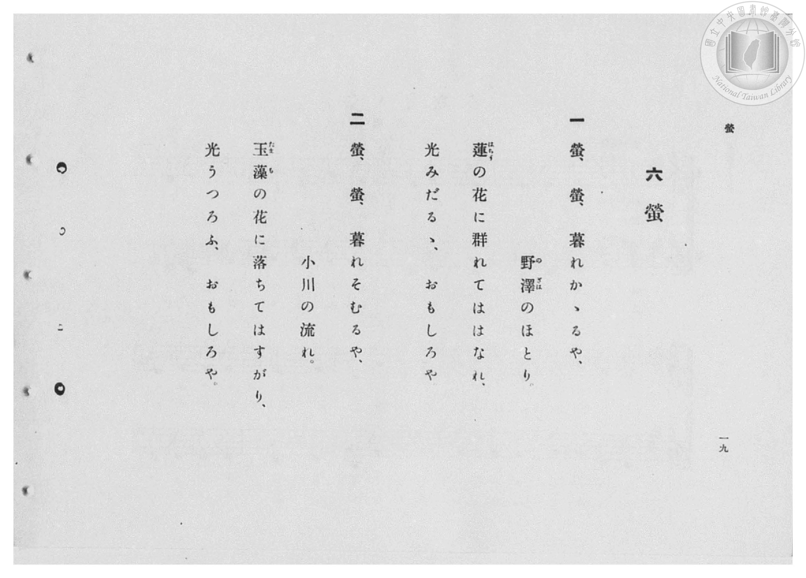

# 螢

> Re:Shōka 使用 AI 協助辨識與重建樂譜，可能會有錯誤。歡迎回報。

- **鋼琴伴奏版**：<br><audio controls src="hotaru.mp3"></audio>

- 臺灣總督府《公學校高等科唱歌》第二學年用（昭和十一年，索書號 0729 74）

## 說明

原書資訊與歌詞全文（對應 P020.jpg–P021.jpg，原書 pp. 18–19，第 6 首）：
調性與拍號：ヘ長調（F 大調，1 降記號）2/4 拍，速度 ♩=100


## 歌詞

```text
一
螢、螢、暮れかゝるや、
野澤（のざは）のほとり。
蓮（はちす）の花に群れてははなれ、
光みだるゝ、おもしろや。

二
螢、螢、暮れそむるや、
小川の流れ。
玉藻（たまも）の花に落ちてはすがり、
光うつろふ、おもしろや。
```

## ABC

<div class="abc-score" data-abc-src="hotaru.abc" aria-label="五線譜載入中"></div>

[下載 ABC 原始檔](hotaru.abc)

## TMD 檔案連結

- [主旋律 TMD 檔案](hotaru.tmd) [[在 TMD Studio 編輯](https://tmdlang.github.io/Tmd-TS/#tmd=s7IKdvYPcrWy4qpTUCpJTLdSSM7PyUlNLsnMz7PKzk9PzM7Ojy_OyM9OVIKrKMvPKc1NBcqW5McbIYSL80uLklOtipMz8vNz4ktSK0qS8vOz0eXjCxLTU60CDIwMEDIFRfllqXmJeUDdBUWZeSWpKWDtCAWpZZkpqSDp4uTEvPiy1KLMtMzUFCQXpRYVgxwMtaKkKDGvOLkoswDkC4Sq_KKSjPz0osSCjEqrjMzikvyizOTEnPjsxDwkz5VkpAL9lpiXmZuYgy6al1hSWpSKLlqcmlicn1eMbE9memaeVUliZjnQtflpaZnJmSDDtLQUXsxbpKClxaVoq2BoYMBlb6vgxmVjpG9iB9L7on3X88bFz3fsfT538dNdcx43dD1tXfN07Y5nCxa-XD3j-drO58snPp2y8dnanscN3c_XrHmyqwco-3TnludTVrzf0_Fsxtqnk3qe9jY-2dEAFHy_p-f5lkXPZu94MXO-goG5kaWCucn7PZ1KXFz6Wgq21AJcCgoKT_vmg6zZ3P5iRdeLjnag-16snPe0dcWzae1AZz3d0PusvVMBFOF6WQXpjxomA5mGICbQhRCtCgUFegqGFkApQ0uQs9esUTBTeLlsGtC57_fMAlnxYtX-Zw3LQYZ39wL9AxR93Dzj5dTtQHGgFW4KT5csBzN7DBVezux9sWIGWFEnMGQVgDqA4i8b5j_dtUzh0cyVtqCAB5kJDCaw0fMWPW5ohJDPZq173NTzuLH7cdPcx01AsgUoCFL0sr3v2b4lQKseN6573DjtceN6oOlg9u7HjSseN3U9bmgCGzZ5HVjR-seNCx83zoQoetG18XHj6uf7loDNXgaWBaJVIC7E-KetQHX7HzcuAFs6Fyj6uLHrcVPT48bpj5t6wc5ogrh5Vw8uNwMd3IDi5qcb-p9unwu0_9nWRrBVYBc-7-t8MX032JHzHzfuA1qC7MgXE_aCXQ5x5MzHjT1gvyEc2fa4EeiN3seNW7E7EqiO8kQFBQpa-lxcHvkliUWlVgGZiXn5DjUGNdUgKxRsDM207MAsbIlZAZQ5djS8WNijoGECCofn6xt04CkQIauJRSvQTpCxNQrVuWm1CqYKumBoDMSGQFwDZhkB2UZA2gAsAlNjBsQgNkQNRBVQNB6EasCG-hjWKDxung1V_7hpP4hsXg3WAxEHiT1u3gMVjYfINK2H6WheA1YD1QGmISY8bl4CZvUBRbfBbDMCqmncDdPbOB-stxuiFywOEgPbBhaF2tbYD3dfD1jNXKhtDVDRbiBuAbMmAWV7gLbhj4hdPfgiAiyLNyJAoQgKbVComqCEOAzWoPGRRUBxVF0AiklTlFgA-RIUXiASHPLNHdB4WEWC6aAwA5n1uLkRJdRBMQbMVGASZB4onCChCKJJMh0UR437CIbyjk68yR0kizeUkVM6JBWD0jMIgsIcnBnMgBAhbKoOJEAcYAzFwcSAGJxNEAHdtBMqBwtsUMCDgrkLLg5KfI-bF4CTN0imDS4DiSRMHeBs0DwJYRMo0JuaYPLQgAdFAigyYBEKLN_AZBcQLwTLLIPLQCJsJlQHLJKAhR9YfBPYJrwR8HT2bDwRAJHFGwHISRw5AkygMiZoRU01MEbMUYMflt6Rgx_sZWAeB5HglNgMKgdAwQnNz-DSA6yqaRVYJUhuETwAtoPVrIXqAZUyyKkTOc1DohFsEzTYQBEJkoHoAlYSQPZWWBRAbEKKtOlQNZB8AiphUG2q5eLStVOA1AfRPoaxCkg8IzBPmQsA)]
- [鋼琴伴奏 TMD 檔案](hotaru_piano.tmd) [[在 TMD Studio 編輯](https://tmdlang.github.io/Tmd-TS/#tmd=s7IKdvYPcrWy4qpTUCpJTLdSSM7PyUlNLsnMz7PKzk9PzM7Ojy_OyM9OVIKrKMvPKc1NBcqW5McbIYSL80uLklOtipMz8vNz4ktSK0qS8vOz0eXjCxLTU60CDIwMEDIFRfllqXmJeUDdBUWZeSWpKWDtCAWpZZkpqSDp4uTEvPiy1KLMtMzUFCQXpRYVgxxckJmYlx-fWFSUmJeempuah2QEkqBVYmZ8YnJyfm5BYl4mqqr8opKM_PSixIKMSquMzOKS_KLM5MSc-OzEPCT_l2QAjbEC6U3MQRfNSywpLUpFFy1OTSzOzytGticzPTPPqiQxsxzoofy0tMzkTJBhWloKL-Yter-n42X3nucTtjzZs-Xp0v7nnR3v93QqaGlxKdoqGBoYcNnbKrhx2Rjpm9iBDHzRvut54-LnO_Y-n7v46a45jxu6nrauebp2x7MFC1-unvF8befz5ROfTtn4bG3P44bu52vWPNnVA5R9unPL8ykrgDY9m7H26aSep72NT3Y0AAXf7-l5vmXRs9k7Xsycr2BgbmSpYG4CtF2Ji8szr6Qo3yoAFMRBHg41BjXVXApAYGNopmUHZtUoVOcW1CqYKuiCoTEQGwJxDZhlBGQbAWkDkAhXLYpxPriMA5pmGA_UYAoiQGaBGTVACkQbwaXghnrklyQWlRJyZBpRjoSrMQNZA1cDUQUUjQehGrChPoY1Co-bZ0PVP27aDyKbV4P1QMRBYo-b90BFIb543LQepqN5DVgNVAeYhpjwuHkJmNUHFN0Gs80IqKZxN0xv43yw3m6IXrA4SAxsG1gUaltjP9x9PWA1c6G2NUBFu4G4BcyaBJTtAdoGDTGQd0HBAvK-CUrQwGANGh9ZBBSYoJg0BULk4AI5B-QxEAkOouYOaICtIsF0kOdAZj1ubkQJHlDQPm5cByZB5oE8BPEuiCbJdFBgNu5DBAdy2oGkC1AKAUFQ4ICTlxkQIoRN1YEEiAMMyjiYGBCDEx4iRJp2QuVgoQIKIVB4dMHFQdH5uHkBOMGAZNrgMpDQxNQBTljNkxA2gUKnqQkmDw0hUGiBQg0W8o8bQUnwcWMXEC8EyyyDy0BCdiZUByw0HzeB7HzcuAlsEzSkkBMNckiZQGVM0HJZNTDozFHDCZaCkMMJ7DZg8gaR4LhtBmUBkL-hSRmcccCqmlaBVYLkFsFduh2sZi1UDyiDIcc3ciqChDfYJqj_QCEOkoHoetzUC2RvhYUVxCak0J0OVQNJeaDMhWoTWpFFnYIQSakJTD2GICJMa4ACYGVwAqwAWQceG8EsdLXIhmM1BclGiBMhwmZgYWMQASxboSxM9yEbj8M9SFqQVCC7BkU42jBe2zRe2zAWGjuIVAeMIV07BXBlpQBkQGIr2gekEsEzAvOUuQA)]

## 分析

```text
================================================================================
📊 TMD Song Profile: [ 螢 ]
================================================================================
⏱  Duration:       0:38 (38.4s), 32 measures total
🎼 Key & Tempo:    首調基準 F, != 100.0 BPM, <2/4>
   - 分析範圍：      由實際發聲的音符與和弦推測調性；播放脈絡另行呈現
🎤 人聲音域:    D4 (MIDI 62) – F5 (MIDI 77) [跨度: 15 個半音 / 1.2 個八度, 難度: moderate]
   - 最低音:  D4 in [Hotaru[L1] #1 @ m.4, 0:04]
   - 最高音: F5 in [Hotaru[L1] #1 @ m.12, 0:13]
   - 適合: soprano, mezzo-soprano, contralto, tenor, baritone, bass
🏛  結構:      Hotaru[L1] (19.2s) -> Hotaru[L2] (19.2s)
⚡ 編曲密度:        Peak 1 軌道同時演奏
🗝  調性診斷：       C 調性不明確（流行色彩大調，未偵測到可信轉調）
   - 風格氣質:    流行大調（略帶和弦色彩音與裝飾副屬和弦）
   - 轉調歷程:    全曲維持單一推測調性（未偵測到可信轉調）
   - 核心骨幹音:  C, D, F, A, G
   - 調性數值:    C 調性不明確 [相關度: 0.77, 穩定度: Ambiguous, 自然音純度: 91.8%]
   - 候選調性 (K-S): C 大調 (0.77), F 大調 (0.76), A 小調 (0.57)
   - 五度圈歷程:   +0 -> +0
   - 各段落調性細節:
     • [Hotaru[L1] #1]: C 調性不明確 (r: 0.77, 自然音純度: 91.8%, 調外音: C#, A#)
     • [Hotaru[L2] #1]: C 調性不明確 (r: 0.77, 自然音純度: 91.8%, 調外音: C#, A#)

  [ 五度圈游移軌跡 ]
              [C ]*
         F            G  
      Bb               D  
      Eb               A  
         Ab           E  
            Db       B  
               F# 
     (* = active key center)

  [ 十二半音累積音高分佈 ]
     C  : ████████████████████████  37.7%
     C# : █                          1.6%
     D  : ███████████               17.2%
     D# :                            0.0%
     E  : █                          1.6%
     F  : ██████████                15.6%
     F# :                            0.0%
     G  : █████                      8.2%
     G# :                            0.0%
     A  : ███████                   11.5%
     A# : ████                       6.6%
     B  :                            0.0%
--------------------------------------------------------------------------------
Assignment 軌道音域：
  - Piano         : D4 – F5 (15 個半音 / 1.2 個八度, 96 個音符)
================================================================================
```


## 原書掃描頁






