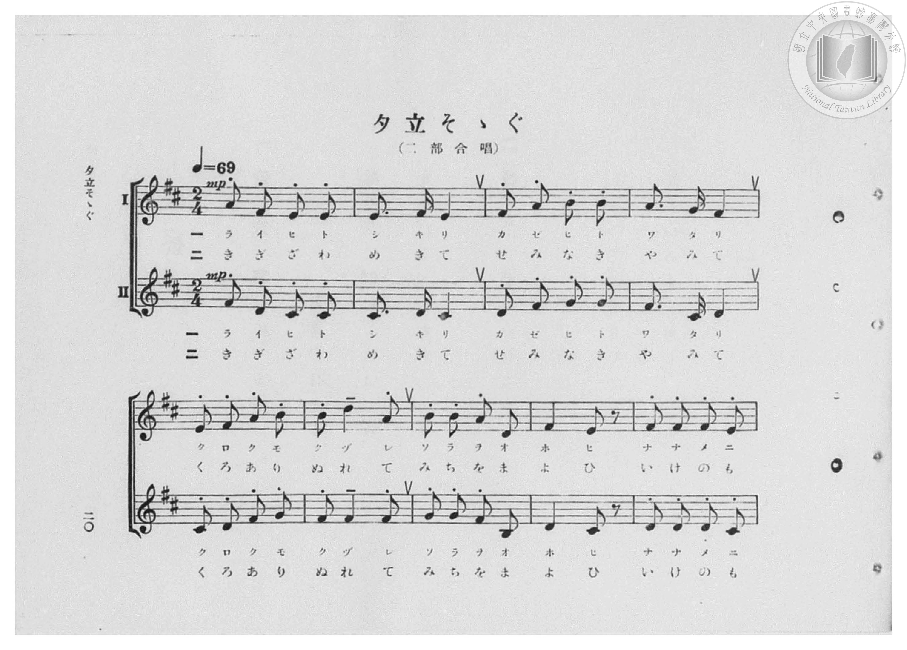
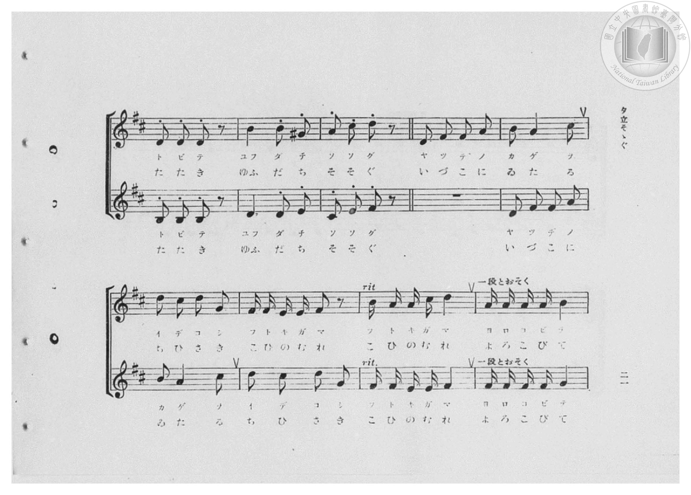
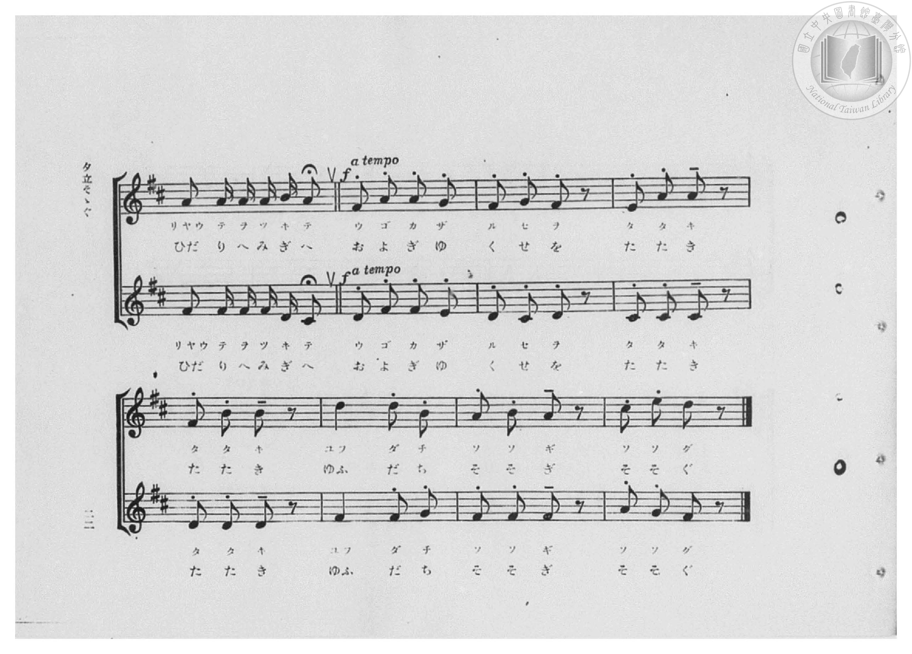
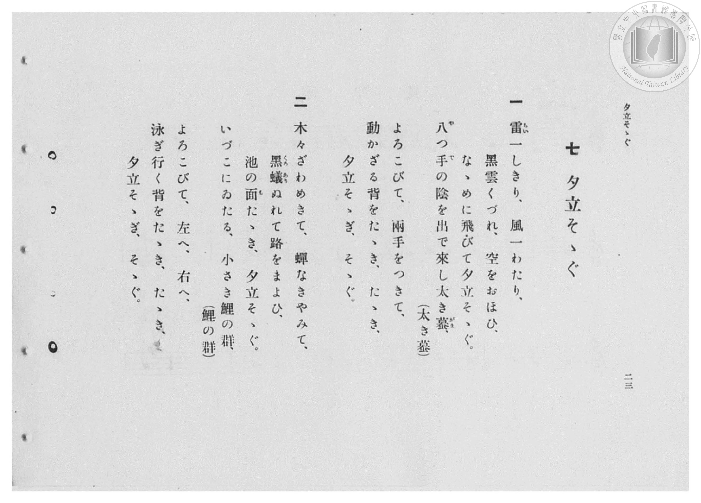

# 夕立そゝぐ

> Re:Shōka 使用 AI 協助辨識與重建樂譜，可能會有錯誤。歡迎回報。

- **鋼琴伴奏版**：<br><audio controls src="yudachi_sosogu.mp3"></audio>

- 臺灣總督府《公學校高等科唱歌》第二學年用（昭和十一年，索書號 0729 74）

## 說明

原書資訊與歌詞全文（對應 P022.jpg–P025.jpg，原書 pp. 20–23，第 7 首）：
調性與拍號：ニ長調（D 大調，2 升記號）2/4 拍，速度 ♩=69（二部合唱）


## 歌詞

```text
一
雷（らい）一しきり、風一わたり、
黒雲くづれ、空をおほひ、
なゝめに飛びて夕立そゝぐ。
八（や）つ手（で）の陰を出で來し太き蟇（がま）、（太き蟇）
よろこびて、兩手をつきて、
動かざる背をたゝき、たゝき、
夕立そゝぎ、そゝぐ。

二
木々ざわめきて、蟬なきやみて、
黒蟻（くろあり）ぬれて路をまよひ、
池の面（も）たゝき、夕立そゝぐ。
いづこにゐたる、小さき鯉の群、（鯉の群）
よろこびて、左へ、右へ、
泳ぎ行く背をたゝき、たゝき、
夕立そゝぎ、そゝぐ。
```

## ABC

<div class="abc-score" data-abc-src="yudachi_sosogu.abc" aria-label="五線譜載入中"></div>

[下載 ABC 原始檔](yudachi_sosogu.abc)

## TMD 檔案連結

- [主旋律 TMD 檔案](yudachi_sosogu.tmd) [[在 TMD Studio 編輯](https://tmdlang.github.io/Tmd-TS/#tmd=s7IKdvYPcrWy4qpTUCpJTLdSSM7PyUlNLsnMz7PKzk9PzM7Ojy_OyM9OVIKrKMvPKc1NBcqW5McbIYSL80uLklOtipMz8vNz4ktSK0qS8vOz0eXjCxLTU60CDIwwdMJljHHKmCBkCoryy1LzEvOANhYUZeaVpKaArUQoSC3LTEkFSRcnJ-bFl6UWZaZlpqYg-SK1qBjkSagVJUWJecXJRZkFIJ8jVOUXlWTkpxclFmRUWmVkFpfkF2UmJ-bEZyfmIQVISUYqMDzyEktKi1LRRctTE4GMInThxLzM3MQcZHsy0zPzrEoSM8uBrs1PS8tMzgTJa2kpPF0y9fnq7seNcx83zX3cOEFBS4tL0VbBzJLL3lbBhcvGSN_EDmTMi_ZdzxsXP9-x9_ncxU93zXnc0PW0dc3TtTueLVj4cvWM52s7ny-f-HTKxmdrex43dD9fs-bJrh6g7NOdW55PWfF-T8ezGWufTup52tv4ZEcDUPD9np7nWxY9m73jxcz5CgbmRpYK5ibv93QqcXHpaynYUgtwKSgoPO2bD7Jmc_uLFV0vOtqB7nuxct7T1hXPprUDnfV0Q--z9k4FUHrRyypIf9QwGcg0BTGBLoRoVSgo0FMwMgBKGRmDnL1mjYK5wstl04DOfb9nFsiKF6v2P2tYDjK8uxfoH6Do4-bul1O3A8WBVrgAQ3g5mNljpPC0F-iOGWBFncCQVQDqAIq_bJj_dNcyhUczV9qaWQK1AMPuZfOKpxM6gAEKVMgFsgQYbiDq5eztQAWPmzofN7YApYCijxunP27sfdzU9bih8eWiFSCRpv7HjfMhImA9uye9nL3pcSNQdOnjJmD8ND5fuetx06THjV2PG3c_btwEVfe4cRUoDTQ1Pm5c_XLx7MeNmx83LkNLHo8bmsCh2roa7AyQGx43LnnW2Q3iNi4Hc9e9nLkBaPzT9l1AkSf72oAufLpkFdCRL-aDwvxxY8_jxn0glQ2NoChASHWCXdEENLf3ceNkiP1ARU9bVwItADt4CcirYEGwK7qnPm4Eum3a46buF809YBVAfwPd2QtUgcwGq0bxSR9YBZKvwIG8qwdEPZuz4nFDK9jcfnBwQO18MX8NKIxAod3yuHE_wiHAEH4xfzfYb0ANQNVNwNAHh8UaUIA3LnuxfT3YdftAvoMH-LONC0ChNXcROCybwBoQbsYe8sB4B0UjKHhWP26aANbQDVK9ARi9wODofbkeFAXP9y2BBC-cizt4ty973LgDxOgHioAYYLdtBnL6XiwEur6f4rAFqqA8N0OBgpY-F1dkaUpickZmcH5xfnqpVUBmYl6-oUONQU01yCoFG0MzLTswC1tpogAqnXY0PFu3VUEDlvGhYkB3A5MA0NM6CpYKwBB9vr5BE4sBQBeADK9RqM4tqFUwVdBVMAZiIyiuAZMgMQgNEgHJg9SZQXENmKerYAKWAasBG-ljWKPwuHklkP-4aQmIbJ4EJjvAeh43bQerfdy0Fii2Cm7646bVYNE9mDqa10N17EfWAbHLCCjf2AuSbewDk9PAKvuhZjZCdAJVANMJwq7G2WDR_WASZCLEDJCOFqgOoF0IHeCMBQ0U5GCoAZOGcVB1IGGIEAiDeIbwkANBkHYDuAgMg8MbEXJNIN8-bl4L9geEvQjqNgivFWra4-Y1UPG9YB44xJs3gfWB_AQKOZA_IWpBIRoPFe0Ci0DIhWCyGy1EQeEHzGLgkGgCs0GqQTIgO4HlAcxccBiBxCFhCTatCRx7jfugrgPFIkQtyG1QNzSCwvlx40QwuQ6sC2QPNKRxJvldPbAkb0xBkgfFCgxD4gMUXyAIok3UwUKg6DMHKQLFLkQVSD0s1hBxDckFEMXIOQDk78fNk8FkG1LoL3vcPBUeLQ1gEpRM4REJJTcgaYFkI3CQNbeDSVBiR2QaUMBCzAOxkCNyPjiAISQoOqEmNgErtK3weFkAjzuQlrlgHoScgBFjS8Ek2FeNIMtBhoFUQSyB5FNIaoIFNij84AFpAtZiDC5YjMABCYsAUyA0R-QlUARAICxukPMIJEDAQdG0GUyCShVQUE0Fhzy4dGlaA2TPQwpGbHLQEqF5BTjPgUwDxRkkxtDLGXDqBqdiYDUFD1KQDFAHUByUkh83NUDzByzcsMnByjyQa0BlE0gN0Gb0Egd30d8Jywcm2POBBTH5AJRyYaEMSc_VabUohRwsuhDpHhJdIDUQ3VARpHS_CpheHzeBfAIKRVCSBCVdSHkPClWQv8GyTVvAJCQJb4PGA4S3G6wbqbwAlv0gcQgJKhvB4khxA2wbgpMxsKACNgCgBXgfmA2JBnBxBy6MoFVFE9QxkMIOUiWAiy5YxGHNO7BkDSvlQRhaOsCSLpiBqCFhZQSSKiMQgShYkBI2Vm8SX2iASlJYiGEtTKhXNIDCEBZSWIsMrlqsbRyjgWrjgFIvqAQ3B7kOTNRAKJAwlIFcyoPSPiL9g7WApBCFAlQ7snpEXgFBEF0DNwfEM4NYCzMHrB9Rt8AwxHF0qQrBDkIQCLdAggXWGgS7CFYwQBSBSGSIpXpEyioolSTBOgFiHkgEBEHy9CsUIT6AQIjnQYUiLGrgDTZERCFaEXAuXAhngwMziGFJCBHCsEY5wjRgjtK1U0DJVNE-hrEKmIJGYEFlLgA)]
- [鋼琴伴奏 TMD 檔案](yudachi_sosogu_piano.tmd) [[在 TMD Studio 編輯](https://tmdlang.github.io/Tmd-TS/#tmd=s7IKdvYPcrWy4qpTUCpJTLdSSM7PyUlNLsnMz7PKzk9PzM7Ojy_OyM9OVIKrKMvPKc1NBcqW5McbIYSL80uLklOtipMz8vNz4ktSK0qS8vOz0eXjCxLTU60CDIwwdMJljHHKmCBkCoryy1LzEvOANhYUZeaVpKaArUQoSC3LTEkFSRcnJ-bFl6UWZaZlpqYg-SK1qBjkyYLMxLz8-MSiosS89NTc1DwkI5AErRIz4xOTk_NzCxLzMlFV5ReVZOSnFyUWZFRaZWQWl-QXZSYn5sRnJ-YhhVlJBtAYq7zEktKiVHTR8tREIKMIXRhkUWIOsj2Z6Zl5ViWJmeVAD-WnpWUmZ4LktbQUni6Z-nx19-PGuY-b5j5unPB-T8fL7j3PJ2x5smfL06X9zzs73u_pVNDS4lK0VTCz5LK3VXDhsjHSN7EDmf2ifdfzxsXPd-x9Pnfx011zHjd0PW1d83TtjmcLFr5cPeP52s7nyyc-nbLx2dqexw3dz9esebKrByj7dOeW51NWAC16NmPt00k9T3sbn-xoAAq-39PzfMuiZ7N3vJg5X8HA3MhSwdwEaLkSF5dnXklRvlUAKLSDPBxqDGqquRSAwMbQTMsOzKpRqM4tqFUwVdBVMAZiIyiuAZMgMUMwDRThqkUxzgeXcUDTDOOBGkwhBJxZAxTWNo3XhhkIggYwgyNLUxKTMzKD84vz00shFhiS5VwIDRIByYPUmUFxDZinq2ACloF4CWSkj2GNwuPmlUD-46YlILJ5EpjsAOt53LQdrPZx01qg2Cq46Y-bVoNF92DqaF4P1bEfWQfELiOgfGMvSLaxD0xOA6vsh5rZCNEJVPG4cRnCrsbZYNH9YBJkIsQMkI4WqA6gXQgdXNCwAgUGcjDUgEnDOKg6kDBECIRBPFDcQEIOBEHawTEEFoFhcHgjQq4J5NvHzWvB_oCwF0HdBuG1Qk173LwGKr4XzAOHePMmsD6Qn0AhB_InRC0oRCGp5nFzF1gEQi4Ek91oIQoKv8dNkHBtArNBqkEyIDsfN_XAzAWHEUgcEpZg05rAsde4D-o6UCxC1ILcBnVDIyicHzdOBJPrwLpA9sBDGhRwMAwJMlCQgiCINlEHC4FC2BykCBQBEFUg9bCARUQHJKFCFCMnUpDTHjdPBpNtSAG07HHzVHjINYBJUEqChzWU3ICkBZLSwb5qbgeToPSISNcgv0PMA7GQw3o-OAwgJCjEoSY2tT1u3AoPugXw4AVpmQvmQcgJGIG6FEyCfdUIshxkGEgVxBJIVoJEOCywQeEHD0gTsBZjcN43AgckLAJMgdAckdxBEQCBsLhBTsaQAAEHRdNmMAnK-KCgmgoOeXAB0LQGyJ6HFIzY5KCZtnkFOFuATAPFGSTG0IsCcAIEJ7THjaAohGdsYHiAxEGJ7XFTAzQJw8INmxysWAK5BlR8gNQAbcYsFECJCxYQkCRXnVaLUlTAQhSRNCEhClID0Q0ruRFJcxUwST1uAlkG8igo1YBSF6TUBHkc5DSwbNMWMAlJZdugQQXh7QbrRsp1wBIUJA4hQSUMWBwp-DZBUxowuz9u3AEtBvvAbEhIgQsNcJaGFrhNUMdAigxIwQouAGBhizV5w8IOVlaCMDQDw1IXmIGoZ2DZGEmVEYhA5H2ktIfVm8Tna1B5BAsxrPmderkXFIawkMKaq3FU5kZ4KnNQAgOVg-YgA8BEDYQCCUMZyGUlKHkikihYC6KRAjEXrAtZPSI5gyCIroGbA-KZQVsoUAVg_YgSGoYhjoOlBRAHQSBUQxwOa5iA9cByF0QRiESGWKoBpPSGUhkQLPsg5oFEQBAkjxwuEDsgEOI8UN6HeQ9euyM8i6jP4Fy4EM6qDzMQYNGACANYCw5hGvaEQ0YzE4mD1vyEsU1gfkFRDJZH9hlEDiwMJsDakM1BsICpCR4-kCSBrhZiGDSAsDoQnq5APGOEKRA9JgjHGGH3LML9eJ2IJgqLRVQd2L2Kz3D00MVuOHIoVOeC0h4-w9AsRo8P5LgCW4ogYGEGUgoTAwcbLrOxioLSpK6dArjXowBkoKTPaB_DWCyCRmBBZS4A)]

## 分析

```text
================================================================================
📊 TMD Song Profile: [ 夕立そゝぐ ]
================================================================================
⏱  Duration:       1:30 (90.4s), 52 measures total
🎼 Key & Tempo:    首調基準 D, != 69.0 BPM, <2/4>
   - 分析範圍：      由實際發聲的音符與和弦推測調性；播放脈絡另行呈現
🎤 人聲音域:    D4 (MIDI 62) – E5 (MIDI 76) [跨度: 14 個半音 / 1.2 個八度, 難度: moderate]
   - 最低音:  D4 in [YudachiSosogu[L1] #1 @ m.7, 0:11]
   - 最高音: E5 in [YudachiSosogu[L1] #1 @ m.26, 0:43]
   - 適合: soprano, mezzo-soprano, contralto, tenor, baritone, bass
🏛  結構:      YudachiSosogu[L1] (45.2s) -> YudachiSosogu[L2] (45.2s)
⚡ 編曲密度:        Peak 2 軌道同時演奏
🗝  調性診斷：       D 大調（純淨自然大調，未偵測到可信轉調）
   - 風格氣質:    純淨自然大調（陽光明朗、易唱易記，無明顯調外色彩）
   - 轉調歷程:    全曲維持單一推測調性（未偵測到可信轉調）
   - 核心骨幹音:  D, F#, A, B, E
   - 調性數值:    D 大調 [相關度: 0.89, 穩定度: High, 自然音純度: 99.5%]
   - 候選調性 (K-S): D 大調 (0.89), B 小調 (0.75), F# 小調 (0.74)
   - 五度圈歷程:   +2 -> +2
   - 各段落調性細節:
     • [YudachiSosogu[L1] #1]: D 大調 (r: 0.89, 自然音純度: 99.5%, 調外音: G#)
     • [YudachiSosogu[L2] #1]: D 大調 (r: 0.89, 自然音純度: 99.5%, 調外音: G#)

  [ 五度圈游移軌跡 ]
               C  
         F            G  
      Bb              [D ]*
      Eb               A  
         Ab           E  
            Db       B  
               F# 
     (* = active key center)

  [ 十二半音累積音高分佈 ]
     C  :                            0.0%
     C# : █████████                  9.4%
     D  : ████████████████████████  24.9%
     D# :                            0.0%
     E  : ██████████                 9.9%
     F  :                            0.0%
     F# : ██████████████████████    23.0%
     G  : ██████                     6.1%
     G# : █                          0.5%
     A  : ██████████████            14.2%
     A# :                            0.0%
     B  : ████████████              12.0%
--------------------------------------------------------------------------------
Assignment 軌道音域：
  - Piano1        : D4 – E5 (14 個半音 / 1.2 個八度, 188 個音符)
  - Piano2        : B3 – D5 (15 個半音 / 1.2 個八度, 178 個音符)
================================================================================
```


## 原書掃描頁










