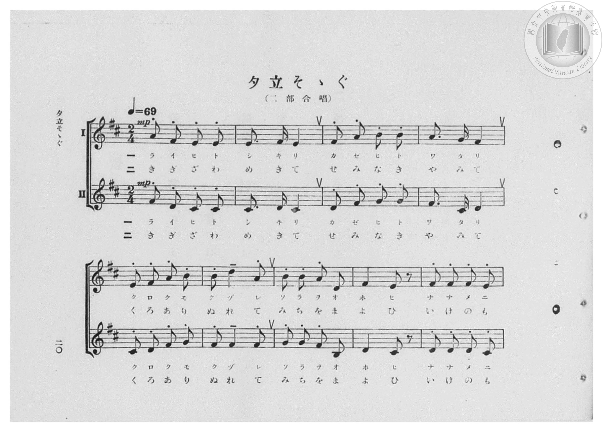
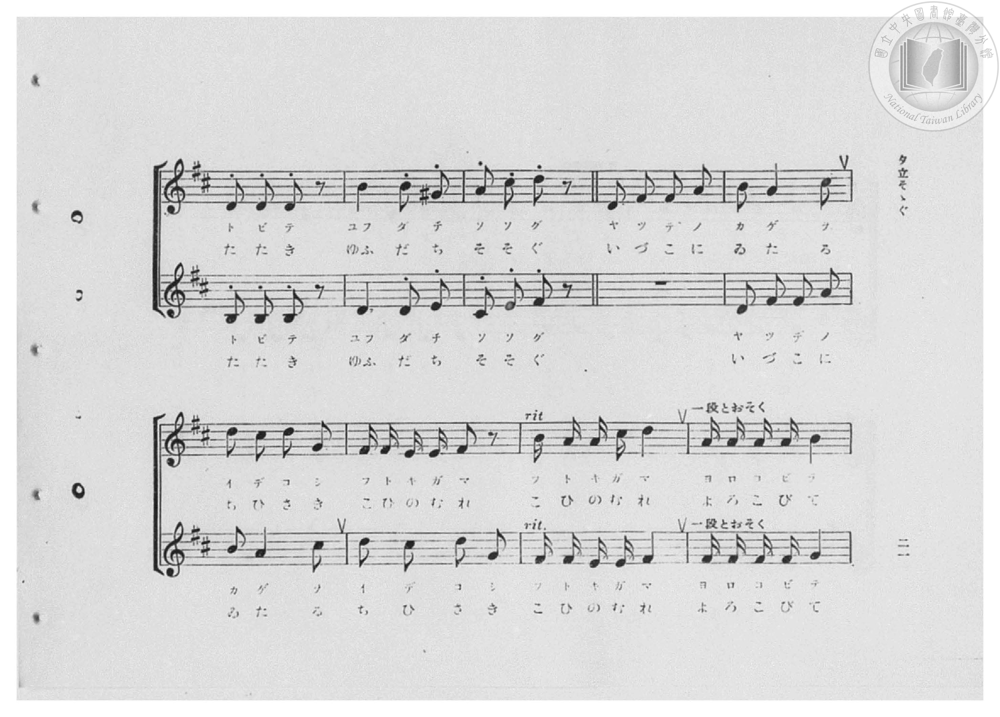
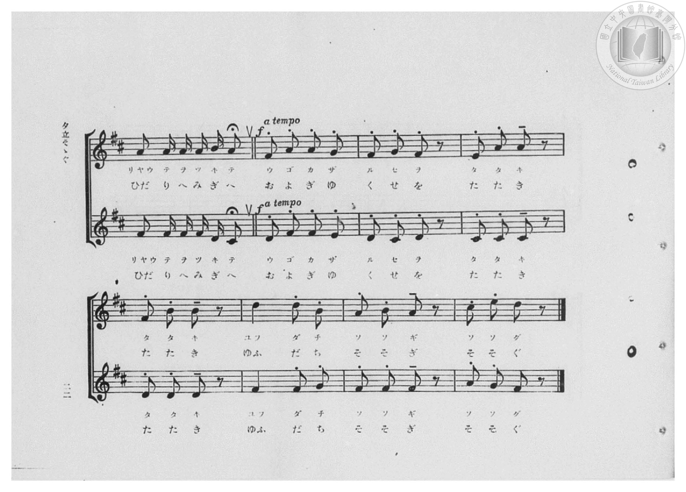
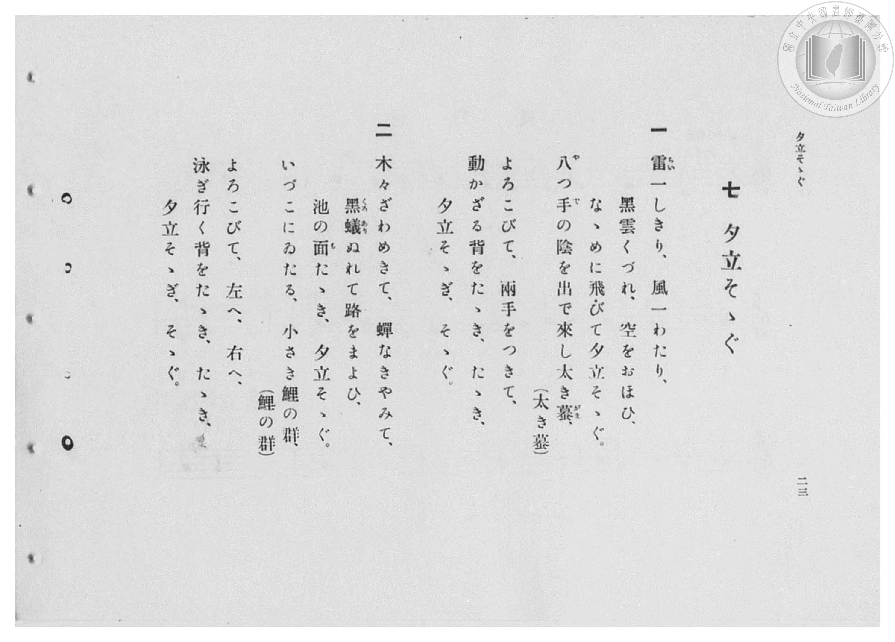

# 夕立そゝぐ

> Re:Shōka 使用 AI 協助辨識與重建樂譜，可能會有錯誤。歡迎回報。

- **鋼琴伴奏版**：<br><audio controls src="yudachi_sosogu.mp3"></audio>
- **NEUTRINO 歌聲合成版**：<br><audio controls src="yudachi_sosogu_neutrino.mp3"></audio>

- 臺灣總督府《公學校高等科唱歌》第二學年用（昭和十一年，索書號 0729 74）

## 說明

原書資訊與歌詞全文（對應 P022.jpg–P025.jpg，原書 pp. 20–23，第 7 首）：
調性與拍號：ニ長調（D 大調，2 升記號）2/4 拍，速度 ♩=69（二部合唱）


## 歌詞

```text
一
雷（らい）一しきり、風一わたり、
黒雲くづれ、空をおほひ、
なゝめに飛びて夕立そゝぐ。
八（や）つ手（で）の陰を出で來し太き蟇（がま）、（太き蟇）
よろこびて、兩手をつきて、
動かざる背をたゝき、たゝき、
夕立そゝぎ、そゝぐ。

二
木々ざわめきて、蟬なきやみて、
黒蟻（くろあり）ぬれて路をまよひ、
池の面（も）たゝき、夕立そゝぐ。
いづこにゐたる、小さき鯉の群、（鯉の群）
よろこびて、左へ、右へ、
泳ぎ行く背をたゝき、たゝき、
夕立そゝぎ、そゝぐ。
```

## ABC

<div class="abc-score" data-abc-src="yudachi_sosogu.abc" aria-label="五線譜載入中"></div>

[下載 ABC 原始檔](yudachi_sosogu.abc)

## TMD 檔案連結

- [主旋律 TMD 檔案](yudachi_sosogu.tmd) [[在 TMD Studio 編輯](https://tmdlang.github.io/Tmd-TS/#tmd=s7IKdvYPcrWy4qpTUCpJTLdSSM7PyUlNLsnMz7PKzk9PzM7Ojy_OyM9OVIKrKMvPKc1NBcqW5McbIYSL80uLklOtipMz8vNz4ktSK0qS8vOz0eXjCxLTU60CDIwwdMJljHHKmCBkCoryy1LzEvOANhYUZeaVpKaArUQoSC3LTEkFSRcnJ-bFl6UWZaZlpqYg-SK1qBjkSagVJUWJecXJRZkFIJ8jVOUXlWTkpxclFmRUWmVkFpfkF2UmJ-bEZyfmIQVISUYqMDzyEktKi1LRRctTE4GMInThxLzM3MQcZHsy0zPzrErzQI4ugTpVS0vh6ZKpz1d3P26c-7hp7uPGCQpaWlyKtgpmllz2tgouXDZG-iZ2IDNetO963rj4-Y69z-cufrprzuOGrqeta56u3fFswcKXq2c8X9v5fPnEp1M2Plvb87ih-_maNU929QBln-7c8nzKivd7Op7NWPt0Us_T3sYnOxqAgu_39DzfsujZ7B0vZs5XMDA3slQwN3m_p1OJi0tfS8GWWoBLQUHhad98kDWb21-s6HrR0Q5034uV8562rng2rR3orKcbep-1dyqAEoteVkH6o4bJQKYpiAl0IUSrQkGBnoKRAVDKyBjk7DVrFMwVXi6bBnTu-z2zQFa8WLX_WcNykOHdvUD_AEUfN3e_nLodKA60wgUYwsvBzB4jhae9QHfMACvqBIasAlAHUPxlw_ynu5YpPJq50tbMEqgFGHYvm1c8ndABDFCgQi6QJcBwA1EvZ28HKnjc1Pm4sQUoBRR93Dj9cWPv46auxw2NLxetAIk09T9unA8RAevZPenl7E2PG4GiSx83AeOn8fnKXY-bJj1u7HrcuPtx4yaouseNq0BpoKnxcePql4tnP27c_LhxGVryeNzQBA7V1tVgZ4Dc8LhxybPObhC3cTmYu-7lzA1A45-27wKKPNnXBnTh0yWrgI58MR8U5o8bex437gOpbGgERQFCqhPsiiagub2PGydD7Acqetq6EmgB2MFLQF4FC4Jd0T31cSPQbdMeN3W_aO4BqwD6G-jOXqAKZDZYNYpP-sAqkHwFDuRdPSDq2ZwVjxtaweb2g4MDaueL-WtAYQQK7ZbHjfsRDgGG8Iv5u8F-A2oAqm4Chj44LNaAArxx2Yvt68Gu2wfyHTzAn21cAAqtuYvAYdkE1oBwM_aQB8Y7KBpBwbP6cdMEsIZukOoNwOgFBkfvy_WgKHi-bwkkeOFc3MG7fdnjxh0gRj9QBMQAu20zkNP3YiHQ9f0Uhy1QBeW5GQoUtPS5uCJLUxKTMzKD84vz00utAjIT8_INHWoMaqpBVinYGJpp2YFZ2EoTBVDptKPh2bqtChqwjA8VA7obmASAntZRsFQAhujz9Q2aWAwAugBkeI1CdW5BrYKpgq6CMRAbQXENmASJQWiQCEgepM4MimvAPF0FE7AMWA3YSB_DGoXHzSuB_MdNS0Bk8yQw2QHW87hpO1jt46a1QLFVcNMfN60Gi-7B1NG8HqpjP7IOiF1GQPnGXpBsYx-YnAZW2Q81sxGiE6gCmE4QdjXOBovuB5MgEyFmgHS0QHUA7ULoAGcsaKAgB0MNmDSMg6oDCUOEQBjEM4SHHAiCtBvARWAYHN6IkGsC-fZx81qwPyDsRVC3QXitUNMeN6-Biu8F88Ah3rwJrA_kJ1DIgfwJUQsK0XioaBdYBEIuBJPdaCEKCj9gFgOHRBOYDVINkgHZCSwPYOaCwwgkDglLsGlN4Nhr3Ad1HSgWIWpBboO6oREUzo8bJ4LJdWBdIHugIY0zye_qgSV5YwqSPChWYBgSH6D4AkEQbaIOFgJFnzlIESh2IapA6mGxhohrSC6AKEbOASB_P26eDCbbkEJ_2ePmqfBoaQCToGQKj0gouQFJCyQbgYOsuR1MghI7ItOAAhZiHoiFHJHzwQEMIUHRCTWxCVihbYXHywJ43IG0zAXzIOQEjBhbCibBvmoEWQ4yDKQKYgkkn0JSEyywQeEHD0gTsBZjcMFiBA5IWASYAqE5Ii-BIgACYXGDnEcgAQIOiqbNYBJUqoCCaio45MGlS9MaIHseUjBik4OWCM0rwHkOZBooziAxhl7OgFM3OBUDqyl4kIJkgDqA4qCU_LipAZo_YOGGTQ5W5oFcAyqbQGqANqOXOLiL_k5YPjDBng8siMkHoJQLC2VIeq5Oq0Up5GDRhUj3kOgCqYHohoogpftVwPT6uAnkE1AogpIkKOlCyntQqIL8DZZt2gImIUl4GzQeILzdYN1I5QWw7AeJQ0hQ2QgWR4obYNsQnIyBBRWwAQAtwPvAbEg0gIs7cGEErSqaoI6BFHaQKgFcdMEiDmvegSVrWCkPwtDSAZZ0wQxEDQkrI5BUGYEIRMGClLCxepP4QgNUksJCDGthQr2iARSGsJDCWmRw1WJt4xgNVBsHlHpBJbg5yHVgogZCgYShDORSHpT2EekfrAUkhVYUDc-GDjg4kAMCUQiAIIiugQcQiGcGCU9YAIH1IypNGIaE-mhbh45tHXDEIAhEnEDSPay5D44ZWMkPUQQikSGW9s9oawfIR2ntYDQICbZ_IEELEgFBkDxaCTPa2KFKYweScCEQkuZBjR1YyQTviCHKKUTvAM6FC4245g5mlwmzDIHVFYgiBDasgCXchltLR9dOAaWxowAUUOYCAA)]
- [鋼琴伴奏 TMD 檔案](yudachi_sosogu_piano.tmd) [[在 TMD Studio 編輯](https://tmdlang.github.io/Tmd-TS/#tmd=s7IKdvYPcrWy4qpTUCpJTLdSSM7PyUlNLsnMz7PKzk9PzM7Ojy_OyM9OVIKrKMvPKc1NBcqW5McbIYSL80uLklOtipMz8vNz4ktSK0qS8vOz0eXjCxLTU60CDIwwdMJljHHKmCBkCoryy1LzEvOANhYUZeaVpKaArUQoSC3LTEkFSRcnJ-bFl6UWZaZlpqYg-SK1qBjkyYLMxLz8-MSiosS89NTc1DwkI5AErRIz4xOTk_NzCxLzMlFV5ReVZOSnFyUWZFRaZWQWl-QXZSYn5sRnJ-YhhVlJBtAYq7zEktKiVHTR8tREIKMIXRhkUWIOsj2Z6Zl5ViWJmeVAD-WnpWUmZ4LktbQUni6Z-nx19-PGuY-b5j5unPB-T8fL7j3PJ2x5smfL06X9zzs73u_pVNDS4lK0VTCz5LK3VXDhsjHSN7EDmf2ifdfzxsXPd-x9Pnfx011zHjd0PW1d83TtjmcLFr5cPeP52s7nyyc-nbLx2dqexw3dz9esebKrByj7dOeW51NWAC16NmPt00k9T3sbn-xoAAq-39PzfMuiZ7N3vJg5X8HA3MhSwdwEaLkSF5dnXklRvlUAKLSDPBxqDGqquRSAwMbQTMsOzKpRqM4tqFUwVdBVMAZiIyiuAZMgMUMwDRThqkUxzgeXcUDTDOOBGkwhBJxZAxTWNo3XhhkIggYwgyNLUxKTMzKD84vz00shFhiS5VwIDRIByYPUmUFxDZinq2ACloF4CWSkj2GNwuPmlUD-46YlILJ5EpjsAOt53LQdrPZx01qg2Cq46Y-bVoNF92DqaF4P1bEfWQfELiOgfGMvSLaxD0xOA6vsh5rZCNEJVPG4cRnCrsbZYNH9YBJkIsQMkI4WqA6gXQgdXNCwAgUGcjDUgEnDOKg6kDBECIRBPFDcQEIOBEHawTEEFoFhcHgjQq4J5NvHzWvB_oCwF0HdBuY17YKa9rh5DVR8L5gHDvHmTWA1ID-BQg7kT4haUIhCUs3j5i6wCIRcCCa70UIUFH6PmyDh2gRmg1SDZEB2Pm7qgZkLDiOQOCQswaY1gWOvcR_UdaBYhKgFuQ3qhkZQOD9unAgm14F1geyBhzQo4GAYEmSgIAVBEG2iDhYChbA5SBEoAiCqQOphAYuIDkhChShGTqQgpz1ungwm25ACaNnj5qnwkGsAk6CUBA9rKLkBSQskpYN91dwOJkHpEZGuQX6HmAdiIYf1fHAYQEhQiENNbGp73LgVHnQL4MEL0jIXzIOQEzACdRaYBPuqEWQ5QgZkCSQrQSIcFtig8IMHpAlYizE47xuBAxIWAaZAaI5I7qAIgEBY3CAnY0iAgIOiaTOYBGV8UFBNBYc8uABoWgNkz0MKRmxy0EzbvAKcLUCmgeIMEmPoRQE4AYIT2uNGUBTCMzYwPEDioMT2uKkBmoRh4YZNDlYsgVwDKj5AaoA2YxYKoMQFCwhIkqtOq0UpKmAhikiakBAFqYHohpXciKS5CpikHjeBLAN5FJRqQKkLUmqCPA5yGli2aQuYhKSybdCggvB2g3Uj5TpgCQoSh5CgEgYsjhR8m6ApDZjdHzfugBaDfWA2JKTAhQY4S0ML3CaoYyBFBqRgBRcAsLDFmrxhYQcrK0EYmoFhqQvMQNQzsGyMpMoIRCDyPlLaw-pN4vM1qDyChRjW_E693AsKQ1hIYc3VOCpzI2yVub6Wgi06UAA1dnY0PFu3VUED1F7VyypIh4o9bmgENoNeLOzRUbBUeLqh__n6Bk0sBmjpI7cUQKkXVMiag1wHJmogFEgYykAuiEFpH5H-wVoQLaBh3lwABwdyQCAKARAE0TXwAALxzKDtOqgCsH5EvQbDkFAfbTEgtxhwJv1dPbCkb0xB0gdHDIJAxAkk3cMazeCYgZX8EEUgEhliaaKMNkiAhqM0SDDabASbKJCgBYmAIEgerYQZKe0R3HVAJywjmGDPCBbEZARIwoVASJoHNXZgJRO8O4MopxANeDgXLjTimjuYvRrMMgRWVyCKEFjnHEu4jYCWDhnjIkgctPESGNsElhZRFIPlESEMkwMLgwmwNmRzECxgRQ5P35B6Al0txDBotGN1ILyyAfGMEaZA9JggHGOE3bMI9-N1IpooLG2i6sDuVXyGo4cudsORQ6E6F1R24DMMzWL0-ECOK7ClCAIWZiClMDFwsOEyG6soKE3q2imAh-kUgAyU9BntYxiLRdAILKjMBQA)]

## 分析

```text
================================================================================
📊 TMD Song Profile: [ 夕立そゝぐ ]
================================================================================
⏱  Duration:       0:45 (45.2s), 26 measures total
🎼 Key & Tempo:    首調基準 D, != 69.0 BPM, <2/4>
   - 分析範圍：      由實際發聲的音符與和弦推測調性；播放脈絡另行呈現
🎤 人聲音域:    D4 (MIDI 62) – E5 (MIDI 76) [跨度: 14 個半音 / 1.2 個八度, 難度: moderate]
   - 最低音:  D4 in [YudachiSosogu #1 @ m.7, 0:11]
   - 最高音: E5 in [YudachiSosogu #1 @ m.26, 0:43]
   - 適合: soprano, mezzo-soprano, contralto, tenor, baritone, bass
🏛  結構:      YudachiSosogu (45.2s)
⚡ 編曲密度:        Peak 2 軌道同時演奏
🗝  調性診斷：       D 大調（純淨自然大調，未偵測到可信轉調）
   - 風格氣質:    純淨自然大調（陽光明朗、易唱易記，無明顯調外色彩）
   - 轉調歷程:    全曲維持單一推測調性（未偵測到可信轉調）
   - 核心骨幹音:  D, F#, A, B, E
   - 調性數值:    D 大調 [相關度: 0.89, 穩定度: High, 自然音純度: 99.5%]
   - 候選調性 (K-S): D 大調 (0.89), B 小調 (0.75), F# 小調 (0.74)
   - 五度圈歷程:   +2
   - 各段落調性細節:
     • [YudachiSosogu #1]: D 大調 (r: 0.89, 自然音純度: 99.5%, 調外音: G#)

  [ 五度圈游移軌跡 ]
               C  
         F            G  
      Bb              [D ]*
      Eb               A  
         Ab           E  
            Db       B  
               F# 
     (* = active key center)

  [ 十二半音累積音高分佈 ]
     C  :                            0.0%
     C# : █████████                  9.4%
     D  : ████████████████████████  24.9%
     D# :                            0.0%
     E  : ██████████                 9.9%
     F  :                            0.0%
     F# : ██████████████████████    23.0%
     G  : ██████                     6.1%
     G# : █                          0.5%
     A  : ██████████████            14.2%
     A# :                            0.0%
     B  : ████████████              12.0%
--------------------------------------------------------------------------------
Assignment 軌道音域：
  - Piano1        : D4 – E5 (14 個半音 / 1.2 個八度, 94 個音符)
  - Piano2        : B3 – D5 (15 個半音 / 1.2 個八度, 89 個音符)
================================================================================
```


## 原書掃描頁










