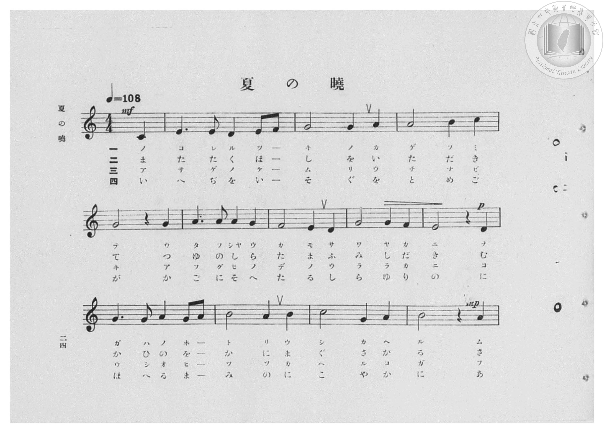
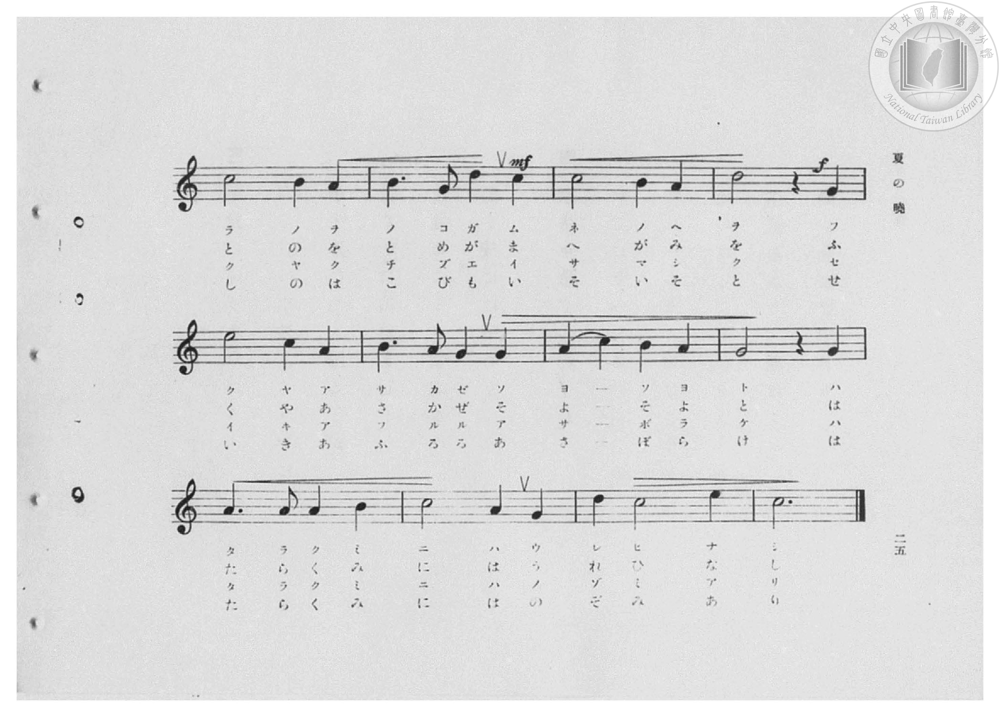
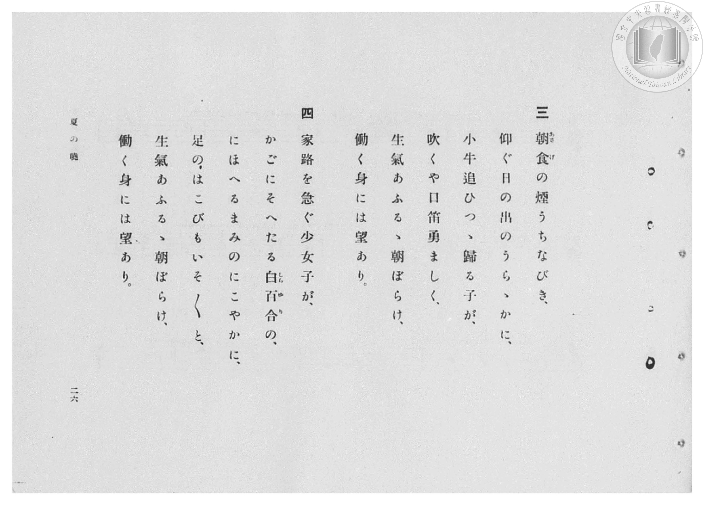
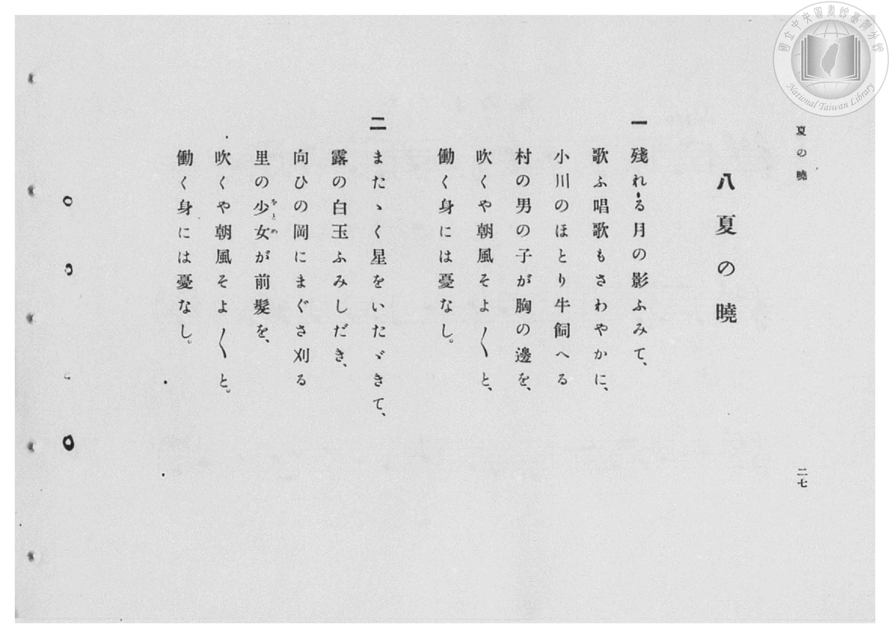

# 夏の曉

> Re:Shōka 使用 AI 協助辨識與重建樂譜，可能會有錯誤。歡迎回報。

- **鋼琴伴奏版**：<br><audio controls src="natsu_no_akatsuki.mp3"></audio>

- 臺灣總督府《公學校高等科唱歌》第二學年用（昭和十一年，索書號 0729 74）

## 說明

原書資訊與歌詞全文（對應 P026.jpg–P029.jpg，原書 pp. 24–27，第 8 首）：
調性與拍號：ハ長調（C 大調，無升降記號）4/4 拍（弱起 1 拍），速度 ♩=108


## 歌詞

```text
一
殘れる月の影ふみて、
歌ふ唱歌もさわやかに、
小川のほとり牛飼へる
村の男の子が胸の邊を、
吹くや朝風そよ〳〵と、
働く身には憂なし。

二
またゝく星をいたゞきて、
露の白玉ふみしだき、
向ひの岡にまぐさ刈る
里の少女（をとめ）が前髪を、
吹くや朝風そよ〳〵と、
働く身には憂なし。

三
朝食（あさげ）の煙うちなびき、
仰ぐ日の出のうらゝかに、
小牛追ひつゝ歸る子が、
吹くや口笛勇ましく、
生氣あふるゝ朝ぼらけ、
働く身には望あり。

四
家路を急ぐ少女が、
かごにそへたる白百合（しらゆり）の、
にほへるまみのにこやかに、
足のはこびもいそ〳〵と、
生氣あふるゝ朝ぼらけ、
働く身には望あり。
```

## ABC

<div class="abc-score" data-abc-src="natsu_no_akatsuki.abc" aria-label="五線譜載入中"></div>

[下載 ABC 原始檔](natsu_no_akatsuki.abc)

## TMD 檔案連結

- [主旋律 TMD 檔案](natsu_no_akatsuki.tmd) [[在 TMD Studio 編輯](https://tmdlang.github.io/Tmd-TS/#tmd=s7IKdvYPcrWy4qpTUCpJTLdSSM7PyUlNLsnMz7PKzk9PzM7Ojy_OyM9OVIKrKMvPKc1NBcqW5McbIYSL80uLklOtipMz8vNz4ktSK0qS8vOz0eXjCxLTU60CDIzMcMqY45SxQMgUFOWXpeYl5gFtLCjKzCtJTQFbiVCQWpaZkgqSLk5OzIsvSy3KTMtMTUHyRWpRMciTUCtKihLzipOLMgtAPkeoyi8qychPL0osyKi0ysgsLskvykxOzInPTsxDCpCSjFRgeOQllpQWpaKLlmTmpsbnp8WnJFaiS6UkZuZUxudkpiFpApqfnplnVZKYWQ50dX5aWmZyZmKOEpeWlsLTJf2PG9c9m92poKXFpWirYGhgwWVvq-DMZWOib2IHMuFF-67njYuf79j7fO7ip7vmPG7oetq65unaHc8WLHy5esbztZ3Pl098OmXjs7U9jxu6n69Z82RXD1D26c4tz6eseL-n49mMtU8n9TztbXyyowEo-H5Pz_Mti57N3vFi5nwFA3MjSwVzk_d7OpW4uPS1FGypBbgUFBSe9s0HWbO5_cWKrhcd7UD3vVg572nrimfT2oHOerqh91l7pwIoyehlFaQ_apgMZFqCmEAXQrQqFBToKRiZAKWMzEHOXrNGwULh5bJpQOe-3zMLZMWLVfufNSwHGd7dC_QPUPRxc__LqduB4kArnIGBuxzM7HnesvBpb_vLmb0vVswAK-wEhq4CUBfIJXs2vti6XcEQwgUa3fOyYf7TXcsUHs1caQuKDpBNwMADUc_WzXjc1PO4qfvZnA5gtD3du_Fx49bHjfsfNy573NAIVgGMhsat0PhoanrcOPVxU__jppbHjd2PG1dDFT3d0P90-1ygAY8bdz9uXPG4qet55-yXi_c8btwBNBtszNyJQOnnU7aDbFk74XFjz4vmHUD2y6aux02TYMZM2Pm4EWT4szlzXy5a8bhx7uOmjscNmx83AN20AqaouReo6MWu1SDrG9c_awO6adXjxumPG5ogPtvVA6IeN-573Dj_cRPQVf3PZgAZkx43Ah0NZMx73Ag0Aea_l3M2gRw2c-_zvk6Y36c_blwAUgRzFdDpIEVPNy0E2wk0GOiBqU87OqCee9kODKN1TzdMfLp0MzACwHYBA6ERGPpAjz7t7H25ehW1fbmjExysQCMWA6MfGHngqGmcBLZz3fPWmY8b2x43Ah0M1LUZ4ZknuzcAXf9s-lKQg9t3gaOs7XFTJzigUGMUGIUv9u8Fe30JUPrZWlBcQuIO3SdP-xc_XzP7aXc7OHCAwdcPVfF8yvxnGxaDHbcVqBtkzBygRXtANjZOxOHXObNBGoAJA-rXp7Nng6l1215sXw8Mx2cNQNdPgAQ3wjFg508BGwG0AZi2gFHdDYrXmfueTugAB9F0sEeB3u2ChBJcJ1APMN2C_Af2ADAJAIMFKDgZPaG_2Aa0ESi3HiQHDFdQhgCqmIsefRT7GyhNeakFBQpa-lxcfoklxaV--Y7ZIDo70yogMzEv36HGoKYaZJeCjYWWHZiBrdRUAJXCOxpeLOxR0ICWLtoKxuA0sr5BB17mIZRpYjED6AiQ-TUKBgq6cFydm1YLLKl0gcLGQFIXSBqBSROgiClYRBdMm4HVgEgQNAdiwziQENhMH8MahXggD4YfN_eBlT9u2gxW_rh5DRCvBrNagHgPWG4t1DCI6sdNIHmQ-Ca4-FQwOR9hjxGaPY37IHoaQWpA_PlA3A9m7YbZ0zgdZl7TJLBMC4oekMgCMNmLsMcYzZ6mRVC3bYWatAnu6o0we5pBpkDcvQosswyip7kRLt4FJicj7DFB9w_MbTugLluE5GqYf-bC3T0B7iuQ-Aq4P0E2AvMi2B78iWpXDzhRmWJPS2BZvGkJlkRAaQnEhiURMzANETGBqgElMFDiQugCyYBEa8DiMHOqC2oh6uBp63FzG1QeEhvQkG3aDw3XqUD29sfNS1AkQckJIg2KPEjUgYxaDxeHqIcmu-ZuZCuaQYkQkeiA1RWybCNIJ8gOiLOAJRI0mQGLF2hkIBIXKIkCSyGoOMTJIBGwenDSA4mDEh_Cgw0I24FJEZFVUBIjOHuA-BuAbHAigWW75na4HyGJFJYUV8LFQSwcfgdnWkQCBZbwKH4HqQWJgpIXiL8amiQhiRbF700gtRCfgnwBChuIOCjcgAUtVP06FPPBbiKQbHd0gpOtCY4iECSLN9nCyjpIAkQu60AiyAkZkkBBoqiJvToXmErBwohU2rQGGrj9sIBvng0vHTrgQY9SOjRthwcKpHycAY0SWPKFJEdwMkFKjpAIA7YNoMEHKgVg5QMsMiFBiSgjQaUFRBxcrsIiEhxJiOAHySEnPUjCB7nzcRPY5cCkBvMTqLSC-AnEQiQnkB8g4mAXQBIUPHxgfkKyCZzMdkNdtwOecPbB_YTINmDfQhIJkAaVpRD3gV0AT5woodfYBLYJb5ICtnEwk5Q5CbUquDoEQVDdCKktQSxQajICSUFqWnCdiU0tWA08cQGVghMhUgmIyLqQlAUuoKA8SBhDwheaVoB0L5oOWMqC1a8YsQBOWfBaBJ6ukGsXUN0CKRAQ6QpSV4FEIOKguALFNkgnIg7ABSBSukIvhkF8RG35uHkaUAxk5-MmWGELqXtBcvPA4qCcg2wSpPACpSLkVAWv_aEpB2oPNOUA25BAPaD0gah7EfUrJE2B-MghA_HPbLA9BGrXKfjSFOHa1RiWKMAJBjlRmYHTB6KgAitApCaMahmpkEIPePSmDbA8b9oDZu2FRgk4GoAZESYGEUEu1CBJCdTwQk5KID5y5gRnQ2gRA8msjxvnIAdxE8g8qE2QOgUsghn44EhESkwgn0BsWovsJ1gNCSyGYEURsm-hNjWD3QDOYCCZjbj8BE5O8CIPXGMj_AQLPaCfoIUXsm9hfoKEIayNMBGLn_AXUq1r8RZSBOs95MYZKLUgFUWI9hq4KIKLg9MgkjpYskJOUrB22Epo8oK22ZEaFpCARDREICUVrISAtIyRa0NYsCAnJ2gbHxh8sDY-tKSBl_aQQAR2qKGmQcojeH-iEVR_IZcJaLaAkxLRfoH3ccANPLAqiPtgiQ9kGxZbwMmIeL-ASi2QOLjMQ6oHockL3IhCtaWWi0vXTgGtvxntYxirgE3YCLuwMXZhE7CwMhcA)]
- [鋼琴伴奏 TMD 檔案](natsu_no_akatsuki_piano.tmd) [[在 TMD Studio 編輯](https://tmdlang.github.io/Tmd-TS/#tmd=s7IKdvYPcrWy4qpTUCpJTLdSSM7PyUlNLsnMz7PKzk9PzM7Ojy_OyM9OVIKrKMvPKc1NBcqW5McbIYSL80uLklOtipMz8vNz4ktSK0qS8vOz0eXjCxLTU60CDIzMcMqY45SxQMgUFOWXpeYl5gFtLCjKzCtJTQFbiVCQWpaZkgqSLk5OzIsvSy3KTMtMTUHyRWpRMciTBZmJefnxiUVFiXnpqbmpeUhGIAlaJWbGJyYn5-cWJOZloqrKLyrJyE8vSizIqLTKyCwuyS_KTE7Mic9OzEMKs5IMoDFWeYklpUWp6KIlQAPj89PiUxIr0aVSEjNzKuNzMtOQNAHNT8_MsypJzCwHeiw_LS0zOTMxR4lLS0vh6ZL-x43rns3ufL-n42X3nucTtjzZs-Xp0v7nnR3v93QqaGlxKdoqGBpYcNnbKjhz2Zjom9iBjH3Rvut54-LnO_Y-n7v46a45jxu6nrauebp2x7MFC1-unvF8befz5ROfTtn4bG3P44bu52vWPNnVA5R9unPL8ykrgDY9m7H26aSep72NT3Y0AAXf7-l5vmXRs9k7Xsycr2BgbmSpYG4CtF2Ji8szr6Qo3yoAFOBBHg41BjXVXApAYGOhZQdm1ChU5xbUKhgr6AKhsYIRmDQBCpuCRXQVDOOgjBquWhTjfHAYBzTNEKjbGIhN44EGmgJxjUK0obaxtmks1CwQNICZ6ZdYUlzql--YDaKzM_E6FqQJhqtz00BWAU3B43wQbQZWAyJB0BzmqRqwmT6GNQrxQB4MP27uAyt_3LQZrPxx8xogXg1mtQDxHrDcWqhhENWPm0DyIPFNcPGpYHI-wh4jNHsa90H0NILUgPjzgbgfzNoNs6dxOsy8pklgmRYUPSCRBWCyF2GPMZo9TYugbtsKNWkT3NUbYfY0g0yBuHsVWGYZRE9zI1y8C0xORthjgu4fmNt2QF22CMnVMP_Mhbt7AtxXIPEVcH-CbHzcOAVsDzTSYXEJinQQGxaXZmAaImICVQNKCaBUgNAFkgGJ1oDFYeaAkilYHTwRPG5ug8pDgg0aBE37oQEwFcje_rh5CYokKN4h0qBQhoQxyKj1cHGIemj6aO5GtqIZlFoQqeNxI8hUuGwjSCfIDoizgIUMND08buqEhhoiFYDS0uNGqO2NECeDRMDqwWkEJA5KJQgPNiBsB6YZRJpGSTXgdAzibwCywbEJyx_N7XA_QlITLM2shIuDWDj8Ds5diJT0uLEHxe8gtSBRUDoA8VdD0w4kdaH4vQmkFuJTkC9AYQMRB4Xb4yZQugWpX4diPthNsPQFKz0gKQW59ACJIKc4SEoCiaKmSnAZChZGJKemNdBQ6IeFUPNseH7rgIcRSn5r2g53PaTEmQENO1g6g6QbcHwipRtIyD5uBOZssD9B-QqW42ChDvEzotQB5T-IOLikgoU4ODQR4QSSQ04jkBQKcufjJrDLgWkC5idQ_of4CcRCxDvIDxBxsAsgMQ8PH5ifkGwCp4fdUNftgMfwPrifEOkb7FtIbAJpUOkEcR_YBfBUhBJ6jU1gm6BxD6_eQNUCpKIAsUDRbgSSglQy4OoCm1qwGngqACoFpxakMgWRGSBJAJzloTxIYEACAhqpQLoXTQcsCcCqFozgAicBeAEKTwDIBSuoWIVkMUQCgBTTIBGIOChQQdEC0okILHCRgpQA0As2EB9RUTxungYUA9n5uAlWfEGqHZDcPLA4KIkjmwQpDkDRjRz98IoPGsVQe6BR_LgRFG6giERUO4iqBRL5ID5yyED8MxtsDyzjw2IPHLPIsW8GjkhE1gcrQEQ7Ro2ElO3RQwi9-gUWZU17wKy90LADhxcwacPEICLIxQQkzkGNA-Q4B_GRkzs4YUMzLST5P26cgxwWTSDzoDZBilOwCGYogUMbKdZBPoHYtBbZT7DKAZixYZkb2bdQm5rBbgDnBJDMRlx-Asc7vBABV1YIP8FCD-gnaHGA7FuYnyBhCKseJ2LxEzTmkRsQoGhFytyINgU4c8PFwYkFSR0s_pHjHtZWWAlNB9AGIFLlB_ExorKE5H1YnoM0s5ArApj7keMd2mAE-hPWYITmXXhBB_Ht40ZQFQgyDZLD4Y3TRlDRjZzL0GwBxznRfoE3mMGNELAqiPtgqQRkGxZbwPFNvF9A5QBIHFyKIFUB0HQAruhRbcHVt8DRc0HuW4AjFldfBiYEok3igRSw-QmiTEAiIGUmIGWwCgauGGYqXC1MCpjS4hXMQBqBBEgQbAhCK1gDiAMseGDGAxnIyQ9NMdgchBjCUSAZY2ASN0Z2PGFDISowVRtBnUVIHXZTsTkBESZoQYrqI3hoQo2EKwYzCIQfPIih6vD0TXXtFMBdXgUgAy0tRfsYArVgETbCLmyMXdgELKzMBQA)]

## 分析

```text
================================================================================
📊 TMD Song Profile: [ 夏の曉 ]
================================================================================
⏱  Duration:       3:42 (222.2s), 100 measures total
🎼 Key & Tempo:    首調基準 C, != 108.0 BPM, <4/4>
   - 分析範圍：      由實際發聲的音符與和弦推測調性；播放脈絡另行呈現
🎤 人聲音域:    C4 (MIDI 60) – E5 (MIDI 76) [跨度: 16 個半音 / 1.3 個八度, 難度: moderate]
   - 最低音:  C4 in [NatsuNoAkatsuki[L1] #1 @ m.1, 0:01]
   - 最高音: E5 in [NatsuNoAkatsuki[L1] #1 @ m.18, 0:37]
   - 適合: soprano, mezzo-soprano, contralto, tenor, baritone, bass
🏛  結構:      NatsuNoAkatsuki[L1] (55.6s) -> NatsuNoAkatsuki[L2] (55.6s) -> NatsuNoAkatsuki[L3] (55.6s) -> NatsuNoAkatsuki[L4] (55.6s)
⚡ 編曲密度:        Peak 1 軌道同時演奏
🗝  調性診斷：       C 大調（純淨自然大調，未偵測到可信轉調）
   - 風格氣質:    純淨自然大調（陽光明朗、易唱易記，無明顯調外色彩）
   - 轉調歷程:    全曲維持單一推測調性（未偵測到可信轉調）
   - 核心骨幹音:  G, A, C, E, D
   - 調性數值:    C 大調 [相關度: 0.85, 穩定度: Moderate, 自然音純度: 100.0%]
   - 候選調性 (K-S): C 大調 (0.85), G 大調 (0.77), A 小調 (0.73)
   - 五度圈歷程:   +0 -> +0 -> +0 -> +0
   - 各段落調性細節:
     • [NatsuNoAkatsuki[L1] #1]: C 大調 (r: 0.85, 自然音純度: 100.0%)
     • [NatsuNoAkatsuki[L2] #1]: C 大調 (r: 0.85, 自然音純度: 100.0%)
     • [NatsuNoAkatsuki[L3] #1]: C 大調 (r: 0.85, 自然音純度: 100.0%)
     • [NatsuNoAkatsuki[L4] #1]: C 大調 (r: 0.85, 自然音純度: 100.0%)

  [ 五度圈游移軌跡 ]
              [C ]*
         F            G  
      Bb               D  
      Eb               A  
         Ab           E  
            Db       B  
               F# 
     (* = active key center)

  [ 十二半音累積音高分佈 ]
     C  : ██████████████████        17.6%
     C# :                            0.0%
     D  : ██████████                 9.9%
     D# :                            0.0%
     E  : ████████████              12.1%
     F  : █████████                  8.8%
     F# :                            0.0%
     G  : ████████████████████████  23.6%
     G# :                            0.0%
     A  : ████████████████████      19.2%
     A# :                            0.0%
     B  : █████████                  8.8%
--------------------------------------------------------------------------------
Assignment 軌道音域：
  - Piano         : C4 – E5 (16 個半音 / 1.3 個八度, 300 個音符)
================================================================================
```


## 原書掃描頁










