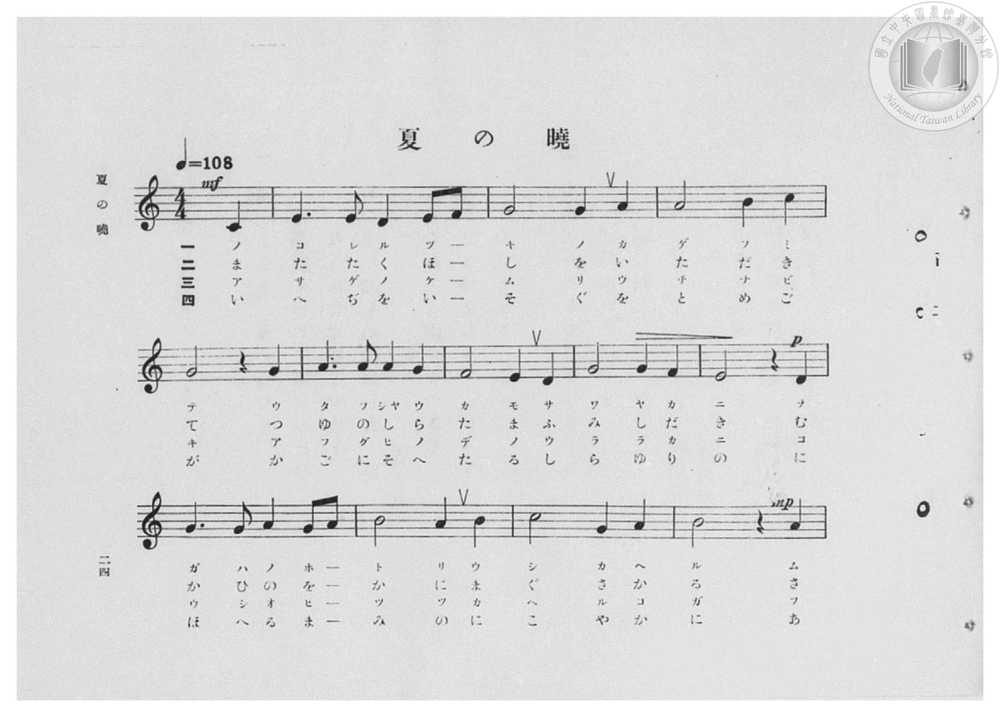
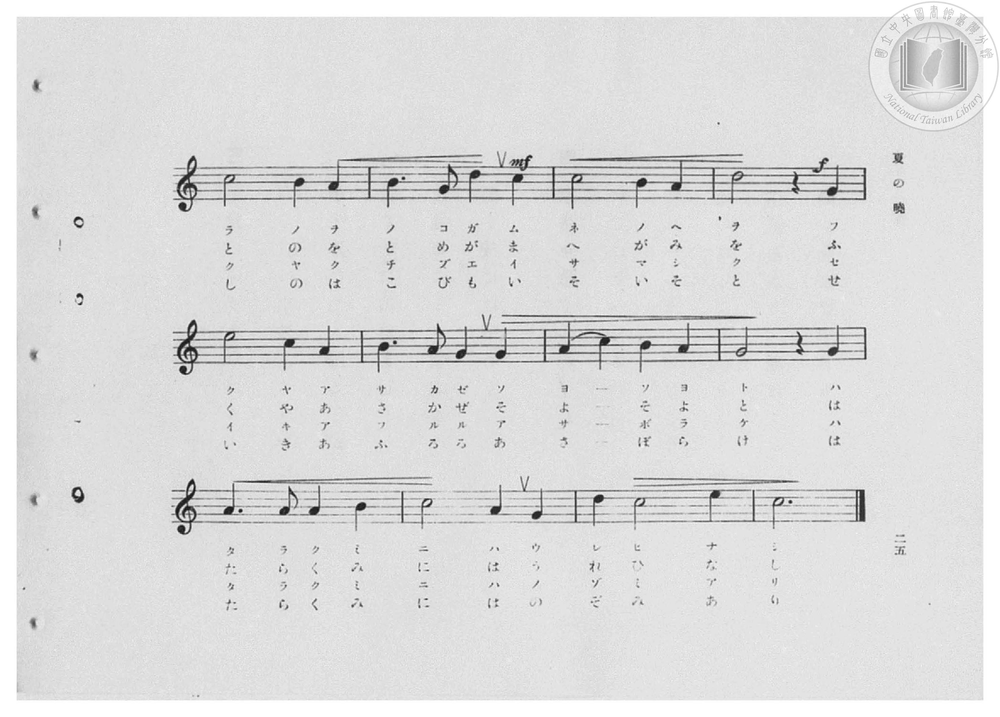
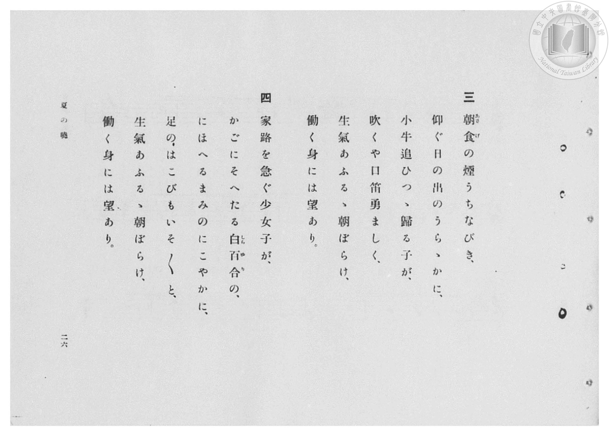
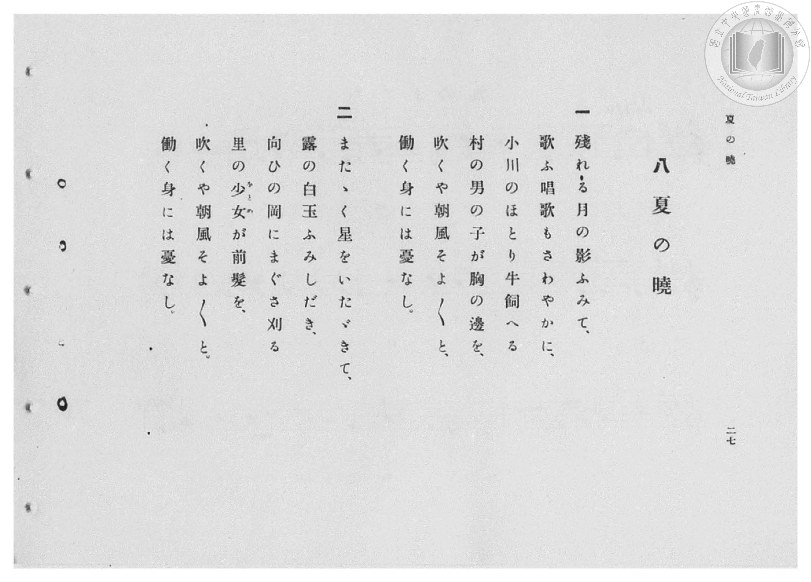

# 夏の曉

> Re:Shōka 使用 AI 協助辨識與重建樂譜，可能會有錯誤。歡迎回報。

- **鋼琴伴奏版**：<br><audio controls src="natsu_no_akatsuki.mp3"></audio>
- **NEUTRINO 歌聲合成版**：<br><audio controls src="natsu_no_akatsuki_neutrino.mp3"></audio>

- 臺灣總督府《公學校高等科唱歌》第二學年用（昭和十一年，索書號 0729 74）

## 說明

原書資訊與歌詞全文（對應 P026.jpg–P029.jpg，原書 pp. 24–27，第 8 首）：
調性與拍號：ハ長調（C 大調，無升降記號）4/4 拍（弱起 1 拍），速度 ♩=108


## 歌詞

```text
一
殘れる月の影ふみて、
歌ふ唱歌もさわやかに、
小川のほとり牛飼へる
村の男の子が胸の邊を、
吹くや朝風そよ〳〵と、
働く身には憂なし。

二
またゝく星をいたゞきて、
露の白玉ふみしだき、
向ひの岡にまぐさ刈る
里の少女（をとめ）が前髪を、
吹くや朝風そよ〳〵と、
働く身には憂なし。

三
朝食（あさげ）の煙うちなびき、
仰ぐ日の出のうらゝかに、
小牛追ひつゝ歸る子が、
吹くや口笛勇ましく、
生氣あふるゝ朝ぼらけ、
働く身には望あり。

四
家路を急ぐ少女が、
かごにそへたる白百合（しらゆり）の、
にほへるまみのにこやかに、
足のはこびもいそ〳〵と、
生氣あふるゝ朝ぼらけ、
働く身には望あり。
```

## ABC

<div class="abc-score" data-abc-src="natsu_no_akatsuki.abc" aria-label="五線譜載入中"></div>

[下載 ABC 原始檔](natsu_no_akatsuki.abc)

## TMD 檔案連結

- [主旋律 TMD 檔案](natsu_no_akatsuki.tmd) [[在 TMD Studio 編輯](https://tmdlang.github.io/Tmd-TS/#tmd=s7IKdvYPcrWy4qpTUCpJTLdSSM7PyUlNLsnMz7PKzk9PzM7Ojy_OyM9OVIKrKMvPKc1NBcqW5McbIYSL80uLklOtipMz8vNz4ktSK0qS8vOz0eXjCxLTU60CDIzMcMqY45SxQMgUFOWXpeYl5gFtLCjKzCtJTQFbiVCQWpaZkgqSLk5OzIsvSy3KTMtMTUHyRWpRMciTUCtKihLzipOLMgtAPkeoyi8qychPL0osyKi0ysgsLskvykxOzInPTsxDCpCSjFRgeOQllpQWpaKLlmTmpsbnp8WnJFaiS6UkZuZUxudkpiFpApqfnplnVZoHcnwJ1MlaWgpPl_Q_blz3bHangpYWl6KtgqGBBZe9rYIzl42JvokdSPuL9l3PGxc_37H3-dzFT3fNedzQ9bR1zdO1O54tWPhy9YznazufL5_4dMrGZ2t7Hjd0P1-z5smuHqDs051bnk9Z8X5Px7MZa59O6nna2_hkRwNQ8P2enudbFj2bvePFzPkKBuZGlgrmJu_3dCpxcelrKdhSC3ApKCg87ZsPsmZz-4sVXS862oHue7Fy3tPWFc-mtQOd9XRD77P2TgVQetHLKkh_1DAZyLQEMYEuhGhVKCjQUzAyAUoZmYOcvWaNgoXCy2XTgM59v2cWyIoXq_Y_a1gOMry7F-gfoOjj5v6XU7cDxYFWOAMDdzmY2fO8ZeHT3vaXM3tfrJgBVtgJDF0FoC6QS_ZsfLF1u4IhhAs0uudlw_ynu5YpPJq50hYUHSCbgIEHop6tm_G4qedxU_ezOR3AaHu6d-Pjxq2PG_c_blz2uKERrAIYDY1bofHR1PS4cerjpv7HTS2PG7sfN66GKnq6of_p9rlAAx437n7cuOJxU9fzztkvF-953LgDaDbYmLkTgdLPp2wH2bJ2wuPGnhfNO4Dsl01dj5smwYyZsPNxI8jwZ3Pmvly04nHj3MdNHY8bNj9uALppBUxRcy9Q0Ytdq0HWN65_1gZ006rHjdMfNzRBfLarB0Q9btz3uHH-4yagq_qfzQAyJj1uBDoayJj3uBFoAsx_L-dsAjls5t7nfZ0wv09_3LgApAjmKqDTQYqebloIthNoMNADU592dEA997IdGEbrnm6Y-HTpZmAEgO0CBkIjMPSBHn3a2fty9Spq-3JHJzhYgUYsBkY_MPLAUdM4CWznuuetMx83tj1uBDoYqGszwjNPdm8Auv7Z9KUgB7fvAkdZ2-OmTnBAocYoMApf7N8L9voSoPSztaC4hMQduk-e9i9-vmb20-52cOAAg68fquL5lPnPNiwGO24rUDfImDlAi_aAbGyciMOvc2aDNAATBtSvT2fPBlPrtr3Yvh4Yjs8agK6fAAluhGPAzp8CNgJoAzBtAaO6GxSvM_c9ndABDqLpYI8CvdsFCSW4TqAeYLoF-Q_sAWASAAYLUHAyekJ_sQ1oI1BuPUgOGK6gDAFUMRc9-ij2N1Ca8lILChS09Lm4_BJLikv98h2zQXR2plVAZmJevkONrmFNNcgyBRsLLTswA1uxqQAqhnc0vFjYo6ABLV60FYzBiWR9gw680EMo08RiBtAVIPNrFAwUdOG4OjetFlhU6QKFjYGkLpA0ApMmQBFTsIgumDYDqwGRIGgOxIZxICGwmT6GNQrxQB4MP27uAyt_3LQZrPxx8xogXg1mtQDxHrDcWqhhENWPm0DyIPFNcPGpYHI-wh4jNHsa90H0NILUgPjzgbgfzNoNs6dxOsy8pklgmRYUPSCRBWCyF2GPMZo9TYugbtsKNWkT3NUbYfY0g0yBuHsVWGYZRE9zI1y8C0xORthjgu4fmNt2QF22CMnVMP_Mhbt7AtxXIPEVcH-CbARmRrA9-BPVrh5wojLFnpbAsnjTEiyJgNISiA1LImZgGiJiAlUDSmCgxIXQBZIBidaAxWHmVBfUQtTB09bj5jaoPCQ2oCHbtB8arlOB7O2Pm5egSIKSE0QaFHmQqAMZtR4uDlEPTXbN3chWNIMSISLRAesrZNlGkE6QHRBnAYskaDIDli_QyEAkLlASBRZDUHGIk0EiYPXgpAcSByU-hAcbELYDkyIiq6AkRnD2APE3ANngRALLds3tcD9CEiksKa6Ei4NYOPwOzrSIBAos4lH8DlILEgUlLxB_NTRJQhItit-bQGohPgX5AhQ2EHFQuAFLWqj6dSjmg91EINnu6AQnWxMcRSBIFm-yhZV1kASIXNaBRJATMiSBgkRRE3t1LjCVgoURqbRpDTRw-2EB3zwbXjp0wIMepXRo2g4PFEj5OAMaJbDkC0mO4GSClBwhEQZsHECDD1QKwMoHWGRCghJRRoJKC4g4uFyFRSQ4khDBD5JDTnqQhA9y5-MmsMuBSQ3mJ1BpBfETiIVITiA_QMTBLoAkKHj4wPyEZBM4me2Gum4HPOHsg_sJkW3AvoUkEiANKksh7gO7AJ44UUKvsQlsE94kBWzkYCYpcxJqVXB1CIKguhFSW4JYoNRkBJKC1LTgOhObWrAaeOICKgUnQqQSEJF1ISkLXEBBeZAwhoQvNK0A6V40HbCUBatfMWIBnLLgtQg8XSHXLqC6BVIgINIVpK4CiUDEQXEFim2QTkQcgAtApHSFXgyD-Ija8nHzNKAYyM7HTbDCFlL3guTmgcVBOQfZJEjhBUpFyKkKXvtDUw7UHmjKATYigXpA6QNR9yLqV0iaAvGRQwbin9lgewjUrlPwpSnCtasxLFGAEwxyojIDpw9EQQVWgEhNGNUyUiGFHvDoTRtged60B8zaC40ScDQAMyJMDCKCXKhBkhKo4YWclEB85MwJzobQIgaSWR83zkEO4iaQeVCbIHUKWAQz8MGRiJSYQD6B2LQW2U-wGhJYDMGKImTfQm1qBrsBnMFAMhtx-QmcnOBFHrjGRvgJFnpAP0ELL2TfwvwECUNYG2EiFj_hL6Ra1-ItpAjWe8iNM1BqQSqKEO01cFEEFwenQSR1sGSFnKRg7bCV0OQFbbMjNSwgAYloiEBKKlgJAWkZI9eGsGBBTk7QNj4w-GBtfGhJAy_tIYEI7FFDTYOUR_D-RCOo_kIuE9BsASclov0C7-OAG3hgVRD3wRIfyDYstoCTEfF-AZVaIHFwmYdUD0KTF7gRhWpLLReXrp0CWodTASikzAUA)]
- [鋼琴伴奏 TMD 檔案](natsu_no_akatsuki_piano.tmd) [[在 TMD Studio 編輯](https://tmdlang.github.io/Tmd-TS/#tmd=s7IKdvYPcrWy4qpTUCpJTLdSSM7PyUlNLsnMz7PKzk9PzM7Ojy_OyM9OVIKrKMvPKc1NBcqW5McbIYSL80uLklOtipMz8vNz4ktSK0qS8vOz0eXjCxLTU60CDIzMcMqY45SxQMgUFOWXpeYl5gFtLCjKzCtJTQFbiVCQWpaZkgqSLk5OzIsvSy3KTMtMTUHyRWpRMciTBZmJefnxiUVFiXnpqbmpeUhGIAlaJWbGJyYn5-cWJOZloqrKLyrJyE8vSizIqLTKyCwuyS_KTE7Mic9OzEMKs5IMoDFWeYklpUWp6KIlQAPj89PiUxIr0aVSEjNzKuNzMtOQNAHNT8_MsypJzCwHeiw_LS0zOTMxR4lLS0vh6ZL-x43rns3ufL-n42X3nucTtjzZs-Xp0v7nnR3v93QqaGlxKdoqGBpYcNnbKjhz2Zjom9iBjH3Rvut54-LnO_Y-n7v46a45jxu6nrauebp2x7MFC1-unvF8befz5ROfTtn4bG3P44bu52vWPNnVA5R9unPL8ykrgDY9m7H26aSep72NT3Y0AAXf7-l5vmXRs9k7Xsycr2BgbmSpYG4CtF2Ji8szr6Qo3yoAFOBBHg41BjXVXApAYGOhZQdm1ChU5xbUKhgr6AKhsYIRmDQBCpuCRXQVDOOgjBquWhTjfHAYBzTNEKjbGIhN44EGmgJxjYKhtrE2zEgQNICZ6JdYUlzql--YDaKzMxFO1TXENBykC4arc9NANgGNweN6EG0GVgMiQdAc5qcasJk-hjUK8UAeDD9u7gMrf9y0Gaz8cfMaIF4NZrUA8R6w3FqoYRDVj5tA8iDxTXDxqWByPsIeIzR7GvdB9DSC1ID484G4H8zaDbOncTrMvKZJYJkWFD0gkQVgshdhjzGaPU2LoG7bCjVpE9zVG2H2NINMgbh7FVhmGURPcyNcvAtMTkbYY4LuH5jbdkBdNgPJ1TD_zIW7ewLcVyDxFXB_gmx83DgFbA800mFxCYp0EBsWl2ZgGiJiAlUDSgmgVIDQBZIBidaAxWHmgFIpWB08ETxuboPKQ4INGgRN-6EBMBXI3v64eQmKJCjeIdKgUIaEMcio9XBxiHpo-mjuRraiGZRaEKnjcSPIVLhsI0gnyA6Is4BlDDQ9PG7qhIYaIhWA0tLjRqjtjRAng0TA6sFpBCQOSiUIDzYgbAemGUSaRkk14HQM4m8AssGxCcsfze1wP0JSEyzNrISLg1g4_A7OXYiU9LixB8XvILUgUVA6APFXQ9MOJHWh-L0JpBbiU5AvQGEDEQeF2-MmULoFqV-HYj7YTbD0BSs9ICkFufQAiSCnOEhKAomipkpwEQoWRiSnpjXQUOiHhVDzbHh-64CHEUp-a9oOdz2kxJkBDTtYOoOkG3B8IqUbSMg-bgTmbLA_QfkKluNgoQ7xM6LUAeU_iDi4pIKFODg0EeEEkkNOI5AUCnLn4yawy4FpAuYnUP6H-AnEQsQ7yA8QcbALIDEPDx-Yn5BsAqeH3VDX7YDH8D64nxDpG-xbSGwCaVDpBHEf2AXwVIQSeo1NYJugcQ-v3UDVAqSiALFA0W4EkoJUMuDqAptasBp4KgAqBacWpDIFkRkgSQCc5aE8SGBAAgIaqUC6F00HLAnAqhaM4AInAXgBCk8AyAUrqFiFZDFEAoAU0yARiDgoUEHRAtKJCCxwkYKUANALNhAfUVE8bp4GFAPZ-bgJVnxBqh2Q3DywOCiJI5sEKQ5A0Y0c_fCKDxrFUHugUfy4ERRuoIhEVDuIqgUS-SA-cshA_DMbbA8s48NiDxyzyLFvBo5IRNYHK0BEO0aNhJTt0UMIvfoFFmVNe8CsvdCwA4cXMGnDxCAiyMUEJM5BjQPkOAfxkZM7OGFDMy0k-T9unIMcFk0g86A2QYpTsAhmKIFDGynWQT6B2LQW2U-wygGYsWGZG9m3UJuawW4A5wSQzEZcfgLHO7wQAVdWCD_BQg_oJ2hxgOxbmJ8gYQirHidi8RM05pEbEKBoRcrciDYFOHPDxcGJBUkdLP6R4x7WVlgJTQfQBiBS5QfxMaKyhOR9WJ6DNLOQKwKY-5HjHdpgBPoT1mCE5l14QQfx7eNGUBUIMg2Sw-GN00ZQ0Y2cy9BsAcc50X6BN5jBjRCwKoj7YKkEZBsWW8DxTbxfQOUASBxciiBVAdB0AK7oUW3B1bkAdVwIdS7AMYuzLwMVAtEm8UAK2P4EUSYgEZAyE5AyWA0DVwwzFa4WJgVMavEKZiCNQAIkCDYEoRWsAcQBljww44EM5PSHphhsDkIM4SiQjDEwjRsjO56woRAVmKqNoM4ipA67qdicgAgTtCBF9RE8NKFGwhWDGQTCDx7EUHXR4M5pLFICgvdOde0UwF1eBSADLTFF-xgCtWARNsIubIxd2AQsrMwFAA)]

## 分析

```text
================================================================================
📊 TMD Song Profile: [ 夏の曉 ]
================================================================================
⏱  Duration:       0:53 (53.3s), 24 measures total
🎼 Key & Tempo:    首調基準 C, != 108.0 BPM, <4/4>
   - 分析範圍：      由實際發聲的音符與和弦推測調性；播放脈絡另行呈現
🎤 人聲音域:    C4 (MIDI 60) – E5 (MIDI 76) [跨度: 16 個半音 / 1.3 個八度, 難度: moderate]
   - 最低音:  C4 in [NatsuNoAkatsuki #1 @ m.1, 0:01]
   - 最高音: E5 in [NatsuNoAkatsuki #1 @ m.18, 0:37]
   - 適合: soprano, mezzo-soprano, contralto, tenor, baritone, bass
🏛  結構:      NatsuNoAkatsuki (53.3s)
⚡ 編曲密度:        Peak 1 軌道同時演奏
🗝  調性診斷：       C 大調（純淨自然大調，未偵測到可信轉調）
   - 風格氣質:    純淨自然大調（陽光明朗、易唱易記，無明顯調外色彩）
   - 轉調歷程:    全曲維持單一推測調性（未偵測到可信轉調）
   - 核心骨幹音:  G, A, C, E, D
   - 調性數值:    C 大調 [相關度: 0.85, 穩定度: Moderate, 自然音純度: 100.0%]
   - 候選調性 (K-S): C 大調 (0.85), G 大調 (0.77), A 小調 (0.73)
   - 五度圈歷程:   +0
   - 各段落調性細節:
     • [NatsuNoAkatsuki #1]: C 調性不明確 (r: 0.80, 自然音純度: 100.0%)

  [ 五度圈游移軌跡 ]
              [C ]*
         F            G  
      Bb               D  
      Eb               A  
         Ab           E  
            Db       B  
               F# 
     (* = active key center)

  [ 十二半音累積音高分佈 ]
     C  : ██████████████████        17.6%
     C# :                            0.0%
     D  : ██████████                 9.9%
     D# :                            0.0%
     E  : ████████████              12.1%
     F  : █████████                  8.8%
     F# :                            0.0%
     G  : ████████████████████████  23.6%
     G# :                            0.0%
     A  : ████████████████████      19.2%
     A# :                            0.0%
     B  : █████████                  8.8%
--------------------------------------------------------------------------------
Assignment 軌道音域：
  - Piano         : C4 – E5 (16 個半音 / 1.3 個八度, 75 個音符)
================================================================================
```


## 原書掃描頁










