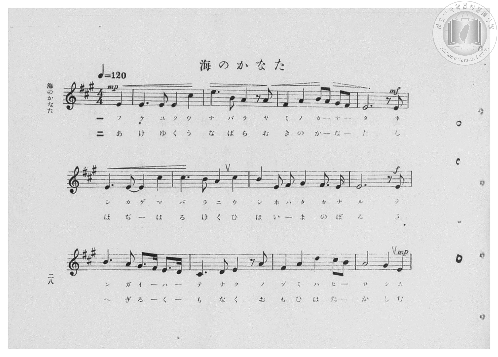
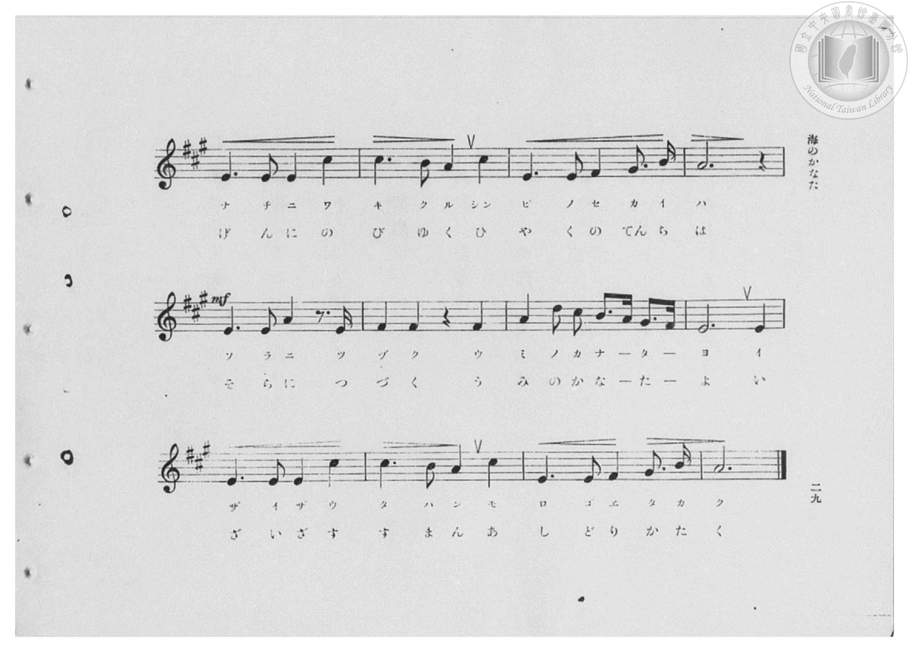
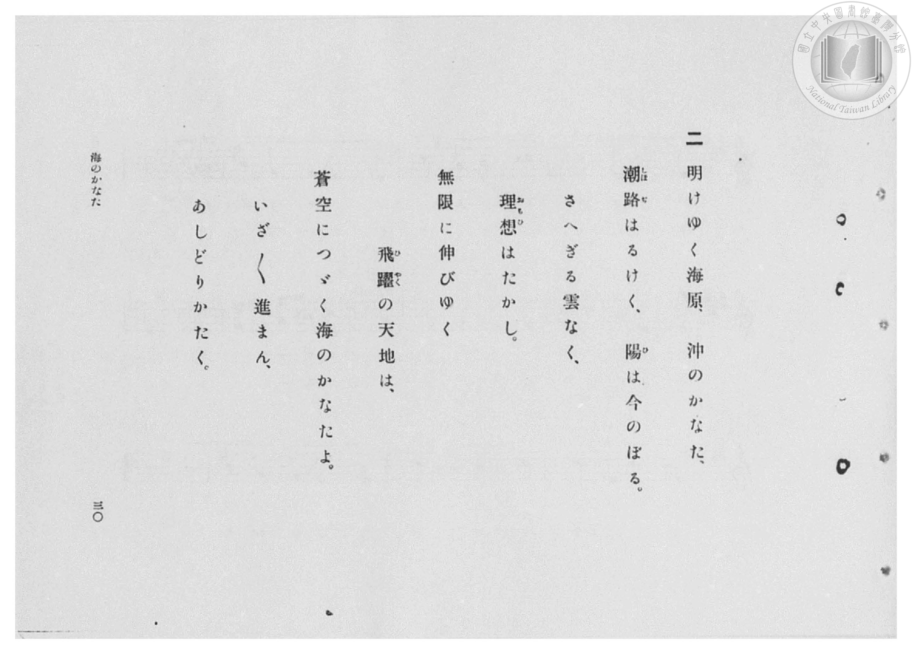
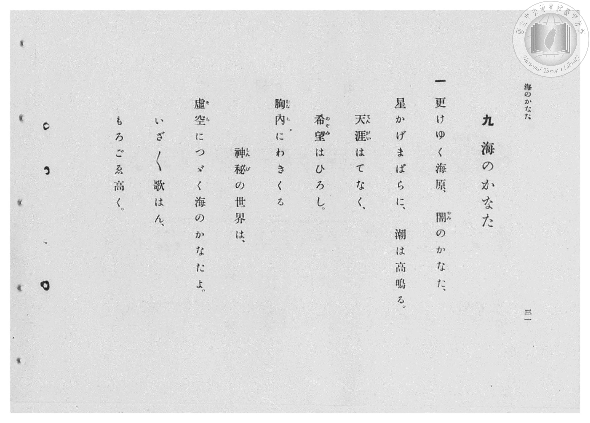

# 海のかなた

> Re:Shōka 使用 AI 協助辨識與重建樂譜，可能會有錯誤。歡迎回報。

- **鋼琴伴奏版**：<br><audio controls src="umi_no_kanata.mp3"></audio>
- **NEUTRINO 歌聲合成版**：<br><audio controls src="umi_no_kanata_neutrino.mp3"></audio>

- 臺灣總督府《公學校高等科唱歌》第二學年用（昭和十一年，索書號 0729 74）

## 說明

原書資訊與歌詞全文（對應 P030.jpg–P033.jpg，原書 pp. 28–31，第 9 首）：
調性與拍號：イ長調（A 大調，3 升記號）4/4 拍（弱起 1 拍），速度 ♩=120


## 歌詞

```text
一
更けゆく海原、闇（やみ）のかなた、
星かげまばらに、潮は高鳴る。
天涯（てんがい）はてなく、希望（のぞみ）はひろし。
胸內（むなうち）にわきくる神秘（しんぴ）の世界は、
虛空（そら）につゞく海のかなたよ。
いざ〳〵歌はん、もろごゑ高く。

二
明けゆく海原、沖のかなた、
潮路（しほぢ）はるけく、陽（ひ）は今のぼる。
さへぎる雲なく、理想（おもひ）はたかし。
無限に伸びゆく飛躍（ひやく）の天地は、
蒼空につゞく海のかなたよ。
いざ〳〵進まん、あしどりかたく。
```

## ABC

<div class="abc-score" data-abc-src="umi_no_kanata.abc" aria-label="五線譜載入中"></div>

[下載 ABC 原始檔](umi_no_kanata.abc)

## TMD 檔案連結

- [主旋律 TMD 檔案](umi_no_kanata.tmd) [[在 TMD Studio 編輯](https://tmdlang.github.io/Tmd-TS/#tmd=s7IKdvYPcrWy4qpTUCpJTLdSSM7PyUlNLsnMz7PKzk9PzM7Ojy_OyM9OVIKrKMvPKc1NBcqW5McbIYSL80uLklOtipMz8vNz4ktSK0qS8vOz0eXjCxLTU60CDIwNcMoY4pRBsq2gKL8sNS8xD2hjQVFmXklqCthKhILUssyUVJB0cXJiXnxZalFmWmZqCpIvUouKQZ6EWlFSlJhXnFyUWQDyOUJVflFJRn56UWJBRqVVRmZxSX5RZnJiTnx2Yh5SgJRkpALDozgVQygvsaS0KBXZtMz0zDyr0jyQ00qgDtLSUni2dfvjxnWPG7sfN6563DhfQUuLS9FWwdDIgMveVsGRy8ZE38QOZMiL9l3PGxc_37H3-dzFT3fNedzQ9bR1zdO1O54tWPhy9YznazufL5_4dMrGZ2t7Hjd0P1-z5smuHqDs051bnk9Z8X5Px7MZa59O6nna2_hkRwNQ8P2enudbFj2bvePFzPkKBuZGlgrmJu_3dCpxcelrKdhSC3ApKCg87ZsPsmZz-4sVXS862oHue7Fy3tPWFc-mtQOd9XRD77P2TgVQmtDLKkh_1DAZyDQGMYEuhGhVKCjQUzCyAEoZG4KcvWaNgqXCy2XTgM59v2cWyIoXq_Y_a1gOMry7F-gfoOjjpiUvp24HigOtcFR4umQ5mNljrPC0F-iOGWBFncCQVQDqALliz8YXW7crGEK4QGN7XjbMf7prmcKjmSttQVEBsgUYcCDq2ewtjxsnPm5qe9zYD4w7oBsfNzS-nA7yzOOmlseNQHs6kSMUKAvWNmM-WGjS48Z9jxs3PG4CKloNlHu2F6h0PTAGX27e8rip-3FDEzjQlqx8tm09yMjGZY-bJj9u7Hnc2AI2eD1IBGRwP1Dz0x09z-bMBisDmjIPZjlQzabHTb2PG6dDjXvRvONp63KwCxvAmoGOXwhWuvpxU__jRqDSfqDlz5fOe758Bti46WBbgckE5JcnO6Y9nwp0wXqoX17MnP185S6wurlAj0ANalzyuAnoBFCgoPi_qQPqCqAXHjdOe9yw-XHDVlAyBZoHtKSh8XFTE9i1Ux43TQQGBNhrTZAg39UDCbs-zCB_tmkatmDeu-7FdkjATX_cuPtx4yJoiACDFmgEONReztwLVrAJIvVkdxfYoD2I4H_cOPVx447HjX1AoZezN8HD-_mEtmfNm8Gau0CuhhkBsh_kEFh4P29Z-HLmBGCgPNkDNGUzxOUvF89-sQuU2sCxAwyKfkjoAuP66ZwNSKE7aQ8wdEkO0ZcNQHfug4ZoI9BtQP-vfNwE9BtQG9B54EAF6qE8V0OBgpY-F1dobqZfvjewRCxJtArITMzLd6jRNaypBlmkYGNopmUHZmErUxRAZdSOhhcLexQ0oPlPW8FE4emG_ufrG3TgJQJCmSYWM4BOAJlfo2CgoAuG6HR1bkGtgmk8lFeDYIIgmAMXMUYoQlJjBMSGSIaC2DVgS30MaxRgetHpx81T4aY9btqIZN7j5mUgsmk9jN8E4kNVNnehqJwAJlcimf24eQnCfiM89jc2IUxtnIhsalMbWL4frhLEh6lchayycQNYfSey_Y0gF9aAMydQgxnMPlgIwULLHCQBlkULcmQICs7q3DRo_CAC9XHzfJgTmvvgzl4N5u8BkyBHQNig4N2Pw3xIgM1GmA0MMGBZB_feOjirG2E2OAjgZgPrYzxmN04Hm40_ie_qASdxHCkbLIs3ZROVYmEs5DhAVQEShZsAjhlwHIEgNBaBMoQiC0tcNW1HUgSNpaZNMH7zPLgDIMkZrhKcrB83g0IeohMpG8DNhMTe42ZQYkXEM8QWSDoAmQvh4YijZlDyRo7_3ciuaFwEVgOKbQgfli1BroC5DSIDykTI2QbmR5CZ8Mzc2AI3D1gYw0UhKQ1YxWCYi-HeRlDBQShN7ejEl6bAsnjTFCwxgCA8u4ITAjT-TUBpwRg5LQBFkFIevCTELAJMoDQo6YHsqYHLwCA84aEVzkgFwGYk5Y-b1oBJUMkHCVxIgoCwQaphJRhEDFw4wMtXSCIAFSOgoIdHCVIRA4_S5klQMyHJdS2as5GT5QJUN4MT1g5ktY0gG2FRDXYzNOlA3dwEK58hqsGFDjxxIZW0SCoRSQ45wYH8gSiu0JMWpIiCuL4B7ma8ievp7NmYicuQhKqYSgUWpjHwpAZNQEZY0hYMwup_5ESFWrk2gkl4-dOMnPPXIqsEJyVEKQNMBoj0CTJ2CoqxkHiHFTLwogqYekFqYTGMDtHyADg9gVIjwhGTQWQj3BHwygukEjW3oNfvSAVVE6h4gqsEq0GuBkFdDShzIUq5htu5BOq-KfiSEuG6D9E6gEEwB7k9Bq234GkDzoClALgAIrGAiihY8QQyDVH84akAsZVTTXuRFKBXaRD1j5tbwDHfClOFUjJBRJBbgKhNH1izB5J0weUItBqElX0rcDgXVl6ipqm5KCpALTtEmoK6txGcUhuXwlShlEoQEeQWI7xSBqcjaFMK2o6ElHsQH8HKvQ5c7gVXnRD34i-fWtfiLZ8IVn6DtXxq2oYcHODoQ4ihto-QW7zQ1hG8SHrcDGrTQFWiVGKPm7aA5WHdEXhSAiYykKmEczsiIU1DNhfS6oGLPW6ciXABnA2RAVXAsFIGxEfupsCqKogMODM1wcpsWNUGSk4gtYQL0louLl07BaT-qQKQq8wFAA)]
- [鋼琴伴奏 TMD 檔案](umi_no_kanata_piano.tmd) [[在 TMD Studio 編輯](https://tmdlang.github.io/Tmd-TS/#tmd=s7IKdvYPcrWy4qpTUCpJTLdSSM7PyUlNLsnMz7PKzk9PzM7Ojy_OyM9OVIKrKMvPKc1NBcqW5McbIYSL80uLklOtipMz8vNz4ktSK0qS8vOz0eXjCxLTU60CDIwNcMoY4pRBsq2gKL8sNS8xD2hjQVFmXklqCthKhILUssyUVJB0cXJiXnxZalFmWmZqCpIvUouKQZ4syEzMy49PLCpKzEtPzU3NQzICSdAqMTM-MTk5P7cgMS8TVVV-UUlGfnpRYkFGpVVGZnFJflFmcmJOfHZiHlKYlWQAjbEqTsUQykssKS1KRTYtMz0zz6okMbMc6Oz8tLTM5MzEHCUuLS2FZ1u3P25c97ix-3HjqseN89_v6XjZvef5hC1P9mx5urT_eWfH-z2dClpaXIq2CoZGBlz2tgqOXDYm-iZ2IMNftO963rj4-Y69z-cufrprzuOGrqeta56u3fFswcKXq2c8X9v5fPnEp1M2Plvb87ih-_maNU929QBln-7c8nzKCqBNz2asfTqp52lv45MdDUDB93t6nm9Z9Gz2jhcz5ysYmBtZKpibAG1X4uLyzCspyrcKAAVqkIdDjUFNNZcCENgYmmnZgVk1CtW5BbUKpvEKunAI5pjBRMwhDCOgUkMkRcjQAErXcNWiWOmDy0qwjSBzjUAE2D4oC4sg0N74eG2glLYhsitxOiA0N9Mv3xsY3yWJCJ_rGmJxB0wbOo0aJDVYQgcuYoxQhKTGCIhhgQUyFMSuAVvqY1ijANOLTj9ungo37XHTRiTzHjcvA5FN62H8JhAfqrK5C0XlBDC5Esnsx81LEPYb4bG_sQlhauNEZFOb2sDy_XCVID5M5SpklY0bwOo7ke1vBLmwhgsa6vCUBQshWGiBUxpYFi3IkSEoOKtz06DxgwjUx83zYU5o7oM7ezWYvwdMghwBYYOCdz8O8yEBNhthNjDAHjf2wr23Ds7qRpgNDgK42Y0wl2A1u3E62GxoYBCVtGAs5MBCVQEShZsADkJotoVnZKAMoVDFEqhN25EUQYOzaROM3zwP7gBIuoOrBKe_x82gIILoREqvcDMhwfy4GZSqEBECsQUSYSBzITwcgdkMSofIEbUb2RWNi8BqQNEC4cPyD8gVMLdBZECpHTl9w_wIMhOe6xpb4OY9btwHF4UkiceNezDMxXBvIyiHwyMfFmsgCM8A4BiDRpQJKNKMkSMNKIKUROBlC2amMoHSoDQCsgez9IanELTiDilLbUZS_rhpDZgElSWQUIDEHIQNUg0rEyBi4OwGL7EgsQXKmKAwgocdUqaFh33zJKiZkHS1Fs3ZyOlnAaqbwSlgB7LaRpCNsDgBuxkax1A3N8FKPIhqcDaGpwKksgtJJSJtIKcMkD8QBQB6GoBkeojrG-Bupm4RQK0qHBH7qPVKI5iE5-hm5Ly0FlklOM4R-RYYX4iEBDJ2CoqxkAiCZVt45gcmM5BaWFSgQ7TECo54ULJBOGIyiGyEOwJeboNUoiZr9KoNKes3gTI8XCVYDXINsAxiDYi5EKWkwO1ceKMLVtjCIJiD3GaAFtnwSIQzYFEFF0DEKijTwzI8yDREgYKn7MeW85v2IilAL80h6h83t4CjqBWmCiWvQ0SQWymo1TOsaoakMXDOhNYAsNJkBQ7nwkog1Mifi6IC1PpARD7UvY3gJNW4FKYKJZ9DRJBbNfD6CBzh0Ooe2taBlCQQH8FKkg5c7gXXGhD3DvIc37QN2d3gcEaIodbhyM0naA0Oz-SPm0H1LlQlSvn9uGkLWB7WtoXHOTA1gEwlnH8QMT4N2VxIzQwXe9w4E-ECOBsiA6p7YPkWxEdu88JKaYgMONU3wUpBWKkOineQWsJFE7a-CKhLRFJfBB5N4F4TsCcEZEO6SeDeEIyJVRiUREA0WocKQzXIDkjQ1gAbGHBhcFsDzDICC5ohDIMwcZgPEURxPNRwUp2PQwJiO7hdhMQEtqewOxPJkcgqSHY9iV1WonwKDnrCgY5kC06zByzYqRYulLgdT0BiFURRiyOoUUJ9cCV12g2f6NopgIdwFIAMpOIr2scwFkPICCykzAUA)]

## 分析

```text
================================================================================
📊 TMD Song Profile: [ 海のかなた ]
================================================================================
⏱  Duration:       0:48 (48.0s), 24 measures total
🎼 Key & Tempo:    首調基準 A, != 120.0 BPM, <4/4>
   - 分析範圍：      由實際發聲的音符與和弦推測調性；播放脈絡另行呈現
🎤 人聲音域:    C#4 (MIDI 61) – E5 (MIDI 76) [跨度: 15 個半音 / 1.2 個八度, 難度: moderate]
   - 最低音:  C#4 in [UmiNoKanata #1 @ m.11, 0:20]
   - 最高音: E5 in [UmiNoKanata #1 @ m.3, 0:04]
   - 適合: soprano, mezzo-soprano, contralto, tenor, baritone, bass
🏛  結構:      UmiNoKanata (48.0s)
⚡ 編曲密度:        Peak 1 軌道同時演奏
🗝  調性診斷：       E 調性不明確（純淨自然大調，未偵測到可信轉調）
   - 風格氣質:    純淨自然大調（陽光明朗、易唱易記，無明顯調外色彩）
   - 轉調歷程:    全曲維持單一推測調性（未偵測到可信轉調）
   - 核心骨幹音:  E, A, C#, F#, B
   - 調性數值:    E 調性不明確 [相關度: 0.83, 穩定度: Ambiguous, 自然音純度: 97.5%]
   - 候選調性 (K-S): E 大調 (0.83), A 大調 (0.81), C# 小調 (0.71)
   - 五度圈歷程:   +4
   - 各段落調性細節:
     • [UmiNoKanata #1]: E 大調 (r: 0.84, 自然音純度: 97.5%, 調外音: D)

  [ 五度圈游移軌跡 ]
               C  
         F            G  
      Bb               D  
      Eb               A  
         Ab          [E ]*
            Db       B  
               F# 
     (* = active key center)

  [ 十二半音累積音高分佈 ]
     C  :                            0.0%
     C# : ██████████                15.3%
     D  : ██                         2.5%
     D# :                            0.0%
     E  : ████████████████████████  38.6%
     F  :                            0.0%
     F# : ██████                    10.1%
     G  :                            0.0%
     G# : ████                       6.0%
     A  : ████████████              20.0%
     A# :                            0.0%
     B  : █████                      7.4%
--------------------------------------------------------------------------------
Assignment 軌道音域：
  - Piano         : C#4 – E5 (15 個半音 / 1.2 個八度, 95 個音符)
================================================================================
```


## 原書掃描頁










