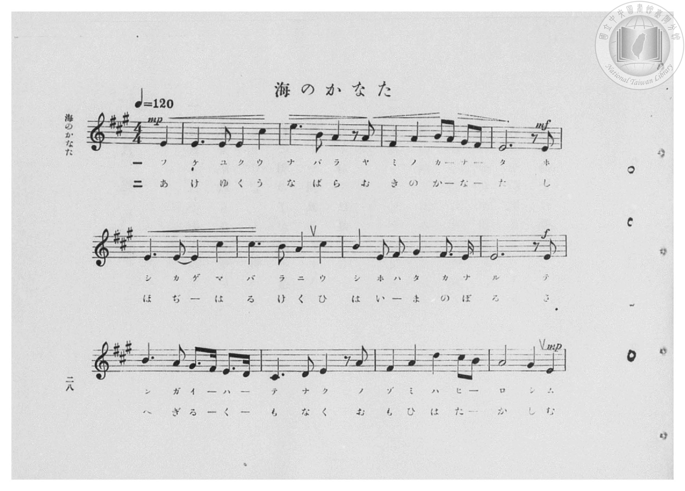
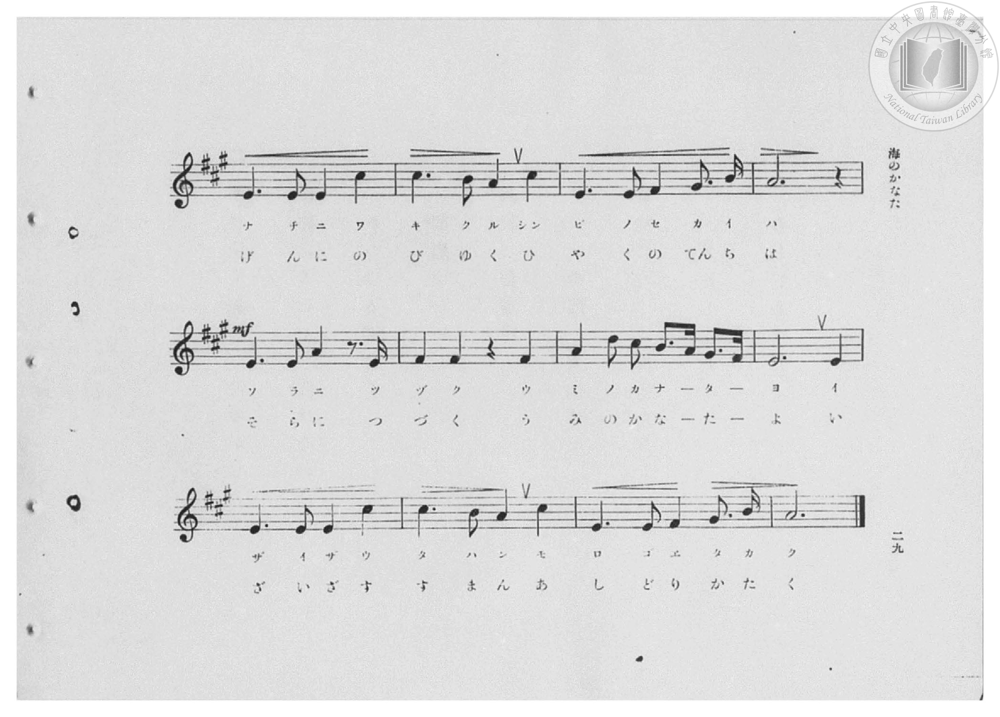
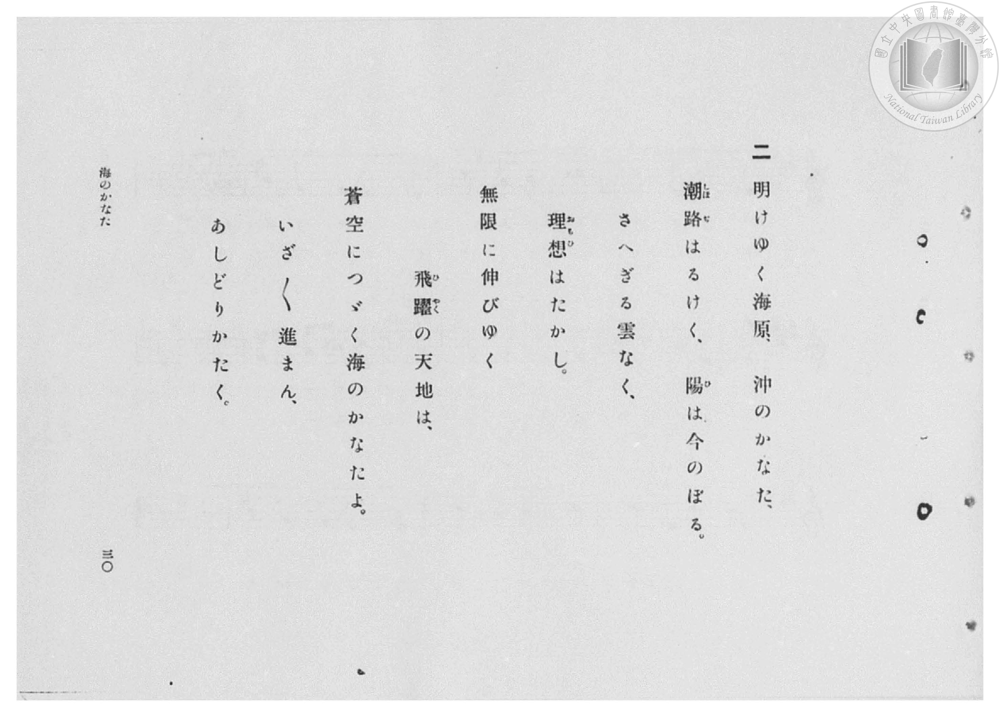
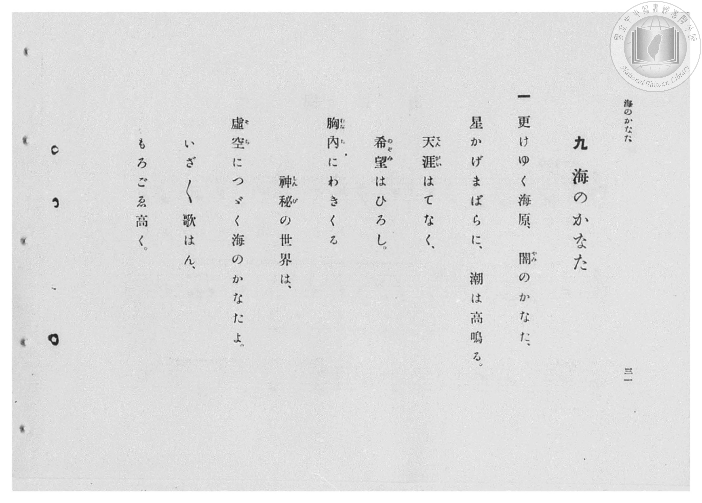

# 海のかなた

> Re:Shōka 使用 AI 協助辨識與重建樂譜，可能會有錯誤。歡迎回報。

- **鋼琴伴奏版**：<br><audio controls src="umi_no_kanata.mp3"></audio>

- 臺灣總督府《公學校高等科唱歌》第二學年用（昭和十一年，索書號 0729 74）

## 說明

原書資訊與歌詞全文（對應 P030.jpg–P033.jpg，原書 pp. 28–31，第 9 首）：
調性與拍號：イ長調（A 大調，3 升記號）4/4 拍（弱起 1 拍），速度 ♩=120


## 歌詞

```text
一
更けゆく海原、闇（やみ）のかなた、
星かげまばらに、潮は高鳴る。
天涯（てんがい）はてなく、希望（のぞみ）はひろし。
胸內（むなうち）にわきくる神秘（しんぴ）の世界は、
虛空（そら）につゞく海のかなたよ。
いざ〳〵歌はん、もろごゑ高く。

二
明けゆく海原、沖のかなた、
潮路（しほぢ）はるけく、陽（ひ）は今のぼる。
さへぎる雲なく、理想（おもひ）はたかし。
無限に伸びゆく飛躍（ひやく）の天地は、
蒼空につゞく海のかなたよ。
いざ〳〵進まん、あしどりかたく。
```

## ABC

<div class="abc-score" data-abc-src="umi_no_kanata.abc" aria-label="五線譜載入中"></div>

[下載 ABC 原始檔](umi_no_kanata.abc)

## TMD 檔案連結

- [主旋律 TMD 檔案](umi_no_kanata.tmd) [[在 TMD Studio 編輯](https://tmdlang.github.io/Tmd-TS/#tmd=s7IKdvYPcrWy4qpTUCpJTLdSSM7PyUlNLsnMz7PKzk9PzM7Ojy_OyM9OVIKrKMvPKc1NBcqW5McbIYSL80uLklOtipMz8vNz4ktSK0qS8vOz0eXjCxLTU60CDIwNcMoY4pRBsq2gKL8sNS8xD2hjQVFmXklqCthKhILUssyUVJB0cXJiXnxZalFmWmZqCpIvUouKQZ6EWlFSlJhXnFyUWQDyOUJVflFJRn56UWJBRqVVRmZxSX5RZnJiTnx2Yh5SgJRkpALDozgVQygvsaS0KBXZtMz0zDyrksTMcqCb8tPSMpMzE3OUuLS0FJ5t3f64cd3jxu7HjaseN85X0NLiUrRVMDQy4LK3VXDksjHRN7EDmfOifdfzxsXPd-x9Pnfx011zHjd0PW1d83TtjmcLFr5cPeP52s7nyyc-nbLx2dqexw3dz9esebKrByj7dOeW51NWvN_T8WzG2qeTep72Nj7Z0QAUfL-n5_mWRc9m73gxc76CgbmRpYK5yfs9nUpcXPpaCrbUAlwKCgpP--aDrNnc_mJF14uOdqD7Xqyc97R1xbNp7UBnPd3Q-6y9UwGULPSyCtIfNUwGMo1BTKALIVoVCgr0FIwsgFLGhiBnr1mjYKnwctk0oHPf75kFsuLFqv3PGpaDDO_uBfoHKPq4acnLqduB4kArHBWeLlkOZvYYKzztBbpjBlhRJzBkFYA6QK7Ys_HF1u0KhhAu0Nielw3zn-5apvBo5kpbUFSAbAEGHIh6NnvL48aJj5vaHjf2A-MO6MbHDY0vp4M887ip5XEj0J5O5AgFyoK1zZgPFpr0uHHf48YNj5uAilYD5Z7tBSpdD4zBl5u3PG7qftzQBA60JSufbVsPMrJx2eOmyY8bex43toANXg8SARncD9T8dEfPszmzwcqApsyDWQ5Us-lxU-_jxulQ414073jauhzswgawZqDjF4KVrn7c1P-4Eai0H2j586Xzni-fATZuOthWYDIB-eXJjmnPpwJdsB7qlxczZz9fuQusbi7QI1CDGpc8bgI6ARQoKP5v6oC6AuiFx43THjdsftywFZRMgeYBLWlofNzUBHbtlMdNE4EBAfZaEyTId_VAwq4PM8ifbZqGLZj3rnuxHRJw0x837n7cuAgaIsCgBRoBDrWXM_eCFWyCSD3Z3QU2aA8i-B83Tn3cuONxYx9Q6OXsTfDwfj6h7VnzZrDmLpCrYUaA7Ac5BBbez1sWvpw5ARgoT_YATdkMcfnLxbNf7AKlNnDsAIOiHxK6wLh-OmcDUuhO2gMMXZJD9GUD0J37oCHaCHQb0P8rHzcB_QbUBnQeOFCBeijP1VCgoKXPxRWam-mX7w0sFEsSrQIyE_PyHWoMaqpB9ijYGJpp2YFZ2IoUBVARtaPhxcIeBQ1o9tNWMFF4uqH_-foGHXiBgFCmicUMoAtA5tcoGCjogiE6XZ1bUKtgGg_l1SCYIAjmwEWMEYqQ1BgBsSGSoSB2DdhSH8MaBZhedPpx81S4aY-bNiKZ97h5GYhsWg_jN4H4UJXNXSgqJ4DJlUhmP25egrDfCI_9jU0IUxsnIpva1AaW74erBPFhKlchq2zcAFbfiWx_I8iFNeC8CdRgBrMPFkKw0DIHSYBl0YIcGYKCszo3DRo_iEB93Dwf5oTmPrizV4P5e8AkyBEQNih49-MwHxJgsxFmAwMMWNTBvbcOzupGmA0OArjZwOoYj9mN08Fm40_iu3rASRxHygbL4k3ZRKVYGAs5DlBVgEThJoBjBhxHIAiNRaAMocjCEldN25EUQWOpaROM3zwP7gBIcoarBCfrx82gkIfoRMoGcDMhsfe4GZRYEfEMsQWSDkDmQng44qgZlLyR4383sisaF4HVgGIbwodlS5ArYG6DyIAyEXK2gfkRZCY8Mze2wM0DlsVwUUhKA9YwGOZiuLcRVHAQSlM7OvGlKbAs3jQFSwwgCM-u4IQAjX8TUFowRk4LQBGklAcvCTGLABMoDUp6IHtq4DIwCE94aIUzUgGwGUn546Y1YBJU8kECF5IgIGyQalgJBhEDFw7w8hWSCEDFCCjo4VGCVMTAo7R5EtRMSHJdi-Zs5GS5ANXN4IS1A1ltI8hGWFSD3QxNOlA3N8HKZ4hqcKEDT1xIJS2SSkSSQ05wIH8giiv0pAUpoiCub4C7GW_iejp7NmbiMiShKqZSgYVpDDypQROQEZa0BYOw-h85UaFWro1gEl7-NCPn_LXIKsFJCVHKAJMBIn2CjJ2CYiwk3mGFDLyoAqZekFpYDKNDtDwATk-g1IhwxGQQ2Qh3BLzyAqlEzS3o9TtSQdUEKp7gKsFqkKtBUE8DylyIUq7hdi6Bum8KvqREuO5DtA5gEMxBbo9B6y142oAzYCkALoBILKAiClY8gUxDFH94KkBs5VTTXiQF6FUaRP3j5hZwzLfCVKGUTBAR5BYgatMH1uyBJF1wOQKtBmFl3woczoWVl6hpai6KClDLDpGmoO5tBKfUxqUwVSilEkQEucUIr5TB6QjalIK2IyHlHsRHsHKvA5d7wVUnxL34y6fWtXjLJ4KV32Atn5q2IQcHOPoQYqjtI-QWL7R1BC-SHjeD2jRQlSiV2OOmLWB5WHcEnpSAiQxkKuHcjkhI05DNhbR64GKPG2ciXABnQ2RAFTCslAHxkbspsKoKIgPOTE2wMhtWtYGSE0gt4YK0lotL104BqXsa7WMYq4AuZAQWUuYCAA)]
- [鋼琴伴奏 TMD 檔案](umi_no_kanata_piano.tmd) [[在 TMD Studio 編輯](https://tmdlang.github.io/Tmd-TS/#tmd=s7IKdvYPcrWy4qpTUCpJTLdSSM7PyUlNLsnMz7PKzk9PzM7Ojy_OyM9OVIKrKMvPKc1NBcqW5McbIYSL80uLklOtipMz8vNz4ktSK0qS8vOz0eXjCxLTU60CDIwNcMoY4pRBsq2gKL8sNS8xD2hjQVFmXklqCthKhILUssyUVJB0cXJiXnxZalFmWmZqCpIvUouKQZ4syEzMy49PLCpKzEtPzU3NQzICSdAqMTM-MTk5P7cgMS8TVVV-UUlGfnpRYkFGpVVGZnFJflFmcmJOfHZiHlKYlWQAjbEqTsUQykssKS1KRTYtMz0zz6okMbMc6Oz8tLTM5MzEHCUuLS2FZ1u3P25c97ix-3HjqseN89_v6XjZvef5hC1P9mx5urT_eWfH-z2dClpaXIq2CoZGBlz2tgqOXDYm-iZ2IMNftO963rj4-Y69z-cufrprzuOGrqeta56u3fFswcKXq2c8X9v5fPnEp1M2Plvb87ih-_maNU929QBln-7c8nzKCqBNz2asfTqp52lv45MdDUDB93t6nm9Z9Gz2jhcz5ysYmBtZKpibAG1X4uLyzCspyrcKAAVqkIdDjUFNNZcCENgYmmnZgVk1CtW5BbUKpvEKunAI5pjBRMwhDCOgUkMkRcjQAErXcNWiWOmDy0qwjSBzjUAE2D4oC4tgjUK0YXy8NlBO2zA-lhgnhOZm-uV7A2O8JBG_32G60GnUMKnBEjxwEWOEIiQ1RkAMCy2QoSB2DdhSH8MaBZhedPpx81S4aY-bNiKZ97h5GYhsWg_jN4H4UJXNXSgqJ4DJlUhmP25egrDfCI_9jU0IUxsnIpva1AaW74erBPFhKlchq2zcAFbfiWx_I8iFNVzQUIcnLVgIwUILnNTAsmhBjgxBwVmdmwaNH0SgPm6eD3NCcx_c2avB_D1gEuQICBsUvPtxmA8JsNkIs4EB9rixF-69dXBWN8JscBDAzW6EuQSr2Y3TwWZDA4OopAVjIQcWqgqQKNwEcBBC8y08JwNlCIUqlkBt2o6kCBqcTZtg_OZ5cAdA0h1cJTj9PW4GBRFEJ1J6hZsJCebHzaBUhYgQiC2QCAOZC-HhCMxmUDpEjqjdyK5oXARWA4oWCB-Wf0CugLkNIgNK7cjpG-ZHkJnwXNfYAjfvceM-uCgkSTxu3INhLoZ7G0E5HB75sFgDQXgGAMcYNKJMQJFmjBxpQBGkJAIvWzAzlQmUBqURkD2YxTc8haAVd0hZajOS8sdNa8AkqCyBhAIk5iBskGpYmQARA2c3eIkFiS1QxgSFETzskDItPOybJ0HNhKSrtWjORk4_C1DdDE4BO5DVNoJshMUJ2M3QOIa6uQlW4kFUg7MxPBUglV1IKhFpAzllgPyBKADQ0wAk00Nc3wB3M3WLAGrV4YjYR61XGsEkPEc3I-eltcgqwXGOyLfA-EIkJJCxU1CMhUQQLNvCMz8wmYHUwqICHaIlVnDEg5INwhGTQWQj3BHwchukEjVZo1dtSFm_CZTh4SrBapBrgGUQa0DMhSglBW7nwltdsMIWBsEc5DYDtMiGRyKcAYsquAAiVkGZHpbhQaYhChQ8ZT-2nN-0F0kBemkOUf-4uQUcRa0wVSh5HSKC3EpBrZ5hVTMkjYFzJrQGgJUmK3A4F1YCoUb-XBQVoNYHIvKh7m0EJ6nGpTBVKPkcIoLcqoHXR-AIh1b30LYOpCSB-AhWknTgci-41oC4d5Dn-KZtyO4GhzNCDLUOR24-QWtweCZ_3Ayqd6EqUcrvx01bwPKwti08zoGpAWQq4fyDiPFpyOZCama42OPGmQgXwNkQGVDdA8u3ID5ymxdWSkNkwKm-CVYKwkp1ULyD1BIumrB1RXD1iXB1ReCxBO41ATtCQDakm2SIzMQqDEohIBqtQ4WhGmQHJGRrgO0LuDC4qQFmGYEFzRCGQZg4zIcIojgeajipzschAbEd3CxCYgKbU9idieRIZBUku56ULiuxPgUHPeFAR7IFp9kDFuxUCxdK3I4nILEKoqjFEdQooT64kjoth0907RTAgzgKQAZS-RXtYwjUjiZkBBZS5gIA)]

## 分析

```text
================================================================================
📊 TMD Song Profile: [ 海のかなた ]
================================================================================
⏱  Duration:       1:40 (100.0s), 50 measures total
🎼 Key & Tempo:    首調基準 A, != 120.0 BPM, <4/4>
   - 分析範圍：      由實際發聲的音符與和弦推測調性；播放脈絡另行呈現
🎤 人聲音域:    C#4 (MIDI 61) – E5 (MIDI 76) [跨度: 15 個半音 / 1.2 個八度, 難度: moderate]
   - 最低音:  C#4 in [UmiNoKanata[L1] #1 @ m.11, 0:20]
   - 最高音: E5 in [UmiNoKanata[L1] #1 @ m.3, 0:04]
   - 適合: soprano, mezzo-soprano, contralto, tenor, baritone, bass
🏛  結構:      UmiNoKanata[L1] (50.0s) -> UmiNoKanata[L2] (50.0s)
⚡ 編曲密度:        Peak 1 軌道同時演奏
🗝  調性診斷：       E 調性不明確（純淨自然大調，未偵測到可信轉調）
   - 風格氣質:    純淨自然大調（陽光明朗、易唱易記，無明顯調外色彩）
   - 轉調歷程:    全曲維持單一推測調性（未偵測到可信轉調）
   - 核心骨幹音:  E, A, C#, F#, B
   - 調性數值:    E 調性不明確 [相關度: 0.83, 穩定度: Ambiguous, 自然音純度: 97.5%]
   - 候選調性 (K-S): E 大調 (0.83), A 大調 (0.81), C# 小調 (0.71)
   - 五度圈歷程:   +4 -> +4
   - 各段落調性細節:
     • [UmiNoKanata[L1] #1]: E 調性不明確 (r: 0.83, 自然音純度: 97.5%, 調外音: D)
     • [UmiNoKanata[L2] #1]: E 調性不明確 (r: 0.83, 自然音純度: 97.5%, 調外音: D)

  [ 五度圈游移軌跡 ]
               C  
         F            G  
      Bb               D  
      Eb               A  
         Ab          [E ]*
            Db       B  
               F# 
     (* = active key center)

  [ 十二半音累積音高分佈 ]
     C  :                            0.0%
     C# : ██████████                15.3%
     D  : ██                         2.5%
     D# :                            0.0%
     E  : ████████████████████████  38.6%
     F  :                            0.0%
     F# : ██████                    10.1%
     G  :                            0.0%
     G# : ████                       6.0%
     A  : ████████████              20.0%
     A# :                            0.0%
     B  : █████                      7.4%
--------------------------------------------------------------------------------
Assignment 軌道音域：
  - Piano         : C#4 – E5 (15 個半音 / 1.2 個八度, 190 個音符)
================================================================================
```


## 原書掃描頁










