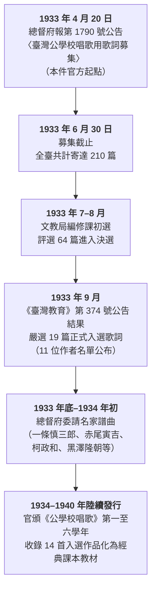

# 〈臺灣公學校唱歌用歌詞募集〉臺灣總督府報官方公告（昭和8年）

本頁收錄日治時期昭和 8 年（1933）4 月 20 日臺灣總督府正式發布於《臺灣總督府報》第 1790 號（4 月 21 日刊出，第 73 頁）之**〈臺灣公學校唱歌用歌詞募集〉**官方公告原文、國史館臺灣文獻館典藏檔案詮釋資料、完整白話語譯與歷史考證。

本件公告是臺灣音樂教育史上極具指標意義的**法規與徵集要項起點**——臺灣總督府文教局在此首次以最高官方公報明訂**「題材限與臺灣相關者（題材ハ臺灣ニ關係アルモノニ限リ）」**，懸賞每篇高達三十圓的獎金（相當於當時公學校初任教師近一個月俸額），面向全臺公開徵選公學校第一至第六學年適用之鄉土童謠與唱歌教材歌詞。

此一徵集案於同年 6 月底截止收件，在來自全臺的 210 篇應徵作品中初選 64 篇、決選 19 篇入選，最終有 14 首作品經總督府文教局聘請名家譜曲後，正式編入昭和 9 至 15 年（1934–1940）官頒出版之《公學校唱歌》第一至第六學年教科書，形成了今日所見豐富的臺灣在地鄉土唱歌體系。

> 🔗 **公學校唱歌官方史料六部曲全紀錄導航**：
> 1. 📜 **歌詞徵集令（1933 年 4 月 20 日，本件）**：總督府報第 1790 號〈臺灣公學校唱歌用歌詞募集〉公告（明訂「題材限臺灣相關者」、每篇賞金 30 圓）。
> 2. 📜 **歌詞入選令（1933 年 8 月 1 日）**：總督府報第 1873 號[〈懸賞募集公學校唱歌教材入選歌詞〉公告](../official_selection/index.md)（公布 19 篇入選作詞著名單與歌詞全文）。
> 3. 🎼 **歌曲徵曲令（1933 年 9 月 7 日）**：總督府報第 1904 號[〈臺灣公學校用唱歌歌曲募集〉公告](../melody_call/index.md)（每篇賞金 50 圓、公布 16 首指定歌詞）。
> 4. 🔍 **歌曲徵曲訂正令（1933 年 9 月 8 日）**：總督府報第 1905 號[〈臺灣公學校用唱歌歌曲募集〉訂正公告](../melody_call_errata/index.md)（勘誤七處錯漏字與濁點）。
> 5. 🏆 **歌曲入選令（1933 年 11 月 15 日）**：總督府報第 1958 號[〈懸賞募集公學校用唱歌歌曲入選者〉公告](../official_melody_selection/index.md)（公布 6 位入選作曲家名單）。
> 6. 📖 **民間成果詳刊（1933 年 9 月）**：刊載於《臺灣教育》第 374 號之[〈懸賞募集 公學校唱歌教材入選歌詞〉與作詞者名單](../lyrics_contest/index.md)（評審過程、初選 64 篇與課本改寫對照）。

---

## 一、典藏與公報檔案詮釋資料

| 欄位名稱 | 詮釋資料內容 | 考證說明 |
| :--- | :--- | :--- |
| **件名** | **臺灣公學校唱歌用歌詞募集** | 《臺灣總督府報》第 1790 號官報公告題名 |
| **件典藏號** | `0071031790a007` | 國史館臺灣文獻館典藏號 |
| **件號** | `007` | 該卷分件號次 |
| **全宗號** | `007` | 臺灣總督府報全宗 |
| **卷號／卷典藏號** | `193304` / `007-193304` | 昭和 8 年 4 月臺灣總督府報合訂卷 |
| **卷名** | 昭和8年4月臺灣總督府報 | 卷收錄第 1774–1796 期（分件量 294 件） |
| **系列階層** | 綜合資料／公告 | 府報「公告」法定發布欄位 |
| **發令機關** | **臺灣總督府** | 發令者：臺灣總督府（主管單位為文教局編修課） |
| **發令日期** | **昭和 8 年（1933）4 月 20 日** | 公告本文署名日期 |
| **刊登公報** | **《臺灣總督府報》第 1790 號** | 昭和 8 年（1933）4 月 21 日發行，第 73 頁（第三種郵便物認可） |
| **日期起訖** | 1933-04-20 至 1933-04-20 | 法令公告發布日 |
| **關鍵詞** | 臺灣公學校唱歌用歌詞、公學校唱歌、懸賞募集、文教局編修課 | 主題分類關鍵詞 |
| **版權與出處** | Copyright 國史館臺灣文獻館<br/>DataSource: 國史館臺灣文獻館 | 典藏機構：國史館臺灣文獻館 |
| **本站檔案檔名** | `0071031790a007.jpg` / `P001.jpg` | 府報第 1790 號第 73 頁原始掃描檔案 |

---

## 二、官方公報原始影像展示

下圖為國史館臺灣文獻館典藏之《臺灣總督府報》第 1790 號第 73 頁原件掃描影像，中央右側刊載「島內氣象表」，中左側即為本篇〈臺灣公學校唱歌用歌詞募集〉公告本文與全部 11 條要項：


---

## 三、公告全文原文忠實轉錄

> 註：以下轉錄完全依循昭和 8 年 4 月 20 日臺灣總督府報原刊字樣，保留日語漢文訓讀體與片假名句型；為利當代讀者研讀，排版依原條目分列，並加上標點符號與助讀標記。

```text
公　告

◎ 臺灣公學校唱歌用歌詞募集

今般本府ニ於テ左記要項ニ依リ公學校唱歌用歌詞ヲ募集ス

昭和八年四月二十日
臺灣總督府

一、題材ハ臺灣ニ關係アルモノニ限リ、歌詞ノ程度ハ第一學年用乃至第六學年用ニ適スルモノトス。
一、應募者ハ資格ニ制限ナク、又一人ニテ何篇應募スルモ可ナリ。但シ同一ノ題目ニツキテハ一人一篇ニ限ル。
一、〆切ハ昭和八年六月末日トス。
一、應募歌詞ハ一篇毎ニ別紙ニ記載シ、題目ノ下ニ何學年用ト記入スベシ。
一、應募者ハ別ニ住所氏名ヲ明記セル應募歌詞目錄ヲ添付スベシ。
　　應募歌詞ヲ記載セル紙面ニハ住所氏名ヲ記載スベカラズ。
一、應募歌詞及其ノ目錄ハ同封トシテ〆切期限內ニ到達スルヤウ文教局編修課宛ニ發送スベシ。但シ封皮ニ「應募歌詞」ノ四字ヲ記載スルヲ要ス。
一、應募歌詞ハ必ズ一處ニ纏メテ發送スベシ。一旦發送シタルモノハ訂正スルコトヲ得ズ。
一、應募歌詞ノ原稿ハ一切之ヲ返還セズ。
一、應募歌詞ハ本府ニ於テ審査ノ上、入選シタルモノ一篇ニツキ三十圓以內ノ賞金ヲ交付ス。
一、入選シタル歌詞ノ著作權ハ本府ニ屬スルモノトス。
　　入選歌詞ヲ本府ニ於テ使用スル場合ハ適宜修正スルコトアルベシ。
```

---

## 四、要項白話語譯與法規意旨逐條解讀

| 原文條目 | 現代中文白話語譯 | 法規意旨與背景考證 |
| :--- | :--- | :--- |
| **公告主旨**<br>`今般本府ニ於テ左記要項ニ依リ公學校唱歌用歌詞ヲ募集ス` | 本府（臺灣總督府）本次依照下列要項，公開徵集公學校唱歌用歌詞。 | 正式確立由臺灣總督府主導之官頒公學校教科書教材公開徵集制度。 |
| **第一條（題材與適用對象）**<br>`一、題材ハ臺灣ニ關係アルモノニ限リ、歌詞ノ程度ハ第一學年用乃至第六學年用ニ適スルモノトス。` | 一、題材**限與臺灣具相關性者**，歌詞深淺程度須適合公學校第一學年乃至第六學年學童使用。 | **全案最核心之歷史轉折點**：明確打破日治前期直接全盤移植日本內地文部省唱歌之舊習，制度化要求公學校教材必須深植臺灣本土風土、動植物、生活、地理與氣候。 |
| **第二條（應徵資格與投件限制）**<br>`一、應募者ハ資格ニ制限ナク、又一人ニテ何篇應募スルモ可ナリ。但シ同一ノ題目ニツキテハ一人一篇ニ限ル。` | 一、應徵者資格完全無限制；一人應徵篇數亦無限制。但同一題目每人僅限投一篇。 | 開放全臺公私立教育人員、師範生、甚至社會各界人士廣泛參與；一人可投多篇（例如臺南吉村守最終入選 5 篇、臺中岡田與志松入選 3 篇），極具開放性。 |
| **第三條（徵集截止期限）**<br>`一、〆切ハ昭和八年六月末日トス。` | 一、收件截止日期為**昭和 8 年（1933）6 月 30 日**。 | 自公告日（4 月 20 日）起算，給予投稿者約 2 個月又 10 天的創作與寄送期間。後續文教局統計於 6 月末截收了高達 210 篇應徵作品。 |
| **第四條（格式分紙）**<br>`一、應募歌詞ハ一篇毎ニ別紙ニ記載シ、題目ノ下ニ何學年用ト記入スベシ。` | 一、應徵歌詞每篇須各自書寫於單獨紙張上，並於題目下方註記適用之學年。 | 便於評審委員會依第一・二學年、第三・四學年、第五・六學年進行分組分類審查。 |
| **第五條（匿名盲審機制）**<br>`一、應募者ハ別ニ住所氏名ヲ明記セル應募歌詞目錄ヲ添付スベシ。應募歌詞ヲ記載セル紙面ニハ住所氏名ヲ記載スベカラズ。` | 一、應徵者須另紙檢附明確載明住所與姓名之「應徵歌詞目錄」。**書寫應徵歌詞之本文紙面上，絕對不得書寫住所及姓名。** | **極嚴謹之現代匿名盲審（Blind Review）設計**：歌詞本紙不具名，僅附清冊，杜絕評審委員因知名度或省籍身分產生偏見，確保作品評選公平公正。 |
| **第六條（收件地址與信封規定）**<br>`一、應募歌詞及其ノ目錄ハ同封トシテ〆切期限內ニ到達スルヤウ文教局編修課宛ニ發送スベシ。但シ封皮ニ「應募歌詞」ノ四字ヲ記載スルヲ要ス。` | 一、應徵歌詞及其目錄須同封於同一信封內，務必於截止期限前寄達「**文教局編修課**」。信封封面必須註明「**應募歌詞**」四個大字。 | 主辦主管單位為臺灣總督府文教局負責教材編寫印行的核心單位——**編修課**。 |
| **第七條（整批寄送與禁修原則）**<br>`一、應募歌詞ハ必ズ一處ニ纏メテ發送スベシ。一旦發送シタルモノハ訂正スルコトヲ得ズ。` | 一、應徵歌詞務必全部整理彙整於一處一併寄發。一旦寄出後，概不受理任何修改或抽換。 | 避免投件雜亂與事後爭議，維持官方審查程序之權威與效率。 |
| **第八條（原稿留存）**<br>`一、應募歌詞ノ原稿ハ一切之ヲ返還セズ。` | 一、應徵歌詞之原稿一律不予退還。 | 符合近代公部門文藝競賽與教材徵集之通例。 |
| **第九條（入選獎金）**<br>`一、應募歌詞ハ本府ニ於テ審査ノ上、入選シタルモノ一篇ニツキ三十圓以內ノ賞金ヲ交付ス。` | 一、應徵歌詞經本府嚴格審查後，入選作品**每篇核發三十圓以內之賞金**。 | **優渥之公金賞額**：昭和 8 年公學校初任教師月薪約在 30–45 圓之間，入選一篇可得高達 30 圓，等同整月薪水，極具吸引力。 |
| **第十條（著作權與編修修改權）**<br>`一、入選シタル歌詞ノ著作權ハ本府ニ屬スルモノトス。入選歌詞ヲ本府ニ於テ使用スル場合ハ適宜修正スルコトアルベシ。` | 一、入選歌詞之著作權歸屬於本府（臺灣總督府）。本府於日後使用入選歌詞時，**得視教學需要作適度合宜之文字修正**。 | 此條為日後課本編纂的重要依據。比對 9 月入選原詞與 1934 年成書，總督府編修課確實依此條款將許多詩句改寫得更合乎唱歌教學、節奏對位與公學校兒童語彙（如〈子すずめ〉刪節、〈木蔭の子目白〉修句、〈だいしゃ〉與〈白頭鶴〉調降學年等）。 |

---

## 五、歷史脈絡與深層考證分析

### 1. 臺灣公學校教科書在地化的劃時代轉折

日治前期，臺灣公學校唱歌科雖然在 1915 年發布了《公學校唱歌集》（46 首），但其內容有近三分之二直接取自日本文部省尋常小學校歌目，臺灣本土動植物或鄉土題材極為稀少（僅有少量描寫臺灣名勝風光的曲目）。

1930 年代初期，隨著臺灣教育界倡導「生活教育」與「鄉土教育」，加上學童對內地季節（如嚴寒積雪、櫻花、富士山）缺乏直觀生活經驗，總督府文教局遂決心為臺灣公學校編纂一套完全符合臺灣南國生活實態的新教科書。昭和 8 年 4 月這份公告中**「題材限與臺灣相關者（題材ハ臺灣ニ關係アルモノニ限リ）」**的明文規定，標誌著殖民地音樂教育教材首次官方主導的「在地化」轉向。

### 2. 「三十圓以內」獎金之當代物價與購買力考釋

根據昭和 8 年（1933）臺灣總督府文官官等俸給規程與當代物價統計：
- 當時臺灣公學校「訓導」（正式合格教師）之初任起薪約為每月 **35 至 45 圓**；聘用之「準訓導」月薪約 **25 至 30 圓**。
- 當時白米一斗（約 15 公斤）約 1 圓 50 錢至 2 圓；臺北到高雄的縱貫鐵路三等急行客車票價約 4 圓。

換言之，每入選一篇歌詞即可獲得相當於一名公學校基層教師**將近整整一個月工資**的三十圓獎金！若像臺南吉村守一人入選 5 篇，累計獎金高達 150 圓，相當於半年的教師俸額。如此優渥的賞額，直接促成了全臺教育人員與民間創作者的熱烈迴響。

### 3. 公開徵件成果與教科書落實鏈條

本公告發布後的歷史發展脈絡極為清晰完整：



這份公告不僅是一紙公文，更是日治臺灣音樂教科書走向本土化編纂的「身分證」與起跑點，奠定了後續長達數十年間無數臺灣公學校師生傳唱的鄉土童謠基礎。

---

## 六、相關連結與參照文獻

- [〈懸賞募集 公學校唱歌教材入選歌詞〉與作詞者名單（1933 年 9 月入選結果考證）](../lyrics_contest/index.md)
- [《公學校唱歌》第一學年用總覽](../grade_1/index.md)（收錄〈メジロ ノ コ〉、〈ユフダチ ヤンダ〉、〈ジヤンケン〉、〈カアレン〉、〈コスズメ〉）
- [《公學校唱歌》第二學年用總覽](../grade_2/index.md)（收錄〈タケノコ〉、〈ペタコ〉）
- [《公學校唱歌》第三學年用總覽](../grade_3/index.md)（收錄〈だいしゃ〉、〈牛車〉、〈すゐれん〉、〈おぢいさん〉、〈白さぎ〉）
- [《公學校唱歌》第四學年用總覽](../grade_4/index.md)（收錄〈かげろふ〉）
- [《公學校唱歌》第五學年用總覽](../grade_5/index.md)（收錄〈赤嵌城〉）
- [《公學校唱歌》全六冊統計與研究報告](../statistics.md)
- [國立臺灣歷史博物館典藏號 2020.006.0850 赤尾寅吉編《拔萃兒童唱歌集》（1933 同年出版）](../../archives/index.md)
