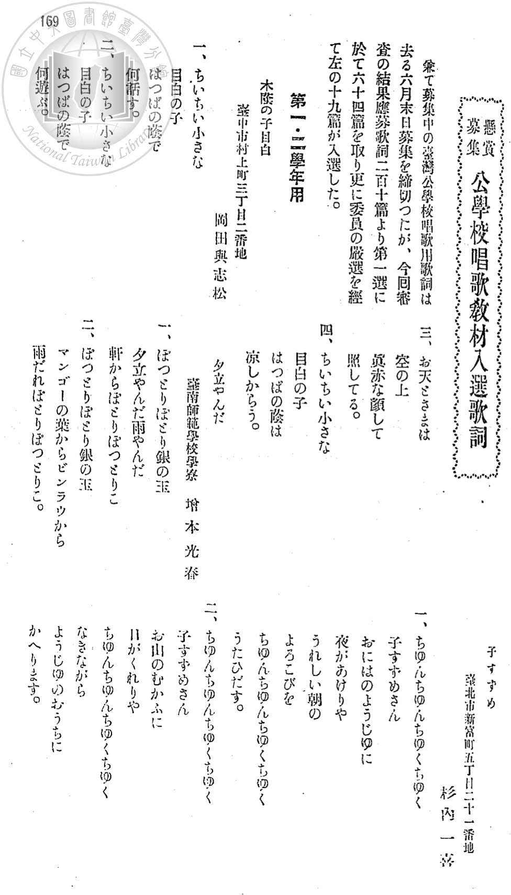
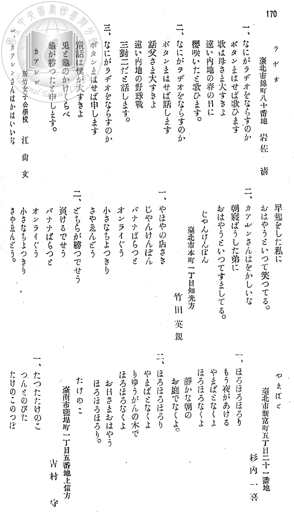
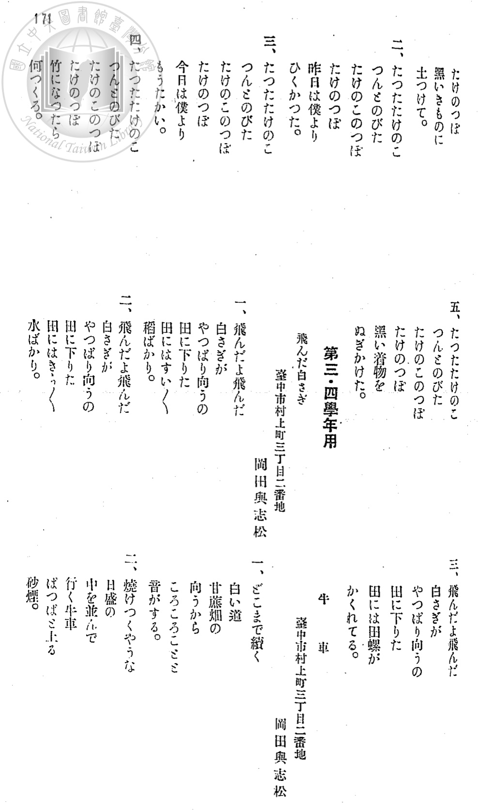
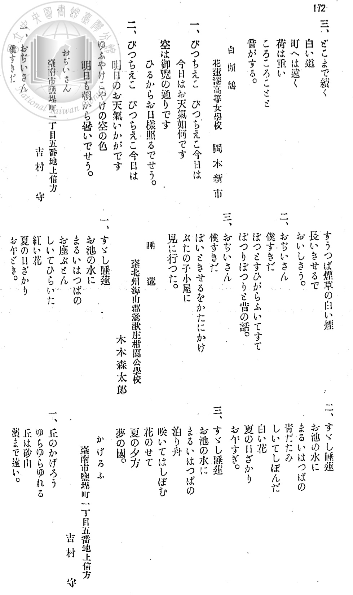
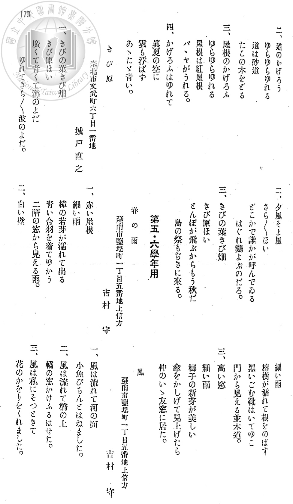
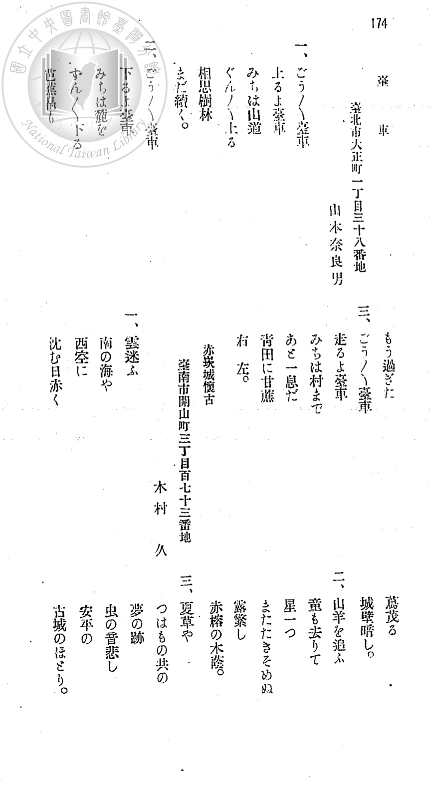

# 〈懸賞募集 公學校唱歌教材入選歌詞〉與作詞者名單

本頁收錄日治時期臺灣總督府為編纂新制《公學校唱歌》教科書所舉辦之**「懸賞募集 公學校唱歌教材入選歌詞」**完整入選名單與原詞全文（原刊頁碼第 169–174 頁，掃描檔 `P001.jpg`–`P006.jpg`）。

這份史料記載了《公學校唱歌》與《うたのほん（唱歌課本）》中**第一至第五學年 14 首臺灣在地新創曲目**——包括第一學年的〈メジロ ノ コ〉、〈ユフダチ ヤンダ〉、〈ジヤンケン〉、〈カアレン〉、〈コスズメ〉，第二學年的〈タケノコ〉、〈ペタコ〉（原題〈白頭鶴〉），第三學年的〈だいしゃ〉、〈牛車〉、〈すゐれん〉、〈おぢいさん〉、〈白さぎ〉，第四學年的〈かげろふ〉，以及第五學年的〈赤嵌城〉（原題〈赤崁城懷古〉）——的**原始作詞者姓名、身分與居住地／任教學校**，可據以比對入選原詞與最終編入課本時的字句修訂過程。

---

## 一、典藏與書目詮釋資料

### 1. 掃描檔案資訊（本頁圖檔來源）

- **題名**：〈懸賞募集 公學校唱歌教材入選歌詞〉
- **原刊頁碼**：第 169–174 頁（共 6 頁，對應 `P001.jpg`–`P006.jpg`）
- **影像檔名**：`jpli2008-pd-sxt_0705_6_n374-027_no20_j-i.pdf`（國立臺灣圖書館日治時期期刊影像，索書號 `0705-6`，《臺灣教育》第 374 號，昭和 8 年／1933 年 9 月）
- **前言記載**：
  > 「豫て募集中の臺灣公學校唱歌用歌詞は去る六月末日募集を締切つたが、今回審査の結果應募歌詞二百十篇より第一選に於て六十四篇を取り更に委員の嚴選を經て左の十九篇が入選した。」
  > （中譯：先前公開徵求之臺灣公學校唱歌用歌詞，已於本年六月底截止收件；本次審查結果，自應徵歌詞 210 篇中初選出 64 篇，再經委員會嚴格評選，最終由以下 19 篇入選。）

### 2. 相關期刊詮釋資料參照

| 欄位             | 內容                                              |
| :--------------- | :------------------------------------------------ |
| **資料格式**     | 期刊                                              |
| **期刊名稱**     | 第一教育（另參《臺灣教育》第 374 號）             |
| **出版單位**     | 臺灣子供世界社                                    |
| **出版地**       | 臺灣                                              |
| **出版年(日治)** | 昭和三年十二月五日（入選歌詞刊載於昭和八年九月）  |
| **出版年(西元)** | 1928/12/5（入選歌詞刊載於 1933/9）                |
| **發行者**       | 吉川利一                                          |
| **卷期／索書號** | `v007` `n011`（索書號 `0705-78`）／ `n374`（索書號 `0705-6`） |
| **影像檔名**     | `jpli2008-pd-sxt_0705_6_n374-027_no20_j-i.pdf` / `jpli2008-pd-sxt_0705_78_v007n011-016_no12_j-i.pdf` |

---

## 二、入選 19 篇歌詞與《公學校唱歌》收錄曲目總對照表

應徵的 210 篇作品中共有 **19 篇**入選（第一・二學年用 8 篇、第三・四學年用 7 篇、第五・六學年用 4 篇），由 **11 位作者**創作（其中臺南市鹽埕町**吉村守**一人入選 5 篇、臺中市村上町**岡田與志松**入選 3 篇、臺北市新富町**杉内一喜**入選 2 篇；另有新竹女子公學校臺籍作者**江尚文**、臺南師範學校學寮**增本光春**、鶯歌庄柑園公學校**木本森太郎**、花蓮港高等女學校**岡本新市**等教育現場師生）。

目前本資料庫已收錄之《公學校唱歌》（第一至第六學年用全六冊）與《うたのほん 下》（初等科第二學年用）中，**共有 14 首臺灣鄉土新創曲目（共 15 處收錄）**出自此批入選歌詞：

| 編號 | 募集組別 | 入選原題 | 作詞者 | 當時記載之學校／住址 | 節數 | 原刊頁碼 | 編入《公學校唱歌》／《うたのほん》對應曲目 |
| ---: | :--- | :--- | :--- | :--- | :---: | :---: | :--- |
| 1 | 第一・二學年用 | **木蔭の子目白** | **岡田與志松** | 臺中市村上町三丁目二番地 | 4 | p. 169 (`P001`) | 《公學校唱歌》第一學年 第 3 課 **[〈メジロ ノ コ〉](../grade_1/3_mejiro_no_ko/index.md)** |
| 2 | 第一・二學年用 | **夕立やんだ** | **增本光春** | 臺南師範學校學寮 | 2 | p. 169 (`P001`) | 《公學校唱歌》第一學年 第 4 課 **[〈ユフダチ ヤンダ〉](../grade_1/4_yudachi_yanda/index.md)** |
| 3 | 第一・二學年用 | **子すずめ** | **杉内一喜** | 臺北市新富町五丁目二十一番地 | 2 | p. 169 (`P001`) | 《公學校唱歌》第一學年 第 13 課 **[〈コスズメ〉](../grade_1/13_kosuzume/index.md)** |
| 4 | 第一・二學年用 | **ラヂオ** | **岩佐清** | 臺北市錦町八十番地 | 3 | p. 170 (`P002`) | 未直接採用（《公學校唱歌》第二學年 第 11 課 **[〈ラヂオ〉](../grade_2/11_rajio/index.md)** 另行改寫為廣播體操與兒童時間題材） |
| 5 | 第一・二學年用 | **カアレン** | **江尚文** | 新竹女子公學校 | 2 | p. 170 (`P002`) | 《公學校唱歌》第一學年 第 11 課 **[〈カアレン〉](../grade_1/11_karen/index.md)** 《うたのほん 下》第 9 課 **[〈かあれん〉](../../utanohon/ge_2006.006.0878/9_kaaren/index.md)** |
| 6 | 第一・二學年用 | **じやんけんぽん** | **竹田英親** | 臺北市本町一丁目知光方 | 2 | p. 170 (`P002`) | 《公學校唱歌》第一學年 第 9 課 **[〈ジヤンケン〉](../grade_1/9_janken/index.md)** |
| 7 | 第一・二學年用 | **やまばと** | **杉内一喜** | 臺北市新富町五丁目二十一番地 | 2 | p. 170 (`P002`) | （未編入第一～三學年課本） |
| 8 | 第一・二學年用 | **たけのこ** | **吉村守** | 臺南市鹽埕町一丁目五番地上信方 | 5 | p. 170–171 (`P002`–`P003`) | 《公學校唱歌》第二學年 第 4 課 **[〈タケノコ〉](../grade_2/4_takenoko/index.md)** |
| 9 | 第三・四學年用 | **飛んだ白さぎ** | **岡田與志松** | 臺中市村上町三丁目二番地 | 3 | p. 171 (`P003`) | 《公學校唱歌》第三學年 第 15 課 **[〈白さぎ〉](../grade_3/15_shirasagi/index.md)** |
| 10 | 第三・四學年用 | **牛車** | **岡田與志松** | 臺中市村上町三丁目二番地 | 3 | p. 171–172 (`P003`–`P004`) | 《公學校唱歌》第三學年 第 4 課 **[〈牛車〉](../grade_3/4_gyusha/index.md)** |
| 11 | 第三・四學年用 | **白頭鶴** | **岡本新市** | 花蓮港高等女學校 | 2 | p. 172 (`P004`) | 調降學年編入《公學校唱歌》第二學年 第 5 課 **[〈ペタコ〉](../grade_2/5_petako/index.md)**（另參《うたのほん 下》第 13 課[〈ぺたこ〉](../../utanohon/ge_2006.006.0878/13_petako/index.md)） |
| 12 | 第三・四學年用 | **おぢいさん** | **吉村守** | 臺南市鹽埕町一丁目五番地上信方 | 3 | p. 172 (`P004`) | 《公學校唱歌》第三學年 第 13 課 **[〈おぢいさん〉](../grade_3/13_ojiisan/index.md)** |
| 13 | 第三・四學年用 | **睡蓮** | **木本森太郎** | 臺北州海山郡鶯歌庄柑園公學校 | 3 | p. 172 (`P004`) | 《公學校唱歌》第三學年 第 7 課 **[〈すゐれん〉](../grade_3/7_suiren/index.md)** |
| 14 | 第三・四學年用 | **かげろふ** | **吉村守** | 臺南市鹽埕町一丁目五番地上信方 | 4 | p. 172–173 (`P004`–`P005`) | 《公學校唱歌》第四學年 第 6 課 **[〈かげろふ〉](../grade_4/6_kagerou/index.md)** |
| 15 | 第三・四學年用 | **きび原** | **城戸直之** | 臺北市文武町六丁目一番地 | 3 | p. 173 (`P005`) | （未編入第一～六學年課本） |
| 16 | 第五・六學年用 | **春の雨** | **吉村守** | 臺南市鹽埕町一丁目五番地上信方 | 3 | p. 173 (`P005`) | （未編入第一～六學年課本；第六學年臺灣鄉土新創曲另採〈胡蝶蘭〉與〈せんだん並木〉） |
| 17 | 第五・六學年用 | **風** | **吉村守** | 臺南市鹽埕町一丁目五番地上信方 | 3 | p. 173 (`P005`) | （未編入第一～六學年課本；第六學年臺灣鄉土新創曲另採〈胡蝶蘭〉與〈せんだん並木〉） |
| 18 | 第五・六學年用 | **臺車** | **山本奈良男** | 臺北市大正町一丁目三十八番地 | 3 | p. 174 (`P006`) | 調降學年編入《公學校唱歌》第三學年 第 2 課 **[〈だいしゃ〉](../grade_3/2_daisha/index.md)** |
| 19 | 第五・六學年用 | **赤崁城懷古** | **木村久** | 臺南市開山町三丁目百七十三番地 | 3 | p. 174 (`P006`) | 《公學校唱歌》第五學年 第 12 課 **[〈赤嵌城〉](../grade_5/12_sekikanjo/index.md)** |

---

## 三、入選歌詞全文轉錄與課本修訂考證

### 第一・二學年用（共 8 篇）

#### 1. 〈木蔭の子目白〉— 岡田與志松（臺中市村上町三丁目二番地）
- **對應課本曲目**：《公學校唱歌》第一學年用 第 3 課 **[〈メジロ ノ コ〉](../grade_1/3_mejiro_no_ko/index.md)**
- **入選原詞（`P001.jpg`）**：
  > 一、ちいちい小さな　目白の子　はつぱの蔭で　何話す。
  > 二、ちいちい小さな　目白の子　はつぱの蔭で　何遊ぶ。
  > 三、お天とさまは　空の上　眞赤な顔して　照してる。
  > 四、ちいちい小さな　目白の子　はつぱの蔭は　涼しからう。
- **課本修訂對照**：編入第一學年課本時，全曲轉為片假名分寫，標題簡化為〈メジロ ノ コ〉，第二節末句「何遊ぶ」改為語法更自然的「ナニ シテル」，第三節「眞赤な顔して」改為「マッカ ナ カホ デ」，第四節則完全一致。

#### 2. 〈夕立やんだ〉— 增本光春（臺南師範學校學寮）
- **對應課本曲目**：《公學校唱歌》第一學年用 第 4 課 **[〈ユフダチ ヤンダ〉](../grade_1/4_yudachi_yanda/index.md)**
- **入選原詞（`P001.jpg`）**：
  > 一、ぽつとりぽとり銀の玉　夕立やんだ雨やんだ　軒からぽとりぽつとりと
  > 二、ぽつとりぽとり銀の玉　マンゴーの葉からビンラウから　雨だれぽとりぽつとりと。
- **課本修訂對照**：作者增本光春當時為臺南師範學校住宿生（學寮）。編入第一學年課本時，一字未改（僅轉為片假名分寫），將南臺灣夏日午後陣雨停歇後，檨仔樹（マンゴー）與檳榔樹（ビンラウ）葉尖滴落水珠的景象化為公學校一年級代表曲。

#### 3. 〈子すずめ〉— 杉内一喜（臺北市新富町五丁目二十一番地）
- **對應課本曲目**：《公學校唱歌》第一學年用 第 13 課 **[〈コスズメ〉](../grade_1/13_kosuzume/index.md)**
- **入選原詞（`P001.jpg`）**：
  > 一、ちゆんちゆんちゆくちゆく　子すずめさん　おにはのようじゆに　夜があけりや　うれしい朝の　よろこびを　ちゆんちゆんちゆくちゆく　うたひだす。
  > 二、ちゆんちゆんちゆくちゆく　子すずめさん　お山のむかふに　日がくれりや　ちゆんちゆんちゆくちゆく　なきながら　ようじゆのおうちに　かへります。
- **課本修訂對照**：編入第一學年課本時，為配合一年級 8 小節簡短曲式，刪除第一節中段「おにはのようじゆに 夜があけりや」，直接連接為「チユン チユン チユク チユク コスズメ サン、ウレシイ アサ ノ ヨロコビ ヲ、チユン チユン チユク チユク ウタヒダス」，第二節則將「お庭の榕樹（ようじゆ）」保留於歸巢場景。

#### 4. 〈ラヂオ〉— 岩佐清（臺北市錦町八十番地）
- **入選原詞（`P002.jpg`）**：
  > 一、なにがラヂオをならすのか　ボタンまはせば歌ひます　歌は母さま大すきよ　遠い内地の春の日に　櫻咲いたと歌ひます。
  > 二、なにがラヂオをならすのか　ボタンまはせば話します　話は父さま大すきよ　遠い内地の野球戰　三對二だと話します。
  > 三、なにがラヂオをならすのか　ボタンまはせば申します　童話は僕が大すきよ　兎と龜のかけくらべ　龜が勝つたと申します。

#### 5. 〈カアレン〉— 江尚文（新竹女子公學校）
- **對應課本曲目**：《公學校唱歌》第一學年用 第 11 課 **[〈カアレン〉](../grade_1/11_karen/index.md)**、《うたのほん 下》第 9 課 **[〈かあれん〉](../../utanohon/ge_2006.006.0878/9_kaaren/index.md)**
- **入選原詞（`P002.jpg`）**：
  > 一、カアレンさんはかはいいな　早起をした私に　おはやうといつて笑つてる。
  > 二、カアレンさんはをかしいな　朝寢ばうした弟に　おはやうといつてすましてる。
- **課本修訂對照**：作者**江尚文**服務（或就讀）於**新竹女子公學校**，為本次入選名單中極具代表性的臺灣本島人作者。其作品以臺語「加令（八哥）」入歌，不仅原封不動編入昭和 9 年《公學校唱歌》第一學年（僅將「早起をした」微調為「ハヤオキ シタ」），更在昭和 18 年國民學校改制後繼續留存於《うたのほん 下》（初等科第二學年用），傳唱超過十年。

#### 6. 〈じやんけんぽん〉— 竹田英親（臺北市本町一丁目知光方）
- **對應課本曲目**：《公學校唱歌》第一學年用 第 9 課 **[〈ジヤンケン〉](../grade_1/9_janken/index.md)**
- **入選原詞（`P002.jpg`）**：
  > 一、やほやの店さき　じやんけんぽん　バナナぱらつと　オンライぐう　小さなちよつきり　さやゑんどう
  > 二、どちらが勝つでせう　負けるでせう　バナナぱらつと　オンライぐう　小さなちよつきり　さやゑんどう。
- **課本修訂對照**：編入第一學年課本時標題簡化為〈ジヤンケン〉，將整串香蕉比作「布（ぱらつと）」、鳳梨（臺語「旺來」オンライ）比作「石頭（ぐう）」、荷蘭豆（さやゑんどう）比作「剪刀（ちよつきり）」，原詞一字未改。

#### 7. 〈やまばと〉— 杉内一喜（臺北市新富町五丁目二十一番地）
- **入選原詞（`P002.jpg`）**：
  > 一、ほろほろほろり　もう夜があける　やまばとなくよ　ほろほろなくよ　靜かな朝の　お庭でなくよ。
  > 二、ほろほろほろり　やまばとなくよ　りゆうがんの木で　ほろほろなくよ　お日さまおはやう　ほろほろほろり。

#### 8. 〈たけのこ〉— 吉村守（臺南市鹽埕町一丁目五番地上信方）
- **對應課本曲目**：《公學校唱歌》第二學年用 第 4 課 **[〈タケノコ〉](../grade_2/4_takenoko/index.md)**
- **入選原詞（`P002.jpg`–`P003.jpg`）**：
  > 一、たつたたけのこ　つんとのびた　たけのこのつぼ　たけのつぼ　黑いきものに　土つけて。
  > 二、たつたたけのこ　つんとのびた　たけのこのつぼ　たけのつぼ　昨日は僕より　ひくかつた。
  > 三、たつたたけのこ　つんとのびた　たけのこのつぼ　たけのつぼ　今日は僕より　もうたかい。
  > 四、たつたたけのこ　つんとのびた　たけのこのつぼ　たけのつぼ　竹になつたら　何つくる。
  > 五、たつたたけのこ　つんとのびた　たけのこのつぼ　たけのつぼ　黑い着物を　ぬぎかけた。
- **課本修訂對照**：編入《公學校唱歌》第二學年用第四課時，精選前三節並改為片假名分詞標題〈タケノコ〉，將各節中間疊句「たけのこのつぼ たけのつぼ」改為更生動形容高個子的「タケノコ ノッポ、タケ ノッポ」。

---

### 第三・四學年用（共 7 篇）

#### 9. 〈飛んだ白さぎ〉— 岡田與志松（臺中市村上町三丁目二番地）
- **對應課本曲目**：《公學校唱歌》第三學年用 第 15 課 **[〈白さぎ〉](../grade_3/15_shirasagi/index.md)**
- **入選原詞（`P003.jpg`）**：
  > 一、飛んだよ飛んだ　白さぎが　やつぱり向うの　田に下りた　田にはすい〱　稻ばかり。
  > 二、飛んだよ飛んだ　白さぎが　やつぱり向うの　田に下りた　田にはきゝつ〱　水ばかり。
  > 三、飛んだよ飛んだ　白さぎが　やつぱり向うの　田に下りた　田には田螺が　かくれてる。
- **課本修訂對照**：編入第三學年課本時標題簡化為〈白さぎ〉，並依春耕插秧至秧苗成長的季節順序，將第一節與第二節對調，且將「田にはきゝつ〱 水ばかり」修訂為「田にはきらきら 水ばかり」（水波閃爍貌）。

#### 10. 〈牛車〉— 岡田與志松（臺中市村上町三丁目二番地）
- **對應課本曲目**：《公學校唱歌》第三學年用 第 4 課 **[〈牛車〉](../grade_3/4_gyusha/index.md)**
- **入選原詞（`P003.jpg`–`P004.jpg`）**：
  > 一、どこまで續く　白い道　甘蔗畑の　向うから　ごろごろごごと　音がする。
  > 二、燒けつくやうな　日盛の　中を並んで　行く牛車　ぱつぱと上る　砂煙。
  > 三、どこまで續く　白い道　町へは遠く　荷は重い　ごろごろごごと　音がする。
- **課本修訂對照**：編入第三學年課本時，僅將「ごろごろごごと」微調為清音「ころころこと」，其餘三節歌詞完全一致。

#### 11. 〈白頭鶴〉— 岡本新市（花蓮港高等女學校）
- **對應課本曲目**：《公學校唱歌》第二學年用 第 5 課 **[〈ペタコ〉](../grade_2/5_petako/index.md)**（另參《うたのほん 下》第 13 課 **[〈ぺたこ〉](../../utanohon/ge_2006.006.0878/13_petako/index.md)**）
- **入選原詞（`P004.jpg`）**：
  > 一、ぴつちえこ　ぴつちえこ今日は　今日はお天氣如何です　空は御覽の通りです　ひるからお日樣照るでせう。
  > 二、ぴつちえこ　ぴつちえこ今日は　明日のお天氣いかがです　ゆふやけこやけの空の色　明日も朝から暑いでせう。
- **課本修訂對照**：花蓮港高等女學校教師**岡本新市**投稿時原歸入「第三・四學年用」，題為〈白頭鶴〉（當時日人對臺灣平地常見鳥類「白頭翁」之俗稱，臺語稱「白頭殼仔 pe̍h-thâu-khak-á」）。編纂委員會將其調降學年編入《公學校唱歌》**第二學年用第五課**，並直接以臺語音譯改題為**〈ペタコ〉**，首句鳴叫聲由「ぴつちえこ ぴつちえこ」改為「ピッチコ ピッチコ」，第二節後段由「ゆふやけこやけの空の色 明日も朝から暑いでせう」改訂為與第一節句型對稱的「ソラ ハ ユフヤケ マッカ デス。アス ハ アサ カラ テル デセウ」（後於昭和 18 年《うたのほん 下》另有描寫白頭翁啄食木瓜之同名異曲〈ぺたこ〉）。

#### 12. 〈おぢいさん〉— 吉村守（臺南市鹽埕町一丁目五番地上信方）
- **對應課本曲目**：《公學校唱歌》第三學年用 第 13 課 **[〈おぢいさん〉](../grade_3/13_ojiisan/index.md)**
- **入選原詞（`P004.jpg`，自上段最左欄接中段最右欄）**：
  > 一、おぢいさん　僕すきだ　すうつぱ煙草の白い煙　長いきせるで　おいしさう。
  > 二、おぢいさん　僕すきだ　ぽつとすひがらふいてすて　ぽつりぽつりと昔の話。
  > 三、おぢいさん　僕すきだ　ぽいときせるをかたにかけ　ぶたの子小屋に　見に行つた。
- **課本修訂對照**：編入第三學年課本第 13 課時，為了讓男女學童皆能自然吟唱，將各節首句「おぢいさん 僕すきだ」統一改為「わたしのすきな おぢいさん」，第二節末句「昔の話」微調為「おはなしを」，第三節末句「ぶたの子小屋に 見に行つた」調整語序為「こやにぶたの子 見にいつた」。

#### 13. 〈睡蓮〉— 木本森太郎（臺北州海山郡鶯歌庄柑園公學校）
- **對應課本曲目**：《公學校唱歌》第三學年用 第 7 課 **[〈すゐれん〉](../grade_3/7_suiren/index.md)**
- **入選原詞（`P004.jpg`）**：
  > 一、すゞし睡蓮　お池の水に　まるいはつぱの　お座ぶとん　しいてひらいた　紅い花　夏の日ざかり　お午どき。
  > 二、すゞし睡蓮　お池の水に　まるいはつぱの　青だたみ　しいてしぼんだ　白い花　夏の日ざかり　お午すぎ。
  > 三、すゞし睡蓮　お池の水に　まるいはつぱの　泊り舟　咲いてはしぼむ　花のせて　夏の夕方　夢の國。
- **課本修訂對照**：作者**木本森太郎**任教於臺北州海山郡鶯歌庄**柑園公學校**（今新北市樹林區柑園國小）。編入第三學年課本時標題作〈すゐれん〉，並將三節結尾的時間描寫修訂為更富層次的「清晨→正午→向晚」三部曲：第一節末句由「夏の日ざかり お午どき」改為「夏のあしたの 朝まだき」，第二節末句由「夏の日ざかり お午すぎ」改為「夏のまひるの 日ざかりに」，第三節末句由「夏の夕方 夢の國」改為「夏のゆふべの ゆめのくに」。

#### 14. 〈かげろふ〉— 吉村守（臺南市鹽埕町一丁目五番地上信方）
- **對應課本曲目**：《公學校唱歌》第四學年用 第 6 課 **[〈かげろふ〉](../grade_4/6_kagerou/index.md)**
- **入選原詞（`P004.jpg`–`P005.jpg`）**：
  > 一、丘のかげろふ　ゆらゆらゆれる　丘は砂山　濱まで遠い。
  > 二、道のかげろふ　ゆらゆらゆれる　道は砂道　たこの木をとる
  > 三、屋根のかげろふ　ゆらゆらゆれる　屋根は紅屋根　パヽヤがうれる。
  > 四、かげろふはゆれて　眞夏の空に　雲も浮ばず　あゝたゞ青い。
- **課本修訂對照**：編入《公學校唱歌》第四學年用第 6 課時，精選前三節並刪去首句字數不同的第四節；第一節「丘」改作「岡（をか）」，第二節末句還原為「たこの木をどる」（海濱林投樹在陽炎熱氣中搖曳如舞，期刊誤植為「をとる」），第三節則將「紅屋根」改為平假名「べに屋根」、外來語「パヽヤがうれる」改為四拍音數更整齊的漢語詞「もくくわがうれる」（木瓜熟透），生動描繪南臺灣海濱沙丘、林投樹與紅瓦屋簷下木瓜熟成的盛夏景致。

#### 15. 〈きび原〉— 城戸直之（臺北市文武町六丁目一番地）
- **入選原詞（`P005.jpg`）**：
  > 一、きびの葉きび畑　きび原ほい　廣くて青くて海のよだ　ゆれてきら〱波のよだ。
  > 二、夕風そよ風　さら〱ほい　どこかで誰かが呼んでゐる　はぐれ鶏よぶのだろ。
  > 三、きびの葉きび畑　きび原ほい　とんぼが飛ぶからもう秋だ　島の祭もぢきに來る。

---

### 第五・六學年用（共 4 篇）

#### 16. 〈春の雨〉— 吉村守（臺南市鹽埕町一丁目五番地上信方）
- **入選原詞（`P005.jpg`）**：
  > 一、赤い屋根　細い雨　檨の若芽が濡れて出る　青い合羽を着てゆかう　二階の窓から見える雨。
  > 二、白い壁　細い雨　榕樹が濡れて根をのばす　黑いごむ靴はいてゆこ　門から見える並木道。
  > 三、高い窓　細い雨　椰子の新芽が美しい　傘をかしげて見上げたら　仲のいゝ友窓に居た。

#### 17. 〈風〉— 吉村守（臺南市鹽埕町一丁目五番地上信方）
- **入選原詞（`P005.jpg`）**：
  > 一、風は流れて河の面　小魚ぴちんとはねました。
  > 二、風は流れて橋の上　轎の窓かけふるはせた。
  > 三、風は私にそつときて　花のかをりをくれました。

#### 18. 〈臺車〉— 山本奈良男（臺北市大正町一丁目三十八番地）
- **對應課本曲目**：《公學校唱歌》第三學年用 第 2 課 **[〈だいしゃ〉](../grade_3/2_daisha/index.md)**
- **入選原詞（`P006.jpg`）**：
  > 一、ごう〱臺車　上るよ臺車　みちは山道　ぐん〱上る　相思樹林　まだ續く。
  > 二、ごう〱臺車　下るよ臺車　みちは麓を　ずん〱下る　芭蕉畠も　もう過ぎた
  > 三、ごう〱臺車　走るよ臺車　みちは村まで　あと一息だ　青田に甘蔗　右 左。
- **課本修訂對照**：山本奈良男投稿時原歸入「第五・六學年用」，但因節奏明快、詞句朗朗上口，編纂委員會將其調降學年，改以平假名標題〈だいしゃ〉編入《公學校唱歌》**第三學年用第二課**，並將第三節末句「青田に甘蔗 右 左」修訂為「青田にかんしやばたけ 右ひだり」。

#### 19. 〈赤崁城懷古〉— 木村久（臺南市開山町三丁目百七十三番地）
- **對應課本曲目**：《公學校唱歌》第五學年用 第 12 課 **[〈赤嵌城〉](../grade_5/12_sekikanjo/index.md)**
- **入選原詞（`P006.jpg`）**：
  > 一、雲迷ふ　南の海や　西空に　沈む日赤く　蔦茂る　城壁暗し。
  > 二、山羊を追ふ　童も去りて　星一つ　またたきそめぬ　露繁し　赤榕の木蔭。
  > 三、夏草や　つはもの共の　夢の跡　虫の音悲し　安平の　古城のほとり。
- **課本修訂對照**：作者**木村久**居住於臺南市開山町（延平郡王祠所在地）。編入《公學校唱歌》第五學年用第 12 課時，標題簡化為**〈赤嵌城〉**（せきかんじやう），原詞三節一字未改（僅將部分漢字轉為假名「雲まよふ」「つたしげる」「童もさりて」「つゆしげし」「ゆめのあと」並標註振假名），譜以ト短調（G 小調）3/4 拍優美蒼涼之旋律，詠嘆安平古堡（熱蘭遮城）夕照與赤榕（雀榕）木陰。

---

## 四、原刊掃描影像（`P001.jpg`–`P006.jpg`）

### P001.jpg（原刊第 169 頁）
〈懸賞募集 公學校唱歌教材入選歌詞〉首頁，含前言及「第一・二學年用」入選作：岡田與志松〈木蔭の子目白〉、增本光春〈夕立やんだ〉、杉内一喜〈子すずめ〉。

### P002.jpg（原刊第 170 頁）
「第一・二學年用」入選作：岩佐清〈ラヂオ〉、新竹女子公學校江尚文〈カアレン〉、竹田英親〈じやんけんぽん〉、杉内一喜〈やまばと〉、吉村守〈たけのこ〉（第一節）。

### P003.jpg（原刊第 171 頁）
「第一・二學年用」吉村守〈たけのこ〉（第二～五節），以及「第三・四學年用」入選作：岡田與志松〈飛んだ白さぎ〉、岡田與志松〈牛車〉（第一～二節）。

### P004.jpg（原刊第 172 頁）
「第三・四學年用」入選作：岡田與志松〈牛車〉（第三節）、花蓮港高等女學校岡本新市〈白頭鶴〉（即〈ぺたこ〉原詞）、吉村守〈おぢいさん〉、柑園公學校木本森太郎〈睡蓮〉、吉村守〈かげろふ〉（第一節）。

### P005.jpg（原刊第 173 頁）
「第三・四學年用」吉村守〈かげろふ〉（第二～四節）、城戸直之〈きび原〉，以及「第五・六學年用」入選作：吉村守〈春の雨〉、吉村守〈風〉。

### P006.jpg（原刊第 174 頁）
「第五・六學年用」入選作：山本奈良男〈臺車〉、木村久〈赤崁城懷古〉。

