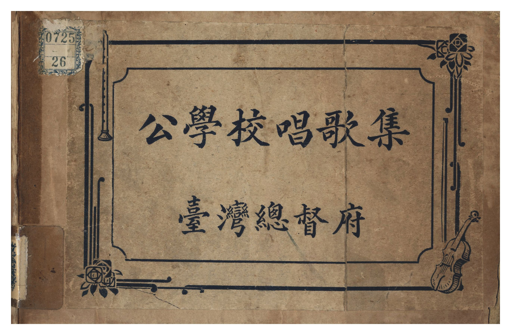
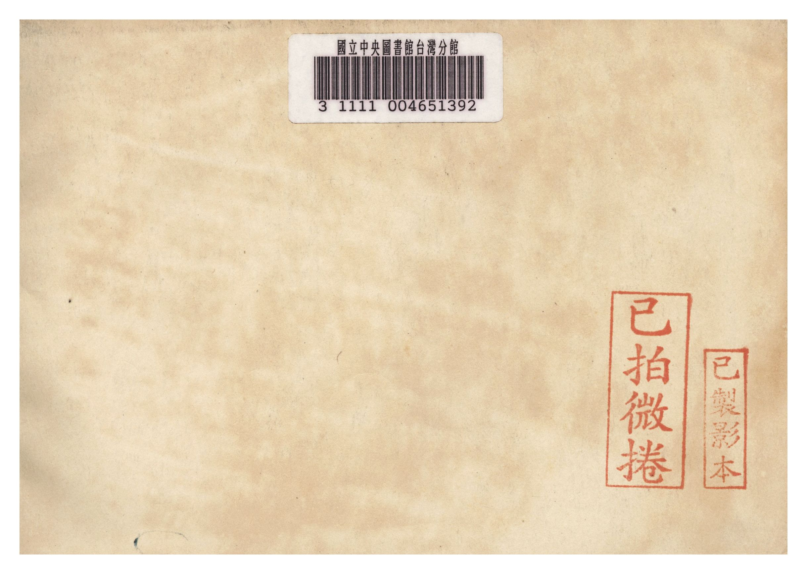
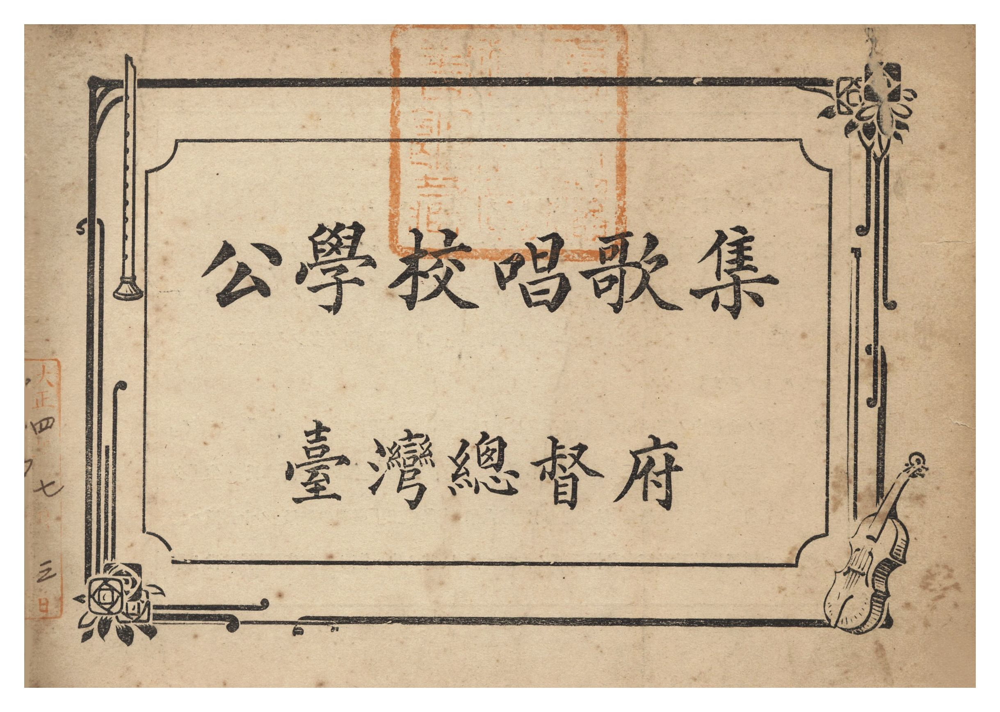
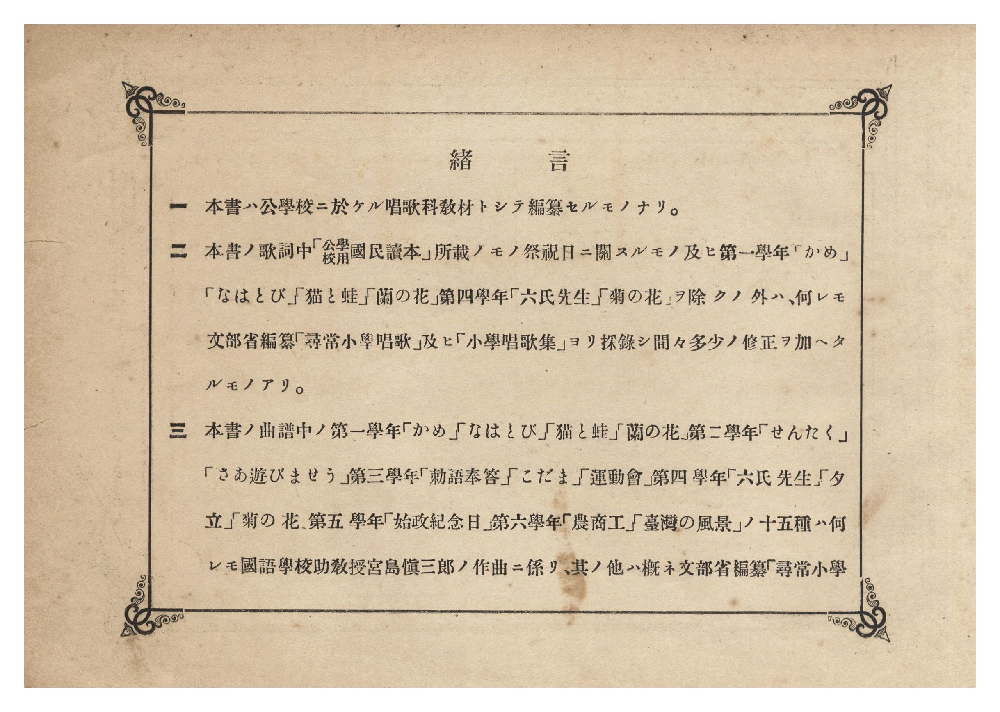
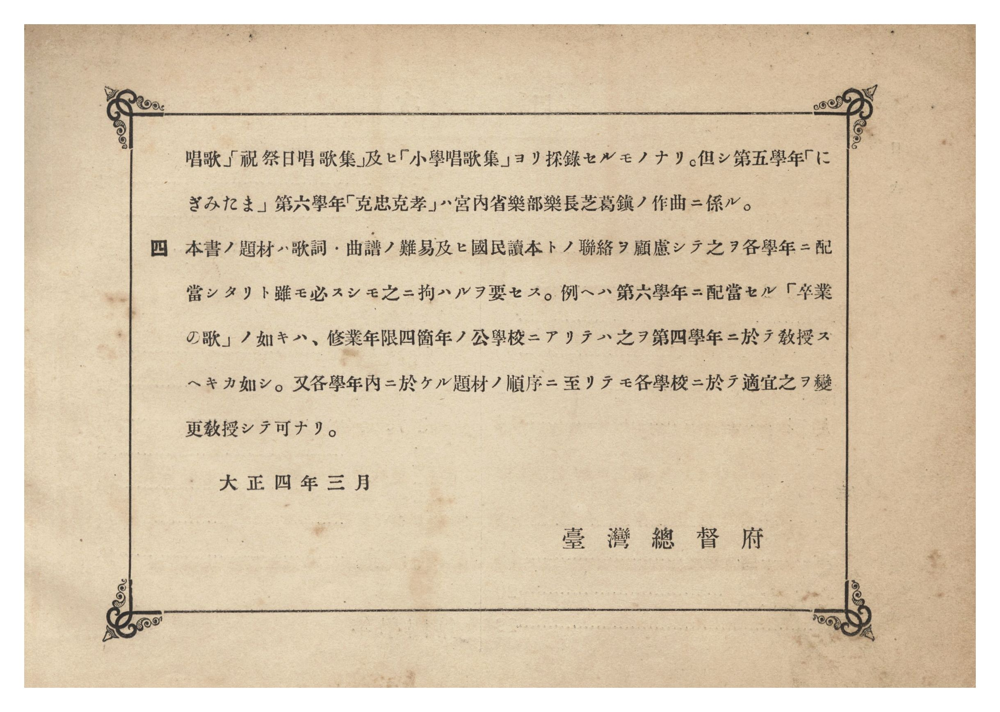
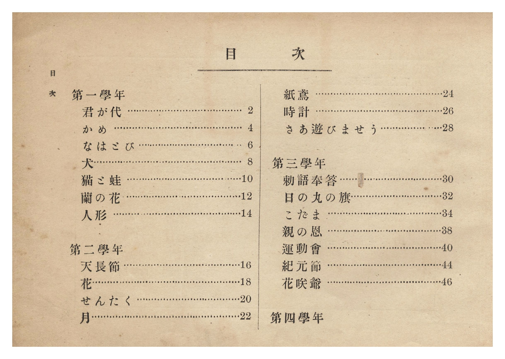
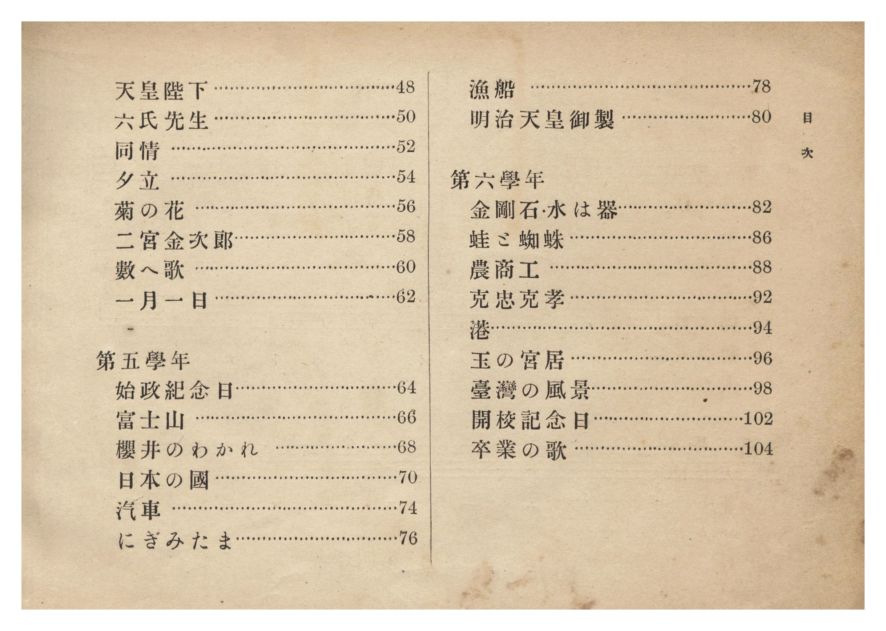

# 書訊與卷首／卷末掃描頁 — 《公學校唱歌集》 大正四年版（國臺圖 0725 26）

本頁收錄本冊之封面、扉頁、目次（もくろく）、樂典大要、版權頁與封底等原書掃描圖檔（共 7 頁）。

## 館藏詮釋資料（國立臺灣圖書館）

| 欄位 | 內容 |
| :--- | :--- |
| **系統編號** | `jpli2009-bk-sxt_0725_26_8888` |
| **資料格式** | 圖書 |
| **主要題名** | 公學校唱歌集 |
| **作者（姓名）** | 臺灣總督府（編輯） |
| **出版／發行者** | 臺灣總督府 |
| **出版年（日治）** | 大正 4 年（1915 年 4 月） |
| **總頁數** | 112 頁（原件部分缺頁，存掃描影像 93 頁） |
| **語文** | 日文 |
| **索書號** | `0725 26` |
| **關鍵詞** | 猫、蛙、天長節、時計、紀元節、運動會、二宮金次郎、始政紀念日、汽車、富士山、明治天皇、金剛石、日本、高砂、臺灣島、蜘蛛、打狗港、淡水河、霧社、人形、佛桑花、帽子 |
| **補充說明** | 目次可連結之章節內文影像包含黑體字章節在內。無版權頁、部分原件缺頁（缺頁曲目：第一學年〈蝶々〉〈お馬〉、第二學年〈桃園〉〈夕やけ〉、第三學年〈帽子〉〈佛桑花〉、第四學年〈蜻蛉〉、第五學年〈楠木正行〉、第六學年〈臺灣周遊唱歌〉〈霧社〉〈卒業〉）。 |

---

## 緒言（原文轉錄）

> 一、本書ハ公學校第一部ニ於テ唱歌教授ノ際教師ノ使用ニ供センガ爲ニ編纂シタルモノナリ。但シ第六學年ニ於テハ便宜兒童ニモ使用セシムル目的ヲ以テ特ニ假名遣ヲ正シ漢字ヲモ交ヘタリ。
>
> 一、本書ハ每學年ノ教材ヲ九曲トシ、別ニ祝祭日唱歌等五曲ヲ加ヘテ合計五十九曲ヲ採擇セリ。而シテ是等ノ歌曲ハ主トシテ各學年ニ於ケル國語讀本中ノ教材ト聯絡ヲ保タシメタリ。其ノ中「猫と蛙」「せんたく」「さあ遊びませう」「こだま」「運動會」「夕立」ハ本府編纂公學校用國民讀本ヨリ、「かめ」「なはとび」「蝶々」「蘭の花」「お馬」「桃園」「夕やけ」「帽子」「佛桑花」「蜻蛉」「臺灣周遊唱歌」「霧社」「卒業」ハ別ニ新作シ、總テ本府囑託一條（舊姓宮島）慎三郎ヲシテ作曲セシメ、「勅語奉答」「六氏先生」「菊の花」「始政紀念日」ハ從來本島ニ行ハレタル歌詞ニ同囑託ノ作曲シタルモノヲ採リ、「にぎみたま」ハ芝葛鎮氏ノ作曲ニカヽルモノヲ採リ、其ノ他ハ悉ク文部省ノ著作ニカヽルモノ、中ニ就キテ採擇シタリ。但シ「花」「人形」「天皇陛下」ハ本島ニ適セシメンガ爲ニ其ノ歌詞ニ多少ノ改作ヲ試ミタリ。
>
> 一、本書ハ使用上ノ便宜ヲ圖リテ本譜及ビ略譜ノ二種ヲ併セ載セタリ。但シ紙數ノ都合ニヨリテ伴奏譜ハ總テ之ヲ省略セリ。
>
> 大正四年四月　　臺灣總督府

---

## 卷首原書掃描頁（P001–P007）

### P001.jpg

本冊封面（右頁），題「公學校唱歌集　臺灣總督府」，左上貼有舊藏圖書分類籤「0725 26」。

### P002.jpg

「緒言」（第 1–2 頁）：說明本書編纂旨趣、選曲與作歌作曲來源（一條／宮島慎三郎、文部省著作《尋常小學唱歌》等）及伴奏譜省略理由。

### P003.jpg

「緒言」續頁（第 3 頁，署「大正四年四月　臺灣總督府」）與「公學校唱歌集目次」前半（第一～三學年）。

### P004.jpg

「公學校唱歌集目次」後半（第四～六學年）。

### P005.jpg

「本集ノ使ヒ方」第 1–2 頁（五線譜與數字簡譜音階、拍子、休止符等樂典對照說明）。

### P006.jpg

「本集ノ使ヒ方」第 3–4 頁。

### P007.jpg

「本集ノ使ヒ方」第 5–6 頁。

