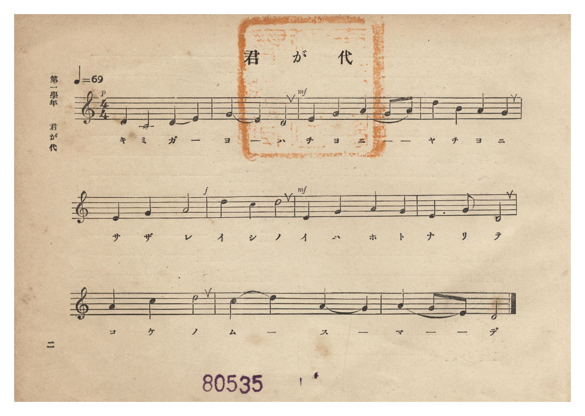
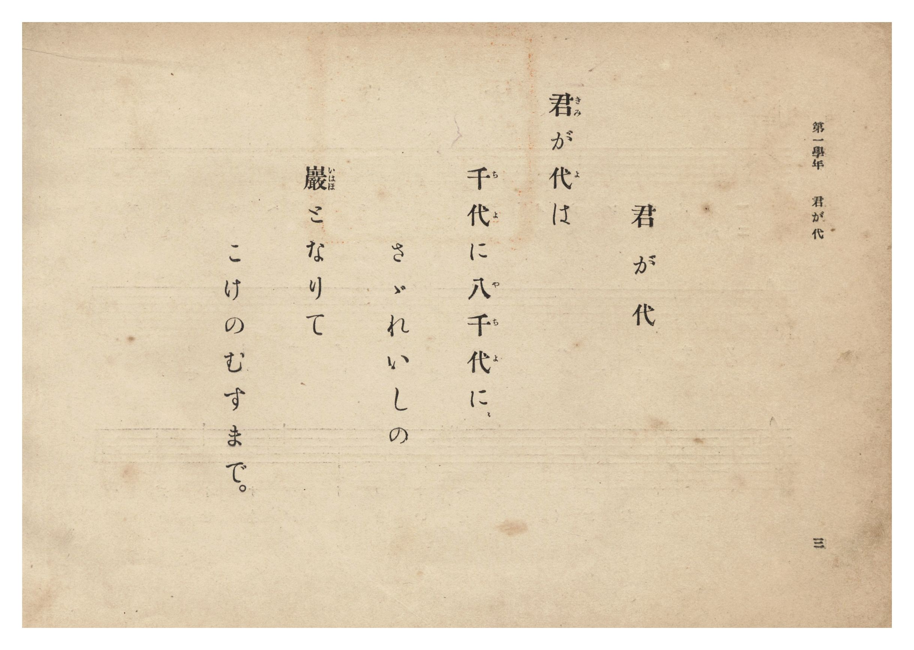

# 君が代

> Re:Shōka 使用 AI 協助辨識與重建樂譜，可能會有錯誤。歡迎回報。

- **鋼琴伴奏版**：<br><audio controls src="kimigayo.mp3"></audio>
- **NEUTRINO 歌聲合成版**：<br><audio controls src="kimigayo_neutrino.mp3"></audio>

- 詞：古歌
- 曲：林廣守
- 臺灣總督府《公學校唱歌集》（大正四年三月，索書號 0725 26）

## 說明

原書資訊與歌詞全文（對應 P008.jpg–P009.jpg，原書 p. 2–3，第一學年第 1 首）：
調性與拍號：律旋調 4/4 拍子，♩=69


## 歌詞

```text
君（きみ）が代（よ）は
千（ち）代（よ）に八（や）千（ち）代（よ）に、
さゞれいしの
巖（いはほ）となりて
こけのむすまで。
```

## ABC

<div class="abc-score" data-abc-src="kimigayo.abc" aria-label="五線譜載入中"></div>

[下載 ABC 原始檔](kimigayo.abc)

## TMD 檔案連結

- [主旋律 TMD 檔案](kimigayo.tmd) [[在 TMD Studio 編輯](https://tmdlang.github.io/Tmd-TS/#tmd=s7IKdvYPcrWy4qpTUCpJTLdSSM7PyUlNLsnMz7PKzk9PzM7Ojy_OyM9OLM4ojTe0NDRVgqssy88pzU21Si9KTEmNN0SIF-eXFiWnWhUnZ-Tn58SXpFaUJOXnZ6PLxxckpqdaBRgYWCBkCoryy1LzEvOAuguKMvNKUlPA2hEKUssyU1JB0sXJiXnxZalFmWmZqSlITkotKga5HGpFSVFiXnFyUWYByDsIVflFJRn5QGcXZFRaZWQWl-QXZSYn5sRnJ-YlIhSVZKQCPZeZWwC0JDEHXTw5tSg1Nz8PRQZoTHpmnhVQOKkUGGRKXFpaCk8nzH7c2PNk92IFLS0uRVsFM0sue1sFZy4bE30TO5DOFyvnvd8z62n_kmdre8BGPZu9CSjwbN70p7sXP13XARZ70b7reePi5zv2Pp-7-OmuOY8bup62rnm6dsezBQufTtkI1Plydtvjhu73ezqeLln-bO3ip7NnP9255cmOzmdzOt7v6Xm-ZdGz2TtezJyvYGBuZKpgZPZ-T6cSF5e-loIttQCXgoLC0775IGs2t79Y0fWiox3oLKDnnraueDatHeSyDb3P2jsVQBGul1WQ_qhhMpBpCWICXQjRqlCgp2AElDAGuXnNmic7GoB-BHoEyFYwVHi5bBrQ3cCwAdn1YtX-Zw3LQbZ09wI9BgrCfd3PpncDxRWAQasAFH66dgLQnEczV9oCAx3svgmzge543Nj7uHE_0CRIvIBEmoCBBOSuByvqbQYrWggUQpVe_bR1NZjbAuTiUfa4oRFk0OPGqY-b5j1u6nnc2PK4cfrjxnVg47cDPQHUBxRa_7hxN1jHiseNqx43dT1uXAbRN_lx40Sg8sdNDY8bZz5u3Pe4cfnjhiaQHOXxBAUKWvpcXN6ZuZnpiZX5VgGZiXn5DjUGNdUgSxRsLLTswAxsCUQBEjEvFvYoaJgoPN3Q_3x9gw48VjWxaABaBTKsRsFIQRcYjbpg2hiIaxRMoSyQCAjWgHkgUTMwbQbSFQdkmsOFgIrAxvnUAEOqF8gFRiaY7IGbAYwJKBsYyAjRxoUgEbAcMJaQVLeARdBla8BpBncY7OohJwyQ_Qex3xDkP7AnwSxswQATAQUUPKgQoTAV7OZpYPcjhUIjxF_TweQ6DHFQyABTIJhcAZVZBQm1pi4gexncIgJpoRMcDsakhQPIYwifo4cEwtsQljE2b08GO30iuveaGqBsYOZB8vQ-uOhyuFG1XFy6dgqwbKAAZCtzAQA)]
- [鋼琴伴奏 TMD 檔案](kimigayo_piano.tmd) [[在 TMD Studio 編輯](https://tmdlang.github.io/Tmd-TS/#tmd=s7IKdvYPcrWy4tLSUng6Yfbjxp4nuxe_39PxsnvP8wlbnuzZ8nRp__POjvd7OhW0tLgUbRXMLLnsbRWcuWxM9E3suOoUlF6snPd-z6yn_Uuere1RAgk8m70JKPBs3vSnuxc_XdcBFnvRvut54-LnO_Y-n7v46a45jxu6nrauebp2x7MFC59O2QjU-XJ22-OGbqDFT5csf7Z28dPZs5_u3PJkR-ezOUC7e55vWfRs9o4XM-crGJgbmSoYmQHdo8TF5Z2Zm5meWJlvFZCZmJcf5OFQY1BTzaUABDYWWnZghr6Wgi06UHi-Zs2THQ0vFvYoaJgoPN3Q_3x9g45CgIGBhV5WQbomFg1a-mDDahSMFHQVDIEYRBsDcY2CKZQFEgHBGjAPJGoGps1AuuKATHO4EFAR2DifGoXHjb1A7uPG_WCyB27G46YOKPtx43qEaONCkAhY7nHjaiTVLWARdNkaLvxhsKuHnDBA9h_EfkOQ_8CeBLOwBQNMBBRQ8KBChMJUsJungd2PFAqNEH9NB5PrMMRBIfO4cTeYXAGVWQUJtaYuIHsZ3CICaaETHA7GpIUDyGMIn6OHBMLbEJYxNm9PBjt9Irr3mhqg7MeNM5E8vQ8uuhxuVC16LvBBzgVGiFzwoq_rZXvvy9mtz1Y0vVy04tmCPU92TXm6a9mLjvank3qe7lkGyetIST1ewTAelMDj40FsoD-ADBAGS4FEIR5BlgBqAOsB8YyhKkF6kRSCjQIqgpsElgd6Q9dOAeYTBSBbmQsA)]

## 分析

```text
================================================================================
📊 TMD Song Profile: [ 君が代 ]
================================================================================
⏱  Duration:       0:38 (38.3s), 11 measures total
🎼 Key & Tempo:    首調基準 C, != 69.0 BPM, <4/4>
   - 分析範圍：      由實際發聲的音符與和弦推測調性；播放脈絡另行呈現
🎤 人聲音域:    C4 (MIDI 60) – D5 (MIDI 74) [跨度: 14 個半音 / 1.2 個八度, 難度: moderate]
   - 最低音:  C4 in [Kimigayo #1 @ m.1, 0:00]
   - 最高音: D5 in [Kimigayo #1 @ m.4, 0:10]
   - 適合: soprano, mezzo-soprano, contralto, tenor, baritone, bass
🏛  結構:      Kimigayo (38.3s)
⚡ 編曲密度:        Peak 1 軌道同時演奏
🗝  調性診斷：       G 調性不明確（純淨自然大調，未偵測到可信轉調）
   - 風格氣質:    純淨自然大調（陽光明朗、易唱易記，無明顯調外色彩）
   - 轉調歷程:    全曲維持單一推測調性（未偵測到可信轉調）
   - 核心骨幹音:  D, A, G, E, C
   - 調性數值:    G 調性不明確 [相關度: 0.76, 穩定度: Ambiguous, 自然音純度: 100.0%]
   - 候選調性 (K-S): G 大調 (0.76), D 大調 (0.75), D 小調 (0.61)
   - 五度圈歷程:   +1
   - 各段落調性細節:
     • [Kimigayo #1]: G 調性不明確 (r: 0.76, 自然音純度: 100.0%)

  [ 五度圈游移軌跡 ]
               C  
         F           [G ]*
      Bb               D  
      Eb               A  
         Ab           E  
            Db       B  
               F# 
     (* = active key center)

  [ 十二半音累積音高分佈 ]
     C  : ███████████               13.6%
     C# :                            0.0%
     D  : ████████████████████████  30.7%
     D# :                            0.0%
     E  : ████████████              15.9%
     F  :                            0.0%
     F# :                            0.0%
     G  : ██████████████            18.2%
     G# :                            0.0%
     A  : ███████████████           19.3%
     A# :                            0.0%
     B  : ██                         2.3%
--------------------------------------------------------------------------------
Assignment 軌道音域：
  - Piano         : C4 – D5 (14 個半音 / 1.2 個八度, 40 個音符)
================================================================================
```


## 原書掃描頁






