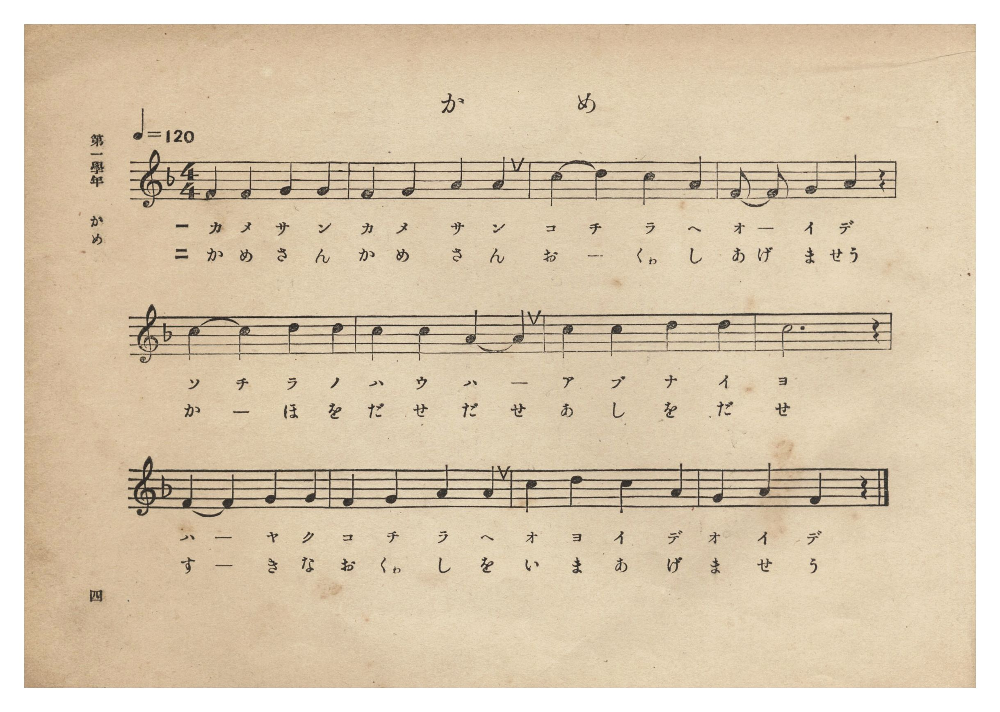
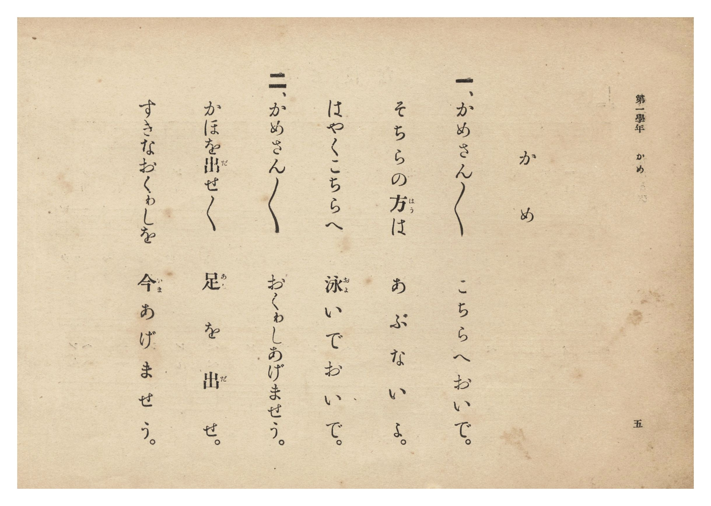

# かめ

> Re:Shōka 使用 AI 協助辨識與重建樂譜，可能會有錯誤。歡迎回報。

- **鋼琴伴奏版**：<br><audio controls src="kame.mp3"></audio>
- **NEUTRINO 歌聲合成版**：<br><audio controls src="kame_neutrino.mp3"></audio>

- 詞：臺灣總督府
- 曲：宮島慎三郎
- 臺灣總督府《公學校唱歌集》（大正四年三月，索書號 0725 26）

## 說明

原書資訊與歌詞全文（對應 P010.jpg–P011.jpg，原書 p. 4–5，第一學年第 2 首）：
調性與拍號：ヘ長調 4/4 拍子，♩=120
作曲：臺灣總督府國語學校助教授 宮島慎三郎


## 歌詞

```text
一、かめさんかめさん　こちらへおいで。
そちらの方（はう）は　あぶないよ。
はやくこちらへ　泳（およ）いでおいで。

二、かめさんかめさん　おくゎしあげませう
かほを出（だ）せ出せ　足（あし）を出（だ）せ。
すきなおくゎしを　今（いま）あげませう。
```

## ABC

```abc
X:1
T:かめ
C:曲：宮島慎三郎
M:4/4
L:1/16
Q:1/4=120
K:F
V:V1 name="Piano" snm="Pia"
[V:V1]
F4 F4 G4 G4 | F4 G4 A4 A4 | c4 d4 c4 A4 | F2 F2 G4 A4 z4 |
w: 1.~か め さ ん | か め さ ん | こ ち ら へ | お _ い で
w: 2.~か め さ ん | か め さ ん | お _ くゎ し | あ げ ま せう
c4 c4 d4 d4 | c4 c4 A4 A4 | c4 c4 d4 d4 | c12 z4 |
w: 1.~そ ち ら の | は う は _ | あ ぶ な い | よ
w: 2.~か _ ほ を | だ せ だ せ | あ し を だ | せ
F8 G4 G4 | F4 G4 A4 A4 | c4 d4 c4 A4 | G4 A4 F4 z4 |
w: 1.~は や く | こ ち ら へ | お よ い で | お い で
w: 2.~す き な | お くゎ し を | い ま あ げ | ま せ う
```

## TMD 檔案連結

- [主旋律 TMD 檔案](kame.tmd) [[在 TMD Studio 編輯](https://tmdlang.github.io/Tmd-TS/#tmd=s7IKdvYPcrWy4qpTUCpJTLdSSM7PyUlNLsnMz7PKzk9PzM7Ojy_OyM9OLM4ojTe0NDRVgqssy88pzU21Si9KTEmNN0SIF-eXFiWnWhUnZ-Tn58SXpFaUJOXnZ6PLxxckpqdaBRgYGiBkCoryy1LzEvOAuguKMvNKUlPA2hEKUssyU1JB0sXJiXnxZalFmWmZqSlITkotKga5HGpFSVFiXnFyUWYByDsIVflFJRn5QGcXZFRaZWQWl-QXZSYn5sRnJ-YlIhSVZKQCPZeYl5mbmIOsNTM9M8-qJDGzHOiA_LS0zORMkLyWlsLjxu7HTY0KWlpcirYKhkYGXPa2Cm5cNib6JnYg7S9Wznu_Z9aL9l3PGxc_37H3-dzFT3fNARv8bPYmoMzTdeuebt72rLXvyY7Ol819YBk01Y8bup62rnm6dsezBQufTtn4bG3Py9ltjxu63-_peLpk-bO1i5_Onv105xagAc_mdLzf0_N8y6Jns3e8mDlfwcDcyFTByOz9nk4lLi59LQVbagEuBQWFp33zQdZsbn-xoutFRzvQWUC_Pm1d8WxaO8hlG3qftXcqgCJaL6sg_VHDZCDTEMQEuhCiVaFAT8EEKGEKcvOaNU92NAD9CPQIkK1gpPBy2TSgu4EhBLLrxar9zxqWg2zp7gV6DCj6uHnGy6nbgeIKwJBWAAo_XTsBaM6jmSttQZEA1PNk7xxIEKMF59M53S9WzYMGZ9fKZ1NnPuvrUECLBy6wCTsaHjc0QiL4cePUx02TUdgNDY8bgSILHzd1Pm7c8bix63Fjy-PG5Y8bmkCaHzfOhcmtezZtJzBIHjeuf9zYBvQUiAHS3PS4cdvjxlUgbU0dcG3rHzcBjelHMbuh4dnmzWAjuoBKwUaArUK2E-ziXT2EXAzU0f-4qe9x43SwAyY9btz3uHE20GEQ27sfN-5-3DTpafsusHULwHbNBnJBihoaXmyDOAOoczpICkMl3BszHzf2gj2HZGHTJKART3Z3gTUA3b0PrAfFFVD9lCdRKFDQ0ufi8k4E5umAzMS8fIcag5pqkAUKNhZadmAGtnyhAEmPLxb2KGiYKDzd0P98fYMOPDFrYtEAtAZkWI2CoYIuGBtBMUQExDKG4hoFUyBpBsQgGiJiCIQwNQYgEbBpPoY1oCgB8kFFDJBsnApmTwbrwScDooHJByzWCWbvgMp0gXktYHI5kIxH2GZErm0gM0EQEtNgxnSoVBMQTwLifWBRUAzD7cQf-rt6yAl9UIjCQheEESKooY-pBgbRQ38uRkiug3ptPZgH8g-EDYIQL4NEtoHJVfDQBso0dSDZgy3cIWG4G2zXJKhpCyABByYRbIQ9oICGqIbIg2RAKlDtIZDSO8lN6SBIWkqHyYPUooc1LBSBJSDYP_1Q_xBIzeBwRU7TxKTzmfDw7gWToJhC6ENJx4jIgBgHScuQ4IfJQNM3mEQk8VouLl07BVDxowCklbkA)]
- [鋼琴伴奏 TMD 檔案](kame_piano.tmd) [[在 TMD Studio 編輯](https://tmdlang.github.io/Tmd-TS/#tmd=s7IKdvYPcrWy4tLSUnjc2P24qfH9no6X3XueT9jyZM-Wp0v7n3d2vN_TqaClxaVoq2BoZMBlb6vgxmVjom9ix1WnoPRi5bz3e2a9aN_1vHHx8x17n89d_HTXHCWQzLPZm4AyT9ete7p527PWvic7Ol8294Fl0FQ_buh62rrm6dodzxYsfDpl47O1PS9ntz1u6AY65OmS5c_WLn46e_bTnVuABjybA3RLz_Mti57N3vFi5nwFA3MjUwUjM6D7lLi4vBNzU60CMhPz8oM8HGoMaqq5FIDAxkLLDszQ11KwRQcKz9esebKj4cXCHgUNE4WnG_qfr2_QUQgwMDTQyypI18SiQUsfbFiNgqGCLhgbQTFEBMQyhuIaBVMgaQbEIBoiYgiEMDUGIBGwaT6GNaCwB_KBwQ8iG6eC2ZPBevDJgOjHjQvBYp1g9g6oTBeY1wImlwPJeIRtRuTaBjITBB839j9u6gMzpkOlmoB4EhDvA4vOftzYBrcTf-jv6iEn9EEhCgtdEEaIoIY-phoYRA_9uRghuQ7qtfVgHsg_EDYIQrwMEtkGJlfBQxso09SBZA-2cIeE4W6wXZOgpi2ABByYRLAR9oACGqIaIg-SAalAtYdASu8kN6WDIGkpHSYPUose1rBQfNwESZ_9UP8QSM3gcEVO08Sk85nw8O4Fk6CYQuhDSceIyIAYB0nLkOCHyUDTN5hEJPFa5NLHB7n0MYGWPsBAi1eINoxVMI0H0qbxsQgRKIWdD1IJpA2gfoIrMgFSJngMwSKPYQYJToErhZoD9LCunQLIz9E-QAVwthGYrcwFAA)]

## 分析

```text
================================================================================
📊 TMD Song Profile: [ かめ ]
================================================================================
⏱  Duration:       0:24 (24.0s), 12 measures total
🎼 Key & Tempo:    首調基準 F, != 120.0 BPM, <4/4>
   - 分析範圍：      由實際發聲的音符與和弦推測調性；播放脈絡另行呈現
🎤 人聲音域:    F4 (MIDI 65) – D5 (MIDI 74) [跨度: 9 個半音 / 0.8 個八度, 難度: easy]
   - 最低音:  F4 in [Kame #1 @ m.1, 0:00]
   - 最高音: D5 in [Kame #1 @ m.3, 0:04]
   - 適合: soprano, mezzo-soprano, contralto, tenor, baritone, bass
🏛  結構:      Kame (24.0s)
⚡ 編曲密度:        Peak 1 軌道同時演奏
🗝  調性診斷：       C 大調（純淨自然大調，未偵測到可信轉調）
   - 風格氣質:    純淨自然大調（陽光明朗、易唱易記，無明顯調外色彩）
   - 轉調歷程:    全曲維持單一推測調性（未偵測到可信轉調）
   - 核心骨幹音:  C, A, F, G, D
   - 調性數值:    C 大調 [相關度: 0.81, 穩定度: Moderate, 自然音純度: 100.0%]
   - 候選調性 (K-S): C 大調 (0.81), F 大調 (0.78), A 小調 (0.71)
   - 五度圈歷程:   +0
   - 各段落調性細節:
     • [Kame #1]: C 大調 (r: 0.81, 自然音純度: 100.0%)

  [ 五度圈游移軌跡 ]
              [C ]*
         F            G  
      Bb               D  
      Eb               A  
         Ab           E  
            Db       B  
               F# 
     (* = active key center)

  [ 十二半音累積音高分佈 ]
     C  : ████████████████████████  28.9%
     C# :                            0.0%
     D  : ███████████               13.3%
     D# :                            0.0%
     E  :                            0.0%
     F  : ███████████████           17.8%
     F# :                            0.0%
     G  : ███████████████           17.8%
     G# :                            0.0%
     A  : ██████████████████        22.2%
     A# :                            0.0%
     B  :                            0.0%
--------------------------------------------------------------------------------
Assignment 軌道音域：
  - Piano         : F4 – D5 (9 個半音 / 0.8 個八度, 43 個音符)
================================================================================
```


## 原書掃描頁






