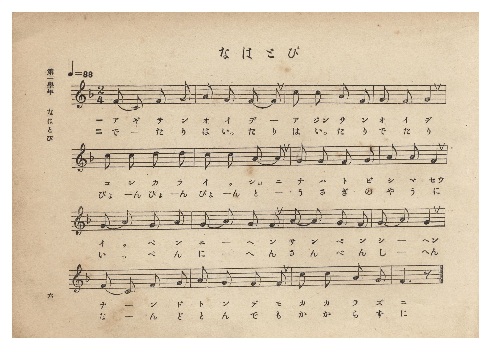
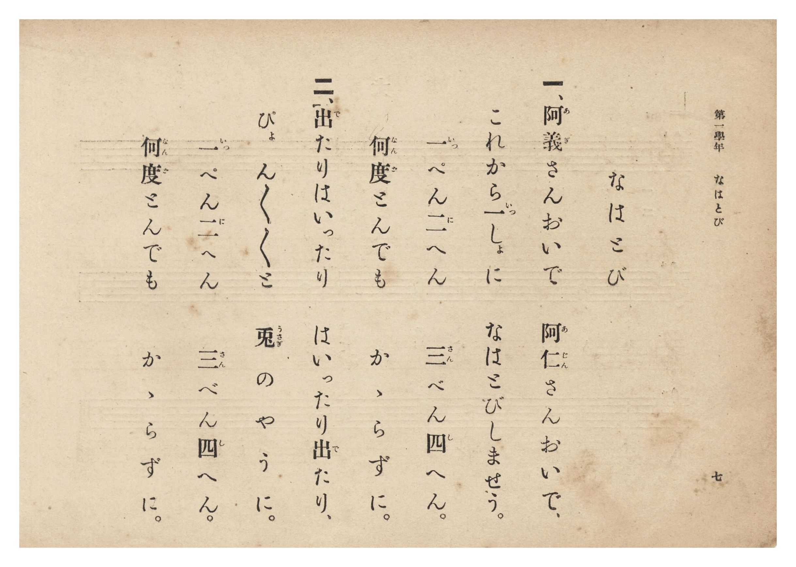

# なはとび

> Re:Shōka 使用 AI 協助辨識與重建樂譜，可能會有錯誤。歡迎回報。

- **NEUTRINO 歌聲合成版**：<br><audio controls src="nawatobi_neutrino.mp3"></audio>
- **鋼琴伴奏版**：<br><audio controls src="nawatobi.mp3"></audio>


- 詞：臺灣總督府
- 曲：宮島慎三郎
- 臺灣總督府《公學校唱歌集》（大正四年三月，索書號 0725 26）

## 說明

原書資訊與歌詞全文（對應 P012.jpg–P013.jpg，原書 p. 6–7，第一學年第 3 首）：
調性與拍號：ヘ長調 2/4 拍子，♩=88
作曲：臺灣總督府國語學校助教授 宮島慎三郎


## 歌詞

```text
一、阿義（あぎ）さんおいで　阿仁（あじん）さんおいで、
これから一（いっ）しょに　なはとびしませう。
一（いっ）ぺん二（に）へん　三（さん）べん四（し）へん。
何度（なんど）とんでも　かゝらずに。

二、出（で）たりはいったり　はいったり出（で）たり、
ぴょんぴょんぴょんと　兎（うさぎ）のやうに。
一（いっ）ぺん二（に）へん　三（さん）べん四（し）へん。
何度（なんど）とんでも　かゝらずに。
```

## ABC

```abc
X:1
T:なはとび
C:曲：宮島慎三郎
M:2/4
L:1/16
Q:1/4=88
K:F
V:V1 name="Piano" snm="Pia"
[V:V1]
F2 C2 F2 G2 | A2 G2 F2 F2 | c2 c2 A2 F2 | G2 F2 G4 |
w: 1.~あ ぎ さ ん | お い で _ | あ じん さ ん | お い で
w: 2.~で _ た り | は いっ た り | は いっ た り | で た り
c2 c2 d2 d2 | c2 c2 A2 A2 | G2 G2 F2 G2 | A2 A2 F4 |
w: 1.~こ れ か ら | い っ しょ に | な は と び | し ま せう
w: 2.~ぴょ ん ぴょ ん | ぴょ ん と _ | う さ ぎ の | や う に
G2 A2 G2 A2 | G2 A2 G2 F2 | A2 A2 G2 F2 | G2 A2 G4 |
w: 1.~い っ ぺ ん | に _ へ ん | さ ん べ ん | し _ へん
w: 2.~い っ ぺ ん | に _ へ ん | さ ん べ ん | し _ へん
F2 C2 F2 G2 | A2 G2 F2 F2 | c2 c2 A2 G2 | F6 z2 |
w: 1.~な _ ん ど | と ん で も | か か ら ず | に
w: 2.~な _ ん ど | と ん で も | か か ら ず | に
```

## TMD 檔案連結

- [主旋律 TMD 檔案](nawatobi.tmd) [[在 TMD Studio 編輯](https://tmdlang.github.io/Tmd-TS/#tmd=s7IKdvYPcrWy4qpTUCpJTLdSSM7PyUlNLsnMz7PKzk9PzM7Ojy_OyM9OLM4ojTe0NDRVgqssy88pzU21Si9KTEmNN0SIF-eXFiWnWhUnZ-Tn58SXpFaUJOXnZ6PLxxckpqdaBRgYGiFkCoryy1LzEvOAuguKMvNKUlPA2hEKUssyU1JB0sXJiXnxZalFmWmZqSlITkotKga5HGpFSVFiXnFyUWYByDsIVflFJRn5QGcXZFRaZWQWl-QXZSYn5sRnJ-YlIhSVZKQCPQf1RE5mWqoSl5aWwuPGVY8b1z9uXPG4cbOClhaXoq2ChQWXva2CG5eNkb6JHUj7i5Xz3u-Z9aJ91_PGxc937H0-d_HTXXPABj-bvQko83Tduqebtz1r7Xuyo_Nlcx9YBk3144aup61rnq7d8WzBwqdTNj5b2_Nydtvjhu73ezqeLln-bO3ip7NnP925BWjAszkd7_f0PN-y6NnsHS9mzlcwMDcyVTAye7-nU4mLS19LwZZagEtBQeFp33yQNZvbX6zoetHRDnQW0K9PW1c8m9YOctmG3mftnQqgKNXLKkh_1DAZyDQGMYEuhGhVKNBTMANKmIPcvGbNkx0NQD8CPQJkKxgrvFw2DehuYAiB7Hqxav-zhuUgW7p7gR4Dij5unvFy6naguAIwpBWAwk_XTgCa82jmSltgHAC1PNk7BxLCaKH5dE73i1XzoKHZtfLZ1JnP-joU0KKBC2zCjobHDY0vZ-x_vm8l0EePG5seN_YB3fS4cerjpsmPG7seN7Y8blz-uKEBqObJ7kaYmhlAWWzKGkGGPm6c_Lip53Fj9-OmTqAFYD1A6cVgDdMfN7U_blwNNBE5aYHEG_c9bpz9uBEY7U1Qp6Hq3AW06smuHrDgarDIDpDlDQ1A_4AFQW4Bi-8EMoAJBiw4HUklxNy9U5_uWgaWWwV2PNDjQBUrwOzlj5uawE4Dun0u0PmPG2eBHdsECa1dPUAvPm3fBda9HKxv_uMmoO-B3gC5E8oFGYAigkULLKi2gMIDZDUmYwXQoKetwOgA6mwDeQ8aNeseNwGNBoqAHTb4ggqok_LsBwUKWvpcXH6J5Ykl-UmZVgGZiXn5DjUGNdUgSxRsLLTswAxs-V4Bkt9eLOxR0DBReLqh__n6Bh14ZtXEogFoFciwGgVDBdN4IGEEZBoDSUMgrFEwBUJjMAskYqSgq1ADVu5jWAOMxiYg7gPiqQrAwAGqAeYJIG4B4uUglVAVoGyDWxHEOCOQOIgPTChAdV1gdetB6oCxS1hwOZwHMhF_6OzqISd0QAFhBoSwIDEGBwkkUEABBgok1MAB-rmpB0h3A-lOsCtBfga5G1QaAKnVYMFVUD-tAOLNYJHpQLwPiEHFAloIgXIJOBiRmGjiK6Ah3wYJcnD8rAOJNIGsB4muJiKQdnSSE0hG4JQDCRpIGoIEDYQFEUMNJFiQ7IJ7BeQ6YH6E8yHJBphn4SLTISpAXNTQoYJheEMFWGRQOWOBxEDpRlfBACVYVoFcBXbpSrArgYkDzAOm86YmsAgwVUFTFrAIgvtVVyEeJUQoM6eWi0vXTgFWDikA2cpcAA)]
- [鋼琴伴奏 TMD 檔案](nawatobi_piano.tmd) [[在 TMD Studio 編輯](https://tmdlang.github.io/Tmd-TS/#tmd=s7IKdvYPcrWy4tLSUnjcuOpx4_rHjSseN25-v6fjZfee5xO2PNmz5enS_uedHe_3dCpoaXEp2ipYWHDZ2yq4cdkY6ZvYcdUpKL1YOe_9nlkv2nc9b1z8fMfe53MXP901Rwkk82z2JqDM03Xrnm7e9qy178mOzpfNfWAZNNWPG7qetq55unbHswULn07Z-Gxtz8vZbY8buoHueLpk-bO1i5_Onv105xagAc_mAJ3S83zLomezd7yYOV_BwNzIVMHIDOg8JS4uv8TyxJL8pEyrgMzEvPwgD4cag5pqLgUgsLHQsgMz9LUUbNGBwvM1a57saHixsEdBw0Th6Yb-5-sbdBQCDAyN9LIK0jWxaNDSBxtWo2CoYBoPJIyATGMgaQiENQqmQGgMZoFEjBR0FWrAyn0Ma4Ch3ATEfUA8VeFx02SgmseNXUDcAsTLQSqhKmaAJHEqghhnBBIH8R83zgeq6wKrWw9S97hxMWHB5XAeyET8obOrh5zQAQWEGRDCgsQYHCSQQAEFGCiQUAMH6OemHiDdDaQ7wa4E-Rnk7umPm9qB1Gqw4Cqon1YA8WawyHQg3gfEsx83tqGF0BawTnBwwplo4iugId8GCXJw_KwDiTSBrAeJriYikHZ0khNIRuCUAwkaSBqCBA2EBRFDDSRYkOyCewXkuseNO-B8SLJ53LgTLjIdogLERQ0dKhiGN1SAOZfKGQskBko3ugoGKMGyCuQqsEtXgl0JTBxgHjCdNzWBRYCpCpqyHjfOgvtVVyEeJUQoM6cWvRjywVYMAX0QrxBtGAumTONjUQWAFCbfND4eaAWIhGhANccESJng0gbWgM0mWFJAUgZmGILVYROD6sWlCmEgKf5DVwCKV2A46topwIIy2gcog8I3AvOVuQA)]

## 分析

```text
================================================================================
📊 TMD Song Profile: [ なはとび ]
================================================================================
⏱  Duration:       0:21 (21.8s), 16 measures total
🎼 Key & Tempo:    首調基準 F, != 88.0 BPM, <2/4>
   - 分析範圍：      由實際發聲的音符與和弦推測調性；播放脈絡另行呈現
🎤 人聲音域:    C4 (MIDI 60) – D5 (MIDI 74) [跨度: 14 個半音 / 1.2 個八度, 難度: moderate]
   - 最低音:  C4 in [Nawatobi #1 @ m.1, 0:00]
   - 最高音: D5 in [Nawatobi #1 @ m.5, 0:06]
   - 適合: soprano, mezzo-soprano, contralto, tenor, baritone, bass
🏛  結構:      Nawatobi (21.8s)
⚡ 編曲密度:        Peak 1 軌道同時演奏
🗝  調性診斷：       F 大調（純淨自然大調，未偵測到可信轉調）
   - 風格氣質:    純淨自然大調（陽光明朗、易唱易記，無明顯調外色彩）
   - 轉調歷程:    全曲維持單一推測調性（未偵測到可信轉調）
   - 核心骨幹音:  G, F, A, C, D
   - 調性數值:    F 大調 [相關度: 0.73, 穩定度: Moderate, 自然音純度: 100.0%]
   - 候選調性 (K-S): F 大調 (0.73), C 大調 (0.67), A 小調 (0.50)
   - 五度圈歷程:   -1
   - 各段落調性細節:
     • [Nawatobi #1]: F 大調 (r: 0.73, 自然音純度: 100.0%)

  [ 五度圈游移軌跡 ]
               C  
        [F ]*          G  
      Bb               D  
      Eb               A  
         Ab           E  
            Db       B  
               F# 
     (* = active key center)

  [ 十二半音累積音高分佈 ]
     C  : █████████████             15.9%
     C# :                            0.0%
     D  : ███                        3.2%
     D# :                            0.0%
     E  :                            0.0%
     F  : ███████████████████████   28.6%
     F# :                            0.0%
     G  : ████████████████████████  30.2%
     G# :                            0.0%
     A  : ██████████████████        22.2%
     A# :                            0.0%
     B  :                            0.0%
--------------------------------------------------------------------------------
Assignment 軌道音域：
  - Piano         : C4 – D5 (14 個半音 / 1.2 個八度, 58 個音符)
================================================================================
```


## 原書掃描頁






