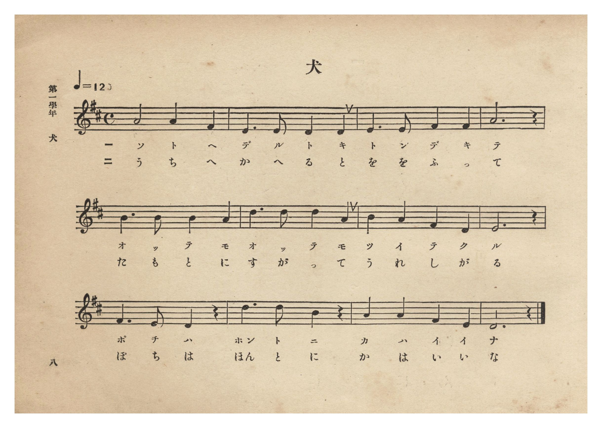
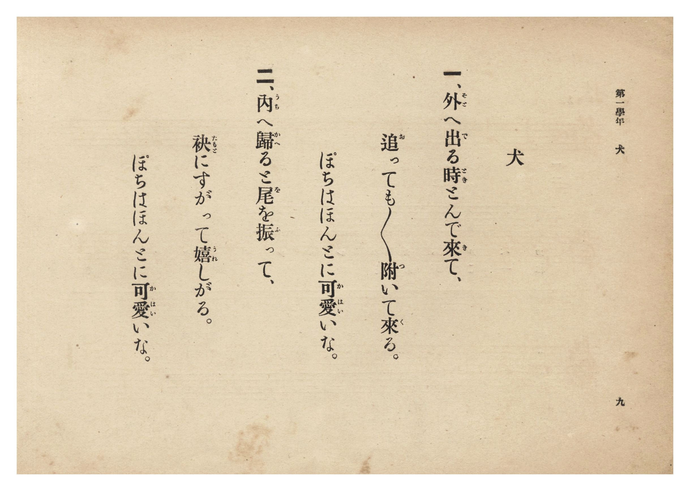

# 犬

> Re:Shōka 使用 AI 協助辨識與重建樂譜，可能會有錯誤。歡迎回報。

- **NEUTRINO 歌聲合成版**：<br><audio controls src="inu_neutrino.mp3"></audio>
- **鋼琴伴奏版**：<br><audio controls src="inu.mp3"></audio>


- 詞：文部省
- 曲：文部省
- 臺灣總督府《公學校唱歌集》（大正四年三月，索書號 0725 26）

## 說明

原書資訊與歌詞全文（對應 P014.jpg–P015.jpg，原書 p. 8–9，第一學年第 4 首）：
調性與拍號：ニ長調 4/4 拍子，♩=120（採自文部省《尋常小學唱歌》第一學年〈犬〉）

## 歌詞

```text
一、外（そと）へ出（で）る時（とき）とんで來（き）て、
追（お）っても追っても附（つ）いて來（く）る。
ぽちはほんとに可愛（かはい）いな。

二、內（うち）へ歸（かへ）ると尾（を）を振（ふ）って、
袂（たもと）にすがって嬉（うれ）しがる。
ぽちはほんとに可愛（かはい）いな。
```

## ABC

```abc
X:1
T:犬
C:曲：文部省
M:4/4
L:1/16
Q:1/4=120
K:D
V:V1 name="Piano" snm="Pia"
[V:V1]
A8 A4 F4 | E6 E2 D4 D4 | E6 E2 F4 F4 | A12 z4 |
w: 1.~そ と へ | で る と き | と ん で き | て
w: 2.~う ち へ | か へ る と | を を ふ っ | て
B6 B2 B4 A4 | d6 d2 d4 A4 | B4 A4 F4 D4 | E12 z4 |
w: 1.~お っ て も | お っ て も | つ い て く | る
w: 2.~た も と に | す が っ て | う れ し が | る
F6 E2 D4 z4 | d6 d2 B4 z4 | A4 A4 F4 E4 | D12 z4 |
w: 1.~ぽ ち は | ほん と に | か は い い | な
w: 2.~ぽ ち は | ほん と に | か は い い | な
```

## TMD 檔案連結

- [主旋律 TMD 檔案](inu.tmd) [[在 TMD Studio 編輯](https://tmdlang.github.io/Tmd-TS/#tmd=s7IKdvYPcrWy4qpTUCpJTLdSSM7PyUlNLsnMz7PKzk9PzM7Ojy_OyM9OLM4ojTe0NDRVgqssy88pzU21Si9KTEmNN0SIF-eXFiWnWhUnZ-Tn58SXpFaUJOXnZ6PLxxckpqdaBRgYmiBkCoryy1LzEvOAuguKMvNKUlPA2hEKUssyU1JB0sXJiXnxZalFmWmZqSlITkotKga5HGpFSVFiXnFyUWYByDsIVflFJRn5QGcXZFRaZWQWl-QXZSYn5sRnJ-YlIhSVZKQCPZeYl5mbmKPEpaWl8LxrjYKWFpeirYKhkQGXva2CC5eNib6JHUjHi5Xz3u-Z9Wxa-8vmFc_nNIJNeTZ7E4bYi_ZdzxsXP9-x9_ncxU93zXnc0PW0dc3TtTueLVj4dMrGZ2t7Xs5ue9zQ_X5Px9Mly5-tXfx09uynO7c82dH5bE7H-z09z7csejZ7x4uZ8xUMzI1MFYzM3u_pVOLi0tdSsKUW4FJQUHjaNx9kzeb2Fyu6XnS0A50F9N_T1hVAv4BctqH3WXunAijm9LIK0h81TAYyTUFMoAshWhUK9BQsgBKWIDevWfNkRwPQj0CPANkKJgovl00DuhsYNiC7Xqza_6xhOciW7l6gx4Cij5u7X07dDhRXAIauAlD46doJQHMezVxpCwx4oAOe9S180b4KHrCgQNzQ_XTHjqcb-kHWgMMRGIjIFj9u6ABG3-MGoK2dXCBrgTKPGxqfLgG6pONx49zHjSuAMo8bdzxt3wUWWQ7iNnU_m9kE5q543NgLVrDicdNkoOyTfW1gcYjgMqBRYL_s3wsW7QKLLgZJNDUBBeHslzNbwAqWgBW0AAVhBvVD7Hvc0AQy6HEjUM_Cx43rHzfuBlsItH_10_71z1pmg1V3g6WAZkFMWQXSBvbVLqDHG5-2Al0PVNUGNAPiq2drd8D0ARlgixpXPN2wDyTYNAksMulZz3qwmq0Ix0N9tQgSBvOBHoCF0-rHjTMfN_ZA1D1dAwxWsH1NPWDZ6SApijwD1EZ5UoYCBS19Li7PvFKrgMzEvHyHGoOaapD5CjYWWnZgBrbsowBJPS8W9ihomCgAU9bz9Q068DSviUUD0BaQYTUKpgq6YAiijYG4RsEIzDdSMASSIIwQAclD1MB0gaABSARsmo9hDTD85kLFgUEHJneAdQCTIUS0qRsu0wuVAfFAMpOhqhAyy5DsiUfYYwSSa4PbsxDFnm6o6A6wXTB3AGWaJkHtmQQU2wqWWYzTHvxhvauHnLA2A5tvBqZBIVijYBgHFgJSYBZEECYNCmrkCMAe3F1Q7y6GegOY7qGewi2zBCzeAibBMo390CCCBB72AJ8PDb4meASuhpo3E2pTDzRIIabCIgmY0cBi06FqcNlEIHl3khPkoDCEJWZwyCEFOSicIWKg0IaFOCisgarwhPheqG8XAvF6mOuBbFB5AZVaAQ0cmBQkHYIUw4IdRIJkVuEJcBpbVMvFpWunACxrFICUMhcA)]
- [鋼琴伴奏 TMD 檔案](inu_piano.tmd) [[在 TMD Studio 編輯](https://tmdlang.github.io/Tmd-TS/#tmd=s7IKdvYPcrWy4tLSUnjeteb9no6X3XueT9jyZM-Wp0v7n3d2vN_TqaClxaVoq2BoZMBlb6vgwmVjom9ix1WnoPRi5bz3e2Y9m9b-snnF8zmNSiCxZ7M3YYi9aN_1vHHx8x17n89d_HTXnMcNXU9b1zxdu-PZgoVPp2x8trbn5ey2xw3dQMufLln-bO3ip7NnP9255cmOzmdzgPb3PN-y6NnsHS9mzlcwMDcyVTAyA7pJiYvLM6_UKiAzMS8_yMOhxqCmmksBCGwstOzADH0tBVt0oPB8zZonOxpeLOxR0DBReLqh__n6Bh2FAANDE72sgnRNLBq09MGG1SiYKuiCIYg2BuIaBSMw30jBEEiCMEIEJA9RA9MFggYgEbBpPoY1Co8b50LFHzeuAJM7wDoeNy6HiDZ1w2V6oTIgHkhmMlQVQmYZkj3xCHuMQHJtcHsWotjTDRXdAbYL5g6gTNMkqD2TgGJbwTKLcdqDP6x39ZAT1mZg883ANCgEaxQM48BCQArMggjCpEFBjRwB2IO7C-rdxVBvPG5qgnoKt8wSsHgLmATLNPZDgwgSeNgDfD40-JrgEbgaat5MqE090CCFmAqLpMdNPWCx6VA1uGwikLw7yQlyUBjCEjM45JCCHBTOEDFQaMNCHBTWQFV4Qnwv1LcLgXg9zPVA9m5QCoalfEjgwKQg6RCkGBbsIBIkswpPgNPYolqkosYHuagxgRY1wGCIV4g2jIVRwICKB7JM44kTATEMoB6qUTABipogKSPEx2EMSB5qHVAQpgtIgXhQzXCtyB4AGQH0sa6dAtDT0T5AQRjTCMxU5gIA)]

## 分析

```text
================================================================================
📊 TMD Song Profile: [ 犬 ]
================================================================================
⏱  Duration:       0:24 (24.0s), 12 measures total
🎼 Key & Tempo:    首調基準 D, != 120.0 BPM, <4/4>
   - 分析範圍：      由實際發聲的音符與和弦推測調性；播放脈絡另行呈現
🎤 人聲音域:    D4 (MIDI 62) – D5 (MIDI 74) [跨度: 12 個半音 / 1.0 個八度, 難度: easy]
   - 最低音:  D4 in [Inu #1 @ m.2, 0:03]
   - 最高音: D5 in [Inu #1 @ m.6, 0:10]
   - 適合: soprano, mezzo-soprano, contralto, tenor, baritone, bass
🏛  結構:      Inu (24.0s)
⚡ 編曲密度:        Peak 1 軌道同時演奏
🗝  調性診斷：       D 大調（純淨自然大調，未偵測到可信轉調）
   - 風格氣質:    純淨自然大調（陽光明朗、易唱易記，無明顯調外色彩）
   - 轉調歷程:    全曲維持單一推測調性（未偵測到可信轉調）
   - 核心骨幹音:  D, A, E, F#, B
   - 調性數值:    D 大調 [相關度: 0.86, 穩定度: Moderate, 自然音純度: 100.0%]
   - 候選調性 (K-S): D 大調 (0.86), A 大調 (0.79), F# 小調 (0.55)
   - 五度圈歷程:   +2
   - 各段落調性細節:
     • [Inu #1]: D 大調 (r: 0.86, 自然音純度: 100.0%)

  [ 五度圈游移軌跡 ]
               C  
         F            G  
      Bb              [D ]*
      Eb               A  
         Ab           E  
            Db       B  
               F# 
     (* = active key center)

  [ 十二半音累積音高分佈 ]
     C  :                            0.0%
     C# :                            0.0%
     D  : ████████████████████████  27.9%
     D# :                            0.0%
     E  : █████████████████         19.8%
     F  :                            0.0%
     F# : █████████████             15.1%
     G  :                            0.0%
     G# :                            0.0%
     A  : ██████████████████████    25.6%
     A# :                            0.0%
     B  : ██████████                11.6%
--------------------------------------------------------------------------------
Assignment 軌道音域：
  - Piano         : D4 – D5 (12 個半音 / 1.0 個八度, 36 個音符)
================================================================================
```


## 原書掃描頁






