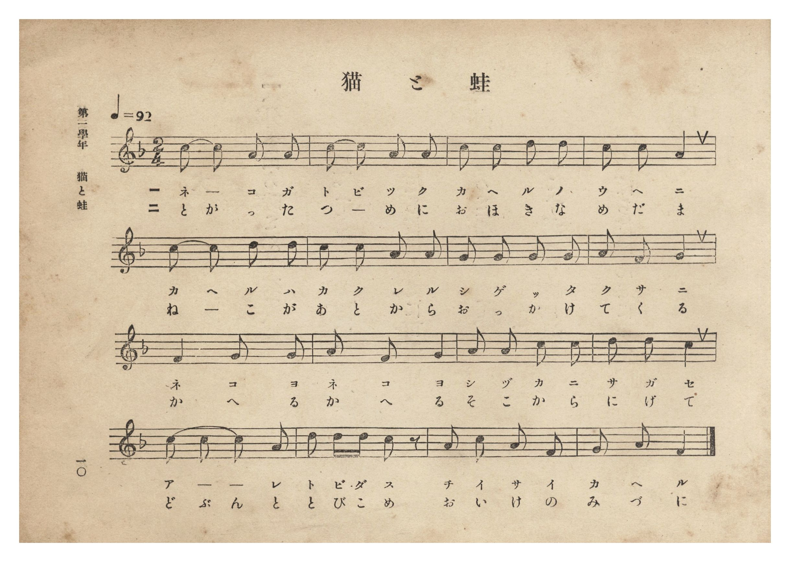
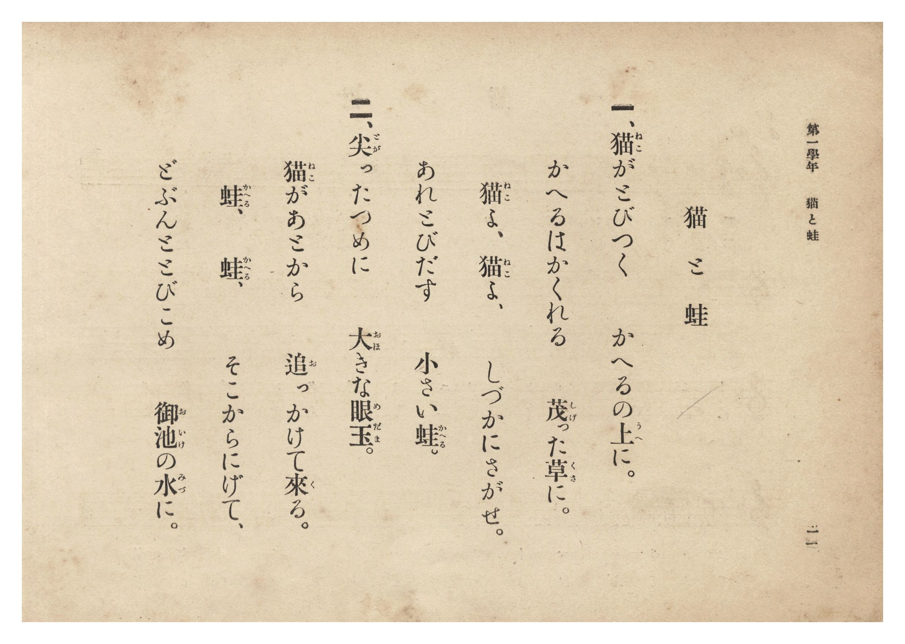

# 猫と蛙

> Re:Shōka 使用 AI 協助辨識與重建樂譜，可能會有錯誤。歡迎回報。

- **鋼琴伴奏版**：<br><audio controls src="neko_to_kaeru.mp3"></audio>
- **NEUTRINO 歌聲合成版**：<br><audio controls src="neko_to_kaeru_neutrino.mp3"></audio>

- 詞：臺灣總督府
- 曲：宮島慎三郎
- 臺灣總督府《公學校唱歌集》（大正四年三月，索書號 0725 26）

## 說明

原書資訊與歌詞全文（對應 P016.jpg–P017.jpg，原書 p. 10–11，第一學年第 5 首）：
調性與拍號：ヘ長調 2/4 拍子，♩=92
作曲：臺灣總督府國語學校助教授 宮島慎三郎

## 歌詞

```text
一、猫（ねこ）がとびつく　かへるの上（うへ）に。
かへるはかくれる　茂（しげ）った草（くさ）に。
猫（ねこ）よ、猫（ねこ）よ、　しづかにさがせ。
あれとびだす　小（ちい）さい蛙（かへる）。

二、尖（とが）ったつめに　大（おほ）きな眼玉（めだま）。
猫（ねこ）があとから　追（お）っかけて來（く）る。
蛙（かへる）、蛙（かへる）、　そこからにげて、
どぶんととびこめ　御池（おいけ）の水（みづ）に。
```

## ABC

```abc
X:1
T:猫と蛙
C:曲：宮島慎三郎
M:2/4
L:1/16
Q:1/4=92
K:F
V:V1 name="Piano" snm="Pia"
[V:V1]
c2 c2 A2 A2 | c2 c2 A2 A2 | c2 c2 d2 d2 | c2 c2 A4 |
w: 1.~ね _ こ が | と び つ く | か へ る の | う へ に
w: 2.~と が っ た | つ _ め に | お ほ き な | め だ ま
c2 c2 d2 d2 | c2 c2 A2 A2 | G2 G2 G2 G2 | A2 F2 G4 |
w: 1.~か へ る は | か く れ る | し げ っ た | く さ に
w: 2.~ね _ こ が | あ と か ら | お っ か け | て く る
F4 G2 G2 | A4 F2 G2 | A2 A2 c2 c2 | d2 d2 c4 |
w: 1.~ね こ よ | ね こ よ | し づ か に | さ が せ
w: 2.~か へ る | か へ る | そ こ か ら | に げ て
c2 c2 c2 A2 | d2 d d c2 z2 | A2 c2 A2 F2 | G2 A2 F4 |
w: 1.~あ _ _ れ | と び だ す | ち い さ い | か へ る
w: 2.~ど ぶ ん と | と び こ め | お い け の | み づ に
```

## TMD 檔案連結

- [主旋律 TMD 檔案](neko_to_kaeru.tmd) [[在 TMD Studio 編輯](https://tmdlang.github.io/Tmd-TS/#tmd=s7IKdvYPcrWy4qpTUCpJTLdSSM7PyUlNLsnMz7PKzk9PzM7Ojy_OyM9OLM4ojTe0NDRVgqssy88pzU21Si9KTEmNN0SIF-eXFiWnWhUnZ-Tn58SXpFaUJOXnZ6PLxxckpqdaBRgYmiFkCoryy1LzEvOAuguKMvNKUlPA2hEKUssyU1JB0sXJiXnxZalFmWmZqSlITkotKga5HGpFSVFiXnFyUWYByDsIVflFJRn5QGcXZFRaZWQWl-QXZSYn5sRnJ-YlIhSVZKQCPZeYl5mbmKPEpaWl8Lxn9ePGFS9mz1TQ0uJStFWwNOKyt1Vw47Ix0jexA2l7sXLe-z2zXrTvet64-PmOvc_nLn66aw7YwGezNwFlnq5b93TztmetfU92dL5s7gPLoKl-3ND1tHXN07U7ni1Y-HTKxmdre17Obnvc0P1-T8fTJcufrV38dPbspzu3AA14Nqfj_Z6e51sWPZu948XM-QoG5kamCkZm7_d0KnFx6Wsp2FILcCkoKDztmw-yZnP7ixVdLzragc4C-vVp64pn09pBLtvQ-6y9UwEUlXpZBemPGiYDmeYgJtCFEK0KBXoKhgZAGUNDkKvXrHmyowHoS6BXgGwFU4WXy6YBXQ4MI5BtL1btf9awHGRPdy_Qa0DRx80zXk7dDhRXAIa1AlD46doJQHMezVxpC4wFoJYne-dAwhgtPJ_O6X6xah40PLtWPps681lfhwJaRHCBTdjR8LihERjHQA89blz7uHEy0EGPG3uAUf64cfPjxiWPG_sfNzQ8bux-3LjjcROQXPdkRxdYcRtQBKx49eOGJpBZSIrWg9n9j5t6QNyGhhc9TWA90x83TgLrWfy4cf6LXqDXgYL9jxunohiE7pymDixuBAuCnQY0dCnYPmBCnQp2-2y4i5pAToD6ZcHjxplADU839IMNWvi4sQVsLVBPCzB9gwWhPgCJA40Ah9CuHqBFTzcAYwooDzSpB-4BUPA0NYLd3QBMp2AFXY8bd4MV9D5uXPV8zp7nfWBPgpQB7d8HNRiLJ0HubgJb0P24Caio4cX-vRATYfYB3TbxceOyJ_vaIMEGDgVg6IKNw-aBRqyC4DCbC7QVahMo2CYBzQVKQcJs5ePGbY-bgNJAt0BCbjLI_UA_7lv4bOMCmDdbgM4BO23dsw1bwIL7gRGBEpGUZ0MoUNDS5-LyTczMswrITMzLd6gxqKkGWaBgY2imZQdmYcv8CpAs92Jhj4KGiQIw4p-vb9CB51hNLBqA9oAMqwFmTl0wNoZifCJmUIyqBgRrwKb5GNYAg3UtVAwYnGCyB6wDGMRg3mYwuQRM9kNlusG8HSCyCcJeB5VpQ8g0rka1ywhhJsgGYMoBk_OhOkE2gF3R1AjXDRLvAvN2g8leMLkKIgNVtwBM7oPbhT_Md_VQEubYwxMS5kZAEhnXgMUNoTz0MMcMwfUoYQsKaWAJAZcHyUwHy0zCEnZg1Y1TcYY6rhhuAvMgcQK2t6kTJdQhtkBcNBEqswzJfSAZYkJ9Ryc5oQ4KOxBEDVEQhIUqRASEYfFRA48jEI9ASm_qgPoJlzgkxJcihQIsVULCGpKOZ2MJcVjIIMcxPvG5SLGDGhMgG2GxDgp7IsIb2CihJJXD0jUsLM3AIgbw8IbJg2IBku5hPPTwBqUvGISkZuRyBZR3gTUfkBcPlVkIlmkBk5AQBrGx5Rf08F4Jlt8GloeEIsgWVNsmQ8sMmG2QNA6xDZS6EaXYfjAPEu-I_FTLxaVrpwAq7BWAtDIXAA)]
- [鋼琴伴奏 TMD 檔案](neko_to_kaeru_piano.tmd) [[在 TMD Studio 編輯](https://tmdlang.github.io/Tmd-TS/#tmd=s7IKdvYPcrWy4tLSUnjes_px44oXs2e-39PxsnvP8wlbnuzZ8nRp__POjvd7OhW0tLgUbRUsjbjsbRXcuGyM9E3suOoUlF6snPd-z6wX7bueNy5-vmPv87mLn-6aowSSeTZ7E1Dm6bp1Tzdve9ba92RH58vmPrAMmurHDV1PW9c8Xbvj2YKFT6dsfLa25-XstscN3UB3PF2y_NnaxU9nz366cwvQgGdzgE7peb5l0bPZO17MnK9gYG5kqmBkBnSeEheXb2JmnlVAZmJefpCHQ41BTTWXAhDYGJpp2YFZ-loKtuhA4fmaNU92NLxY2KOgYaLwdEP_8_UNOgoBBoZmelkF6ZpYNGjpgw2rUTBV0AVjYyjGJ2IGxahqQLAGbJqPYY3C48a1ULHHjZPBZA9YBzBOwLzNYHIJmOyHynSDeTtAZBOEvQ4q04aQaVyNapcRwkyQDY8bF4PJ-VCdIBvArmhqhOsGiXeBebvBZC-YXAWRgapbACb3we3CH-a7eigJc-zhCQlzIyCJjGvA4oZQHnqYY4bgepSwBYX04yZwOIHlQTLTwTKTsIQdWHXjVJyhjiuGm8A8SJyA7W3qRAl1iC0QF02EyixDch9IhphQ39FJTqiDwg4EUUMUBGGhChEBYVh81MDjCMQjkNKbOqB-wiUOCfGlSKEAS5WQsIak49lYQhwWMshxjE98LlLsoMYEyEZYrIPCnojwBpZblKRyWLqGhaUZWMQAHt4weVAsQNI9jIce3qD0BYOQ1IxcroDy7uPGmUBePFRmIVimBUxCQhjExpZf0MN7JVh-G1geEoogW1BtmwwtM2C2QdI4xDZQ6kaUYvvBPEi8I_JTLXJZ74Nc1ltAi_oahWjDWKBaCImDZ4JFDlU3NhUK0UbxuWA-lIbLm8ZjMQIqiN89YHuwugBDhQGmHMQKmHZg4OjaKYDCJ9oHJARjG4HZylwA)]

## 分析

```text
================================================================================
📊 TMD Song Profile: [ 猫と蛙 ]
================================================================================
⏱  Duration:       0:20 (20.9s), 16 measures total
🎼 Key & Tempo:    首調基準 F, != 92.0 BPM, <2/4>
   - 分析範圍：      由實際發聲的音符與和弦推測調性；播放脈絡另行呈現
🎤 人聲音域:    F4 (MIDI 65) – D5 (MIDI 74) [跨度: 9 個半音 / 0.8 個八度, 難度: easy]
   - 最低音:  F4 in [Main #1 @ m.8, 0:09]
   - 最高音: D5 in [Main #1 @ m.3, 0:03]
   - 適合: soprano, mezzo-soprano, contralto, tenor, baritone, bass
🏛  結構:      Main (20.9s)
⚡ 編曲密度:        Peak 1 軌道同時演奏
🗝  調性診斷：       C 調性不明確（純淨自然大調，未偵測到可信轉調）
   - 風格氣質:    純淨自然大調（陽光明朗、易唱易記，無明顯調外色彩）
   - 轉調歷程:    全曲維持單一推測調性（未偵測到可信轉調）
   - 核心骨幹音:  C, A, G, D, F
   - 調性數值:    C 調性不明確 [相關度: 0.78, 穩定度: Ambiguous, 自然音純度: 100.0%]
   - 候選調性 (K-S): C 大調 (0.78), A 小調 (0.77), F 大調 (0.67)
   - 五度圈歷程:   +0
   - 各段落調性細節:
     • [Main #1]: C 調性不明確 (r: 0.78, 自然音純度: 100.0%)

  [ 五度圈游移軌跡 ]
              [C ]*
         F            G  
      Bb               D  
      Eb               A  
         Ab           E  
            Db       B  
               F# 
     (* = active key center)

  [ 十二半音累積音高分佈 ]
     C  : ████████████████████████  33.3%
     C# :                            0.0%
     D  : █████████                 12.7%
     D# :                            0.0%
     E  :                            0.0%
     F  : ████████                  11.1%
     F# :                            0.0%
     G  : ███████████               15.9%
     G# :                            0.0%
     A  : ███████████████████       27.0%
     A# :                            0.0%
     B  :                            0.0%
--------------------------------------------------------------------------------
Assignment 軌道音域：
  - Piano         : F4 – D5 (9 個半音 / 0.8 個八度, 58 個音符)
================================================================================
```


## 原書掃描頁






