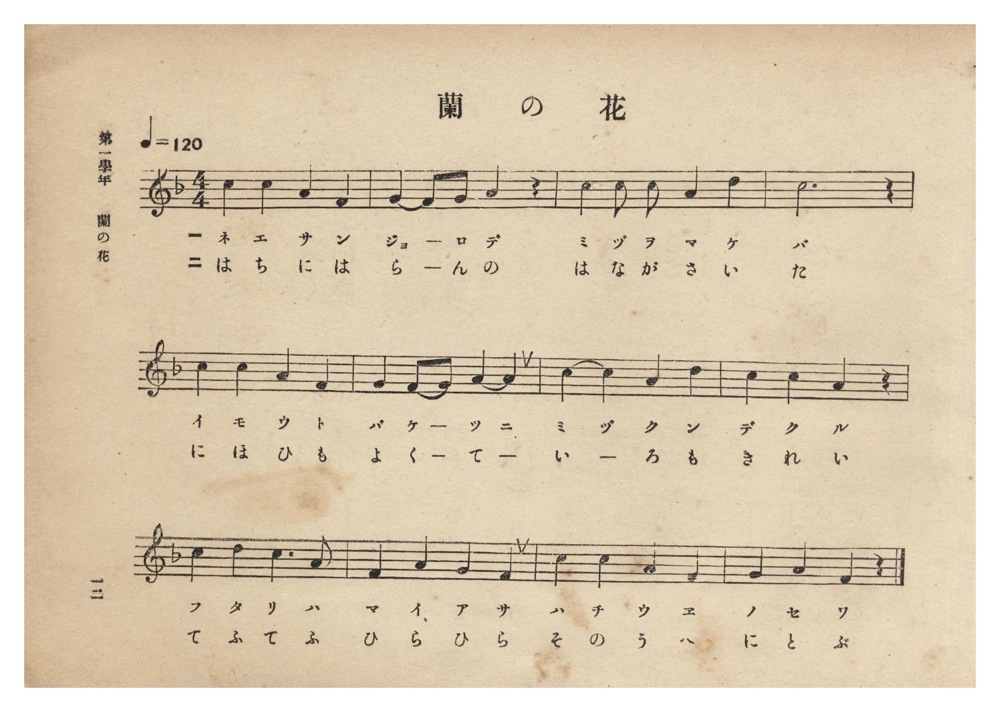
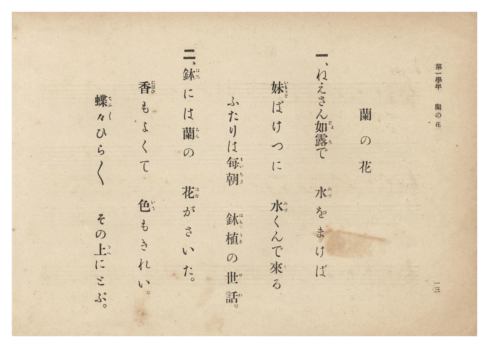

# 蘭の花

> Re:Shōka 使用 AI 協助辨識與重建樂譜，可能會有錯誤。歡迎回報。

- **鋼琴伴奏版**：<br><audio controls src="ran_no_hana.mp3"></audio>
- **NEUTRINO 歌聲合成版**：<br><audio controls src="ran_no_hana_neutrino.mp3"></audio>

- 詞：臺灣總督府
- 曲：宮島慎三郎
- 臺灣總督府《公學校唱歌集》（大正四年三月，索書號 0725 26）

## 說明

原書資訊與歌詞全文（對應 P018.jpg–P019.jpg，原書 p. 12–13，第一學年第 6 首）：
調性與拍號：ヘ長調 4/4 拍子，♩=120
作曲：臺灣總督府國語學校助教授 宮島慎三郎


## 歌詞

```text
一、ねえさん如露（じょろ）で　水（みづ）をまけば
妹（いもうと）ばけつに　水（みづ）くんで來（く）る
ふたりは毎朝（まいあさ）　鉢植（はちうゑ）の世話（せわ）。

二、鉢（はち）には蘭（らん）の　花（はな）がさいた。
香（にほひ）もよくて　色（いろ）もきれい。
蝶々（てふてふ）ひらひら　その上（うへ）にとぶ。
```

## ABC

```abc
X:1
T:蘭の花
C:曲：宮島慎三郎
M:4/4
L:1/16
Q:1/4=120
K:F
V:V1 name="Piano" snm="Pia"
[V:V1]
c4 c4 A4 F4 | G4 F2 G2 A4 z4 | c4 c2 c2 A4 d4 | c12 z4 |
w: 1.~ね え さ ん | じょ _ ろ で | み づ を ま け | ば
w: 2.~は ち に は | ら _ ん の | は な が さ い | た
c4 c4 A4 F4 | G4 F2 G2 A4 A4 | c4 c4 A4 d4 | c4 c4 A4 z4 |
w: 1.~い も う と | ば け _ つ に | み づ く ん | で く る
w: 2.~に ほ ひ も | よ く _ て _ | い _ ろ も | き れ い
c4 d4 c6 A2 | F4 A4 G4 F4 | c4 c4 A4 F4 | G4 A4 F4 z4 |
w: 1.~ふ た り は | ま い あ さ | は ち う ゑ | の せ わ
w: 2.~て ふ て ふ | ひ ら ひ ら | そ の う へ | に と ぶ
```

## TMD 檔案連結

- [主旋律 TMD 檔案](ran_no_hana.tmd) [[在 TMD Studio 編輯](https://tmdlang.github.io/Tmd-TS/#tmd=s7IKdvYPcrWy4qpTUCpJTLdSSM7PyUlNLsnMz7PKzk9PzM7Ojy_OyM9OLM4ojTe0NDRVgqssy88pzU21Si9KTEmNN0SIF-eXFiWnWhUnZ-Tn58SXpFaUJOXnZ6PLxxckpqdaBRgYWiBkCoryy1LzEvOAuguKMvNKUlPA2hEKUssyU1JB0sXJiXnxZalFmWmZqSlITkotKga5HGpFSVFiXnFyUWYByDsIVflFJRn5QGcXZFRaZWQWl-QXZSYn5sRnJ-YlIhSVZKQCPVeQk5iHZD9QZXpmnlVJYmY50P78tLTM5MzEHCUuLS2FFzPWPm5c96Jro4KWFpeirYKhkQGXva2CG5eNib6JHciEFyvnvd8z60X7rueNi5_v2Pt87uKnu-aAzX42exNQ5um6dU83b3vW2vdkR-fL5j6wDJrqxw1dT1vXPF2749mChU-nbHy2tufl7LbHDd3v93Q8XbL82drFT2fPfrpzC9CAZ3M63u_peb5l0bPZO17MnK9gYG5kqmBk9n5PpxIXl76Wgi21AJeCgsLTvvkgaza3v1jR9aKjHegsoF-ftq54Nq0d5LINvc_aOxVAUa2XVZD-qGEykGkJYgJdCNGqUKAHDDCgjKExyNVr1jzZ0QD0JdArQLaCmcLLZdOALgeGEci2F6v2P2tYDrKnuxfoNaDo4-YZL6duB4orAMNaASj8dO0EoDmPZq60BUUDUM-TvXMggYwWoE_ndL9YNQ8aoF0rn02d-ayvQwEtJrjAJuxoeNzQ-LgRGMsdjxunPm6a_HRZ08s5QDOB3BmPm9ofN_UC3fi4cfnjhoZnG7aAxfc_blwKEmya9Lhx3-PGiY8bN4DDa9lOsHTL46amx41tjxtXgHVuAKtY8rhxNRYjGvuBVgJNf7KvDSzeDza3G2Tc48atjxvnP27qety4_tn6vmdz5oJVAC1sedwItGAqSGlDw8vORc-WAN0IlFr_uHEhyOKmiWCj1z3ZMe3Fyo1gqdmPm8BGNzRBvL2rB-htoFa4PrCO1UA2MMWDBJuAzpgMMQZoCTADwFSuAgv2gAIL5JD5ICOBJr5cNhOsAmjE7seNwPAD6m963ATy0uPGZSAjOiGBCgwdcIiCwqj3cRPQoBaoES_mbnvc0ApWtAzseRAJtm0TyDkQsqHhceNcsN-6wCqBwbwD5vYVjxuBJoDNojwHQIGClj4XV1Binl--B7AgsQrITMzLd6gxqKkG2aJgY6FlB2Zgy3sKkBT_YmGPgoaJwtMN_c_XN-jAM4wmFg1Au0CG1SiYKuiCsTEQGwJxjYIRmGUEFjEAi0DUmIJFzOAiMAhWAzbNx7AGmJbWAvnANA4mp4LIpslgPZBUDtYCjBggdzmQFQ-V2g9WvhQoMwlI7wPzJkLlNiBZBlYPscwIJLcerHIhmFwNJkEiQJmmTqhNk4Fi65BsguhYBcQ9MAc2tkDl5mPYhD_Id_VQP8hBGFUNIshhIuhBDnI_MJmD_dIGJlcghR0kJIEFAzyUkEMcRPajRBMoXmBi3VjCHBLOu8HkJrjNoDCHRDpYZ-MyaDjC3AeLdyT1jRBeDzwOiAnzHZ3khjkoHCEJ1xgoAgp5UFhCwh49hBHxAuOhh_lWsKtBKQZYcEJ8B0xbIBlI6gXHSSMkTkCpDD21guOpCZbGQSkUWHaCxUDhhx7moNCE2QkJWRAPJAOJAVBqR2aDZOaCxSAmQ1LFDqgMJAZBaQRYjsFtq-Xi0rVTgJdACkCOMhcA)]
- [鋼琴伴奏 TMD 檔案](ran_no_hana_piano.tmd) [[在 TMD Studio 編輯](https://tmdlang.github.io/Tmd-TS/#tmd=s7IKdvYPcrWy4tLSUngxY-3jxnUvuja-39PxsnvP8wlbnuzZ8nRp__POjvd7OhW0tLgUbRUMjQy47G0V3LhsTPRN7LjqFJRerJz3fs-sF-27njcufr5j7_O5i5_umqMEknk2exNQ5um6dU83b3vW2vdkR-fL5j6wDJrqxw1dT1vXPF2749mChU-nbHy2tufl7LbHDd1AhzxdsvzZ2sVPZ89-unML0IBnc4Bu6Xm-ZdGz2TtezJyvYGBuZKpgZAZ0nxIXV1Binl--R2JeolVAZmJefpCHQ41BTTWXAhDYWGjZgRn6Wgq26EDh-Zo1T3Y0vFjYo6BhovB0Q__z9Q06CgEGhhZ6WQXpmlg0aOmDDatRMFXQBWNjIDYE4hoFIzDLCCxiABaBqDEFi5jBRWAQrAZsmo9hjcLjxrVA_uPGDjA5FUQ2TQbredw443FTO1jL46ZeIHc5kBUPldoPVr4UKDMJSO8D8yZC5TYgWQZWD7HMCCS3HqxyIZhcDSZBIkCZpk6oTZOBYuuQbILoWAXEPTAHNrZA5eZj2IQ_yHf1UD_IQRhVDSLIYSLoQQ5y_-OmJrBf2sDkCqSwg4Tk48Yl8FBCDnEQ2Y8STaB4gYl1YwlzSDjvBpOb4DaDwhwS6WCdjcug4QhzHyzekdQ3Qng98DggJsx3dJIb5qBwhCRcY6AIKORBYQkJe_QQRsQLjIce5lvBrgalmMdNXRDfAdMWSAaSesFx0giJE1AqQ0-t4HhqgqVxUAp93DgbLAYKP_QwB4UmzE5IyIJ4IBlIDIBSOzIbJDMXLAYxGZIqdkBlIDEISiOPG7fBbavFKIB8kAsgE2gBBAy6eIVow1gYBQy4eJABQK4BqqQJSBLBB8oSMgDCJdYIoCS6HpBJ0YbxaKbALYk2BUpBzQF6V9dOAe7jaB-gKlQBI7CAMhcA)]

## 分析

```text
================================================================================
📊 TMD Song Profile: [ 蘭の花 ]
================================================================================
⏱  Duration:       0:24 (24.0s), 12 measures total
🎼 Key & Tempo:    首調基準 F, != 120.0 BPM, <4/4>
   - 分析範圍：      由實際發聲的音符與和弦推測調性；播放脈絡另行呈現
🎤 人聲音域:    F4 (MIDI 65) – D5 (MIDI 74) [跨度: 9 個半音 / 0.8 個八度, 難度: easy]
   - 最低音:  F4 in [RanNoHana #1 @ m.1, 0:01]
   - 最高音: D5 in [RanNoHana #1 @ m.3, 0:05]
   - 適合: soprano, mezzo-soprano, contralto, tenor, baritone, bass
🏛  結構:      RanNoHana (24.0s)
⚡ 編曲密度:        Peak 1 軌道同時演奏
🗝  調性診斷：       C 調性不明確（純淨自然大調，未偵測到可信轉調）
   - 風格氣質:    純淨自然大調（陽光明朗、易唱易記，無明顯調外色彩）
   - 轉調歷程:    全曲維持單一推測調性（未偵測到可信轉調）
   - 核心骨幹音:  C, A, F, G, D
   - 調性數值:    C 調性不明確 [相關度: 0.78, 穩定度: Ambiguous, 自然音純度: 100.0%]
   - 候選調性 (K-S): C 大調 (0.78), A 小調 (0.78), F 大調 (0.73)
   - 五度圈歷程:   +0
   - 各段落調性細節:
     • [RanNoHana #1]: C 調性不明確 (r: 0.78, 自然音純度: 100.0%)

  [ 五度圈游移軌跡 ]
              [C ]*
         F            G  
      Bb               D  
      Eb               A  
         Ab           E  
            Db       B  
               F# 
     (* = active key center)

  [ 十二半音累積音高分佈 ]
     C  : ████████████████████████  39.8%
     C# :                            0.0%
     D  : ████                       6.8%
     D# :                            0.0%
     E  :                            0.0%
     F  : ██████████                15.9%
     F# :                            0.0%
     G  : ███████                   11.4%
     G# :                            0.0%
     A  : ████████████████          26.1%
     A# :                            0.0%
     B  :                            0.0%
--------------------------------------------------------------------------------
Assignment 軌道音域：
  - Piano         : F4 – D5 (9 個半音 / 0.8 個八度, 45 個音符)
================================================================================
```


## 原書掃描頁






