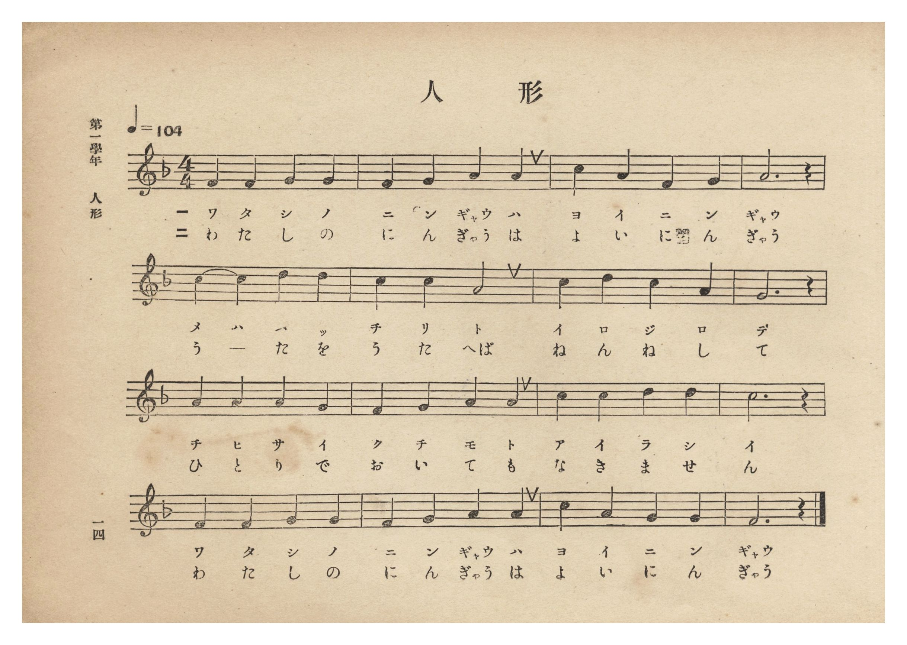
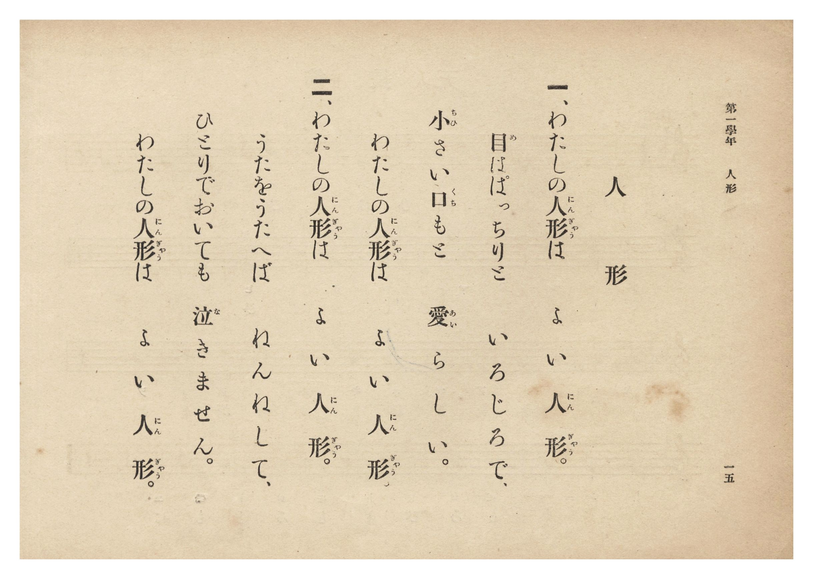

# 人形

> Re:Shōka 使用 AI 協助辨識與重建樂譜，可能會有錯誤。歡迎回報。

- **鋼琴伴奏版**：<br><audio controls src="ningyo.mp3"></audio>
- **NEUTRINO 歌聲合成版**：<br><audio controls src="ningyo_neutrino.mp3"></audio>

- 詞：文部省
- 曲：文部省
- 臺灣總督府《公學校唱歌集》（大正四年三月，索書號 0725 26）

## 說明

原書資訊與歌詞全文（對應 P020.jpg–P021.jpg，原書 p. 14–15，第一學年第 7 首）：
調性與拍號：ヘ長調 4/4 拍子，♩=104（採自文部省《尋常小學唱歌》第一學年〈人形〉）


## 歌詞

```text
一、わたしの人形（にんぎゃう）は　よい人形（にんぎゃう）。
目（め）はぱっちりと　いろじろで、
小（ちひ）さい口（くち）もと　愛（あい）らしい。
わたしの人形（にんぎゃう）は　よい人形（にんぎゃう）。

二、わたしの人形（にんぎゃう）は　よい人形（にんぎゃう）。
うたをうたへば　ねんねして、
ひとりでおいても　泣（な）きません。
わたしの人形（にんぎゃう）は　よい人形（にんぎゃう）。
```

## ABC

```abc
X:1
T:人形
C:曲：文部省
M:4/4
L:1/16
Q:1/4=104
K:F
V:V1 name="Piano" snm="Pia"
[V:V1]
F4 F4 G4 G4 | F4 G4 A4 A4 | c4 A4 F4 G4 | A12 z4 |
w: 1.~わ た し の | に ん ぎゃう は | よ い に ん | ぎゃう
w: 2.~わ た し の | に ん ぎゃう は | よ い に ん | ぎゃう
c4 c4 d4 d4 | c4 c4 A8 | c4 d4 c4 A4 | G12 z4 |
w: 1.~め は ぱ っ | ち り と | い ろ じ ろ | で
w: 2.~う _ た を | う た へば | ね ん ね し | て
A4 A4 A4 G4 | F4 G4 A4 A4 | c4 c4 d4 d4 | c12 z4 |
w: 1.~ち ひ さ い | く ち も と | あ い ら し | い
w: 2.~ひ と り で | お い て も | な き ま せ | ん
F4 F4 G4 G4 | F4 G4 A4 A4 | c4 A4 G4 G4 | F12 z4 |
w: 1.~わ た し の | に ん ぎゃう は | よ い に ん | ぎゃう
w: 2.~わ た し の | に ん ぎゃう は | よ い に ん | ぎゃう
```

## TMD 檔案連結

- [主旋律 TMD 檔案](ningyo.tmd) [[在 TMD Studio 編輯](https://tmdlang.github.io/Tmd-TS/#tmd=s7IKdvYPcrWy4qpTUCpJTLdSSM7PyUlNLsnMz7PKzk9PzM7Ojy_OyM9OLM4ojTe0NDRVgqssy88pzU21Si9KTEmNN0SIF-eXFiWnWhUnZ-Tn58SXpFaUJOXnZ6PLxxckpqdaBRgYGSBkCoryy1LzEvOAuguKMvNKUlPA2hEKUssyU1JB0sXJiXnxZalFmWmZqSlITkotKga5HGpFSVFiXnFyUWYByDsIVflFJRn5QGcXZFRaZWQWl-QXZSYn5sRnJ-YlIhSVZKQCPVeal5yTWFyMZg1QQ3pmnlVufl5SKTBwlLi0tBSe7Nr1dO8iBS0tLkVbBUMDEy57WwU3LhsTfRM7kL4XK-e93zPr2bT2l80rns9pBJv1bPYmDLEX7bueNy5-vmPv87mLn-6a87ih62nrmqdrdzxbsPDplI3P1va8nN32uKH7_Z6Op0uWP1u7-Ons2U93bnmyo_PZnI73e3qeb1n0bPaOFzPnKxiYG5kqGJm939OpxMWlr6VgSy3ApaCg8LRvPsiaze0vVnS96GgHOgvov6etK4B-AblsQ--z9k4FUNzqZRWkP2qYDGQagphAF0K0KhToKRiaAGUMTUGuXrPmyY4GoC-BXgGyFcwVXi6bBnQ5MHRAtr1Ytf9Zw3KQPd29QK8BRR83z3g5dTtQXAEYvgpA4adrJwDNeTRzpS0w6IFOeNa38EX7KnjQgoJxQ_fTHTuebugHWQMOSWAwIlv8uKEDEoePG4AWd3KBbAZKPm5ofNzU_7hx_uPG6Y8b10GUAG143Lj6cdPkx419j5uaHze2AXU8blz_uKHhcRNQqgWfsoYmkNHPZ68DSTc1QnU2bnzcuPhx48LHTV2PG1eADGpsedzU-7hxBphcDnQHOOQ39INNXfi4EZh4gDqnAtU97V8MFgQ6cyFIsKkJYsSzltlgcSC3BSwOVA_0RAvUCdT3FzjMdgFDljZhBuSADG2aBGU07njcuAEcVGvBGtaC7VsGDSpgCIGCARSeyx83AskWkBwwbIABsxkSYKvATgAG777HjbNBRtAqYICGUp7zoEBBS5-LyzcRWAAFZCbm5TvUGNRUgyxQsDHRsgMzsGV3BUhaf7GwR0HDBJSMnq9v0IHnUU0sGoDWgAyrUTAEQiMgBLGMFIyBsEbBFEiCeDVAWhcIDRRqwKp9DGtAwQcM_PlAPB2I1wHVAAMFKDoZSEODBchaDxJv6gCyWuDyIJUwFSBT42GmGlHbVPzhtKuHnHAyBUIzIISwQOECYpmB2TXAsMIMp0awi4F5H4gXg925ECjaBaRXgHWDfdHUC6RngGmQyHLMkAH7Cxw2TZPAakAhAQopUP6AGrQWGlRAGhiAIJFlRAbGjk5yAgOUTIwxEg0igDACA-T1xk1APBXsbZAIKMJBAdIEDhCQCIgFCpJOuC9asAQHyJQV0IBcDlYFYoESxDKwaSCRVUAMCth9QDwbnGgmExcewBqXmpkIJjYUM1EtF5eunQKoKFIA0spcAA)]
- [鋼琴伴奏 TMD 檔案](ningyo_piano.tmd) [[在 TMD Studio 編輯](https://tmdlang.github.io/Tmd-TS/#tmd=s7IKdvYPcrWy4tLSUniya9fTvYve7-l42b3n-YQtT_Zsebq0_3lnx_s9nQpaWlyKtgqGBiZc9rYKblw2Jvomdlx1CkovVs57v2fWs2ntL5tXPJ_TqAQSezZ7E4bYi_ZdzxsXP9-x9_ncxU93zXnc0PW0dc3TtTueLVj4dMrGZ2t7Xs5ue9zQDbT86ZLlz9Yufjp79tOdW57s6Hw2B2h_z_Mti57N3vFi5nwFA3MjUwUjM6CblLi4fBMz86wCMhPz8oM8HGoMaqq5FIDAxkTLDszQ11KwRQcKz9esebKj4cXCHgUNE4WnG_qfr2_QUQgwMDLQyypI18SiQUsfbFiNgiEQGgEhiGWkYAyENQqmQBLEqwHSukBooFADVu1jWKPwuKlf4XHjfCCeDsTrgGoeN64Gik4G0n2Pm5ofN7YBWetB4k0dQFYLXB6kEqYCZGo8zFQjapuKP5x29ZATTqZAaAaEEBYoXEAsMzC7BhhWmOHUCHbx48aNQLwY7M6FQNEuIL0CrBvsi6ZeID0DTINElmOGDNhf4LBpmgRWAwoJUEjteNy4AWrQWmhQAWlgAIJElhEZGDs6yQkMUDIxxkg0iADCCAyQ1xs3AfFUsLdBIqAIBwVIEzhAQCIgFihIOuG-aMESHCBTVkADcjlYFYgFShDLwKaBRFYBMShg9wHxbHCimUxceABzKDUzEUxsKGaiWuSSyAdbSVSjEG0YC1QdbRoPouBcMIlDEhEOcAUmeDTDeBBDsGjGazWKyaRqxuZuYJjo2imAgiXaByQMYxuB2cpcAA)]

## 分析

```text
================================================================================
📊 TMD Song Profile: [ 人形 ]
================================================================================
⏱  Duration:       0:36 (36.9s), 16 measures total
🎼 Key & Tempo:    首調基準 F, != 104.0 BPM, <4/4>
   - 分析範圍：      由實際發聲的音符與和弦推測調性；播放脈絡另行呈現
🎤 人聲音域:    F4 (MIDI 65) – D5 (MIDI 74) [跨度: 9 個半音 / 0.8 個八度, 難度: easy]
   - 最低音:  F4 in [Main #1 @ m.1, 0:00]
   - 最高音: D5 in [Main #1 @ m.5, 0:10]
   - 適合: soprano, mezzo-soprano, contralto, tenor, baritone, bass
🏛  結構:      Main (36.9s)
⚡ 編曲密度:        Peak 1 軌道同時演奏
🗝  調性診斷：       C 調性不明確（純淨自然大調，未偵測到可信轉調）
   - 風格氣質:    純淨自然大調（陽光明朗、易唱易記，無明顯調外色彩）
   - 轉調歷程:    全曲維持單一推測調性（未偵測到可信轉調）
   - 核心骨幹音:  A, G, C, F, D
   - 調性數值:    C 調性不明確 [相關度: 0.72, 穩定度: Ambiguous, 自然音純度: 100.0%]
   - 候選調性 (K-S): C 大調 (0.72), F 大調 (0.71), A 小調 (0.71)
   - 五度圈歷程:   +0
   - 各段落調性細節:
     • [Main #1]: C 調性不明確 (r: 0.72, 自然音純度: 100.0%)

  [ 五度圈游移軌跡 ]
              [C ]*
         F            G  
      Bb               D  
      Eb               A  
         Ab           E  
            Db       B  
               F# 
     (* = active key center)

  [ 十二半音累積音高分佈 ]
     C  : ██████████████████        21.7%
     C# :                            0.0%
     D  : ███████                    8.3%
     D# :                            0.0%
     E  :                            0.0%
     F  : ████████████████          18.3%
     F# :                            0.0%
     G  : ████████████████████      23.3%
     G# :                            0.0%
     A  : ████████████████████████  28.3%
     A# :                            0.0%
     B  :                            0.0%
--------------------------------------------------------------------------------
Assignment 軌道音域：
  - Piano         : F4 – D5 (9 個半音 / 0.8 個八度, 51 個音符)
================================================================================
```


## 原書掃描頁






