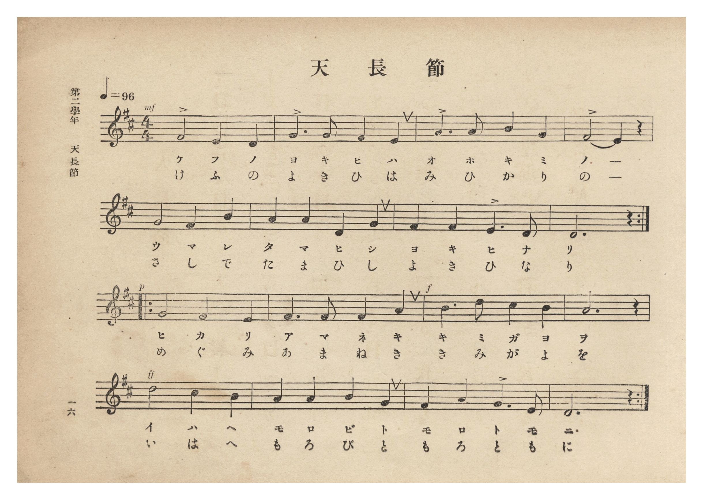
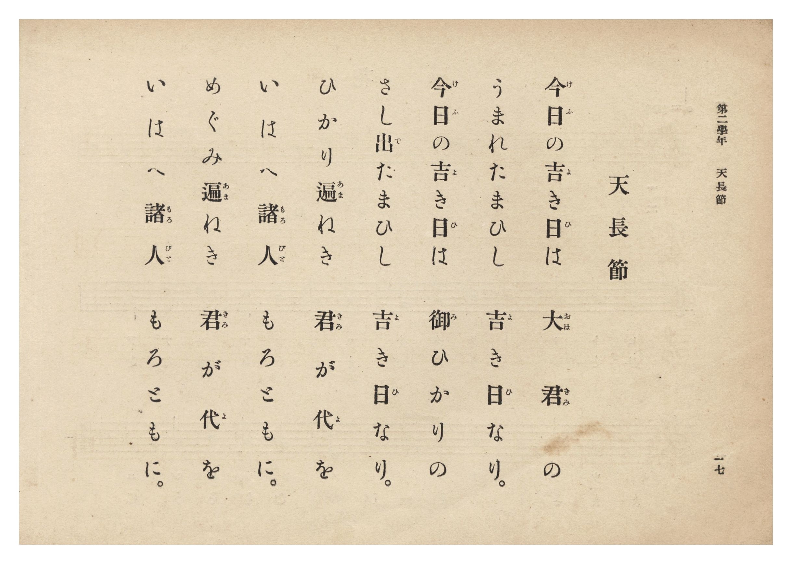

# 天長節

> Re:Shōka 使用 AI 協助辨識與重建樂譜，可能會有錯誤。歡迎回報。

- **鋼琴伴奏版**：<br><audio controls src="tenchosetsu.mp3"></audio>
- **NEUTRINO 歌聲合成版**：<br><audio controls src="tenchosetsu_neutrino.mp3"></audio>

- 詞：黒川眞頼
- 曲：奥好義
- 臺灣總督府《公學校唱歌集》（大正四年三月，索書號 0725 26）

## 說明

原書資訊與歌詞全文（對應 P022.jpg–P023.jpg，原書 p. 16–17，第二學年第 1 首）：
調性與拍號：ニ長調 4/4 拍子，♩=96（原譜前兩行與後兩行各有反覆記號）

## 歌詞

```text
今日（けふ）の吉（よ）き日（ひ）は　大君（おほきみ）の
うまれたまひし　吉（よ）き日（ひ）なり。
今日（けふ）の吉（よ）き日（ひ）は　御（み）ひかりの
さし出（で）たまひし　吉（よ）き日（ひ）なり。
ひかり遍（あま）ねき　君（きみ）が代（よ）を
いはへ諸人（もろびと）　もろともに。
めぐみ遍（あま）ねき　君（きみ）が代（よ）を
いはへ諸人（もろびと）　もろともに。
```

## ABC

```abc
X:1
T:天長節
C:曲：奥好義
M:4/4
L:1/16
Q:1/4=96
K:D
V:V1 name="Vocal" snm="Voc"
[V:V1]
!mf! F8 E4 D4 | G6 G2 F4 E4 | A6 A2 B4 G4 | F8 E4 z4 |
w: 1.~け ふ の | よ き ひ は | お ほ き み | の _
w: 2.~け ふ の | よ き ひ は | み ひ か り | の _
G8 F4 B4 | A4 A4 D4 G4 | F4 F4 E6 D2 | D12 z4 |
w: 1.~う ま れ | た ま ひ し | よ き ひ な | り
w: 2.~さ し で | た ま ひ し | よ き ひ な | り
!p! G8 F4 E4 | F6 F2 F4 A4 | !mf! B6 d2 c4 B4 | A12 z4 |
w: 1.~ひ か り | あ ま ね き | き み が よ | を
w: 2.~め ぐ み | あ ま ね き | き み が よ | を
!f! d8 c4 B4 | A4 A4 B4 G4 | F4 A4 G6 E2 | D12 z4 |
w: 1.~い は へ | も ろ び と | も ろ と も | に
w: 2.~い は へ | も ろ び と | も ろ と も | に
```

## TMD 檔案連結

- [主旋律 TMD 檔案](tenchosetsu.tmd) [[在 TMD Studio 編輯](https://tmdlang.github.io/Tmd-TS/#tmd=s7IKdvYPcrWy4qpTUCpJTLdSSM7PyUlNLsnMz7PKzk9PzM7Ojy_OyM9OLM4ojTe0NDRVgqssy88pzU21Si9KTEmNN0KIF-eXFiWnWhUnZ-Tn58SXpFaUJOXnZ6PLxxckpqdaBRgYIeksKMovS81LzAPqLijKzCtJTQFrRyhILctMSQVJFycn5sWXpRZlpmWmpiA5KbWoGORyqBUlRYl5xclFmQUg7yBU5ReVZOQDnV2QUWmVkVlckl-UmZyYE5-dmJeIUFSSkQr0XGZuAdCSxBx08eTUotTc_DywjJaWwtMlK19O3f58fYOClhaXoq2CpRmXva2CC5eNib6JHUjri5Xz3u-Z9XL3pKfb5z6fM-_lgj1gE5_N3gQUfrp06dOle5_vWwkWe9G-63nj4uc79j6fu_jprjmPG7qetq55unbHswULn07Z-Gxtz8vZbY8but_v6Xi6ZPmztYufzp79dOeWJzs6n83peL-n5_mWRc9m73gxc76CgbmRqYKR2fs9nUpcXPpaCrbUAlwKCgpP--aDrNnc_mJF14uOdqCzgF582rri2bR2kMs29D5r71QAxa5eVkH6o4bJQKYxiAl0IUSrQoGegqEZUMbQHOTqNWue7OoB-hLoFSBbwVDh5bJpQJcDQwdk24tV-581LAfZ090L9BpQ9HFzNzDEgeIKwCBWAAo_XTsBaM6jmSttLYFe7gBa8mLtnKedvU9bV75Y2APU-nRfD4T9dELLszmdT_t7Xyxre7FiBti8Ti6QNU92dz2bvhSo-3HjxMeNW4HCjxvXPZ0AdEXH4yZg4AK5vTAFwIgDctc_bmgARsPTCbPBgl2PG3cD1Txu3A_RCzL0cWPb48Z9j5t6HjfOBzEaNz1unA7Shs_cVY-buh43NFHgqH0LwSIQhwCt7AaZCHPRVKATnrbvAqtYDlZBltPgBr9s7AWraAKaAla0FhQKIIMg4QIPkZ4nuxcjjG6aBDGlBeTmxh0vVu94sgvsqKamx01APZsfN64AqWtogImsADEaV8Psb2p83DgBaPYA2U95VoICBS19Lq4QYMmWkV-cWlJcahWWDyyRHGoMaqpB9ijYWGjZgRnYsrECKPPsaACmbAUNE4WnG_qB5ZAOPO9pYtEAtA1kWI1CdW5arYKxgi4YGgGxIRDXKJiA-SZgGZBojYIpWMRUwQwsDhJB1mUAEgEb6WNYAwzPiVA5YHIFk-vAOoCBDhXtBaUcMGs9RKaxCyqzGywLYu2HyoD0wmA8wh4j8uwBmQribwLibhCrCWQzdnvwB_iuHnICHBKyuuDQA4UlJGRBGBTyiJCFhTxIvAYsB4PoYd0GD4N9YP_0QP0zHyEGDYPpSKEDC2WQDIheBZaBxAL2sJ4KtwdkDrDYoKo9BBJ3J1mJu6AWJbwhKRmSbo3BNCjcoZkAFBnAwI5TMAdSiJjBFeoQ_4B8hJqKmuBxASyD4P4HyYBoSLoGlkJgPaDwAYXGJNyh3tQIt2cCVDc17cEb6sB2BVmhDgxMYDBCrEENTBBGLUBAIpAoMiKQzFvgAQHKysDCGuopUEAAS2aw2GYwuQKLDEgMxGsCB9Fq3AFOY3tqubh07RSQCnoFIFeZCwA)]
- [鋼琴伴奏 TMD 檔案](tenchosetsu_piano.tmd) [[在 TMD Studio 編輯](https://tmdlang.github.io/Tmd-TS/#tmd=s7IKdvYPcrWy4tLSUni6ZOXLqdufr294v6fjZfee5xO2PNmz5enS_uedHe_3dCpoaXEp2ipYmnHZ2yq4cNmY6JvYcdUpKL1YOe_9nlkvd096un3u8znzXi7YowQSfjZ7E1D46dKlT5fufb5vJVjsRfuu542Ln-_Y-3zu4qe75jxu6Hrauubp2h3PFix8OmXjs7U9L2e3PW7oBlr_dMnyZ2sXP509--nOLU92dD6bA3RBz_Mti57N3vFi5nwFA3MjUwUjM6CrlLi4QlLzkjPyi1NLikutAjIT8_KDPBxqDGqquRSAwMZCyw7M0NdSsEUHCs_XrHmyo-HFwh4FDROFpxv6gX7XUQgwMDLSyypI18SiQUsfbFiNQnVuWq2CsYIuGBoBsSEQ1yiYgPkmYBmQaI2CKVjEVMEMLA4SQdZlABIBG-ljWKPwuHEiVO5x41YwuQ6s43FTB1S0F4g3gVnrITKNXVCZ3WBZEGs_VAakFwbjEfYYkWcPyFQQfxMQd4NYTSCbsduDP8B39ZAT4JCQ1QWHHigsISELwqCQR4QsLORB4jVgORhED-s2eBjsA_unB-qf-QgxaBhMRwodWCiDZED0KrAMJBawh_VUuD0gcx43LqeqPQQSdydZibugFiW8ISkZkm6NwTQo3KGZABQZwMCOUzAHUoiYwRXqEP-AfISaiprgcfG4cS3c_yAZEA1J148bQXEECR9QaEzCHepNjXB7JkB1U9MevKEOLLbICnVgYAKDEWINamCCMGoBAhKBRJERgWTeAg8IUFZ-3LgD6ilQQDxugiSyzWByBRYZkBiI1wQOotW4A5zG9tRiKed9kMt5E0Q5_7R1x8vZrc9atwEZwLh41t37dO0ESFWGCG3DeIVow1gYBQzmeCDLNB5JBMowAVImKCpADAOo3zENgjLMQKrN4nMxdIIZyNpwGwW1Gicfv4vgDsfrEazOAYa2rp0CUoBH-wAl0YWMwELKXAA)]

## 分析

```text
================================================================================
📊 TMD Song Profile: [ 天長節 ]
================================================================================
⏱  Duration:       0:40 (40.0s), 16 measures total
🎼 Key & Tempo:    首調基準 D, != 96.0 BPM, <4/4>
   - 分析範圍：      由實際發聲的音符與和弦推測調性；播放脈絡另行呈現
🎤 人聲音域:    D4 (MIDI 62) – D5 (MIDI 74) [跨度: 12 個半音 / 1.0 個八度, 難度: easy]
   - 最低音:  D4 in [Tenchosetsu #1 @ m.1, 0:01]
   - 最高音: D5 in [Tenchosetsu #1 @ m.11, 0:25]
   - 適合: soprano, mezzo-soprano, contralto, tenor, baritone, bass
🏛  結構:      Tenchosetsu (40.0s)
⚡ 編曲密度:        Peak 1 軌道同時演奏
🗝  調性診斷：       D 大調（純淨自然大調，未偵測到可信轉調）
   - 風格氣質:    純淨自然大調（陽光明朗、易唱易記，無明顯調外色彩）
   - 轉調歷程:    全曲維持單一推測調性（未偵測到可信轉調）
   - 核心骨幹音:  F#, D, A, G, B
   - 調性數值:    D 大調 [相關度: 0.90, 穩定度: High, 自然音純度: 100.0%]
   - 候選調性 (K-S): D 大調 (0.90), B 小調 (0.66), F# 小調 (0.62)
   - 五度圈歷程:   +2
   - 各段落調性細節:
     • [Tenchosetsu #1]: D 大調 (r: 0.90, 自然音純度: 100.0%)

  [ 五度圈游移軌跡 ]
               C  
         F            G  
      Bb              [D ]*
      Eb               A  
         Ab           E  
            Db       B  
               F# 
     (* = active key center)

  [ 十二半音累積音高分佈 ]
     C  :                            0.0%
     C# : ████                       3.3%
     D  : ████████████████████      18.3%
     D# :                            0.0%
     E  : ███████████               10.0%
     F  :                            0.0%
     F# : ████████████████████████  21.7%
     G  : ███████████████████       17.5%
     G# :                            0.0%
     A  : ████████████████████      18.3%
     A# :                            0.0%
     B  : ████████████              10.8%
--------------------------------------------------------------------------------
Assignment 軌道音域：
  - Vocal         : D4 – D5 (12 個半音 / 1.0 個八度, 49 個音符)
================================================================================
```


## 原書掃描頁






