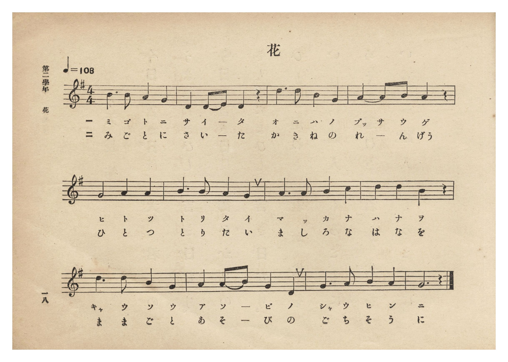
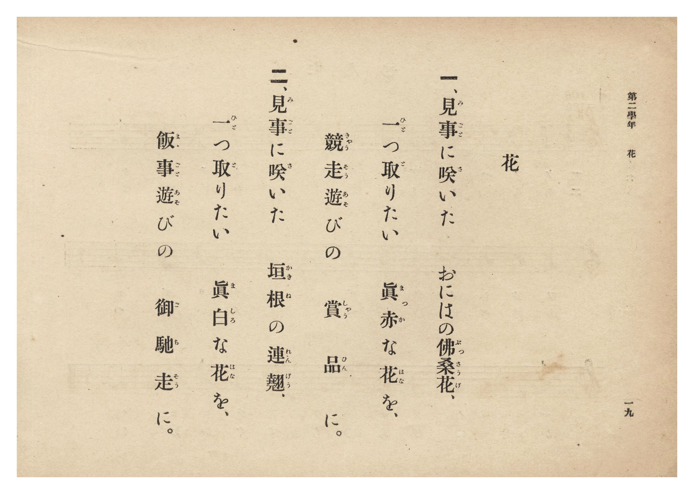

# 花

> Re:Shōka 使用 AI 協助辨識與重建樂譜，可能會有錯誤。歡迎回報。

- **NEUTRINO 歌聲合成版**：<br><audio controls src="hana_neutrino.mp3"></audio>
- **鋼琴伴奏版**：<br><audio controls src="hana.mp3"></audio>


- 詞：文部省（臺灣總督府改作）
- 曲：文部省
- 臺灣總督府《公學校唱歌集》（大正四年三月，索書號 0725 26）

## 說明

原書資訊與歌詞全文（對應 P024.jpg–P025.jpg，原書 p. 18–19，第二學年第 2 首）：
調性與拍號：ト長調 4/4 拍子，♩=108
說明：採自文部省《尋常小學唱歌》第一學年〈花〉，將第一節「れんげの花」改為臺灣風物「佛桑花（ぶっさうげ）」。


## 跨冊／重複收錄參照

> 同曲＋同名異曲（《公學校唱歌集》〈花〉與《新定兒童唱歌》第一學年〈ハナ〉為同曲；《新定兒童唱歌》高等科女子用〈花〉為瀧廉太郎作曲同名異曲）

- **[同曲]** 《新定兒童唱歌》尋常科第一學年用（2020.006.0847.0001）：[**〈ハナ（花）〉**](../../shintei_jido_shoka/grade_1_2020.006.0847.0001/2_05_hana/index.md)（`G` / `4/4` — [原始 TMD](../../shintei_jido_shoka/grade_1_2020.006.0847.0001/2_05_hana/hana.tmd)）
- **[同名異曲]** 《新定兒童唱歌》高等科女子用（2020.006.0849）：[**〈花〉**](../../shintei_jido_shoka/koto_girls_2020.006.0849/2_4_04_hana/index.md)（`A` / `2/4` — [原始 TMD](../../shintei_jido_shoka/koto_girls_2020.006.0849/2_4_04_hana/hana.tmd)）
- **[同曲]** 《新編小公學校唱歌教材集》第一、二學年（大正12年／1923，國臺圖 0725-41）：[**〈花〉**](../../shoka_kyozai_shu_1923/grade_1_2/33_hana/index.md)（`G` / `4/4` — [原始 TMD](../../shoka_kyozai_shu_1923/grade_1_2/33_hana/hana.tmd)）
- 總表：[跨冊重複與同名歌曲總索引](../../duplicate_songs.md)

## 歌詞

```text
一、見事（みごと）に咲（さ）いた　おにはの佛桑花（ぶっさうげ）、
一（ひと）つ取（と）りたい　眞赤（まっか）な花（はな）を、
競走遊（きゃうそうあそ）びの　賞品（しゃうひん）に。

二、見事（みごと）に咲（さ）いた　垣根（かきね）の連翹（れんげう）、
一（ひと）つ取（と）りたい　眞白（ましろ）な花（はな）を、
飯事遊（ままごとあそ）びの　御馳走（ごちそう）に。
```

## ABC

```abc
X:1
T:花
C:曲：文部省
M:4/4
L:1/16
Q:1/4=108
K:G
V:V1 name="Piano" snm="Pia"
[V:V1]
B6 B2 A4 G4 | D4 D2 E2 D4 z4 | d6 d2 B4 G4 | A4 A2 B2 A4 z4 |
w: 1.~み ご と に | さ い _ た | お に は の | ぶっ さ う げ
w: 2.~み ご と に | さ い _ た | か き ね の | れ ん _ げう
G8 A4 A4 | B6 B2 A4 G4 | A6 A2 B4 c4 | d4 d4 B4 z4 |
w: 1.~ひ と つ | と り た い | ま っ か な | は な を
w: 2.~ひ と つ | と り た い | ま し ろ な | は な を
d6 d2 B4 G4 | A4 A2 B2 G4 D4 | G6 A2 B4 A4 | G12 z4 |
w: 1.~きゃ う そ う | あ そ _ び の | しゃ う ひ ん | に
w: 2.~ま ま ご と | あ そ _ び の | ご ち そ う | に
```

## TMD 檔案連結

- [主旋律 TMD 檔案](hana.tmd) [[在 TMD Studio 編輯](https://tmdlang.github.io/Tmd-TS/#tmd=s7IKdvYPcrWy4qpTUCpJTLdSSM7PyUlNLsnMz7PKzk9PzM7Ojy_OyM9OLM4ojTe0NDRVgqssy88pzU21Si9KTEmNN0KIF-eXFiWnWhUnZ-Tn58SXpFaUJOXnZ6PLxxckpqdaBRgYmSBkCoryy1LzEvOAuguKMvNKUlPA2hEKUssyU1JB0sXJiXnxZalFmWmZqSlITkotKga5HGpFSVFiXnFyUWYByDsIVflFJRn5QGcXZFRaZWQWl-QXZSYn5sRnJ-YlIhSVZKQCPVeQk5gHtF9LS-FF10YFLS0uRVsFQwMLLntbBXcuGxN9EzuQhhcr573fM-vZtPaXzSuez2l8v6fjRfuu542Ln-_Y-3zu4qe75jybsvPJ3jnv93SCzX82exOycrAYmobHDV1PW9c8Xbvj2YKFT6dsfLa25-XstscN3UCjny5Z_mzt4qezZz_dueXJjs5nczre7-l5vmXRs9k7Xsycr2BgbmSqYGQGtotLX0vBllqAS0FB4WnffJA1m9tfrOh60dEOdBbQ609bVwD9AnLZht5n7Z0KoDjVyypIf9QwGcg0BTGBLoRoVSjQUzC0AMoYWoJcvWbNk109QF8CvQJkKxgpvFw2DehyYOiAbHuxav-zhuUge7p7gV4Dij5u7ng5dTtQXAEY9ApA4adrJwDNeTRzpS0oVsB6Vj2b0QcK3r6FL9pXwQMZFKAbup_u2PF0Qz_IQnCYAgMU5IQdDRAnPG7oAMby4wag_T1PN7RDpJ6vb3jc0PO4CYgmP26c9LhxHVhNLzBKnzftgkTby0UrnneuBCp7snf2s4UTgQqAofG4cdvjxsWPG6c-bmwDagR6C6jrcUMTF8iZQIMfNzS-WNb9ZBcoTh837n_cOOVx4wqQqsbVTycBEwhQcCqY2_K4cf7jhobHjV1AqceN64FOIGRPI9QOsPQmmLlLnvYDQxcoAuY2AY2bDzK9oeH5nHkvti4BS-0DmwV0E1D9KpgFQCtXgbVMghr9fPW2F1s3vGzsAkv3Pm5qBls-F0w2ARlg_ZuBLgWa_mLzvKeTQZniceN0mMpNwNCE-BUeIruA0UFaiDydt_jZgp1g8W6QKxrXgmXXvWxY_Hw_WBwRa21khsvzmXth4QJ0fC-BcHm5eD3Q-bBwAeoBIpAnMAPl6b6FL5dtBgYiWCVQzUJI8CECBWgc5ZkWChS09Lm4PIDlm1VAZmJevkONQU01yAIFGwstOzADW0mhAMkBLxb2KGiYKAAzDjAv6MCztyYWDUBrQIbVKBgr6AKhMTBH6yoYAnGNgmk8kAISZvEQpgFEFKzOFKweog6kwwiqE6wGbKKPYY0CMEmAVQODC4hXgFmrwXqA6QLMawGT84EkyAaQeBdUx2ogXg9mrYPKgDINWGAqELcB8SSYNoiFRuRZ2A3V0QvEa5EtbOoB8Zomg8VACRJuHf7w39VDTviDwhIEIaEJcgBmjIBYkLDWVTCBxwYIg0TQw34T1ERYQCyBehjEA3msCxoQkEAByeyDql8MDRZgZoHKQGICxANmHSzBTr5d04GyvUTYRSDNd5IT5rjTMogHTvSwiIEEOiRiYFEFguiBDipZoT4DJdG5UBbEZ01gHkRsM5iEpW1QMYukDRSckJQHkgSlYBhED3hYMO4Dp3lYBOC3DKQOxF-I4UBMm2q5uHTtFEAFkQKQVuYCAA)]
- [鋼琴伴奏 TMD 檔案](hana_piano.tmd) [[在 TMD Studio 編輯](https://tmdlang.github.io/Tmd-TS/#tmd=s7IKdvYPcrWy4tLSUnjRtfH9no6X3XueT9jyZM-Wp0v7n3d2vN_TqaClxaVoq2BoYMFlb6vgzmVjom9ix1WnoPRi5bz3e2Y9m9b-snnF8zmNQM0v2nc9b1z8fMfe53MXP90159mUnU_2zgEaoQRS_mz2JmTlYDE0DY8bup62rnm6dsezBQufTtn4bG3Py9ltjxu6gUY_XbL82drFT2fPfrpzy5Mdnc_mAJ3W83zLomezd7yYOV_BwNzIVMHIDGwXl0diXqJVQGZiXn6Qh0ONQU01lwIQ2Fho2YEZ-loKtuhA4fmaNU92NLxY2KOgYaLwdEP_8_UNOgoBBkYmelkF6ZpYNGjpgw2rUTBW0AVCYwUjIGkIxDUKpvFACkiYxUOYBhBRsDpTsHqIOpAOI6hOsBqwiT6GNQqPG_eDVT9unALEK8Cs1WA9jxungnktYHI-kATZABLvgupYDcTrwax1UJltjxsXgwWmAnEbEE-CaYNYaESehd1QHb1AvBbZwqYeEK9pMlhsEshKmHX4w39XDznhDwpLEISEJsgBmDECYkHCWlfBBB4bIAwSQQ_7TVATYQGxBOphEA_ksS5oQEACBSSzD6p-MTRYHjeugspAYgLEe9yELdjJt2s6ULaXCLsIpPlOcsIcd1oG8cCJHhYxkECHRAwsqkAQPdB7Hzc1Q30GSqJzoSyIz5rAPIjYZjAJS9vTUbWBghOS8kCSoBQMg-gBDwvGfeA0D4sA_JaB1IH4CzEciGlTLXI55INcDplAyyFgeMQrRBvGAsMLRMfHQkVMgCwgbYBQAKVAJQuQZQqUBzGACrCYA5LFZjJcEiSFoghiF6pRmDbCRUxAIiA3YloHNQnodV07BZDvo32AonC2EZitzAUA)]

## 分析

```text
================================================================================
📊 TMD Song Profile: [ 花 ]
================================================================================
⏱  Duration:       0:26 (26.7s), 12 measures total
🎼 Key & Tempo:    首調基準 G, != 108.0 BPM, <4/4>
   - 分析範圍：      由實際發聲的音符與和弦推測調性；播放脈絡另行呈現
🎤 人聲音域:    D4 (MIDI 62) – D5 (MIDI 74) [跨度: 12 個半音 / 1.0 個八度, 難度: easy]
   - 最低音:  D4 in [Hana #1 @ m.2, 0:02]
   - 最高音: D5 in [Hana #1 @ m.3, 0:04]
   - 適合: soprano, mezzo-soprano, contralto, tenor, baritone, bass
🏛  結構:      Hana (26.7s)
⚡ 編曲密度:        Peak 1 軌道同時演奏
🗝  調性診斷：       G 大調（純淨自然大調，未偵測到可信轉調）
   - 風格氣質:    純淨自然大調（陽光明朗、易唱易記，無明顯調外色彩）
   - 轉調歷程:    全曲維持單一推測調性（未偵測到可信轉調）
   - 核心骨幹音:  G, A, B, D, C
   - 調性數值:    G 大調 [相關度: 0.78, 穩定度: Moderate, 自然音純度: 100.0%]
   - 候選調性 (K-S): G 大調 (0.78), D 大調 (0.72), B 小調 (0.58)
   - 五度圈歷程:   +1
   - 各段落調性細節:
     • [Hana #1]: G 大調 (r: 0.78, 自然音純度: 100.0%)

  [ 五度圈游移軌跡 ]
               C  
         F           [G ]*
      Bb               D  
      Eb               A  
         Ab           E  
            Db       B  
               F# 
     (* = active key center)

  [ 十二半音累積音高分佈 ]
     C  : ██                         2.3%
     C# :                            0.0%
     D  : ████████████████████      21.6%
     D# :                            0.0%
     E  : █                          1.1%
     F  :                            0.0%
     F# :                            0.0%
     G  : ████████████████████████  26.1%
     G# :                            0.0%
     A  : ████████████████████████  26.1%
     A# :                            0.0%
     B  : █████████████████████     22.7%
--------------------------------------------------------------------------------
Assignment 軌道音域：
  - Piano         : D4 – D5 (12 個半音 / 1.0 個八度, 44 個音符)
================================================================================
```


## 原書掃描頁






