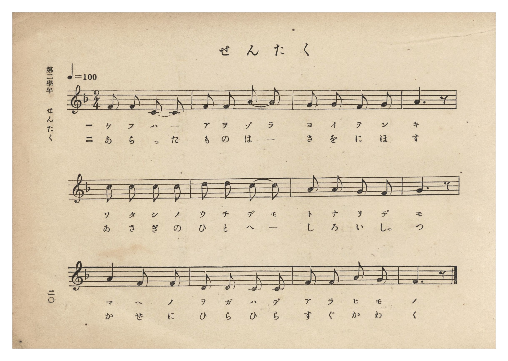
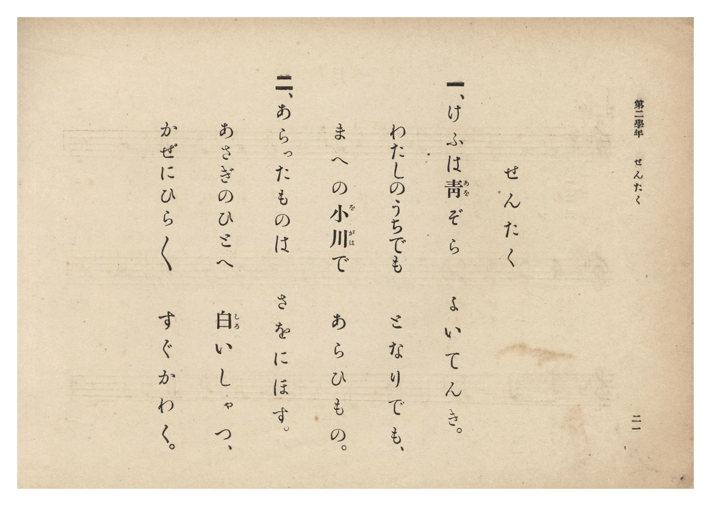

# せんたく

> Re:Shōka 使用 AI 協助辨識與重建樂譜，可能會有錯誤。歡迎回報。

- **NEUTRINO 歌聲合成版**：<br><audio controls src="sentaku_neutrino.mp3"></audio>
- **鋼琴伴奏版**：<br><audio controls src="sentaku.mp3"></audio>


- 詞：公學校用國民讀本
- 曲：宮島慎三郎
- 臺灣總督府《公學校唱歌集》（大正四年三月，索書號 0725 26）

## 說明

原書資訊與歌詞全文（對應 P026.jpg–P027.jpg，原書 p. 20–21，第二學年第 3 首）：
調性與拍號：ヘ長調 2/4 拍子，♩=100
作曲：臺灣總督府國語學校助教授 宮島慎三郎

## 歌詞

```text
一、けふは青（あを）ぞら　よいてんき。
わたしのうちでも　となりでも、
まへの小川（をがは）で　あらひもの。

二、あらったものは　さをにほす。
あさぎのひとへ　白（しろ）いしゃつ、
かぜにひらひら　すぐかわく。
```

## ABC

```abc
X:1
T:せんたく
C:曲：宮島慎三郎
M:2/4
L:1/16
Q:1/4=100
K:F
V:V1 name="Piano" snm="Pia"
[V:V1]
F2 F2 C2 C2 | F2 F2 A2 A2 | G2 G2 F2 G2 | A6 z2 |
w: 1.~け ふ は _ | あ を ぞ ら | よ い て ん | き
w: 2.~あ ら っ た | も の は _ | さ を に ほ | す
c2 c2 c2 c2 | d2 d2 c2 c2 | A2 A2 G2 F2 | G6 z2 |
w: 1.~わ た し の | う ち で も | と な り で | も
w: 2.~あ さ ぎ の | ひ と へ _ | し ろ い しゃ | つ
A4 F2 F2 | D2 D2 C2 C2 | F2 F2 A2 G2 | F6 z2 |
w: 1.~ま へ の | を が は で | あ ら ひ も | の
w: 2.~か ぜ に | ひ ら ひ ら | す ぐ か わ | く
```

## TMD 檔案連結

- [主旋律 TMD 檔案](sentaku.tmd) [[在 TMD Studio 編輯](https://tmdlang.github.io/Tmd-TS/#tmd=s7IKdvYPcrWy4qpTUCpJTLdSSM7PyUlNLsnMz7PKzk9PzM7Ojy_OyM9OLM4ojTe0NDRVgqssy88pzU21Si9KTEmNN0KIF-eXFiWnWhUnZ-Tn58SXpFaUJOXnZ6PLxxckpqdaBRgYmSFkCoryy1LzEvOAuguKMvNKUlPA2hEKUssyU1JB0sXJiXnxZalFmWmZqSlITkotKga5HGpFSVFiXnFyUWYByDsIVflFJRn5QGcXZFRaZWQWl-QXZSYn5sRnJ-YlIhSVZKQCPZeSmJlTGZ-TmZaqxKWlpfC4cfbjpsmPG-c_buxX0NLiUrRVMDQw4LK3VXDjsjHSN7EDaX-xct77PbOetq55unbHswULn09Z8XRO97MNE1-sa3g2Zw3YhmezN4GUrFv3dPO2Z619T3Z0vmzuA8u8aN_1vHHx8x17n89d_HTXnMcNXXCDnk7Z-Gxtz8vZbY8but_v6Xi6ZPmztYufzp79dOcWoAHP5nS839PzfMuiZ7N3vJg5X8HA3MhUwcjs_Z5OJS4ufS0FW2oBLgUFhad980HWbG5_saLrRUc70FlATz9tXfFsWjvIZRt6n7V3KoDiVi-rIP1Rw2Qg0xzEBLoQolWhQE_ByAAoY2QIcvWaNU929QB9CfQKkK1grPBy2TSgy4FhBLLtxar9zxqWg-zp7gV6DSj6uHnGy6nbgeIKwEBXAAo_XTsBaM6jmSttQfEB1PNk7xxIIKMFKDAqXqyaBw3QrpXPps581tehgBYTXGATdjQ8bmh83DjxcePWx43rX86dBPTa48amx01ARufjxnmPmzofNzQ8bgIKtjxuXAZOGL2PG5pAmh839YNTyfTHjeseN7Y9blz4uHH546YmkIbGFY8bVz1u6oKJNII1NO573LgDqPrphv6n2-eCrGqa9LixB2gz2LblYJ1Ay4HsTSBtQHOBVoEduqsH7FCI5GKQvRD5xvVgTVPBJq1-3Lj7ceNMmPuAqoESjX1gdZvAbtoBVP185l6wL6c_buoF2wv0GZDd_LhxCdyh3Y8b54DNA7oD4hpwOADNbpwAkgV5vR9qD-XJDQoUtPS5uIJT80oSs0utAjIT8_IdagxqqkF2KNhYaNmBGdiSuQIoce1oeLGwR0HDRAEYus_XN-jA06YmFg1Am0CG1SgYAqFpPAhB2MZAWKNgBISGQFwD5OkCoYFCDVi9j2ENMHAmAvFWIF4PlAHxm4BJYRKQngekO0EiTR1AXgsQLwOyJ4PV9ILNAdoCMccIpq8TSC8G4vlgfUCRxnVIJk-FmrwaiHeDRWbCzcEfGrt6yAkNUyisUTADQggLFCKg0ACFCkZYNPWD3Q5MQGCXg1zYBsQLgXg52D8gkRVAvArI6wKLQvyJNTRA_m3sg5u0Cap3BzQ0gHY09UJDFpRgwYJLiAyQHZ3kBAgo-kHJAhgg8SCEmlRACcQQSwLZBxQBORvqEXAU9oCjFRoA8KgHehEaSOuwBEk32Jw54AQADRC4LnBCAyYHYIYEqwRFBUikH25OLReXrp0CND8pAJnKXAA)]
- [鋼琴伴奏 TMD 檔案](sentaku_piano.tmd) [[在 TMD Studio 編輯](https://tmdlang.github.io/Tmd-TS/#tmd=s7IKdvYPcrWy4tLSUnjcOPtx0-THjfMfN_a_39PxsnvP8wlbnuzZ8nRp__POjvd7OhW0tLgUbRUMDQy47G0V3LhsjPRN7LjqFJRerJz3fs-sp61rnq7d8WzBwudTVjyd0_1sw8QX6xqezVmjBFLybPYmkJJ1655u3vaste_Jjs6XzX1gmRftu543Ln6-Y-_zuYuf7przuKELbtDTKRufre15ObvtcUM30EVPlyx_tnbx09mzn-7cAjTg2Rygo3qeb1n0bPaOFzPnKxiYG5kqGJkBHarExRWcmleSmF1qFZCZmJcf5OFQY1BTzaUABDYWWnZghr6Wgi06UHi-Zs2THQ0vFvYoaJgoPN3Q_3x9g45CgIGRmV5WQbomFg1a-mDDahQMgdA0HoQgbGMgrFEwAkJDIK4B8nSB0EChBqzex7AGGN4TgXgrEK8HyoD4TQqPmyYB6XlAuhMk0tQB5LUA8TIgezJYTS_YHKAtEHOMYPo6gfRiIJ4P1gcUaVyHZPJUqMmrgXg3WGQm3Bz8obGrh5zQMIXCGgUzIISwQCECCg1QqGCERVM_2O2PG6eDXQ5yYRsQLwTi5WD_gERWAPEqIK8LLArxJ9bQAPm3sQ9u0iao3h3Q0ADa0dQLDdnpj5uawYJLiAyQHZ3kBAgo-kHJAhgg8SCEmlRACcQQSwLZBxQBORvqEXAU9oCjFRoA8KgHehEaSOuwBEk32Jw54AQADRC4LnBCAyaHx40TwCpBUQES6YebU4uWnXywZSegB-IVog1jwZRpfCyqAJACJop4qBQ2JTCPY2ozATJMkPhQBtg0Q7ApcINBDHwGgUzCYT9WBwF9rmunAPV8tA9QAplrBOYqcwEA)]

## 分析

```text
================================================================================
📊 TMD Song Profile: [ せんたく ]
================================================================================
⏱  Duration:       0:14 (14.4s), 12 measures total
🎼 Key & Tempo:    首調基準 F, != 100.0 BPM, <2/4>
   - 分析範圍：      由實際發聲的音符與和弦推測調性；播放脈絡另行呈現
🎤 人聲音域:    C4 (MIDI 60) – D5 (MIDI 74) [跨度: 14 個半音 / 1.2 個八度, 難度: moderate]
   - 最低音:  C4 in [Sentaku #1 @ m.1, 0:00]
   - 最高音: D5 in [Sentaku #1 @ m.6, 0:06]
   - 適合: soprano, mezzo-soprano, contralto, tenor, baritone, bass
🏛  結構:      Sentaku (14.4s)
⚡ 編曲密度:        Peak 1 軌道同時演奏
🗝  調性診斷：       F 大調（純淨自然大調，未偵測到可信轉調）
   - 風格氣質:    純淨自然大調（陽光明朗、易唱易記，無明顯調外色彩）
   - 轉調歷程:    全曲維持單一推測調性（未偵測到可信轉調）
   - 核心骨幹音:  F, C, A, G, D
   - 調性數值:    F 大調 [相關度: 0.87, 穩定度: High, 自然音純度: 100.0%]
   - 候選調性 (K-S): F 大調 (0.87), C 大調 (0.71), A 小調 (0.64)
   - 五度圈歷程:   -1
   - 各段落調性細節:
     • [Sentaku #1]: F 大調 (r: 0.87, 自然音純度: 100.0%)

  [ 五度圈游移軌跡 ]
               C  
        [F ]*          G  
      Bb               D  
      Eb               A  
         Ab           E  
            Db       B  
               F# 
     (* = active key center)

  [ 十二半音累積音高分佈 ]
     C  : ██████████████████        22.2%
     C# :                            0.0%
     D  : ███████                    8.9%
     D# :                            0.0%
     E  :                            0.0%
     F  : ████████████████████████  28.9%
     F# :                            0.0%
     G  : ███████████████           17.8%
     G# :                            0.0%
     A  : ██████████████████        22.2%
     A# :                            0.0%
     B  :                            0.0%
--------------------------------------------------------------------------------
Assignment 軌道音域：
  - Piano         : C4 – D5 (14 個半音 / 1.2 個八度, 38 個音符)
================================================================================
```


## 原書掃描頁






