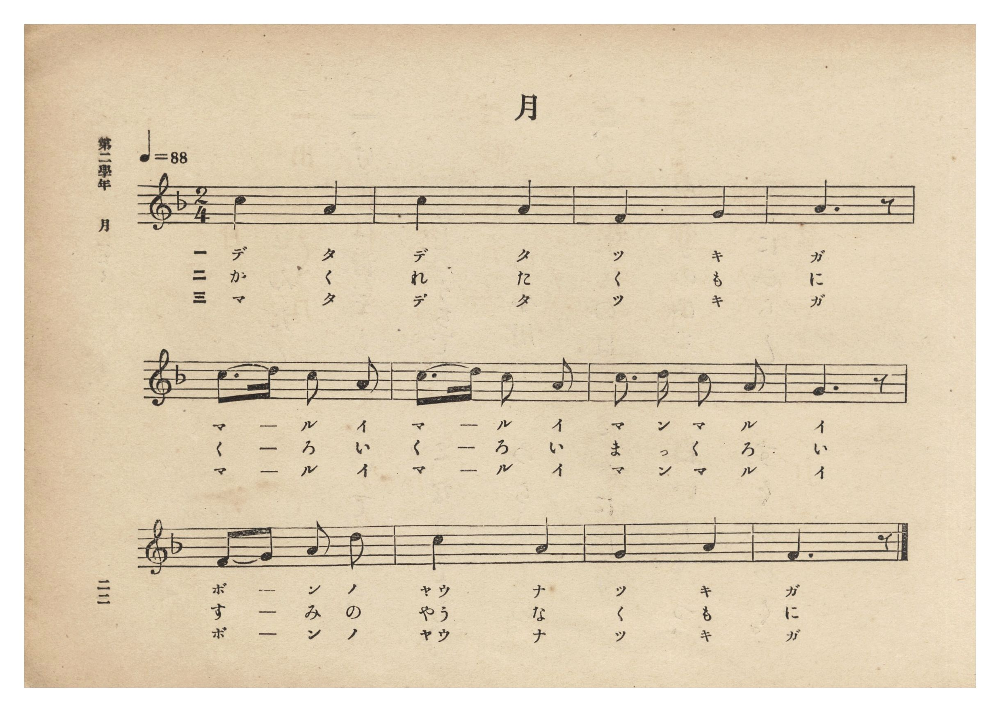
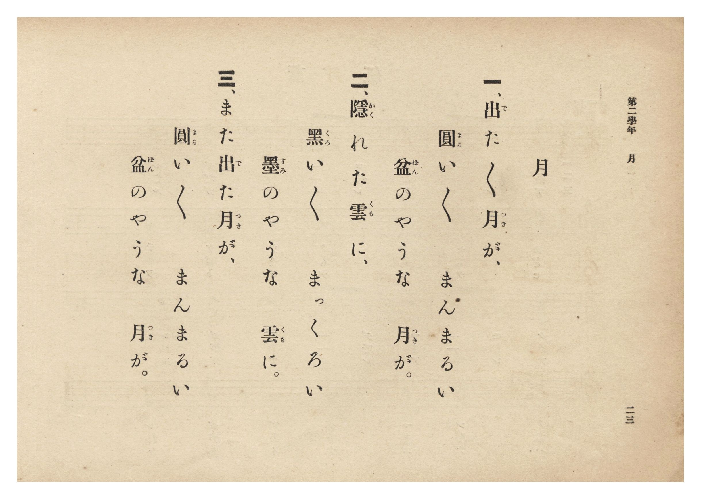

# 月

> Re:Shōka 使用 AI 協助辨識與重建樂譜，可能會有錯誤。歡迎回報。

- **鋼琴伴奏版**：<br><audio controls src="tsuki.mp3"></audio>
- **NEUTRINO 歌聲合成版**：<br><audio controls src="tsuki_neutrino.mp3"></audio>

- 詞：文部省《尋常小學唱歌》
- 曲：文部省《尋常小學唱歌》
- 臺灣總督府《公學校唱歌集》（大正四年三月，索書號 0725 26）

## 說明

原書資訊與歌詞全文（對應 P028.jpg–P029.jpg，原書 p. 22–23，第二學年第 4 首）：
調性與拍號：ヘ長調 2/4 拍子，♩=88

## 歌詞

```text
一、出（で）た〻月（つき）が、
圓（まる）い〻　まんまるい
盆（ぼん）のやうな　月（つき）が。

二、隱（かく）れた雲（くも）に、
黑（くろ）い〻　まっくろい
墨（すみ）のやうな　雲（くも）に。

三、また出（で）た月（つき）が、
圓（まる）い〻　まんまるい
盆（ぼん）のやうな　月（つき）が。
```

## ABC

```abc
X:1
T:月
C:曲：文部省《尋常小學唱歌》
M:2/4
L:1/16
Q:1/4=88
K:F
V:V1 name="Piano" snm="Pia"
[V:V1]
c4 A4 | c4 A4 | F4 G4 | A6 z2 |
w: 1.~で た | で た | つ き | が
w: 2.~か く | れ た | く も | に
w: 3.~ま た | で た | つ き | が
c3 d c2 A2 | c3 d c2 A2 | c3 d c2 A2 | G6 z2 |
w: 1.~ま _ る い | ま _ る い | ま ん ま る | い
w: 2.~く _ ろ い | く _ ろ い | ま っ く ろ | い
w: 3.~ま _ る い | ま _ る い | ま ん ま る | い
F2 G2 A3 d | c4 A4 | G4 A4 | F6 z2 |
w: 1.~ぼ _ ん の | やう な | つ き | が
w: 2.~す _ み の | やう な | く も | に
w: 3.~ぼ _ ん の | やう な | つ き | が
```

## TMD 檔案連結

- [主旋律 TMD 檔案](tsuki.tmd) [[在 TMD Studio 編輯](https://tmdlang.github.io/Tmd-TS/#tmd=s7IKdvYPcrWy4qpTUCpJTLdSSM7PyUlNLsnMz7PKzk9PzM7Ojy_OyM9OLM4ojTe0NDRVgqssy88pzU21Si9KTEmNN0KIF-eXFiWnWhUnZ-Tn58SXpFaUJOXnZ6PLxxckpqdaBRgYWSBkCoryy1LzEvOAuguKMvNKUlPA2hEKUssyU1JB0sXJiXnxZalFmWmZqSlITkotKga5HGpFSVFiXnFyUWYByDsIVflFJRn5QGcXZFRaZWQWl-QXZSYn5sRnJ-YlIhSVZKQCPZeXWFJalKrEpaWl8GxOh4KWFpeirYKFBZe9rYIbl42RvokdSMOLlfPe75n1bFr7y-YVz-c0Pm7oerqh--mOHU839D9du-PplI3P1vY8bugGG_5s9iai1b5o3_W8cfHzHXufz138dNcckNrWNUBVzxYshCh8ObsNqPb9no6nS5Y_W7v46ezZT3duebKjE-jW93t6nm9Z9Gz2jhcz5ysYmBuZKhiZvd_TqcTFpa-lYEstwKWgoPC0bz7Ims3tL1Z0vehoBzoLGB5PW1cA_Qhy2YbeZ-2dCqCI1ssqSH_UMBnItAQxgS6EaFUo0FMwMgLKGBmDXL1mzZNdPaCw2LkFyFYwUXi5bBrQ5cBQA9n2YtX-Zw3LQfZ09wK9BhR93Dzj5dTtQHEFYHwoAIWfrp0ANOfRzJW2wJgC6Xmyo-FxQ-PT9l1A9zxuXA407HHj_McNu8HBBBRZ8rixFywIDPlGsJfmTAZL7HvcBAxdoEQLUPXjhgawyGSIOFAQpPT57Daw0j1ACbDSdY-bWh43tj1uXAXUgM2GJoibdoEsezlrI1geaFo_SL6pB-iyl6AkAhTsf9zUBNa0Guqsl7snwiQgpiE5q3ExRBzqrKeLVoCVznzcuB_TWdhsgDprRyfQMrCB89ECbKBCC6iN8oQKBQpa-lxcIcWl2ZlWAZmJefkONQY11SAbFGwMzbTswCxs-UMBlCp3NLxY2KOgYaIAzKvP1zfowBO1JhYNQItAhtUomCrogqExlMYmYghlGcFFYHIgaAASAZvmY1ijAIwPqDgwTuDqcYkugYv2Ion2IJkejzDdCCTXDdfRj9DRBNOBajpMBTAZIYmuxm66MUhuHw3cjj_WdvWQH2tmYBoUF8SJwOIPW6zBfd4ECmFgfoD6B784MJ9A2RB5kAxIBa7YQ8QIKMwQpuESh9rSuBiqBiKPxxbUWKSBXwjkwU5yYhOUv0BxA8lVZljzICzuMHMlttjcA_fpZGgIrgPnE1BhBpNqXAU3ipyMOBOuYz9xVpCeG2nmi1ouLl07BXBBqwBkKHMBAA)]
- [鋼琴伴奏 TMD 檔案](tsuki_piano.tmd) [[在 TMD Studio 編輯](https://tmdlang.github.io/Tmd-TS/#tmd=s7IKdvYPcrWy4tLSUng2p-P9no6X3XueT9jyZM-Wp0v7n3cCRToVtLS4FG0VLCy47G0V3LhsjPRN7LjqFJRerJz3fs-sZ9PaXzaveD6n8XFD19MN3U937Hi6of_p2h1Pp2x8trbncUO3Ekjts9mbiFb7on3X88bFz3fsfT538dNdc0BqW9cAVT1bsBCi8OXsNqBaoFufLln-bO3ip7NnP9255cmOTrAHep5vWfRs9o4XM-crGJgbmSoYmQG9oMTFFVJcmp1pFZCZmJcf5OFQY1BTzaUABDaGZlp2YJa-loItOlB4vmbNkx0NLxb2KGiYKAAd-3x9g45CgIGRhV5WQbomFg1a-mDDahRMFXTB0BhKYxMxhLKM4CIwORA0AImATfMxrFF43LgcKv64cT5cPS7RJXDRXiTRHiTT4xGmG4HkuuE6-hE6mmA6UE2HqXjc1IQkuhq76cYguX00cDv-WNvVQ36smYFpUFwQJwKLP2yxBvd5EyiEHze2QP2DX_xx02QoGyIPkgGpwBV7iBgBhRnCNFziUFsaF0PVQOTx2IIaizTwC4E82ElObILyFyhuILnKDGsehMUdZq7EFpt74D6dDA3BdeB80vK4sQ0m1bgKbhQ5GXEmXMd-4qwgPTfSzBe1KOWsD3I5awEtZmsUog1jgYohJA6eaTwyFxQNEOcTpRnGgxhCtGaIcqxWA72la6cA9lm0D0gczjFC5hiDOcpcAA)]

## 分析

```text
================================================================================
📊 TMD Song Profile: [ 月 ]
================================================================================
⏱  Duration:       0:16 (16.4s), 12 measures total
🎼 Key & Tempo:    首調基準 F, != 88.0 BPM, <2/4>
   - 分析範圍：      由實際發聲的音符與和弦推測調性；播放脈絡另行呈現
🎤 人聲音域:    F4 (MIDI 65) – D5 (MIDI 74) [跨度: 9 個半音 / 0.8 個八度, 難度: easy]
   - 最低音:  F4 in [Tsuki #1 @ m.3, 0:02]
   - 最高音: D5 in [Tsuki #1 @ m.5, 0:05]
   - 適合: soprano, mezzo-soprano, contralto, tenor, baritone, bass
🏛  結構:      Tsuki (16.4s)
⚡ 編曲密度:        Peak 1 軌道同時演奏
🗝  調性診斷：       A 小調（純淨自然小調，未偵測到可信轉調）
   - 風格氣質:    純淨自然小調（陰鬱抒情、旋律集中，無明顯調外色彩）
   - 轉調歷程:    全曲維持單一推測調性（未偵測到可信轉調）
   - 核心骨幹音:  A, C, G, F, D
   - 調性數值:    A 小調 [相關度: 0.81, 穩定度: Moderate, 自然音純度: 100.0%]
   - 候選調性 (K-S): A 小調 (0.81), C 大調 (0.71), F 大調 (0.66)
   - 五度圈歷程:   +3
   - 各段落調性細節:
     • [Tsuki #1]: A 小調 (r: 0.81, 自然音純度: 100.0%)

  [ 五度圈游移軌跡 ]
               C  
         F            G  
      Bb               D  
      Eb              [A ]*
         Ab           E  
            Db       B  
               F# 
     (* = active key center)

  [ 十二半音累積音高分佈 ]
     C  : █████████████████████     30.0%
     C# :                            0.0%
     D  : ███                        4.4%
     D# :                            0.0%
     E  :                            0.0%
     F  : █████████                 13.3%
     F# :                            0.0%
     G  : ████████████              17.8%
     G# :                            0.0%
     A  : ████████████████████████  34.4%
     A# :                            0.0%
     B  :                            0.0%
--------------------------------------------------------------------------------
Assignment 軌道音域：
  - Piano         : F4 – D5 (9 個半音 / 0.8 個八度, 29 個音符)
================================================================================
```


## 原書掃描頁






