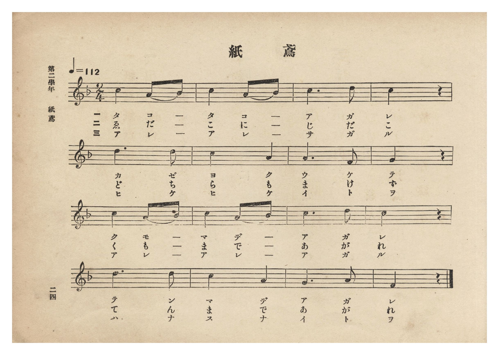
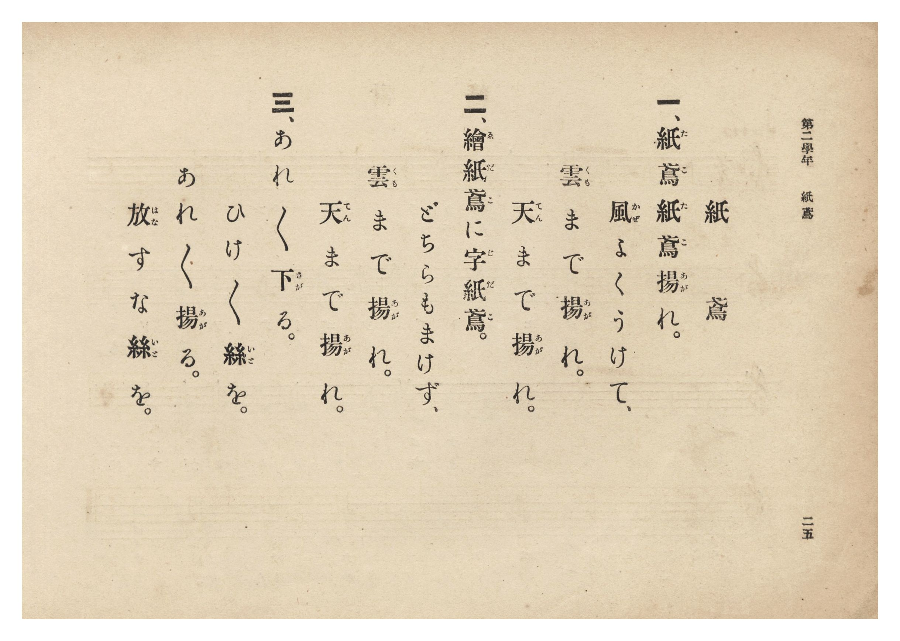

# 紙鳶

> Re:Shōka 使用 AI 協助辨識與重建樂譜，可能會有錯誤。歡迎回報。

- **鋼琴伴奏版**：<br><audio controls src="tako.mp3"></audio>
- **NEUTRINO 歌聲合成版**：<br><audio controls src="tako_neutrino.mp3"></audio>

- 詞：文部省《尋常小學唱歌》
- 曲：文部省《尋常小學唱歌》
- 臺灣總督府《公學校唱歌集》（大正四年三月，索書號 0725 26）

## 說明

原書資訊與歌詞全文（對應 P030.jpg–P031.jpg，原書 p. 24–25，第二學年第 5 首）：
調性與拍號：ヘ長調 2/4 拍子，♩=112


## 歌詞

```text
一、紙鳶（たこ）紙鳶（たこ）揚（あが）れ。
風（かぜ）よくうけて、
雲（くも）まで揚（あが）れ。
天（てん）まで揚（あが）れ。

二、繪紙鳶（ゑだこ）に字紙鳶（じだこ）。
どちらもまけず、
雲（くも）まで揚（あが）れ。
天（てん）まで揚（あが）れ。

三、あれ〻下（さが）る。
ひけ〻絲（いと）を。
あれ〻揚（あが）る。
放（はな）すな絲（いと）を。
```

## ABC

<div class="abc-score" data-abc-src="tako.abc" aria-label="五線譜載入中"></div>

[下載 ABC 原始檔](tako.abc)

## TMD 檔案連結

- [主旋律 TMD 檔案](tako.tmd) [[在 TMD Studio 編輯](https://tmdlang.github.io/Tmd-TS/#tmd=s7IKdvYPcrWy4qpTUCpJTLdSSM7PyUlNLsnMz7PKzk9PzM7Ojy_OyM9OLM4ojTe0NDRVgqssy88pzU21Si9KTEmNN0KIF-eXFiWnWhUnZ-Tn58SXpFaUJOXnZ6PLxxckpqdaBRgYGyBkCoryy1LzEvOAuguKMvNKUlPA2hEKUssyU1JB0sXJiXnxZalFmWmZqSlITkotKga5HGpFSVFiXnFyUWYByDsIVflFJRn5QGcXZFRaZWQWl-QXZSYn5sRnJ-YlIhSVZKQCPVeQk1iJrDEzPTPPKjc_L6kUGChKXFpaCs-3zHy5eZuClhaXoq2CoaERl72tghuXjZG-iR1I34uV897vmfVsWvvL5hXP5zQ-buh6uqH76Y4dTzf0P1274-mUjc_W9jxu6Abb8Wz2JqLVvmjf9bxx8fMde5_PXfx01xyQ2tY1QFXPFiyEKHw5uw2o9v2ejqdLlj9bu_jp7NlPd255sqPz2ZyO93t6nm9Z9Gz2jhcz5ysYmBuZKhiZvd_TqcTFpa-lYEstwKWgoPC0bz7Ims3tL1Z0vehoBzoLGB5PW1cA_Qhy2YbeZ-2dCqA0oJdVkP6oYTKQaQhiAl0I0apQoKdgZAKUMTIFuXrNmie7ekBhsXMLkK1gqvBy2TSgy4GhBrLtxar9zxqWg-zp7gV6DSj6uHnGy6nbgeIKwPhQAAo_XTsBaM6jmSttQVEF0vRkR8PjhkZILALd9Lhx_uPGyUAzMUWe9c8Cc5seN_YAuY-bgJHRBDLi5aIVYInux41zwBJAdv_jxrbHjRMfNy4Dmg5WBIpcsERTE0hR477HjctxGvl0yUqwxLLHTSCr8akGe2IXkNn4fOcqhKubgHYvgDj8cePqp2unI3loBkIKYt3jxpWPGxc-bgKaCTQcaBdQ8yy6OHwH0AmNIBmQ2O4nO0Ap9nHjVJjCbrgDN4Ec1bD7-VaIa1oeNwIDHahiElwF1AwMy2BmPJuyDyyx_nHjKrDTZgIZOM2jPANAgYKWPhdXSGJ2vlVAZmJevkONQU01yAIFG0MzLTswC1u2UwAl9h0NLxb2KGiYKACLgOfrG3TgeUUTiwagPSDDaoDZQhcMjYHYBIjxiYCgGYqIAZSuAZvmY1gDDNr5UDFgooHJ4hRtQjIZGAUQ0SYQDYLxqKYbgeQmwlUvQDIHZiYw9SKJzkAxHaQeWS2a6cbI7kG4AbfoVKxu78YwHX-s7eohJ9ZAsYA9RkCxBnEhjAWChmARIygPW6zB3A3xzRyobzrgIv1IPm9DUQuKEZDoMgyfw2OtcSWKjoVQ0zthIk2wEAap3YfV9FnYTQfH2iasOmCiEBGY6S0oaldAXTIJw3QCea1zcOQ1WKxgD0FgaYokSnJeo53pJOc17KaTmNeAzRpa5TVYzoKJ1oBzHK5Yg-UUiD9B5RE1Y41mpoNjbT2KjlVQc2aiiMBMJzav1XJx6dopgKo9BSCtzAUA)]
- [鋼琴伴奏 TMD 檔案](tako_piano.tmd) [[在 TMD Studio 編輯](https://tmdlang.github.io/Tmd-TS/#tmd=s7IKdvYPcrWy4tLSUni-ZebLzdve7-l42b3n-YQtT_Zsebq0_3lnx_s9nQpaWlyKtgqGhkZc9rYKblw2Rvomdlx1CkovVs57v2fWs2ntL5tXPJ_T-Lih6-mG7qc7djzd0P907Y6nUzY-W9vzuKFbCaT22exNRKt90b7reePi5zv2Pp-7-OmuOSC1rWuAqp4tWAhR-HJ2G1At0LFPlyx_tnbx09mzn-7c8mRH57M5QPf2PN-y6NnsHS9mzlcwMDcyVTAyA_pBiYsrJDE73yogMzEvP8jDocagpppLAQhsDM207MAsfS0FW3Sg8HzNmic7Gl4s7FHQMFEAuvX5-gYdhQADYwO9rIJ0TSwatPTBhtUomCrogqExEJsAMT4REDRDETGA0jVg03wMaxQeN86Hij1unAyTxSnahGTy48YeiGgTiAbBeFTTjUByE-GqFyCZAzPzceNqJNEZKKaD1COrRTPdGNk9CDfgFp2K1e3dGKbjj7VdPeTEGigWsMcIKNYgLoSxQNAQLGIE5WGLNZi7Ib6ZA_VNB1ykH8nnbShqQTECEl2G4XN4rDWuRNGxEGp6J0ykCRbCILX7sJo-C7vp4FjbhFUHTBQiAjO9BUXtCqhLJmGYTiCvdQ6OvAaLFewh-LhxOZIoyXmNdqaTnNewm05iXgOWv7TKa7CcBROtAec4XLEGyykQf4LKI2rGGs1MB8faehQdq6DmzEQRgZlObF6rRa71fJBrPRNopQcMz3gF0_h4NEa0SSyEYQB1Y42CCZJotCEKA6QNoZB8A0Gqo03jkVQCPaBrpwDyQ7QPUAmcbYTENgazlbkA)]

## 分析

```text
================================================================================
📊 TMD Song Profile: [ 紙鳶 ]
================================================================================
⏱  Duration:       0:17 (17.1s), 16 measures total
🎼 Key & Tempo:    首調基準 F, != 112.0 BPM, <2/4>
   - 分析範圍：      由實際發聲的音符與和弦推測調性；播放脈絡另行呈現
🎤 人聲音域:    F4 (MIDI 65) – D5 (MIDI 74) [跨度: 9 個半音 / 0.8 個八度, 難度: easy]
   - 最低音:  F4 in [Tako #1 @ m.7, 0:07]
   - 最高音: D5 in [Tako #1 @ m.3, 0:02]
   - 適合: soprano, mezzo-soprano, contralto, tenor, baritone, bass
🏛  結構:      Tako (17.1s)
⚡ 編曲密度:        Peak 1 軌道同時演奏
🗝  調性診斷：       C 大調（流行色彩大調，未偵測到可信轉調）
   - 風格氣質:    流行大調（略帶和弦色彩音與裝飾副屬和弦）
   - 轉調歷程:    全曲維持單一推測調性（未偵測到可信轉調）
   - 核心骨幹音:  C, A, D, G, A#
   - 調性數值:    C 大調 [相關度: 0.71, 穩定度: Moderate, 自然音純度: 92.9%]
   - 候選調性 (K-S): C 大調 (0.71), A 小調 (0.67), F 大調 (0.61)
   - 五度圈歷程:   +0
   - 各段落調性細節:
     • [Tako #1]: C 大調 (r: 0.71, 自然音純度: 92.9%, 調外音: A#)

  [ 五度圈游移軌跡 ]
              [C ]*
         F            G  
      Bb               D  
      Eb               A  
         Ab           E  
            Db       B  
               F# 
     (* = active key center)

  [ 十二半音累積音高分佈 ]
     C  : ████████████████████████  39.3%
     C# :                            0.0%
     D  : ███████████               17.9%
     D# :                            0.0%
     E  :                            0.0%
     F  : ███                        5.4%
     F# :                            0.0%
     G  : █████                      8.9%
     G# :                            0.0%
     A  : █████████████             21.4%
     A# : ████                       7.1%
     B  :                            0.0%
--------------------------------------------------------------------------------
Assignment 軌道音域：
  - Piano         : F4 – D5 (9 個半音 / 0.8 個八度, 32 個音符)
================================================================================
```


## 原書掃描頁






