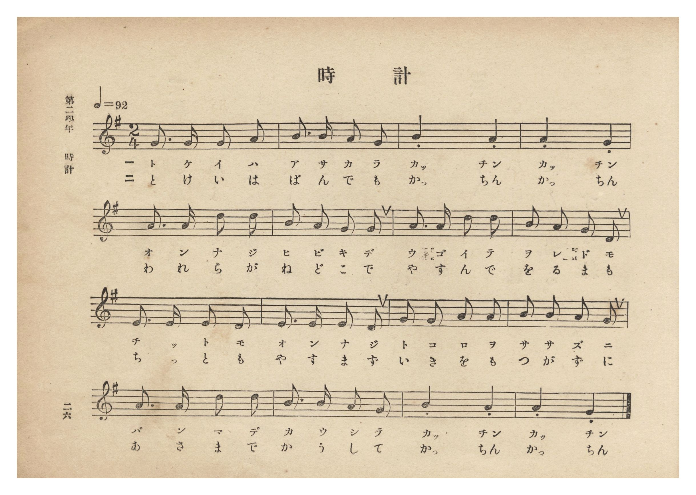
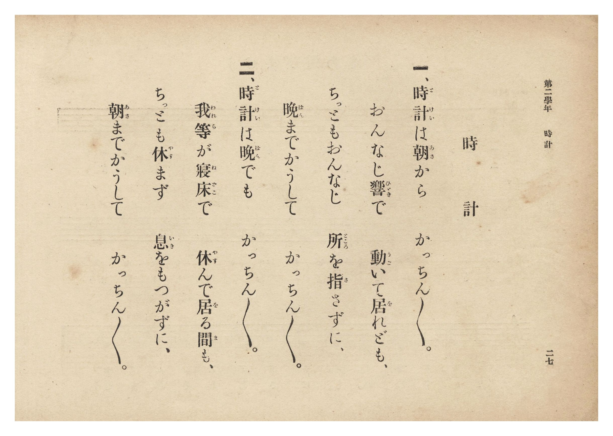

# 時計

> Re:Shōka 使用 AI 協助辨識與重建樂譜，可能會有錯誤。歡迎回報。

- **NEUTRINO 歌聲合成版**：<br><audio controls src="tokei_neutrino.mp3"></audio>
- **鋼琴伴奏版**：<br><audio controls src="tokei.mp3"></audio>


- 詞：文部省《尋常小學唱歌》
- 曲：文部省《尋常小學唱歌》
- 臺灣總督府《公學校唱歌集》（大正四年三月，索書號 0725 26）

## 說明

原書資訊與歌詞全文（對應 P032.jpg–P033.jpg，原書 p. 26–27，第二學年第 6 首）：
調性與拍號：ト長調 2/4 拍子，♩=92


## 跨冊／重複收錄參照

> 同曲（文部省『尋常小學唱歌』〈時計の歌〉；《公學校唱歌集》題為〈時計〉，《新定兒童唱歌》第二學年題為〈とけいのうた〉）

- **[同曲]** 《新定兒童唱歌》尋常科第二學年用（2020.006.0847.0002）：[**〈とけいのうた（時鐘之歌）〉**](../../shintei_jido_shoka/grade_2_2020.006.0847.0002/2_03_tokei_no_uta/index.md)（`G` / `2/4` — [原始 TMD](../../shintei_jido_shoka/grade_2_2020.006.0847.0002/2_03_tokei_no_uta/tokei_no_uta.tmd)）
- 總表：[跨冊重複與同名歌曲總索引](../../duplicate_songs.md)

## 歌詞

```text
一、時計（とけい）は朝（あさ）から　かっちん〻。
おんなじ響（ひゞき）で　動（うご）いて居（を）れども、
ちっともおんなじ　所（ところ）を指（さ）さずに、
晩（ばん）までかうして　かっちん〻。

二、時計（とけい）は晩（ばん）でも　かっちん〻。
我等（われら）が寢床（ねどこ）で　休（やす）んで居（を）る間（ま）も、
ちっとも休（やす）まず　息（いき）をもつかずに、
朝（あさ）までかうして　かっちん〻。
```

## ABC

```abc
X:1
T:時計
C:曲：文部省《尋常小學唱歌》
M:2/4
L:1/16
Q:1/4=92
K:G
V:V1 name="Piano" snm="Pia"
[V:V1]
G3 G G2 A2 | B3 B A2 G2 | B4 A4 | A4 G4 |
w: 1.~と け い は | あ さ か ら | かっ ちん | かっ ちん
w: 2.~と け い は | ば ん で も | かっ ちん | かっ ちん
A3 A d2 d2 | B2 A2 G2 G2 | A3 A d2 d2 | B2 A2 G2 D2 |
w: 1.~お ん な じ | ひ び き で | う ご い て | を れ ど も
w: 2.~わ れ ら が | ね ど こ で | や す ん で | を る ま も
E3 E E2 D2 | E3 E E2 D2 | G2 G2 A2 A2 | B2 B2 A2 G2 |
w: 1.~ち っ と も | お ん な じ | と こ ろ を | さ さ ず に
w: 2.~ち っ と も | や す ま ず | い き を も | つ が ず に
A3 A d2 d2 | B3 B A2 G2 | B4 A4 | A4 G4 |
w: 1.~ば ん ま で | か う し て | かっ ちん | かっ ちん
w: 2.~あ さ ま で | か う し て | かっ ちん | かっ ちん
```

## TMD 檔案連結

- [主旋律 TMD 檔案](tokei.tmd) [[在 TMD Studio 編輯](https://tmdlang.github.io/Tmd-TS/#tmd=s7IKdvYPcrWy4qpTUCpJTLdSSM7PyUlNLsnMz7PKzk9PzM7Ojy_OyM9OLM4ojTe0NDRVgqssy88pzU21Si9KTEmNN0KIF-eXFiWnWhUnZ-Tn58SXpFaUJOXnZ6PLxxckpqdaBRgYI-ksKMovS81LzAPqLijKzCtJTQFrRyhILctMSQVJFycn5sWXpRZlpmWmpiA5KbWoGORyqBUlRYl5xclFmQUg7yBU5ReVZOQDnV2QUWmVkVlckl-UmZyYE5-dmJeIUFSSkQr0XEpiZk5lfE5mWqoSl5aWwrOZTS9WdChoaXEp2ipYGnHZ2yq4c9kY6ZvYgfS9WDnv_Z5Zz6a1v2xe8XxO4-OGrqcbup_u2PF0Q__TtTueTtn4bG3P44ZusB3PZm8iWu2L9l3PGxc_37H3-dzFT3fNAaltXQNU9WzBQojCl7PbgGrf7-l4umT5s7WLn86e_XTnlic7Op_N6Xi_p-f5lkXPZu94MXO-goG5kamCkdn7PZ1KXFz6Wgq21AJcCgoKT_vmg6zZ3P5iRdeLjnags4Dh8bR1BdCPIJdt6H3W3qkAim-9rIL0Rw2TgUxjEBPoQohWhQI9oOOAMkbmIFevWfNkVw8oLHZuAbIVzBReLpsGdDkw1EC2vVi1_1nDcpA93b1ArwFFHzd3vJy6HSiuAIwPBaDw07UTgOY8mrnSFhhTID1PdjQ8bmiExCHQSY8bVzxunPi4sQVo6uPG9c_mzAULNj1unAoW6X7c1Pm4oQHEaFz8uHHh46bJjxt2P25oApn1uLELxG9c9bhxxsv5-8E6Nz1umve4sReseTlQ59NuoEFA8bbHjVPAgi2PG5c93dgKEmyaBBJp6nncuPJxUxPQWRBDF4KtWgESQrIAaNazzgaYkyc_bgLb0TTpWQ8oaGHunfq4cdbjxtVQs57NXAmW2wA0BSy9D-QokF-AzpkOdAh2r4HDaRcw6eEOJ3SDl4M9gCOcnnVMfL4WGGlAH_eDvNsEZAP19Dxdv-jpri6wQWtBYdAIM6uh4cmeiWD1wNCaCfYnMBSWowZb98tpQPVAvfvAXGzhh24KyP-zQAHZuB6sEygODUVwYC8BOx85_NCTA3HhB9RJeXaCAgUtfS6ukPzs1EyrgMzEvHyHGoOaapANCjaGZlp2YBa2XKwAyjs7Gl4s7FHQMFEAlijP1zfowLOeJhYNQItAhtUoGCroAqEhmDYC4hoFY7CIMZgHEoWJQORBsAbOgugGioBN8zGsAcbICrAIMAEBcQuYtR6sBxiyUJmpQNwNYjV1QmVAoQo1ChK4cJvwyEHsNMJv5waIDFAXMDbBLJAryLcTfxzs6iEnDiChaaRgCiRBGBLisPCHxAF-NabxaJHQheTtVWBfzIB6bROYtxlM9oJJULCAZNqg_p0CD8RlEJmmSWCzesBiKxGBiIiApn6ofT3QSAVmeKipaxG6GkHBCLevCWQHiD8T7E5kGYh94CTSuA_JPgIZoJOcwDcDBZ0uiAKzICGJQxQWHaBgR2QW5IhAjoOFUP8thiZQRNLDHTtgdZBwagLHDjgsQDJTwTIQchaYXI0aB7jtQw5pSHiCTQDpgcQzwiaEG5fAYxHVPrxxAGyIUC8DUFIIIWd7iI9hqRyUqkD8NiCeDmZBUznFhRBy8UZbO2u5uHTtFMAVhQKQocwFAA)]
- [鋼琴伴奏 TMD 檔案](tokei_piano.tmd) [[在 TMD Studio 編輯](https://tmdlang.github.io/Tmd-TS/#tmd=s7IKdvYPcrWy4tLSUng2s-nFio73ezpedu95PmHLkz1bni7tf94JFOlU0NLiUrRVsDTisrdVcOeyMdI3seOqU1B6sXLe-z2znk1rf9m84vmcxscNXU83dD_dsePphv6na3c8nbLx2dqexw3dSiC1z2ZvIlrti_ZdzxsXP9-x9_ncxU93zQGpbV0DVPVswUKIwpez24BqgW59umT5s7WLn86e_XTnlic7Op_NATq35_mWRc9m73gxc76CgbmRqYKRGdALSlxcIfnZqZlWAZmJeflBHg41BjXVXApAYGNopmUHZulrKdiiA4Xna9Y82dHwYmGPgoaJAtCxz9c36CgEGBgb6WUVpGti0aClDzasRsFQQRcIDcG0ERDXKBiDRYzBPJAoTAQiD4I1cBZEN1AEbJqPYY3C48YVYJHHjROBuAXMWg_W87ixCSozFYi7QaymTqhM9-PGxVCjHjcufNw0GW4THjmInUb47dwAkQHqety4HMwCuYJ8O_HHwa4ecuIAEppGCqZAEoQhIQ4Lf0gc4FdjGo8WCV1I3l4F9sUMqNc2gXmbwWQvmAQFC0imDerfKfBAXAaRaZoENqsHLLYSEYiICGjqh9rXA43Ux40g1SBT1yJ0NYKCEW5fE8gOEH8m2J3IMhD7wEmkcR-SfQQyQCc5gW8GCjpdEAVmQUIShygsOkDBjsgsyBGBHAcLof5bDE2giKSHO3bA6iDh1ASOHXBYgGSmgmUg5CwwuRo1DnDbhxzSkPAEmwDSA4lnhE0INy6BxyKqfXjjAFjGUS8DUFIIIWd7iI9hqRyUqkD8NiCeDmZBUznFhRBy8UZbO2tR6gkf5HrCBFpNABNrvEK0YSw6wzQexDKNh4pB1YL5ECm4aixiUNUmIBkTsAwSE0k9McZjcwzQX7p2CmCvRfsARRAcIzBHmQsA)]

## 分析

```text
================================================================================
📊 TMD Song Profile: [ 時計 ]
================================================================================
⏱  Duration:       0:20 (20.9s), 16 measures total
🎼 Key & Tempo:    首調基準 G, != 92.0 BPM, <2/4>
   - 分析範圍：      由實際發聲的音符與和弦推測調性；播放脈絡另行呈現
🎤 人聲音域:    D4 (MIDI 62) – D5 (MIDI 74) [跨度: 12 個半音 / 1.0 個八度, 難度: easy]
   - 最低音:  D4 in [Tokei #1 @ m.8, 0:10]
   - 最高音: D5 in [Tokei #1 @ m.5, 0:05]
   - 適合: soprano, mezzo-soprano, contralto, tenor, baritone, bass
🏛  結構:      Tokei (20.9s)
⚡ 編曲密度:        Peak 1 軌道同時演奏
🗝  調性診斷：       D 大調（純淨自然大調，未偵測到可信轉調）
   - 風格氣質:    純淨自然大調（陽光明朗、易唱易記，無明顯調外色彩）
   - 轉調歷程:    全曲維持單一推測調性（未偵測到可信轉調）
   - 核心骨幹音:  A, G, B, D, E
   - 調性數值:    D 大調 [相關度: 0.68, 穩定度: Moderate, 自然音純度: 100.0%]
   - 候選調性 (K-S): D 大調 (0.68), G 大調 (0.64), A 大調 (0.55)
   - 五度圈歷程:   +2
   - 各段落調性細節:
     • [Tokei #1]: D 大調 (r: 0.68, 自然音純度: 100.0%)

  [ 五度圈游移軌跡 ]
               C  
         F            G  
      Bb              [D ]*
      Eb               A  
         Ab           E  
            Db       B  
               F# 
     (* = active key center)

  [ 十二半音累積音高分佈 ]
     C  :                            0.0%
     C# :                            0.0%
     D  : ██████████                14.1%
     D# :                            0.0%
     E  : ███████                    9.4%
     F  :                            0.0%
     F# :                            0.0%
     G  : ████████████████          23.4%
     G# :                            0.0%
     A  : ████████████████████████  34.4%
     A# :                            0.0%
     B  : █████████████             18.7%
--------------------------------------------------------------------------------
Assignment 軌道音域：
  - Piano         : D4 – D5 (12 個半音 / 1.0 個八度, 56 個音符)
================================================================================
```


## 原書掃描頁






