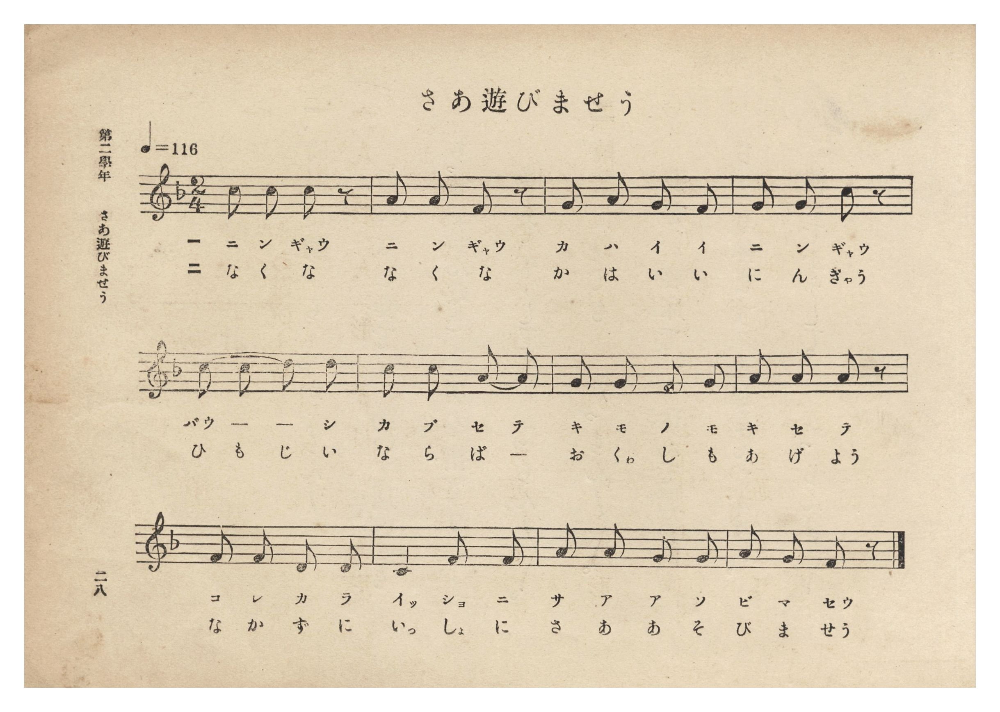
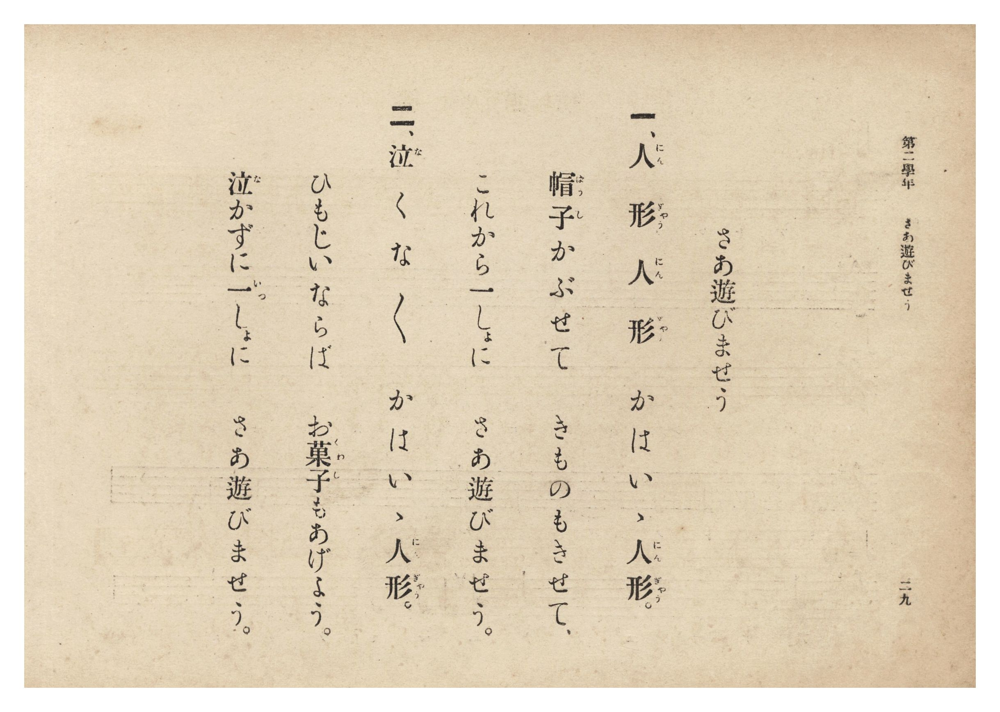

# さあ遊びませう

> Re:Shōka 使用 AI 協助辨識與重建樂譜，可能會有錯誤。歡迎回報。

- **NEUTRINO 歌聲合成版**：<br><audio controls src="saa_asobimasho_neutrino.mp3"></audio>
- **鋼琴伴奏版**：<br><audio controls src="saa_asobimasho.mp3"></audio>


- 詞：公學校用國民讀本
- 曲：宮島慎三郎
- 臺灣總督府《公學校唱歌集》（大正四年三月，索書號 0725 26）

## 說明

原書資訊與歌詞全文（對應 P034.jpg–P035.jpg，原書 p. 28–29，第二學年第 7 首）：
調性與拍號：ヘ長調 2/4 拍子，♩=116
作曲：臺灣總督府國語學校助教授 宮島慎三郎


## 歌詞

```text
一、人形（にんぎゃう）人形（にんぎゃう）　かはいゝ人形（にんぎゃう）。
帽子（ばうし）かぶせて　きものもきせて、
これから一（いっ）しょに　さあ遊（あそ）びませう。

二、泣（な）くな　なく〻　かはいゝ人形（にんぎゃう）。
ひもじいならば　お菓子（くわし）もあげよう。
泣（な）かずに一（いっ）しょに　さあ遊（あそ）びませう。
```

## ABC

```abc
X:1
T:さあ遊びませう
C:曲：宮島慎三郎
M:2/4
L:1/16
Q:1/4=116
K:F
V:V1 name="Piano" snm="Pia"
[V:V1]
c2 c2 c2 z2 | A2 A2 F2 z2 | G2 A2 G2 F2 | G2 G2 c2 z2 |
w: 1.~に ん ぎゃう | に ん ぎゃう | か は い い | に ん ぎゃう
w: 2.~な く な | な く な | か は い い | に ん ぎゃう
c2 c2 d2 d2 | c2 c2 A2 A2 | G2 G2 F2 G2 | A2 A2 A2 z2 |
w: 1.~ばう _ _ し | か ぶ せ て | き も の も | き せ て
w: 2.~ひ も じ い | な ら ば _ | お くゎ し も | あ げ よう
F2 F2 D2 D2 | C4 F2 F2 | A2 A2 G2 G2 | A2 G2 F2 z2 |
w: 1.~こ れ か ら | いっ しょ に | さ あ あ そ | び ま せう
w: 2.~な か ず に | いっ しょ に | さ あ あ そ | び ま せう
```

## TMD 檔案連結

- [主旋律 TMD 檔案](saa_asobimasho.tmd) [[在 TMD Studio 編輯](https://tmdlang.github.io/Tmd-TS/#tmd=s7IKdvYPcrWy4qpTUCpJTLdSSM7PyUlNLsnMz7PKzk9PzM7Ojy_OyM9OLM4ojTe0NDRVgqssy88pzU21Si9KTEmNN0KIF-eXFiWnWhUnZ-Tn58SXpFaUJOXnZ6PLxxckpqdaBRgYmyBkCoryy1LzEvOAuguKMvNKUlPA2hEKUssyU1JB0sXJiXnxZalFmWmZqSlITkotKga5HGpFSVFiXnFyUWYByDsIVflFJRn5QGcXZFRaZWQWl-QXZSYn5sRnJ-YlIhSVZKQCPVeQk1iJrDEzPTPPqiQxsxxofX5aWmZyZmKOEpeWlsLjxqmPG5teNnY9btz8uHHf48bZjxvbFLS0uBRtFQwNzbjsbRXcuGyM9E3sQKa9WDnv_Z5ZT1vXPF2749mChc-nrHg6p_vZhokv1jU8m7MGbOGz2ZtAState7p527PWvic7Ol8294FlXrTvet64-PmOvc_nLn66a87jhi64QU-nbHy2tufl7LbHDd3v93Q8XbL82drFT2fPfrpzC9CAZ3M63u_peb5l0bPZO17MnK9gYG5kqmBk9n5PpxIXl76Wgi21AJeCgsLTvvkgaza3v1jR9aKjHegsoKeftq54Nq0d5LINvc_aOxVA0a-XVZD-qGEykGkKYgJdCNGqUKCnYGQBlDGyBLl6zZonu3qAvgR6BchWMFd4uWwa0OXAMALZ9mLV_mcNy0H2dPcCvQYUfdw84-XU7UBxBWCgKwCFn66dADTn0cyVtqD4AOp5sncOJJDRAhQYFS9WzYMGaNfKZ1NnPuvrUECLCS6wCTsaHjc0Ptm16-neRUBPPW5c_bhp8uPGvsdNzcDYB7oOj9TjhobHjd2PG9c_bmx53DQXr8omcIDu2Av2AlDFBqDE48bpIDmQEdvAqW0Z2MTex01NjxvXgclemHgjSP_jxsmPm3pAGpo6gQ4HG9TyuHEx2JTpj5vaQTaDjIAmZLACoClzwQoQiRrkHLDnd_UATX62GWgAUOEqsKp-IANsxioQu2E3yZ583LgJ7PQZYLetAjoV5FuQKV0v-ifD_N__uAloE9j_IMVANOlxE1Ac7DagKaiOAto_C2ghpX4Gmkt5zoACBS19Lq7gxETH4vykzFxg2ZpvFZCZmJfvUGNQUw2yScHGQssOzMCWLxVAuWFHw4uFPQoaJgpPN_Q_X9-gA89Mmlg0AO0DGVajYAqGBkCWMRAagllGQJYRkA1iGUFkwap9DGuAEbJaARhVQBoaVwrxQHW4RLuBeD0Qt4AxDnUQs41AsquAuB9MQ_Sj84kzD3847eohN5zMgBDCAoUVJHQMgRgSdsZo4QTKlAq6QAhMWXDHbwPi2UC8DCzSC3R8E5BeB6ahIlB51IDZBFU5A-5xYNA0dYKsAdoA4neBgupxUx_YOphxIC2TgDxQXiAiaHZ0khM0hkBoFg9CwMCJBzoHJAAJE1AIgVigcEINHWCcNfVAAgXoDZAIKB9CQguYD8ExCxKdCvUFCM8Fi2wG4n2gYMKefEChPAuunWxDa7m4dO0UULKkAlBAmQsA)]
- [鋼琴伴奏 TMD 檔案](saa_asobimasho_piano.tmd) [[在 TMD Studio 編輯](https://tmdlang.github.io/Tmd-TS/#tmd=s7IKdvYPcrWy4tLSUnjcOPVxY9PLxq7HjZsfN-573Dj7cWPb-z0dL7v3PJ-w5cmeLU-X9j_v7Hi_p1NBS4tL0VbB0NCMy95WwY3LxkjfxI6rTkHpxcp57_fMetq65unaHc8WLHw-ZcXTOd3PNkx8sa7h2Zw1SiAlz2ZvAilZt-7p5m3PWvue7Oh82dwHlnnRvut54-LnO_Y-n7v46a45jxu64AY9nbLx2dqel7PbHjd0A130dMnyZ2sXP509--nOLUADns0BOqrn-ZZFz2bveDFzvoKBuZGpgpEZ0KFKXFzBiYmOxflJmbmJxRn5VgGZiXn5QR4ONQY11VwKQGBjoWUHZuhrKdiiA4Xna9Y82dHwYmGPgoaJwtMN_c_XN-goBBgYm-hlFaRrYtGgpQ82rEbBFAwNgCxjIDQEs4yALCMgG8QygsiCVfsY1gADf7XC46bJQLrvcVMzMOAV4oHqcIl2A_F6IG4BYxzqIGYbgWRXAXE_mIboR-cTZx7-cNrVQ244mQEhhAUKK0joGAIxJOyM0cJpA8g5ukD4uHE63PHbgHg2EC8Di_QCHd8EpNeBaagIVB41YDZBVc6AexwYNE2dIGuANoD4XaCgetzUB7YOZhxIyyQgr4O4oNnRSU7QGAKhWTwIAQMnHugckAAkTEAhBGKBwgk1dIBx1tQDCRSgN0AiLY8bF0NC63FTOzhmQaJTob4A4blgkc1AvA8UTNiTDyiUZ8G1k21oLdYc6YOcI02gORIYAvEK0YaxyAzTeBSWaTyQiaTYBEMxCIOFYMEEVQjSiGo-2CyYSqAzde0UUFwa7QNUiiloBBZU5gIA)]

## 分析

```text
================================================================================
📊 TMD Song Profile: [ さあ遊びませう ]
================================================================================
⏱  Duration:       0:12 (12.4s), 12 measures total
🎼 Key & Tempo:    首調基準 F, != 116.0 BPM, <2/4>
   - 分析範圍：      由實際發聲的音符與和弦推測調性；播放脈絡另行呈現
🎤 人聲音域:    C4 (MIDI 60) – D5 (MIDI 74) [跨度: 14 個半音 / 1.2 個八度, 難度: moderate]
   - 最低音:  C4 in [SaaAsobimasho #1 @ m.10, 0:09]
   - 最高音: D5 in [SaaAsobimasho #1 @ m.5, 0:04]
   - 適合: soprano, mezzo-soprano, contralto, tenor, baritone, bass
🏛  結構:      SaaAsobimasho (12.4s)
⚡ 編曲密度:        Peak 1 軌道同時演奏
🗝  調性診斷：       C 調性不明確（純淨自然大調，未偵測到可信轉調）
   - 風格氣質:    純淨自然大調（陽光明朗、易唱易記，無明顯調外色彩）
   - 轉調歷程:    全曲維持單一推測調性（未偵測到可信轉調）
   - 核心骨幹音:  A, C, G, F, D
   - 調性數值:    C 調性不明確 [相關度: 0.76, 穩定度: Ambiguous, 自然音純度: 100.0%]
   - 候選調性 (K-S): C 大調 (0.76), F 大調 (0.74), A 小調 (0.69)
   - 五度圈歷程:   +0
   - 各段落調性細節:
     • [SaaAsobimasho #1]: C 調性不明確 (r: 0.76, 自然音純度: 100.0%)

  [ 五度圈游移軌跡 ]
              [C ]*
         F            G  
      Bb               D  
      Eb               A  
         Ab           E  
            Db       B  
               F# 
     (* = active key center)

  [ 十二半音累積音高分佈 ]
     C  : ██████████████████████    23.3%
     C# :                            0.0%
     D  : █████████                  9.3%
     D# :                            0.0%
     E  :                            0.0%
     F  : █████████████████         18.6%
     F# :                            0.0%
     G  : ██████████████████████    23.3%
     G# :                            0.0%
     A  : ████████████████████████  25.6%
     A# :                            0.0%
     B  :                            0.0%
--------------------------------------------------------------------------------
Assignment 軌道音域：
  - Piano         : C4 – D5 (14 個半音 / 1.2 個八度, 42 個音符)
================================================================================
```


## 原書掃描頁






