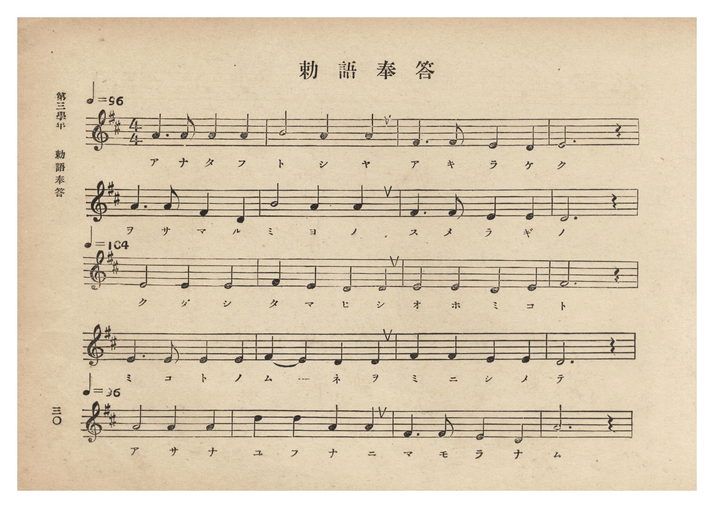
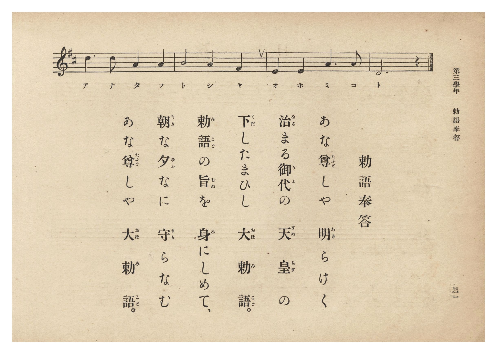

# 勅語奉答

> Re:Shōka 使用 AI 協助辨識與重建樂譜，可能會有錯誤。歡迎回報。

- **鋼琴伴奏版**：<br><audio controls src="chokugo_hoto.mp3"></audio>
- **NEUTRINO 歌聲合成版**：<br><audio controls src="chokugo_hoto_neutrino.mp3"></audio>

- 曲：宮島慎三郎
- 臺灣總督府《公學校唱歌集》（大正四年三月，索書號 0725 26）

## 說明

原書資訊與歌詞全文（對應 P036.jpg–P037.jpg，原書 p. 30–31，第三學年第 1 首）：
調性與拍號：ニ長調 4/4 拍子，速度 ♩=96 → ♩=104 → ♩=96
作曲：臺灣總督府國語學校助教授 宮島慎三郎


## 歌詞

```text
あな尊（たふと）しや　明（あき）らけく
治（をさ）まる御代（みよ）の　天皇（すめらぎ）の
下（くだ）したまひし　大勅語（おほみこと）。
勅語（みこと）の旨（むね）を　身（み）にしめて、
朝（あさ）な夕（ゆふ）なに　守（まも）らなむ
あな尊（たふと）しや　大勅語（おほみこと）。
```

## ABC

<div class="abc-score" data-abc-src="chokugo_hoto.abc" aria-label="五線譜載入中"></div>

[下載 ABC 原始檔](chokugo_hoto.abc)

## TMD 檔案連結

- [主旋律 TMD 檔案](chokugo_hoto.tmd) [[在 TMD Studio 編輯](https://tmdlang.github.io/Tmd-TS/#tmd=s7IKdvYPcrWy4qpTUCpJTLdSSM7PyUlNLsnMz7PKzk9PzM7Ojy_OyM9OLM4ojTe0NDRVgqssy88pzU21Si9KTEmNN0aIF-eXFiWnWhUnZ-Tn58SXpFaUJOXnZ6PLxxckpqdaBRgYmyFkCoryy1LzEvOAuguKMvNKUlPA2hEKUssyU1JB0sXJiXnxZalFmWmZqSlITkotKga5HGpFSVFiXnFyUWYByDsIVflFJRn5QGcXZFRaZWQWl-QXZSYn5sRnJ-YlIhSVZKQCPZeZWwC0JDEHXTw5tSg1Nz8PRQZoTHpmnlVJYmY50HH5aWmZyWB5LS2Fp92tL1bNe7q08_naKQpaWlyKtgqWZlz2tgouXDYm-iZ2IDOezd70fs-sp-vWPd287Vlr35MdnS-b-8Cmv2jf9bxx8fMde5_PXfx015zHDV1PW9c8Xbvj2YKFT6dsfLa25-XstscN3e_3dDxdsvzZ2sVPZ89-unML0IBnczre7-l5vmXRs9k7Xsycr2BgbmSqYGT2fk-nEheXvpaCLbUAl4KCwtO--SBrNre_WNH1oqMd6KwXK-c9bV3xbFo7yGUbep-1dyqA4lsvqyD9UcNkINMcxAS6EKJVoUBPwdgAKGNsCHL1mjVAHwB9CfQKkK1gqPBy2TSgy4FhBLLtxar9zxqWg-zp7gV6DSj6uLn75dTtQHEFYIgqAIWfrp0ANOdlw_ynu5YpPJq50tbSTOFR2yQw09DABM4GxgTQwCd750BiAC20n87pBkUdJLS7Vj6bOvNZX4cCWjRxgUx43Nj0uHHV0w1dQO8-bpz_uHHr48YVQBc_bpz-uKnlcUPDsxl9YCmgsl6QeBNQauLjxn6Q5mebdoPkmiY9bpwK1rPvcVP3030Ln-xeDNaz_3ETMC6B4uuABj1dsvL5LFCoPm6c-bipEWwQ0GiQLNgrO0BpAWjw48YFUPtBztn3uHETiA3SvxySIsHKuh437gZZ0DgZ6t6GJnB8IlQgyTWuezYdyAC6tOFx41qwLyYBTXyxazVEJVjNarCXGx83Lnvc0Aj23Zy5MJ9DfLfq6RIgA2hKGzCYICIgbUCnrQN6E6gS6P0mWBitAlpGVAAT5S_KUzsUKGjpc3E5A8vG0vR8j_ySfKuwfGAx4lBjUFMNskfBxkLLDszAltMUwOm74cXCHgUNE4WnG_qfr2_QgWcPTSwagLaBDKtRMFXQBUJTMA3CNQpmYBEIDyJiDOYbKxgBSUOwCIgFgwYgEbBpPjWgUAULAoMWiOeDWVvBWoDBBtUADGEQ2dQCFYfp6AWKdYJZE6Ey_UjWxIOtwR8Eu3ooCQKQNyHewx8EIFwDVok9CJomQT00FYj3gb3aDfXQflgQNHWAVayDis-EijbCg6APKgNSQUoQ7OgkJwiqFUGFWC08XhHeBHkcFu-IuIeJINTgSA2wGAQWHmASFPMgcUjKAAdO4yYUmS4wbzeYBAUXMMdBZWDph8igAFZc5AQFJAiM8AYBSAQmSig1QOMc5A2IF-Cx3tQAD5y1IBKcbmA6gAUYPFhA6QIis4y0IHiyawqZqcHSrBaaL5BzgWEcKAhABL7CAaYPZ-EAyRuQQgISEm1gHqiggIhBfA_SAUoioBBogucMmB5Y6BGbHFrXYoYFuM2ANyzAvgV7GnsJCfI-Ik_AihK8CYL0EhI9T0CSE_Y8UcvFpWungFSTKAC5ylwA)]
- [鋼琴伴奏 TMD 檔案](chokugo_hoto_piano.tmd) [[在 TMD Studio 編輯](https://tmdlang.github.io/Tmd-TS/#tmd=s7IKdvYPcrWy4tLSUnja3fpi1bynSzufr53yfk_Hy-49zydsebJny9Ol_c87O97v6VTQ0uJStFWwNOOyt1Vw4bIx0Tex46pTUHo2e9P7PbOerlv3dPO2Z619T3Z0vmzuUwLJvGjf9bxx8fMde5_PXfx015zHDV1PW9c8Xbvj2YKFT6dsfLa25-XstscN3UDbni5Z_mzt4qezZz_duQVowLM5QAt7nm9Z9Gz2jhcz5ysYmBuZKhiZAR2hxMXlnJGfXZqe75Ffkm8VkJmYlx_k4VBjUFPNpQAENhZadmCGvpaCLTpQeL5mzZMdDS8W9ihomCg83dD_fH2DjkKAgbGZXlZBuiYWDVr6YMNqFEwVdIHQFEyDcI2CGVgEwoOIGIP5xgpGQNIQLAJiwaABSARsmk-NwuPGJrDg48ZVQDwfzNoK1vK4cQVUw-PG6SCyqQUqDtPRCxTrBLMmQmX6kayJB1uDPwh29VASBCBvQryHPwhAuAasEnsQNE2CemgqEO8De7Ub6qH9sCBo6gCrWAcVnwkVbYQHQR9UBqSClCDY0UlOEFQr2hoamNTC4xXhTZDHYfGOiHuYCEINjtQAi8HHjQvAJCjmQeKQlAEOnMZNKDJdYN5uMAkKrseNk6EysPRDZFAAMx05QQEJAiO8QQASgYkSSg3QOAd5A-IFeKw3NcADZy2IBKcbmI7HjavhwQJKFxCZZaQFwZNdU8hMDZZmtdB8gZwLDONAQQAi8BUOMH04CwdI3oAUEpCQaAPzQAUFRAzie5AOUBIBhUATPGfA9MBCj9jk0LoWMyzMCYYF2LdgT2MvIUHeR-QJWFGCN0GQXkKi5wlIcsKeJ2qxVCQ-yBWJCaIiedHX9bK9F5hRnnX3Pl074emknheNmyBVI1IIxCtEG8bCqBoFEyDDJFbBNB5Im8aDRKBSIBEQBqYAmByIYQD1O06T4Hwkc1BNBlIIU2BlFYolGOohJuJXgzCTGLOIdh0o7-DQjNUwTJcSH2SEPQhMD7p2CkhJQgHIVeYCAA)]

## 分析

```text
================================================================================
📊 TMD Song Profile: [ 勅語奉答 ]
================================================================================
⏱  Duration:       0:58 (58.5s), 24 measures total
🎼 Key & Tempo:    首調基準 D, != 96.0 BPM, <4/4>
   - 分析範圍：      由實際發聲的音符與和弦推測調性；播放脈絡另行呈現
🎤 人聲音域:    D4 (MIDI 62) – D5 (MIDI 74) [跨度: 12 個半音 / 1.0 個八度, 難度: easy]
   - 最低音:  D4 in [ChokugoHoto #1 @ m.3, 0:06]
   - 最高音: D5 in [ChokugoHoto #1 @ m.18, 0:40]
   - 適合: soprano, mezzo-soprano, contralto, tenor, baritone, bass
🏛  結構:      ChokugoHoto (58.5s)
⚡ 編曲密度:        Peak 1 軌道同時演奏
🗝  調性診斷：       A 大調（純淨自然大調，未偵測到可信轉調）
   - 風格氣質:    純淨自然大調（陽光明朗、易唱易記，無明顯調外色彩）
   - 轉調歷程:    全曲維持單一推測調性（未偵測到可信轉調）
   - 核心骨幹音:  E, A, D, F#, B
   - 調性數值:    A 大調 [相關度: 0.83, 穩定度: Moderate, 自然音純度: 100.0%]
   - 候選調性 (K-S): A 大調 (0.83), D 大調 (0.77), F# 小調 (0.55)
   - 五度圈歷程:   +3
   - 各段落調性細節:
     • [ChokugoHoto #1]: A 大調 (r: 0.83, 自然音純度: 100.0%)

  [ 五度圈游移軌跡 ]
               C  
         F            G  
      Bb               D  
      Eb              [A ]*
         Ab           E  
            Db       B  
               F# 
     (* = active key center)

  [ 十二半音累積音高分佈 ]
     C  :                            0.0%
     C# :                            0.0%
     D  : █████████████████████     23.3%
     D# :                            0.0%
     E  : ████████████████████████  26.7%
     F  :                            0.0%
     F# : ███████████████           16.7%
     G  :                            0.0%
     G# :                            0.0%
     A  : ████████████████████████  26.7%
     A# :                            0.0%
     B  : ██████                     6.7%
--------------------------------------------------------------------------------
Assignment 軌道音域：
  - Vocal         : D4 – D5 (12 個半音 / 1.0 個八度, 73 個音符)
================================================================================
```


## 原書掃描頁






