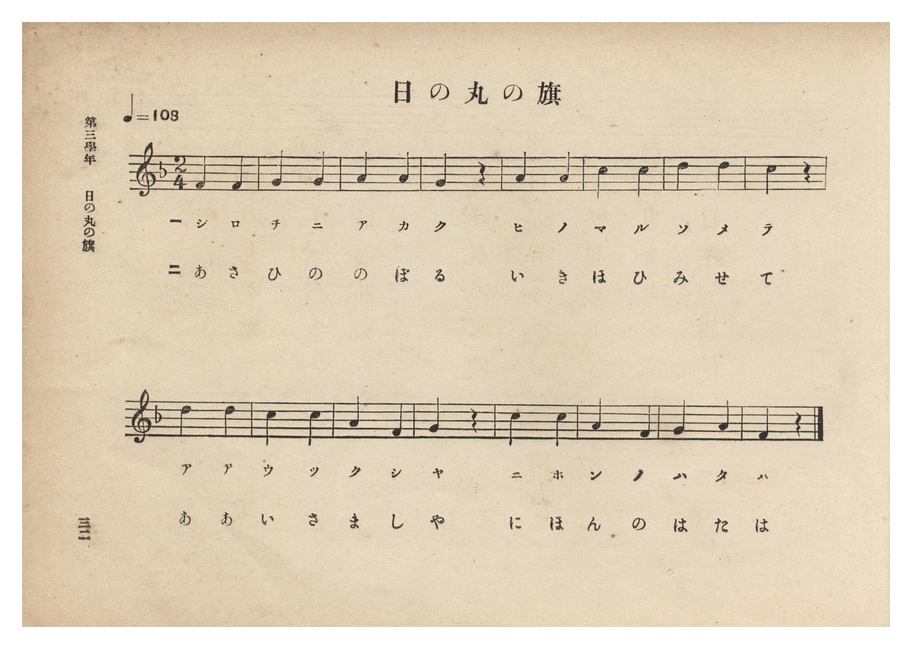
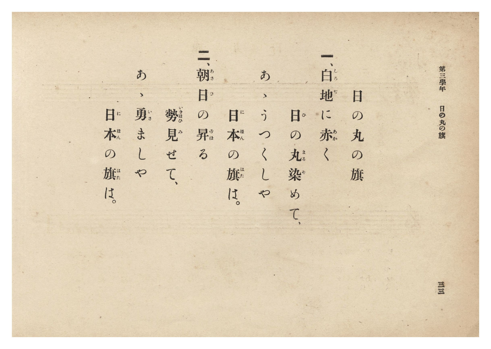

# 日の丸の旗

> Re:Shōka 使用 AI 協助辨識與重建樂譜，可能會有錯誤。歡迎回報。

- **NEUTRINO 歌聲合成版**：<br><audio controls src="hinomaru_no_hata_neutrino.mp3"></audio>
- **鋼琴伴奏版**：<br><audio controls src="hinomaru_no_hata.mp3"></audio>


- 詞：文部省《尋常小學唱歌》
- 曲：文部省《尋常小學唱歌》
- 臺灣總督府《公學校唱歌集》（大正四年三月，索書號 0725 26）

## 說明

原書資訊與歌詞全文（對應 P038.jpg–P039.jpg，原書 p. 32–33，第三學年第 2 首）：
調性與拍號：ヘ長調 2/4 拍子，♩=108


## 跨冊／重複收錄參照

> 同曲＋同名異曲（《公學校唱歌》第一學年、《公學校唱歌集》與《新定兒童唱歌》第一學年為文部省『尋常小學唱歌』〈日の丸の旗〉同曲；《新定兒童唱歌》第三學年為同名異曲）

- **[同曲]** 《公學校唱歌》第一學年用（昭和10年／1935）：[**〈ヒノマル ノ ハタ（日之丸旗）〉**](../../kogakko_shoka/grade_1/1_hinomaru_no_hata/index.md)（`F` / `2/4` — [原始 TMD](../../kogakko_shoka/grade_1/1_hinomaru_no_hata/hinomaru_no_hata.tmd)）
- **[同曲]** 《新定兒童唱歌》尋常科第一學年用（2020.006.0847.0001）：[**〈ヒノマルノハタ（日之丸旗）〉**](../../shintei_jido_shoka/grade_1_2020.006.0847.0001/1_01_hinomaru_no_hata/index.md)（`F` / `2/4` — [原始 TMD](../../shintei_jido_shoka/grade_1_2020.006.0847.0001/1_01_hinomaru_no_hata/hinomaru_no_hata.tmd)）
- **[同名異曲]** 《新定兒童唱歌》尋常科第三學年用（2020.006.0847.0003）：[**〈日の丸のはた（日之丸國旗）〉**](../../shintei_jido_shoka/grade_3_2020.006.0847.0003/2_03_hinomaru_no_hata/index.md)（`F` / `2/4` — [原始 TMD](../../shintei_jido_shoka/grade_3_2020.006.0847.0003/2_03_hinomaru_no_hata/hinomaru_no_hata.tmd)）
- 總表：[跨冊重複與同名歌曲總索引](../../duplicate_songs.md)

## 歌詞

```text
一、白地（しろぢ）に赤（あか）く
日（ひ）の丸（まる）染（そ）めて、
あゝうつくしや
日本（にほん）の旗（はた）は。

二、朝日（あさひ）の昇（のぼ）る
勢（いきほひ）見（み）せて、
あゝ勇（いさ）ましや
日本（にほん）の旗（はた）は。
```

## ABC

```abc
X:1
T:日の丸の旗
C:曲：文部省《尋常小學唱歌》
M:2/4
L:1/16
Q:1/4=108
K:F
V:V1 name="Piano" snm="Pia"
[V:V1]
F4 F4 | G4 G4 | A4 A4 | G4 z4 |
w: 1.~し ろ | ぢ に | あ か | く
w: 2.~あ さ | ひ の | の ぼ | る
A4 A4 | c4 c4 | d4 d4 | c4 z4 |
w: 1.~ひ の | ま る | そ め | て
w: 2.~い き | ほ ひ | み せ | て
d4 d4 | c4 c4 | A4 F4 | G4 z4 |
w: 1.~あ あ | う つ | く し | や
w: 2.~あ あ | い さ | ま し | や
c4 c4 | A4 F4 | G4 A4 | F4 z4 |
w: 1.~に ほ | ん の | は た | は
w: 2.~に ほ | ん の | は た | は
```

## TMD 檔案連結

- [主旋律 TMD 檔案](hinomaru_no_hata.tmd) [[在 TMD Studio 編輯](https://tmdlang.github.io/Tmd-TS/#tmd=s7IKdvYPcrWy4qpTUCpJTLdSSM7PyUlNLsnMz7PKzk9PzM7Ojy_OyM9OLM4ojTe0NDRVgqssy88pzU21Si9KTEmNN0aIF-eXFiWnWhUnZ-Tn58SXpFaUJOXnZ6PLxxckpqdaBRgYWyBkCoryy1LzEvOAuguKMvNKUlPA2hEKUssyU1JB0sXJiXnxZalFmWmZqSlITkotKga5HGpFSVFiXnFyUWYByDsIVflFJRn5QGcXZFRaZWQWl-QXZSYn5sRnJ-YlIhSVZKQCPZeZWwC0JDFHiUtLS-HZ9KWPG9c92bEDSD6bPl1BS4tL0VbB0MCCy95WwY3LxkjfxA6k_8XKee_3zHo2rf1l84rncxofN3Q93dD9dMeOpxv6n67d8XTKxmdrex43dIPtejZ7E9FqX7Tvet64-PmOvc_nLn66aw5IbesaoKpnCxZCFL6c3QZU-35Px9Mly5-tXfx09uynO7c82dH5bE7H-z09z7csejZ7x4uZ8xUMzI1MFYzM3u_pVOLi0tdSsKUW4FJQUHjaNx9kzeb2Fyu6XnS0A50FDI-nrSuAfgS5bEPvs_ZOBVC862UVpD9qmAxkWoKYQBdCtCoU6CkYGwFljI1Brl6zBugDUFjs3AJkKxgpvFw2DehyYKiBbHuxav-zhuUge7p7gV4Dij5unvFy6naguAIwPhSAwk_XTgCa82jmSltQVIE0PdnR8Lih8fnMvU_nbAC66XHj9MdNvY8bFwGNfdy4-sXWJWDBpseNwLAEivSD9AAjHywKjC6gECgVgLn7HjeBFD2bPxnMnQuSbWp83LgMaAFIG8iYprmPG9seNy4BmgS2qgVq3rM5a8CaVj9u3P24CWgAyGBgwgILrn_cCPQNUGT944YmiKt3AVNC47M5c2FOATpwKtxBz2aAghfIeNy4B-yIbnBkdAM9BRRtedwI9OBuiOoXy0Bp5HHjfrDO2eiOfdoNMQmoZypYxT5yXQ3UQHmaggIFLX0uLo_MvPzcxKJSv3yPxJJEq4DMxLx8hxqDmmqQVQo2Jlp2YAa2JK0ATkgNLxb2KGhYKACz1_P1DTrwdKiJRQPQQpBhNQqGQFgDTHhGQNIYCEFsAzjbFAhrFMyAEMQGioN1-RjWAINzugIwYQHFgWkLiFeDWU1A3A1m9SvEg-lNQLwOzNoHVA-RmwtkNYJZy0CqIGYawfRPRdO3Doj3gFhA3RAzW4AYYvNusEoQaz8Qz0YyE39Y7eohJ6xg4QAKE2NouIHCClUEFG6GaGEF8lcT2HVtQLwEGkKgMAT5qwXqr9VgH4FEJsN9vx6I50NZmGEFMRMUHpBQA4YxGWbWcnHp2imgpj8FoIgyFwA)]
- [鋼琴伴奏 TMD 檔案](hinomaru_no_hata_piano.tmd) [[在 TMD Studio 編輯](https://tmdlang.github.io/Tmd-TS/#tmd=s7IKdvYPcrWy4tLSUng2fenjxnVPduwAks-mT3-_p-Nl957nE7Y82bPl6dL-550d7_d0KmhpcSnaKhgaWHDZ2yq4cdkY6ZvYcdUpKL1YOe_9nlnPprW_bF7xfE7j44aupxu6n-7Y8XRD_9O1O55O2fhsbc_jhm4lkNpnszcRrfZF-67njYuf79j7fO7ip7vmgNS2rgGqerZgIUThy9ltQLVAxz5dsvzZ2sVPZ89-unPLkx2dz-YA3dvzfMuiZ7N3vJg5X8HA3MhUwcgM6AclLi6PzLz83MSiUr98j8SSRKuAzMS8_CAPhxqDmmouBSCwMdGyAzP0tRRs0YHC8zVrnuxoeLGwR0HDQgHo6OfrG3QUAgyMLfSyCtI1sWjQ0gcbVqNgCIQ1CkZAWKNgDIQgtgGcbQqENQpmQAhiA8XBunwMaxQeN05XeNzUCxR_3LgIiFeDWU1A3A1m9SvEg-lNQLwOzNoHVA-RmwtkNYJZy0CqIGYawfRPRdO3Doj3gFhA3RAzW4AYYvNusEoQaz8Qz0YyE39Y7eohJ6xg4QAKE2NouIHCClUEFG6GaGEF8lcT2HVtQLwEGkKgMAT5qwXqr9VgH4FEJsN9vx6I50NZmGEFMRMUHpBQA4YxGWbWYk9-PtiSH9Bv8QrRhrEgb8cDWabxICaKGChI4AJwhgmQYQIVgQUOqiiaBtxGoVoMMgzoA107BVRPRPsAFWMRNQKLKnMBAA)]

## 分析

```text
================================================================================
📊 TMD Song Profile: [ 日の丸の旗 ]
================================================================================
⏱  Duration:       0:17 (17.8s), 16 measures total
🎼 Key & Tempo:    首調基準 F, != 108.0 BPM, <2/4>
   - 分析範圍：      由實際發聲的音符與和弦推測調性；播放脈絡另行呈現
🎤 人聲音域:    F4 (MIDI 65) – D5 (MIDI 74) [跨度: 9 個半音 / 0.8 個八度, 難度: easy]
   - 最低音:  F4 in [HinomaruNoHata #1 @ m.1, 0:00]
   - 最高音: D5 in [HinomaruNoHata #1 @ m.7, 0:06]
   - 適合: soprano, mezzo-soprano, contralto, tenor, baritone, bass
🏛  結構:      HinomaruNoHata (17.8s)
⚡ 編曲密度:        Peak 1 軌道同時演奏
🗝  調性診斷：       F 調性不明確（純淨自然大調，未偵測到可信轉調）
   - 風格氣質:    純淨自然大調（陽光明朗、易唱易記，無明顯調外色彩）
   - 轉調歷程:    全曲維持單一推測調性（未偵測到可信轉調）
   - 核心骨幹音:  C, A, F, G, D
   - 調性數值:    F 調性不明確 [相關度: 0.77, 穩定度: Ambiguous, 自然音純度: 100.0%]
   - 候選調性 (K-S): F 大調 (0.77), C 大調 (0.76), A 小調 (0.73)
   - 五度圈歷程:   -1
   - 各段落調性細節:
     • [HinomaruNoHata #1]: F 調性不明確 (r: 0.77, 自然音純度: 100.0%)

  [ 五度圈游移軌跡 ]
               C  
        [F ]*          G  
      Bb               D  
      Eb               A  
         Ab           E  
            Db       B  
               F# 
     (* = active key center)

  [ 十二半音累積音高分佈 ]
     C  : ████████████████████████  25.0%
     C# :                            0.0%
     D  : ██████████████            14.3%
     D# :                            0.0%
     E  :                            0.0%
     F  : █████████████████         17.9%
     F# :                            0.0%
     G  : █████████████████         17.9%
     G# :                            0.0%
     A  : ████████████████████████  25.0%
     A# :                            0.0%
     B  :                            0.0%
--------------------------------------------------------------------------------
Assignment 軌道音域：
  - Piano         : F4 – D5 (9 個半音 / 0.8 個八度, 28 個音符)
================================================================================
```


## 原書掃描頁






