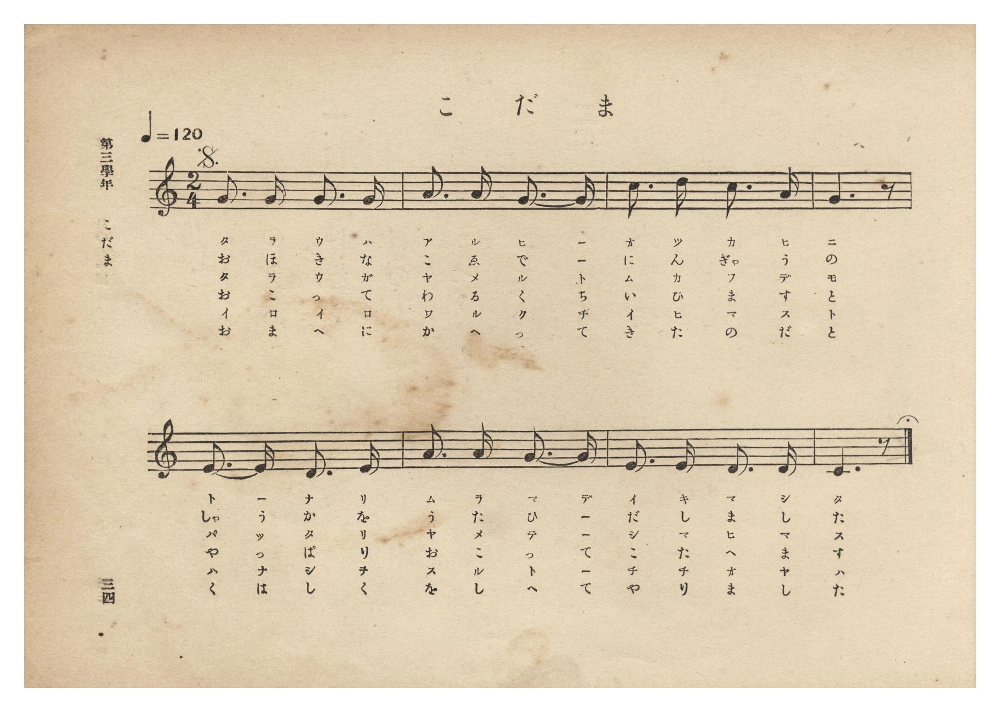
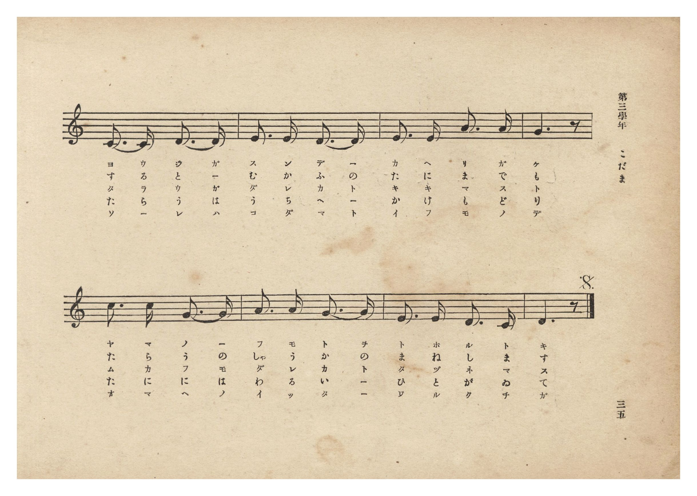
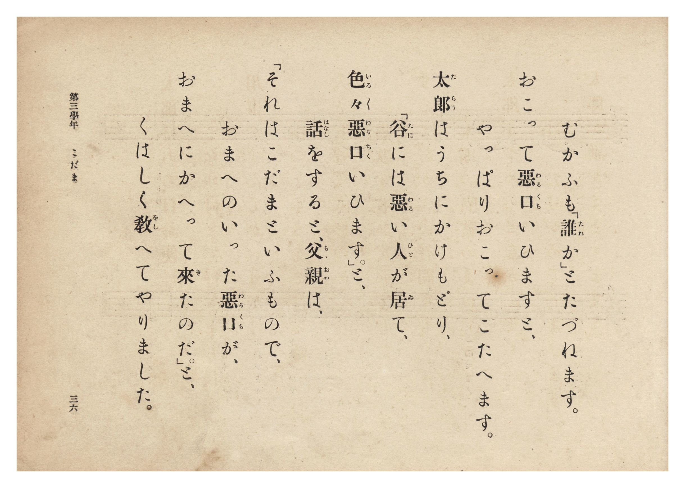
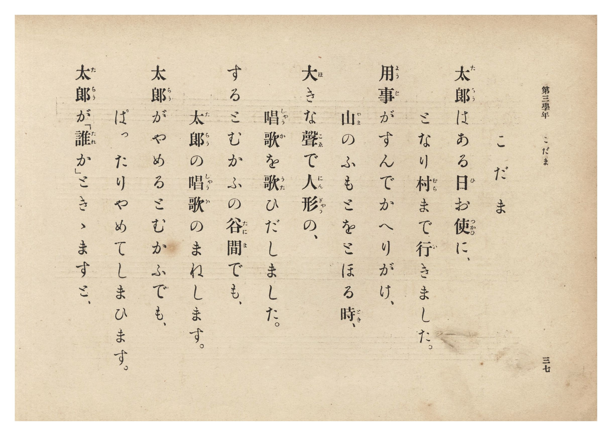

# こだま

> Re:Shōka 使用 AI 協助辨識與重建樂譜，可能會有錯誤。歡迎回報。

- **NEUTRINO 歌聲合成版**：<br><audio controls src="kodama_neutrino.mp3"></audio>
- **鋼琴伴奏版**：<br><audio controls src="kodama.mp3"></audio>


- 詞：公學校用國民讀本
- 曲：宮島慎三郎
- 臺灣總督府《公學校唱歌集》（大正四年三月，索書號 0725 26）

## 說明

原書資訊與歌詞全文（對應 P040.jpg–P043.jpg，原書 p. 34–37，第三學年第 3 首）：
調性與拍號：ハ長調 2/4 拍子，♩=120（D.S. 反覆於第 8 小節延長記號處結束）
作曲：臺灣總督府國語學校助教授 宮島慎三郎


## 歌詞

```text
一、太郎（たらう）はある日（ひ）お使（つかひ）に、
となり村（むら）まで行（い）きました。
用事（ようじ）がすんでかへりがけ、
山（やま）のふもとをとほる時（とき）、

二、大（おほ）きな聲（こゑ）で人形（にんぎゃう）の、
唱歌（しゃうか）を歌（うた）ひだしました。
するとむかふの谷間（たにま）でも、
太郎（たらう）の唱歌（しゃうか）のまねします。

三、太郎（たらう）がやめるとむかふでも、
ぱったりやめてしまひます。
太郎（たらう）が「誰（たれ）か」ときゝますと、
むかふも「誰（たれ）か」とたづねます。

四、おこって惡口（わるくち）いひますと、
やっぱりおこってこたへます。
太郎（たらう）はうちにかけもどり、
「谷（たに）には惡（わる）い人（ひと）が居（ゐ）て、

五、色々（いろいろ）惡口（わるくち）いひます。」と、
話（はなし）をすると、父親（ちゝおや）は、
「それはこだまといふもので、
おまへのいった惡口（わるくち）が、
（D.S. 返始結尾：おまへにかへって來（き）たのだ。」と、くはしく教（をし）へてやりました。）
```

## ABC

```abc
X:1
T:こだま
C:曲：宮島慎三郎
M:2/4
L:1/16
Q:1/4=120
K:C
V:V1 name="Piano" snm="Pia"
[V:V1]
G3 G G3 G | A3 A G3 G | c3 d c3 A | G6 z2 |
w: 1.~た ら う は | あ る ひ _ | お つ か ひ | に
w: 2.~お ほ き な | こ ゑ で _ | に ん ぎゃ う | の
w: 3.~た ら う が | や め る と | む か ふ で | も
w: 4.~お こ っ て | わ る く ち | い ひ ま す | と
w: 5.~い ろ い ろ | わ る く ち | い ひ ま す | と
E3 E D3 E | A3 A G3 G | E3 E D3 D | C6 z2 |
w: 1.~と _ な り | む ら ま で | い き ま し | た
w: 2.~しゃ う か を | う た ひ _ | だ し ま し | た
w: 3.~ぱ っ た り | や め て _ | し ま ひ ま | す
w: 4.~や っ ぱ り | お こ っ て | こ た へ ま | す
w: 5.~は な し を | す る と _ | ち ち お や | は
C3 C D3 D | E3 E D3 D | E3 E A3 A | G6 z2 |
w: 1.~よ う じ が | す ん で _ | か へ り が | け
w: 2.~す る と _ | む か ふ の | た に ま で | も
w: 3.~た ら う が | た れ か と | き き ま す | と
w: 4.~た ら う は | う ち に _ | か け も ど | り
w: 5.~そ _ れ は | こ だ ま と | い ふ も の | で
c3 c G3 G | A3 A G3 G | E3 E D3 C | D6 z2 |
w: 1.~や ま の _ | ふ も と を | と ほ る と | き
w: 2.~た ら う の | しゃ う か の | ま ね し ま | す
w: 3.~む か ふ も | た れ か と | た づ ね ま | す
w: 4.~た に に は | わ る い _ | ひ と が ゐ | て
w: 5.~お ま へ の | い っ た _ | わ る く ち | が
```

## TMD 檔案連結

- [主旋律 TMD 檔案](kodama.tmd) [[在 TMD Studio 編輯](https://tmdlang.github.io/Tmd-TS/#tmd=s7IKdvYPcrWy4qpTUCpJTLdSSM7PyUlNLsnMz7PKzk9PzM7Ojy_OyM9OLM4ojTe0NDRVgqssy88pzU21Si9KTEmNN0aIF-eXFiWnWhUnZ-Tn58SXpFaUJOXnZ6PLxxckpqdaBRiYGCBkCoryy1LzEvOAuguKMvNKUlPA2hEKUssyU1JB0sXJiXnxZalFmWmZqSlITkotKga5HGpFSVFiXnFyUWYByDsIVflFJRn5QGcXZFRaZWQWl-QXZSYn5sRnJ-YlIhSVZKQCPZeXWFJalIoumptflJiDbF5memaeVUliZjnQVflpaZnJmSB5LS2Fx42THzcueNy4T0FLi0vRVsHQyIDL3lbBmcvGSN_EDmTCi5Xz3u-Z9bR1zdO1O54tWPh8yoqnc7qfbZj4Yl3DszlrwJY8m70JpGTduqebtz1r7Xuyo_Nlcx9Y5kX7rueNi5_v2Pt87uKnu-Y8buiCG_R0ysZna3tezm573ND9fk_H0yXLn61d_HT27Kc7twANeDan4_2enudbFj2bvePFzPkKBuZGpgpGZu_3dCpxcelrKdhSC3ApKCg87ZsPsmZz-4sVXS862oHOAnr6aeuKZ9PaQS7b0PusvVMBlBL0sgrSHzVMBjKNQUygCyFaFQr0FIxNgDLG5iBXr1kD9AHQl0CvANkKxgovl00DuhwYRiDbXqza_6xhOcie7l6g14Cij5v7X07dDhRXAAa6AlD46doJQHMezVxpC4wPoBNc9IL1FJ72975Y1vZs2h6QmRYKTzf0P1_f8HT3NpDWFTOAJr2YOfX51gnP5gKN7ARZ9GTvHEjMoMUCMP5erJoHjYWulc-mznzW16GAFn1cYBN2NDxuaHy6ZBVQAOiMx43zHzd1Pm5sA1rwuHH948amx03dz6YvBUsBLQIKdj3Zux_MXfK4sRsmuBpoCMi4x40rHjeuetzU9WzuRJCipgagcWAV-x43Ln-xsAesswUs0gsWnA6ysqEJpBmY8J7sAqWUx01ARW2PG2eA1fU8bpz5uAmYiJeDLdwBNB0sOBFq59ONG8F6WoDmgTWse9y49XFTE8gtTZPALtoN8sXMJrDlQG4vSBlQMzgAdvWAA2A5WBJo8m6Y41a9AHkOKDj5cRPQM0DB5U927Xq6dxFYcDXYSX2Pm5phobUO5h5wsgcrmg6RBrobpKJpEkwcKAKKQmDogbMmMAxQQwLsY6BfgR5oAHt6K9D4Fxu2v5w2GRpJQPuhvl0O8irUZuzRuA6ni0BBBbR5LcwJM0H2Q5IFKIBwmNcDCuumRgwXIrnkcePGx42Lwdq6oKobl8FsAXoaZhduRwNjpefFqg0wcaDrgYLdjxuAEQOKwcdNc6GmALlQO-EuATkDj2Zg6C0FexrZx8ByCWgOOAUA4xXo9GXPmhc-7V8MTlr9YL_2P25cCDYJmNJgfkCyHSgK1LYRnDwRpoAZQBt3EONpYIYDRs1CcOwCLZwITsUrQSZCLQF6a8N2eBKAZr3G9UCnwt0JcSEwpULyLNCFkPB8urEVrAZY7gC5yxDpfwqQ-aJz0-MGsDzQc03AYAKRQIVEhUEDMLjBIQtx5IuV4PwI8swqYJRDUj4iRTc0Pu_Y9mLZKrCaheB4BCURqP_h_nzcOBcYcWBToPUXOO6A1kLyNjDlLocnNmBwA6WBQQwUhUTDfNwuB-V3kDZYqfti_5Sny7uB5erTDcAcNQvJNEgsABmgiHyyDxhHQCeDCw9Q8APtWoDsd7AVQOcCE3k_sMQFWw30NzgAQIYsA2cEiOHQvA4tximv46BAQUufi8s7PyUxN9EqIDMxL9-hxqCmGmSFgo2hmZYdmIWtblUA12gNLxc0QhjAklpBwwRaA-nAa0ZNLDqBVoJMrVEwVdAFQlM4XaNgBmaZIYkYxoGZRnEwlhlcIwQaAHEN2EAfwxpgzM4HiwKzCJDdBmE3rgfqAdZMUJluIHsTVDdIvAuqagkQd0PZm8Ayq5HsiUfYY4SsazcQ90LZq8C6JkPtmQhkL0eyB2IasBYAskHVAFRTG1hyHXarjHF5qQekq6kFKtMI9hZEZgVYpgHKA3l2K5S9HCwDCQYMm0yQPQVy4mIoexlYVz9S4EHZjQvBLoe6ARhkoCYjhD0TLLMCu02mSLqaelHY1LOJyIS7q4echGsMtshYwQhKY0u4qGqMQEkZyZHoqRbmAVAagni_CzkawVEP8zI4GuGBAQpAmMx0sAwkuWBPtaDaHKq4DZHcmyaBNcLS1ny0DLIAbjyRVoFT7UaoysVIKRjiKaRUC0xdCHumQ3Xsg9sPYoNkZmK3B5RmYaaB7YHaCbEHd2qGZVGwT3cQYxM4za6HqlyFcCs05CC6IGkWFpUg8YVQHQsRrgG6F2EW8Sl2Vw-eotaQYIqFpD1DpNSImT5hIrC0jLecbeqAeg2UjGZA2eBCCR4YoGBHLv9gBdQOcAQh65iIPdDBKRZH0GIt4NYhJUpQeYuWZ3AVffgLWbhMD5IfwIUsvNxHzoN4iz5wIYu7hoLxQMkFVvcghxywRoH6AdjIA_sIEo4Y9oCT61yoOMjlyLbAEv8CJFdD_APLSluR7IGEKSweEfYQmVyxFbBEJFdIXQ-k8LUNUJOwIVAEwoJA9AQL8xyodIHVtiCvQRMP0MOwaIPlaigPVMWj1q7QiMcIdnCCxRa9kEDEXvhCJWExsRakEO5UPEUSKNViywVAj-BPtbD8sRRsGxE2IadacK6CtmQg6QmlwoYEMiRgYUX4CiCGpsCmCWAZWKGPZg841cJKBlA0wYpmSAghF_Swigd_gwFiK7I9tVxcunYKkAavApClzAUA)]
- [鋼琴伴奏 TMD 檔案](kodama_piano.tmd) [[在 TMD Studio 編輯](https://tmdlang.github.io/Tmd-TS/#tmd=s7IKdvYPcrWy4tLSUnjcOPlx44LHjfve7-l42b3n-YQtT_Zsebq0_3lnx_s9nQpaWlyKtgqGRgZc9rYKzlw2Rvomdlx1CkovVs57v2fW09Y1T9fueLZg4fMpK57O6X62YeKLdQ3P5qxRAil5NnsTSMm6dU83b3vW2vdkR-fL5j6wzIv2Xc8bFz_fsff53MVPd8153NAFN-jplI3P1va8nN32uKEb6KKnS5Y_W7v46ezZT3duARrwbA7QUT3Ptyx6NnvHi5nzFQzMjUwVjMyADlXi4vLOT0nMTbQKyEzMyw_ycKgxqKnmUgACG0MzLTswS19LwRYdKDxfs-bJjoaXCxohjBcLexQ0TBSebuh_vr5BRyHAwMRAL6sgXROLTi19sKk1CqYKukBoCqdrFMzALDMkEcM4MNMoDsYyg2uEQAMgrgEb6GNYA4yW-WDRx02dQHYbhN24HqjncWMTVKYbyN4E1Q0S74KqWgLE3VD2JrDMaiR74hH2GCHr2g3EvVD2KrCuyVB7JgLZy5HsgZj2uGkykN33uKkZqqkNLLkOu1XGuLzUA9LV1AKVaQR7CyKzAizTAOWBPLsVyl4OloEEA4ZNJsieAjlxMZS9DKyrHynwoOzGhWCXQ90ADDJgboCyZ4JlVmC3yRRJV1MvCpt6NhGZcHf1kJNwjcEWGSsYQWlsCRdVjREoKSM5Ej3VwjwASkMQ73chRyM46mFeBkcjPDBAAQiTmQ6WgSQX7Kl2OnK6gyf3pklgjbC0NR8tgyyAG0-kVeBUuxGqcjFSCoZ4CinVAlMXwp7pUB374PaD2CCZmdjtAaVZmGlge6B2QuzBnZphWRTs0x3E2AROs-uhKlch3AoNOYguSJqFRSVIfCFUx0KEa4DuRZhFfIrd1YOnqDUkmGIhac8QKTVipk-YCCwt4y1nmzqgXgMloxlQNrhQggcGKNiRyz9YAbUDHEHIOiZiD3RwisURtFgLuHVIiRJU3qLlGVxFH_5CFi7Tg-QHcCELL_eR8yDeog9cyOKuoWA8UHKB1T3IIQesUaB-eNy4EuwjSDhi2ANOrnOh4iCXI9sCS_wLkFwN8Q8sK21FsgcSprB4RNhDZHLFVsASkVwhdT2Qwtc2QE3ChkARCAsC0RMszHOg0gVW24K8Bk08QA_Dog2Wq6E8UBWPWrtCIx4j2MEJFlv0QgIRe-ELlYTFxFqQQrhT8RRJoFSLLRcAPYI_1cLyx1KwbUTYhJxqwbkK2pKBpCeUChsSyJCAhRXhK4AYmgKbJoBlYIU-mj3gVAsrGUDRBCuaISGEXNDDKh78DQaIrcj21KK2d32Q27sm0OYuMPnFK0QbxgIZJjAGSMQEyjCAuhciahqPoRAihEMlKgu7mZh2gxmm8RCFQE_o2ilA_BHtA5RC4hmh8IxReEDLkHimYJ4yFwA)]

## 分析

```text
================================================================================
📊 TMD Song Profile: [ こだま ]
================================================================================
⏱  Duration:       0:16 (16.0s), 16 measures total
🎼 Key & Tempo:    首調基準 C, != 120.0 BPM, <2/4>
   - 分析範圍：      由實際發聲的音符與和弦推測調性；播放脈絡另行呈現
🎤 人聲音域:    C4 (MIDI 60) – D5 (MIDI 74) [跨度: 14 個半音 / 1.2 個八度, 難度: moderate]
   - 最低音:  C4 in [Kodama #1 @ m.8, 0:07]
   - 最高音: D5 in [Kodama #1 @ m.3, 0:02]
   - 適合: soprano, mezzo-soprano, contralto, tenor, baritone, bass
🏛  結構:      Kodama (16.0s)
⚡ 編曲密度:        Peak 1 軌道同時演奏
🗝  調性診斷：       G 大調（純淨自然大調，未偵測到可信轉調）
   - 風格氣質:    純淨自然大調（陽光明朗、易唱易記，無明顯調外色彩）
   - 轉調歷程:    全曲維持單一推測調性（未偵測到可信轉調）
   - 核心骨幹音:  G, D, C, E, A
   - 調性數值:    G 大調 [相關度: 0.85, 穩定度: Moderate, 自然音純度: 100.0%]
   - 候選調性 (K-S): G 大調 (0.85), C 大調 (0.75), E 小調 (0.62)
   - 五度圈歷程:   +1
   - 各段落調性細節:
     • [Kodama #1]: G 大調 (r: 0.85, 自然音純度: 100.0%)

  [ 五度圈游移軌跡 ]
               C  
         F           [G ]*
      Bb               D  
      Eb               A  
         Ab           E  
            Db       B  
               F# 
     (* = active key center)

  [ 十二半音累積音高分佈 ]
     C  : ██████████████            17.5%
     C# :                            0.0%
     D  : █████████████████         20.8%
     D# :                            0.0%
     E  : ██████████████            17.5%
     F  :                            0.0%
     F# :                            0.0%
     G  : ████████████████████████  30.0%
     G# :                            0.0%
     A  : ███████████               14.2%
     A# :                            0.0%
     B  :                            0.0%
--------------------------------------------------------------------------------
Assignment 軌道音域：
  - Piano         : C4 – D5 (14 個半音 / 1.2 個八度, 52 個音符)
================================================================================
```


## 原書掃描頁










