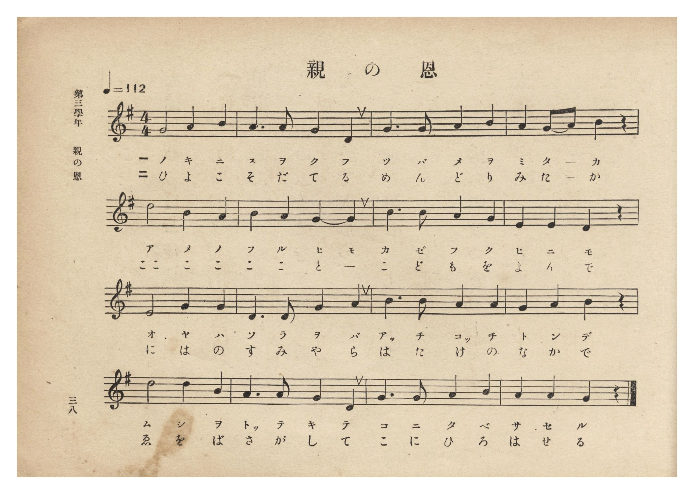
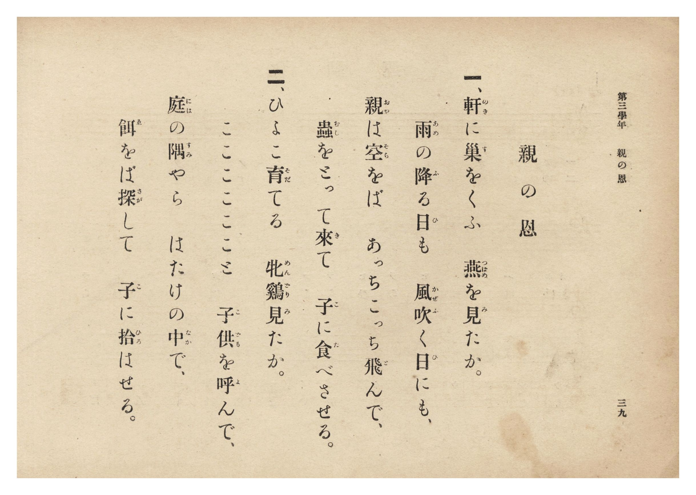

# 親の恩

> Re:Shōka 使用 AI 協助辨識與重建樂譜，可能會有錯誤。歡迎回報。

<audio controls src="oya_no_on.mp3"></audio>

- 詞：文部省《尋常小學唱歌》
- 曲：文部省《尋常小學唱歌》
- 臺灣總督府《公學校唱歌集》（大正四年三月，索書號 0725 26）

## 說明

原書資訊與歌詞全文（對應 P044.jpg–P045.jpg，原書 p. 38–39，第三學年第 4 首）：
調性與拍號：ト長調 4/4 拍子，♩=112

## 歌詞

```text
一、軒（のき）に巣（す）をくふ　燕（つばめ）を見（み）たか。
雨（あめ）の降（ふ）る日（ひ）も　風吹（かぜふ）く日（ひ）にも、
親（おや）は空（そら）をば　あっちこっち飛（と）んで、
蟲（むし）をとって來（き）て　子（こ）に食（た）べさせる。

二、ひよこ育（そだ）てる　牝鷄（めんどり）見（み）たか。
こここここここと　子供（こども）を呼（よ）んで、
庭（には）の隅（すみ）やら　はたけの中（なか）で、
餌（ゑ）をば探（さが）して　子（こ）に拾（ひろ）はせる。
```

## ABC

```abc
X:1
T:親の恩
C:曲：文部省《尋常小學唱歌》
M:4/4
L:1/16
Q:1/4=112
K:G
V:V1 name="Piano" snm="Pia"
[V:V1]
G8 A4 B4 | A6 A2 G4 D4 | G6 G2 A4 B4 | A4 G2 A2 B4 z4 |
w: 1.~の き に | す を く ふ | つ ば め を | み た _ か
w: 2.~ひ よ こ | そ だ て る | め ん ど り | み た _ か
d8 B4 A4 | B4 A4 G4 G4 | c6 c2 A4 G4 | E4 E4 D4 z4 |
w: 1.~あ め の | ふ る ひ も | か ぜ ふ く | ひ に も
w: 2.~ここ こ こ | こ こ と _ | こ ど も を | よ ん で
E8 G4 G4 | D6 D2 G4 A4 | B6 B2 A4 A4 | G4 A4 B4 z4 |
w: 1.~お や は | そ ら を ば | あっ ち こっ ち | と ん で
w: 2.~に は の | す み や ら | は た け の | な か で
d8 d4 B4 | A6 A2 G4 D4 | G6 G2 A4 B4 | A4 A4 G4 z4 |
w: 1.~む し を | とっ て き て | こ に た べ | さ せ る
w: 2.~ゑ を ば | さ が し て | こ に ひ ろ | は せ る
```

## TMD 檔案連結

- [主旋律 TMD 檔案](oya_no_on.tmd) [[在 TMD Studio 編輯](https://tmdlang.github.io/Tmd-TS/#tmd=s7IKdvYPcrWy4qpTUCpJTLdSSM7PyUlNLsnMz7PKzk9PzM7Ojy_OyM9OLM4ojTe0NDRVgqssy88pzU21Si9KTEmNN0aIF-eXFiWnWhUnZ-Tn58SXpFaUJOXnZ6PLxxckpqdaBRiYmCBkCoryy1LzEvOAuguKMvNKUlPA2hEKUssyU1JB0sXJiXnxZalFmWmZqSlITkotKga5HGpFSVFiXnFyUWYByDsIVflFJRn5QGcXZFRaZWQWl-QXZSYn5sRnJ-YlIhSVZKQCPZeWmJuZU4kumptflJijxKWlpfBi2arHjeueNa5U0NLiUrRVMDQ04rK3VXDnsjHRN7EDaXuxct77PbOeTWt_2bzi-ZzGxw1dTzd0P92x4-mG_qdrdzydsvHZ2p7HDd1gK57N3kS02hftu543Ln6-Y-_zuYuf7poDUtu6Bqjq2YKFEIUvZ7cB1b7f0_F0yfJnaxc_nT376c4tT3Z0PpvT8X5Pz_Mti57N3vFi5nwFA3MjUwUjs_d7OpW4uPS1FGypBbgUFBSe9s0HWbO5_cWKrhcd7UBnAcPjaesKoB9BLtvQ-6y9UwGUCPSyCtIfNUwGMk1BTKALIVoVCvQUjC2AMsaWIFevWQP0ASgsdm4BshVMFF4umwZ0OTDUQLa9WLX_WcNykD3dvUCvAUUfN3e8nLodKK4AjA8FoPDTtROA5jyaudIWFFUgTU92NDxuaHyxexLQQcC4fNzYCzTwcePqp9sXg0VmgrhNkx439j9u3Pq4oeF5-1Sw-JLHjRseNzVCZF8sA4X048b9YL3zHzd2P25oApn-cvYKsEQTVGnjupczgRYARbaCdXY_m74UzAXGPJDbBLTg5aIVTyfsBAt2P26cA1XZ2I-isnE1WHEj2NvLVoEluh43tYDl1j9fuQssMvdxEzBsIM7fADQa5I7GxY8bFz5unAxhvFw8G6wS6EqgMqDgcpih84H2dDxuAuqZDjNiBVjPsif72sB6IAG1DGguOFSBIpMhTnu5GBj2QC6QBHJ3Pm6c-rhxNtCvoDABB_kuYDJuBPrkcRNI04smsFVA1zYugBoJUtvwvHPuy-1AHwFd0Qh228rHTV1ABTgDG-wrTLQC4sIn-yBehRjUBPHU04l7wBYA8wSq_5_uWgtWvRoYnNCIm9UKSRBQm5tagKELDtT1YFdMBKp5sgOiC1gqAN0I1AUz7uWSHrA9E-HR8axvEVgpMGyAUkCl07GG5bPufZBYf9wECW-gZbCwBJpLeTaFAgUtfS4u_8pEv3z_PKuAzMS8fIcag5pqkB0KNhZadmAGtuJBAZwpG14s7FHQMFEAFlXP1zfowPO0JhYNQJtAhtUoGCrogqEREBsDcQ2YBeKDZEzjwUIQRYZoikB8EM8AJAI2zsewBpgA1kGNBKZOMLkarAMYaRDRpklAdj9YZitUZglU_QagbCNUDURmP1h8PpjsBpJg90DsMgLJb4LZ1dQBVjMZqm8u1MQFQLwMLA_SDZQBmw_iTwbKrASzuvDahT_Qd_WQE-imUFeDQg8UkjVwFiikQbgGWK6CVJjARWsUzEAOAhPgaEEP9iZ4UICDEBwNIHFQIEO8DwkuYL6DyoDEQKJzYKrA0QILVkjEQVSjBzsoU8OsA7MQIY_gAXM9VA1MHCS2EmokPI4hMQeMD5DsciLDfUcnOeEODjxIUoYFKjgowSEK4iMiAxQ5IB5EBCaHLbmDkg8k3FvAXlgP9TA0CTZ1Qr0KSt4QGVAFAA2NhZDABHFBHIg8KNgwAwQR-qB4gWgH2YWIaWgGAyZkqFuAdkNkQOogiRtYRqLoWQXmQVIHkYEPbMZQkuhBNIklDSwPoAV9UwM8IKaDvQsrNUCVJFRiGbwYAhUDyAlxNTyz74TKTAXzZoONwlLYNIFCDlaEIccnSB-I3wNzCFa7IHkP5BZYjGDaVcvFpWunAK0CFIBMZS4A)]
- [鋼琴伴奏 TMD 檔案](oya_no_on_piano.tmd) [[在 TMD Studio 編輯](https://tmdlang.github.io/Tmd-TS/#tmd=s7IKdvYPcrWy4tLSUnixbNXjxnXPGle-39PxsnvP8wlbnuzZ8nRp__POjvd7OhW0tLgUbRUMDY247G0V3LlsTPRN7LjqFJRerJz3fs-sZ9PaXzaveD6n8XFD19MN3U937Hi6of_p2h1Pp2x8trbncUO3Ekjts9mbiFb7on3X88bFz3fsfT538dNdc0BqW9cAVT1bsBCi8OXsNqBaoGOfLln-bO3ip7NnP9255cmOzmdzgO7teb5l0bPZO17MnK9gYG5kqmBkBvSDEheXf2WiX75_nlVAZmJefpCHQ41BTTWXAhDYWGjZgRn6Wgq26EDh-Zo1T3Y0vFjYo6BhogB07fP1DToKAQYmJnpZBemaWDRo6YMNq1EwVNAFQyMgNgbiGjALxAfJmMaDhSCKDNEUgfggngFIBGycj2GNAjCOoEY-buwFk6vBOh43zoSINk0CsvvBMluhMkug6jcAZRuhaiAy-8Hi88FkN5AEuwdilxFIfhPMrqYOsJrJUH1zoSYuAOJlYHmQbqAM2HwQfzJQZiWY1YXXLvyBvquHnEA3hboaFHqgkKyBs0AhDcI1CiZgFSZw0RoFM5CDwAQ4WtCDvQkeFOAgBEcDSBwUyBDvQ4LrcRNIJUgGJAYSnQNTBY4WWLBCIg6iGj3YJ0NCGqIdxEKEPIL3uHEFVA1MHCS2EmokPI4hMQeMD5DsciLDfUcnOeEODjxIUoYFKjgowSEK4iMiAxQ5IB5EBCaHLbmDkg8k3FvAXlgP9TA0CTZ1Qr0KSt4QmabHjYuhobEQEpggLogDkQcFG2aAIEIfFC8Q7SC7EDENzWDAhAx1C9BuiAxIHSRxP26ciKJnFZgHSR1EBj6wJKMk0YNoEksaWB5AC_qmBnhATAd7F1ZqrEAE8DJ4MQQqBpAT4mp4Zt8JlZkK5s0GG4WlsGkChRysCEOOT5A-EL8H5hCsdkHyHsgtsBjBtKsWrQbwQa4BTKA1ADCU4hWiDWOBYQahQakYyDKNj4XJ4FACwkAJA6iv4KpAFEg3RADFHBOQASZAEYRJKEIIs-DCcL0orkKYD3MWho1Y3UWK_5ANAgalrp0CNDSjfYBqkLlGYK4yFwA)]

## 分析

```text
================================================================================
📊 TMD Song Profile: [ 親の恩 ]
================================================================================
⏱  Duration:       0:34 (34.3s), 16 measures total
🎼 Key & Tempo:    首調基準 G, != 112.0 BPM, <4/4>
   - 分析範圍：      由實際發聲的音符與和弦推測調性；播放脈絡另行呈現
🎤 人聲音域:    D4 (MIDI 62) – D5 (MIDI 74) [跨度: 12 個半音 / 1.0 個八度, 難度: easy]
   - 最低音:  D4 in [OyaNoOn #1 @ m.2, 0:03]
   - 最高音: D5 in [OyaNoOn #1 @ m.5, 0:08]
   - 適合: soprano, mezzo-soprano, contralto, tenor, baritone, bass
🏛  結構:      OyaNoOn (34.3s)
⚡ 編曲密度:        Peak 1 軌道同時演奏
🗝  調性診斷：       G 大調（純淨自然大調，未偵測到可信轉調）
   - 風格氣質:    純淨自然大調（陽光明朗、易唱易記，無明顯調外色彩）
   - 轉調歷程:    全曲維持單一推測調性（未偵測到可信轉調）
   - 核心骨幹音:  A, G, D, B, E
   - 調性數值:    G 大調 [相關度: 0.77, 穩定度: Moderate, 自然音純度: 100.0%]
   - 候選調性 (K-S): G 大調 (0.77), D 大調 (0.70), A 小調 (0.49)
   - 五度圈歷程:   +1
   - 各段落調性細節:
     • [OyaNoOn #1]: G 大調 (r: 0.77, 自然音純度: 100.0%)

  [ 五度圈游移軌跡 ]
               C  
         F           [G ]*
      Bb               D  
      Eb               A  
         Ab           E  
            Db       B  
               F# 
     (* = active key center)

  [ 十二半音累積音高分佈 ]
     C  : ███                        3.3%
     C# :                            0.0%
     D  : ██████████████            16.7%
     D# :                            0.0%
     E  : █████                      6.7%
     F  :                            0.0%
     F# :                            0.0%
     G  : ███████████████████████   27.5%
     G# :                            0.0%
     A  : ████████████████████████  29.2%
     A# :                            0.0%
     B  : ██████████████            16.7%
--------------------------------------------------------------------------------
Assignment 軌道音域：
  - Piano         : D4 – D5 (12 個半音 / 1.0 個八度, 57 個音符)
================================================================================
```


## 原書掃描頁






