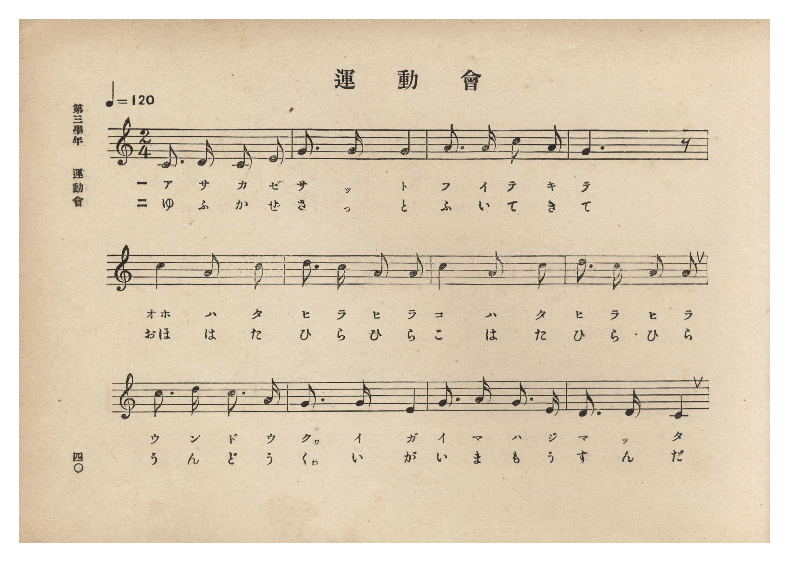
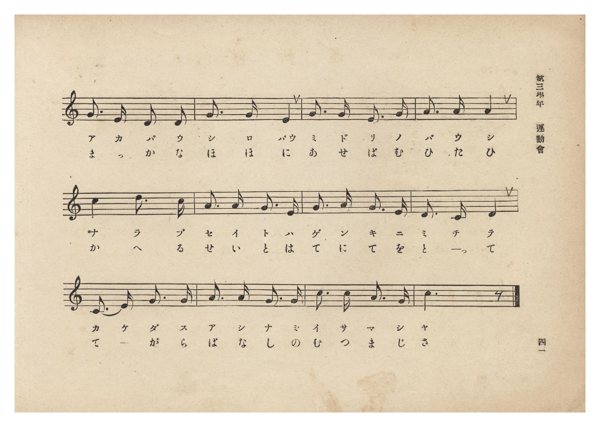
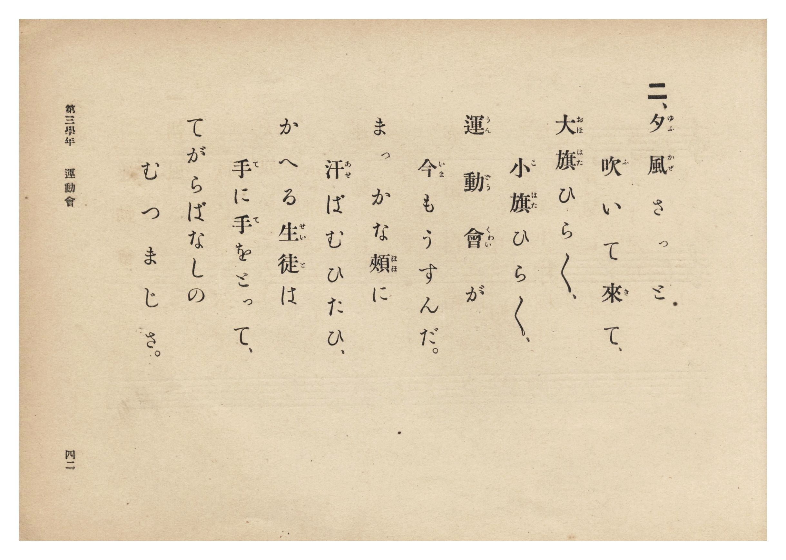
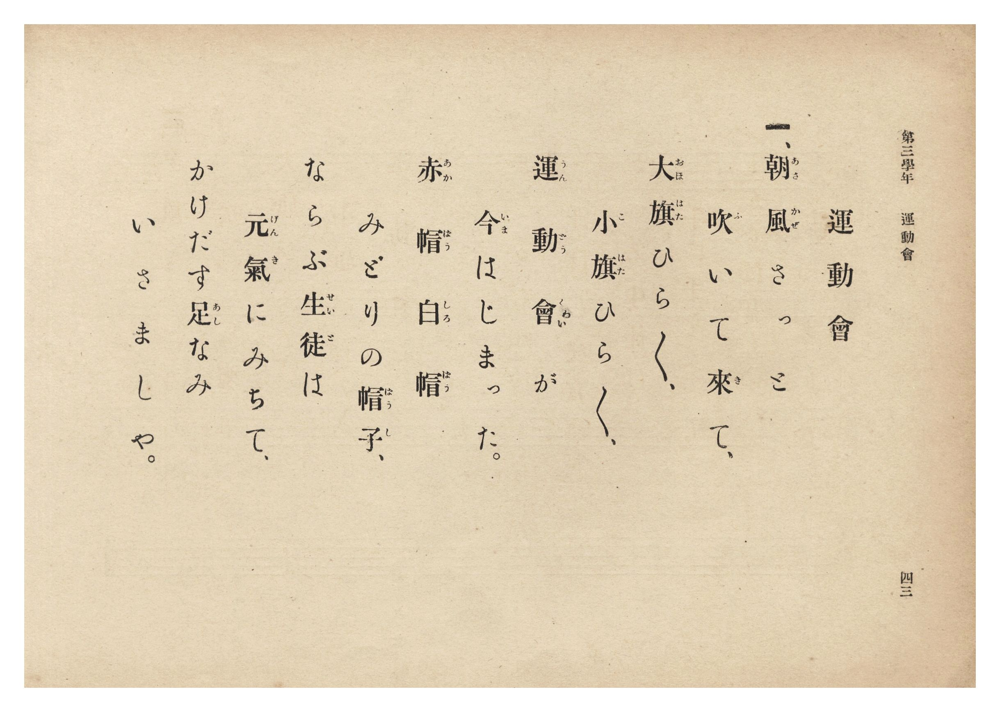

# 運動會

> Re:Shōka 使用 AI 協助辨識與重建樂譜，可能會有錯誤。歡迎回報。

- **鋼琴伴奏版**：<br><audio controls src="undokai.mp3"></audio>
- **NEUTRINO 歌聲合成版**：<br><audio controls src="undokai_neutrino.mp3"></audio>

- 詞：公學校用國民讀本
- 曲：宮島慎三郎
- 臺灣總督府《公學校唱歌集》（大正四年三月，索書號 0725 26）

## 說明

原書資訊與歌詞全文（對應 P046.jpg–P049.jpg，原書 p. 40–43，第三學年第 5 首）：
調性與拍號：ハ長調 2/4 拍子，♩=120
作曲：臺灣總督府國語學校助教授 宮島慎三郎


## 歌詞

```text
一、朝風（あさかぜ）さっと　吹（ふ）いて來（き）て、
大旗（おほはた）ひら〻、小旗（こはた）ひら〻、
運動會（うんどうくゎい）が　今（いま）はじまった。
赤帽（あかばう）白帽（しろばう）　みどりの帽子（ばうし）、
ならぶ生徒（せいと）は　元氣（げんき）にみちて、
かけだす足（あし）なみ　いさましや。

二、夕風（ゆふかぜ）さっと　吹（ふ）いて來（き）て、
大旗（おほはた）ひら〻、小旗（こはた）ひら〻、
運動會（うんどうくゎい）が　今（いま）もうすんだ。
まっかな頰（ほほ）に　汗（あせ）ばむひたひ、
かへる生徒（せいと）は　手（て）に手（て）をとって、
てがらばなしの　むつまじさ。
```

## ABC

```abc
X:1
T:運動會
C:曲：宮島慎三郎
M:2/4
L:1/16
Q:1/4=120
K:C
V:V1 name="Piano" snm="Pia"
[V:V1]
C3 D C2 E2 | G3 G G4 | A3 A c2 A2 | G6 z2 |
w: 1.~あ さ か ぜ | さ っ と | ふ い て き | て
w: 2.~ゆ ふ か ぜ | さ っ と | ふ い て き | て
c4 A2 c2 | d3 c A2 A2 | c4 A2 c2 | d3 c A2 A2 |
w: 1.~おほ は た | ひ ら ひ ら | こ は た | ひ ら ひ ら
w: 2.~おほ は た | ひ ら ひ ら | こ は た | ひ ら ひ ら
c3 d c3 A | G3 G E4 | G3 A G3 E | D3 D C4 |
w: 1.~う ん ど う | くゎ い が | い ま は じ | ま っ た
w: 2.~う ん ど う | くゎ い が | い ま も う | す ん だ
G3 E D2 D2 | G3 G E4 | G3 G E3 G | A3 A A4 |
w: 1.~あ か ば う | し ろ ばう | み ど り の | ば う し
w: 2.~ま っ か な | ほ ほ に | あ せ ば む | ひ た ひ
c4 d3 c | A3 A G3 E | G3 A G3 E | D3 C D4 |
w: 1.~な ら ぶ | せ い と は | げ ん き に | み ち て
w: 2.~か へ る | せ い と は | て に て を | と っ て
C3 E G3 G | A3 A G3 G | c3 c A3 G | c6 z2 |
w: 1.~か け だ す | あ し な み | い さ ま し | や
w: 2.~て _ が ら | ば な し の | む つ ま じ | さ
```

## TMD 檔案連結

- [主旋律 TMD 檔案](undokai.tmd) [[在 TMD Studio 編輯](https://tmdlang.github.io/Tmd-TS/#tmd=s7IKdvYPcrWy4qpTUCpJTLdSSM7PyUlNLsnMz7PKzk9PzM7Ojy_OyM9OLM4ojTe0NDRVgqssy88pzU21Si9KTEmNN0aIF-eXFiWnWhUnZ-Tn58SXpFaUJOXnZ6PLxxckpqdaBRiYmCFkCoryy1LzEvOAuguKMvNKUlPA2hEKUssyU1JB0sXJiXnxZalFmWmZqSlITkotKga5HGpFSVFiXnFyUWYByDsIVflFJRn5QGcXZFRaZWQWl-QXZSYn5sRnJ-YlIhSVZKQCPVdcAFSMrDMzPTPPqiQxsxxof35aWmZyZmKOEpeWlsLLxu6n3VOfzWlW0NLiUrRVMDQy4LK3VXDmsjHSN7EDmfBi5bz3e2Y9bV3zdO2OZwsWPp-y4umc7mcbJr5Y1_BszhqwJc9mbwIpWbfu6eZtz1r7nuzofNncB5Z50b7reePi5zv2Pp-7-OmuOY8buuAGPZ2y8dnanpez2x43dL_f0_F0yfJnaxc_nT376c4tQAOezel4v6fn-ZZFz2bveDFzvoKBuZGpgpHZ-z2dSlxc-loKttQCXAoKCk_75oOs2dz-YkXXi452oLOAnn7auuLZtHaQyzb0PmvvVADFuV5WQfqjhslApiWICXQhRKtCgZ6CiQFQxsQY5Oo1a4A-APoS6BUgW8FU4eWyaUCXA8MIZNuLVfufNSwH2dPdC_QaUPRxc__LqduB4grAQFcACj9dOwFozqOZK21B8QHU82TvHEggowUoMCperJoHDdCulc-mznzW16GAFhNcYBN2NDxuaHw2Z-7LRSuAnnrc2PS4cerjxu7HjXOATgOzFz9uXPG4oeHphJ1gBVvB4i2PG5c92dcGFukFiywDmgMONWCMTZ8Oluh63Lj7ceP6x41A3wBVbHrc1Pm4YTdQ3dMN_TA1k7EqABkET4NgdW2Pm4BKV4IYjf2Pm_qATgDr6QE67cnuLrAaoKP2gQWBJs4AssFun_-4oQkcvluXPN2xF-ZHoAc3AM0Cqn4-cy9MfPrjpl64ONDcx437QVY2Af2xDqgGHPxAZSAFQMVgNWCXPm5cBXJ547bnU-Y_3TcJrGg22DnAMAU7Bxh8rc3PNiwGS00CewUSaqvBdixEBB_YaRMfNy543DjzxbbNMPeCbQNaA1QNchfQaGDMAD0IdHILyIPguNwFDIzGp0umQuOyCejKrUM9LpuAngcqmwnWsgAal7C4BXpt1csFG8AagK7bDQ3ShoZnGyEuAmqeDRbc8LgJGGybQMkBSCIF9Y7HTd14ou1ZJ6gUAoYIxGgUbtMkUGiC3IGIvGUgX4DSAjCRAGNrOjDlgCIMZPkSsKuB6XIq1BeUl1JQoKClz8UVmpcCrNgyrQIyE_PyHWoMaqpBdijYGJpp2YFZ2IpHBXCh1PBiYY-ChokCMCqfr2_QgZdpmlg0AK0CGVajYKigC4RGYNoYiGuABRpIxBRKg0TMwLSZgmEcmEIogkADkAjYOB_DGmDgNYFFgQEEihowaw5YD0gEIrMYiFfAjQcmYKh4CyjowaxeqAyIB4PxCHuMgHJNbVBdW2liD_7A3tVDVmCDAhASlroQTo2CEUQMyAMJQkKXSHVIYQ7K11A9wBQPJudDvbYJItrUCWWDWBCZyaTpQAQ9fawjkNw7KYgBYGBCWWZIKR6U_iFJBSJiBqWNQcEP0QfNL6iBD02ITZOB7JVQL7aBvQYqFqECoDTXA7cAxIeI74OGB4g9AyyzD8oDpV5QGCFZBw58Sq1rgmVQiKaZSMYtgFuHN_CBDTnMwDcnGPiw0ASFJQjjDnmYiClS6QOhsRc13UC8AeoniH-nQ33VC5KBhRlEaj9U00qgdBeUvQ4sAzICYgjMANSQR44ZSImzCmomJDeAaGD1gmQXzIGzEaY3NSCnemAMw9hElDpTyAl2eGmCKEIQoYpI4bjSvCGURg15kMch3gFlVpBHtoG9NRvKA6U_SNELSt4gmUlQ9aB01guVWY0SIQuBGFYQIwc7KKghKnZAzegmYBfEFJD5cHbTJLAMTB0oChF24U_trWvJCnZoOMJSNHqYg0SgUQMt1FHEIBC9boUEBbBpCc-soAyMnNKmwyMHFLDIWR9UH8NS8HSQTBNEBgLRald44MCKEVBEI-eRVYhMBsk9wHQN4S1BsgdSokHqY2R7arm4dO0UoI0dBSBTmQsA)]
- [鋼琴伴奏 TMD 檔案](undokai_piano.tmd) [[在 TMD Studio 編輯](https://tmdlang.github.io/Tmd-TS/#tmd=s7IKdvYPcrWy4tLSUnjZ2P20e-qzOc3v93S87N7zfMKWJ3u2PF3a_7yz4_2eTgUtLS5FWwVDIwMue1sFZy4bI30TO646BaUXK-e93zPraeuap2t3PFuw8PmUFU_ndD_bMPHFuoZnc9YogZQ8m70JpGTduqebtz1r7Xuyo_Nlcx9Y5kX7rueNi5_v2Pt87uKnu-Y8buiCG_R0ysZna3tezm573NANdNHTJcufrV38dPbspzu3AA14NgfoqJ7nWxY9m73jxcz5CgbmRqYKRmZAhypxcYXmpeRnJ2ZaBWQm5uUHeTjUGNRUcykAgY2hmZYdmKWvpWCLDhSer1nzZEfDi4U9ChomCk839D9f36CjEGBgYqaXVZCuiUWDlj7YsBoFQwVdIDQC08ZAXKNgChYxhdIgETMwbaZgGAemEIog0AAkAjbOx7BG4XFjE1j0ceNUIO4Gs-aA9YBEIDKLgXgF3PjHjVuh4i1AvAzM6oXKgHgwGI-wxwgo19QG1bWVJvbgD-xdPWQFNigAIWGpC-HUKBhBxIA8kCAkdIlUhxTmXY8bd0P1PG5cDybnQ722CSLa1Allg1gQmcmk6UAEPX2sI5DcOymIAWBgQllmSCkelP4hSQUiYgaljUHBD9EHzS-ogQ9NiE2TgeyVUC-2gb3W_7ipDyoASnM9cAtAfIj4Pmh4gNgzwDL7oDxQ6gWFEZJ14MCn1LomWAaFaJqJZNwCuHV4Ax9YmGEGvjnBwIeFJigsQRh3yMNETJFKHwiNvajpBuINUD9B_Dsd6qtekAwszCBS-6GaVgKlu6DsdWAZkBEQQ2AGoIY8csxASpxVUDMhuQFEP25cjWQXzIGzEaY3NSCnemAMw9hElDpTyAl2eGmCKEIQoYpI4bjSvCGURg15kMch3gFlVpBHtoG9NRvKA6U_SNELSt4gmUlQ9aB01guVWY0SIQuBGFYQIwc7KKghKnZAzegmYBfEFJD5cHbTJLAMTB0oChF24U_trWvJCnZoOMJSNHqYg0SgUQMt1FHEIBC9boUExePGifDMCsrAyCltOjxyQAGLnPVB9TEsBU8HyTRBZCAQrXaFBw6sGAFFNHIeWYXIZJDcA0zXEN4SJHsgJRqkPka2pxatreOD3NYxgTZ1gGERrxBtGIvMMAEyTKAiBlAHI4maxsNYmEJIZsJMQDMcrBTEQlJqGo9dLcx8hFKQbog4FlPBxqD7CkUtsq-AwaNrpwANoWgfoBpkrhGYq8wFAA)]

## 分析

```text
================================================================================
📊 TMD Song Profile: [ 運動會 ]
================================================================================
⏱  Duration:       0:24 (24.0s), 24 measures total
🎼 Key & Tempo:    首調基準 C, != 120.0 BPM, <2/4>
   - 分析範圍：      由實際發聲的音符與和弦推測調性；播放脈絡另行呈現
🎤 人聲音域:    C4 (MIDI 60) – D5 (MIDI 74) [跨度: 14 個半音 / 1.2 個八度, 難度: moderate]
   - 最低音:  C4 in [Undokai #1 @ m.1, 0:00]
   - 最高音: D5 in [Undokai #1 @ m.6, 0:05]
   - 適合: soprano, mezzo-soprano, contralto, tenor, baritone, bass
🏛  結構:      Undokai (24.0s)
⚡ 編曲密度:        Peak 1 軌道同時演奏
🗝  調性診斷：       C 大調（純淨自然大調，未偵測到可信轉調）
   - 風格氣質:    純淨自然大調（陽光明朗、易唱易記，無明顯調外色彩）
   - 轉調歷程:    全曲維持單一推測調性（未偵測到可信轉調）
   - 核心骨幹音:  G, C, A, D, E
   - 調性數值:    C 大調 [相關度: 0.83, 穩定度: Moderate, 自然音純度: 100.0%]
   - 候選調性 (K-S): C 大調 (0.83), G 大調 (0.75), A 小調 (0.64)
   - 五度圈歷程:   +0
   - 各段落調性細節:
     • [Undokai #1]: C 大調 (r: 0.83, 自然音純度: 100.0%)

  [ 五度圈游移軌跡 ]
              [C ]*
         F            G  
      Bb               D  
      Eb               A  
         Ab           E  
            Db       B  
               F# 
     (* = active key center)

  [ 十二半音累積音高分佈 ]
     C  : ██████████████████████    26.6%
     C# :                            0.0%
     D  : ████████████              13.8%
     D# :                            0.0%
     E  : ████████                   9.6%
     F  :                            0.0%
     F# :                            0.0%
     G  : ████████████████████████  28.7%
     G# :                            0.0%
     A  : ██████████████████        21.3%
     A# :                            0.0%
     B  :                            0.0%
--------------------------------------------------------------------------------
Assignment 軌道音域：
  - Piano         : C4 – D5 (14 個半音 / 1.2 個八度, 81 個音符)
================================================================================
```


## 原書掃描頁










