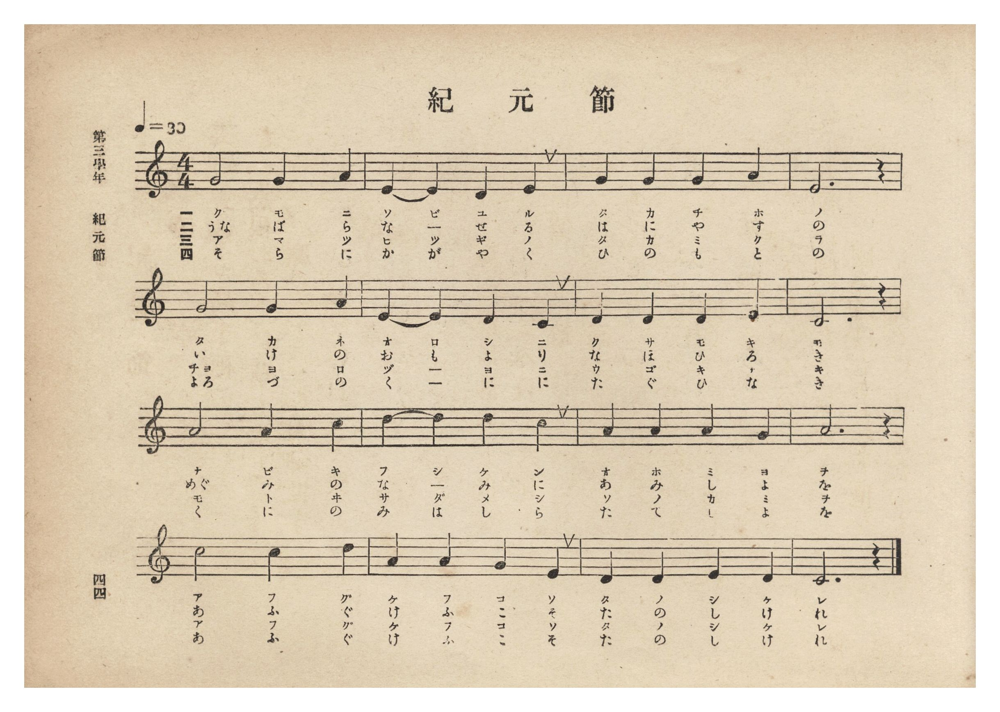
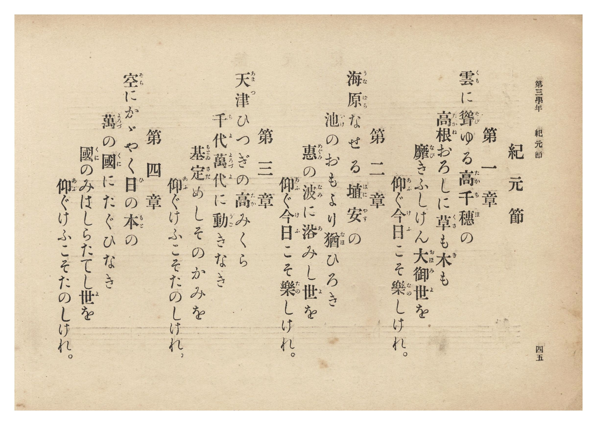

# 紀元節

> Re:Shōka 使用 AI 協助辨識與重建樂譜，可能會有錯誤。歡迎回報。

- **NEUTRINO 歌聲合成版**：<br><audio controls src="kigensetsu_neutrino.mp3"></audio>
- **鋼琴伴奏版**：<br><audio controls src="kigensetsu.mp3"></audio>


- 詞：高崎正風
- 曲：伊澤修二
- 臺灣總督府《公學校唱歌集》（大正四年三月，索書號 0725 26）

## 說明

原書資訊與歌詞全文（對應 P050.jpg–P051.jpg，原書 p. 44–45，第三學年第 6 首）：
調性與拍號：ハ長調 4/4 拍子，♩=80


## 跨冊／重複收錄參照

> 同曲（儀式歌〈紀元節〉；收錄於《公學校唱歌集》、《新定兒童唱歌》卷首與《唱歌帖》P124）

- **[同曲]** 《新定兒童唱歌》尋常科第一學年用（2020.006.0847.0001）：[**〈紀元節〉**](../../shintei_jido_shoka/grade_1_2020.006.0847.0001/0_04_kigensetsu/index.md)（`C` / `4/4` — [原始 TMD](../../shintei_jido_shoka/grade_1_2020.006.0847.0001/0_04_kigensetsu/kigensetsu.tmd)）
- **[同曲]** 楊金土手抄《唱歌帖》第 1 冊（2020.006.0843）：[**〈紀元節〉**](../../shokacho/vol_01/p124_kigensetsu/index.md)（`C` / `4/4` — [原始 TMD](../../shokacho/vol_01/p124_kigensetsu/kigensetsu.tmd)）
- 總表：[跨冊重複與同名歌曲總索引](../../duplicate_songs.md)

## 歌詞

```text
第一章
雲（くも）に聳（そび）ゆる　高千穂（たかちほ）の
高根（たかね）おろしに　草（くさ）も木（き）も
靡（なび）きふしけん　大御世（おほみよ）を
仰（あふ）ぐ今日（けふ）こそ　樂（たの）しけれ。

第二章
海原（うなばら）なせる　埴安（はにやす）の
池（いけ）のおもより　猶（なほ）ひろき
恵（めぐみ）の波（なみ）に　浴（あ）みし世（よ）を
仰（あふ）ぐ今日（けふ）こそ　樂（たの）しけれ。

第三章
天津（あまつ）ひつぎの　高（たか）みくら
千代萬代（ちよよろづよ）に　動（うご）きなき
基（もとゐ）定（さだ）めし　そのかみを
仰（あふ）ぐけふこそ　たのしけれ。

第四章
空（そら）にかゞやく　日（ひ）の本（もと）の
萬（よろづ）の國（くに）に　たぐひなき
國（くに）のみはしら　たてし世（よ）を
仰（あふ）ぐけふこそ　たのしけれ。
```

## ABC

```abc
X:1
T:紀元節
C:曲：伊澤修二
M:4/4
L:1/16
Q:1/4=80
K:C
V:V1 name="Vocal" snm="Voc"
[V:V1]
G4 G4 G4 A4 | E4 E4 D4 E4 | G4 G4 G4 A4 | E12 z4 |
w: 1.~く _ も に | そ び ゆ る | た か ち ほ | の
w: 2.~う な ば ら | な _ せ る | は に や す | の
w: 3.~あ _ ま つ | ひ つ ぎ の | た か み く | ら
w: 4.~そ _ ら に | か が や く | ひ の も と | の
G4 G4 G4 A4 | E4 E4 D4 C4 | D4 D4 D4 E4 | C12 z4 |
w: 1.~た _ か ね | お ろ し に | く さ も き | も
w: 2.~い _ け の | お も よ り | な ほ ひ ろ | き
w: 3.~ち よ よ ろ | づ _ よ に | う ご き な | き
w: 4.~よ ろ づ の | く _ に に | た ぐ ひ な | き
A4 A4 A4 c4 | d4 d4 d4 c4 | A4 A4 A4 G4 | A12 z4 |
w: 1.~な _ び き | ふ し け ん | お ほ み よ | を
w: 2.~め ぐ み の | な _ み に | あ み し よ | を
w: 3.~も _ と ゐ | さ だ め し | そ の か み | を
w: 4.~く _ に の | み は し ら | た て し よ | を
c8 c4 d4 | A4 A4 G4 E4 | D4 D4 E4 D4 | C12 z4 |
w: 1.~あ ふ ぐ | け ふ こ そ | た の し け | れ
w: 2.~あ ふ ぐ | け ふ こ そ | た の し け | れ
w: 3.~あ ふ ぐ | け ふ こ そ | た の し け | れ
w: 4.~あ ふ ぐ | け ふ こ そ | た の し け | れ
```

## TMD 檔案連結

- [主旋律 TMD 檔案](kigensetsu.tmd) [[在 TMD Studio 編輯](https://tmdlang.github.io/Tmd-TS/#tmd=s7IKdvYPcrWy4qpTUCpJTLdSSM7PyUlNLsnMz7PKzk9PzM7Ojy_OyM9OLM4ojTe0NDRVgqssy88pzU21Si9KTEmNN0aIF-eXFiWnWhUnZ-Tn58SXpFaUJOXnZ6PLxxckpqdaBRiYGiBkCoryy1LzEvOAuguKMvNKUlPA2hEKUssyU1JB0sXJiXnxZalFmWmZqSlITkotKga5HGpFSVFiXnFyUWYByDsIVflFJRn5QGcXZFRaZWQWl-QXZSYn5sRnJ-YlIhSVZKQCPZeZWwC0JDEHXTw5tSg1Nz8PLKOlpfB8S8PT1ubn6xsUtLS4FG0VLAy47G0VnLlsTPRN7EBaX6yc937PrJerZzzd0vds7eKXi1aATXw2exNQ-Mmermf7ljzZv-7Jrh6w8Iv2Xc8bFz_fsff53MVPd8153ND1tHXN07U7ni1Y-HTKxmdre17Obnvc0P1-T8fTJcuBxj2dPfvpzi1PdnQ-m9Pxfk_P8y2Lns3e8WLmfAUDcyNTBSOz93s6lbi49LUUbKkFuBQUFJ72zQdZs7n9xYquFx3tQGcBffm0dcWzae0gl23ofdbeqQCKYL2sgvRHDZOBTEMQE-hCiFaFAj0FExOgjIkpyNVr1gB9APQl0CtAtoKZwstl04AuBwYQyLYXq_Y_a1gOsqe7F-g1oOjj5v6XU7cDxRWAoawAFH66dgLQnEczV9oCwx-kB2xkw_PVC0Ccl6Cw7njc2P-4qQlo7OPG1S8aN4NF5j4GMTofN7U9bup-3NAAiqbe5ucrgcqAsvMfN3Y_blz4uHE3WNc6sFmrZzxbsBNJei1YrutxU-_jxulAo4GmvOgFOh1sX-NUsOlNz-asAIv0Qrhgg-YuBAutgjqhEah_K9iIiY-bJgNNAUbw030Ln-wAhgRQWRfQFY8b9z9uAkYz0IhJICOe7N4AlmsC6gQbMeHJ7q5n05eCBSfCBCeDvNnQ8GwF3FPrwOIQm3oeNzTBQ2xXDzTEnm3dDowosPo2sBM3PG4C-gmoC8ieDQmrp_O3PF0H8eh6kL-bWh43zkQE1LONC8ByQNGJEFFwKDUBffC4qQuo_3nPNlgAQMJ3EzgMe8GaQW4HqmsE-gnoa4j-Z5sXwTRAREBh_WzrFkgYgEX2A70FDTGaBtSOTmhAPV2y8tkWiDlAw_c9blwC9UrjkseNfSBPgxMVPL3AXAlMip1g_b3NT3YvfjFhDZAEK1oIDh8gAgbFUqgnwB592g1MS5D4mAJLL8CQAAfX0_m7wF4GOmHF4yZgVuh8um4WWPXUx43AaACGAzAkpwNNASd5YEwAEy4wLeEIHEiYwAMEEhTYwgFY-kDD4flKsAuA6qHpZDXIjqZ54FTRDwpVaGgDcyI4LuesgbsYkWaA4QCJOoj3IRJP54CKO3BuWg0PDbCbgA4FBjQ8ENDVAZ0MDGlg2pwOdBRMzzJiUwjhQABqo7w4hQIFLX0uLu_M9NS84tSS4lKrsHxgveRQY1BTDbJGwcZCyw7MwFaSQwu7Fwt7FDRMFJ5u6AfWRjrw4lcTiwagZSDDahRMFXTh2AyIaxSMgSQIG0FpXGpg0AAkAjbNx7BGARj6UHFg1ILIxtVgHcAwBPM2g2XawGQ3VGY-WAbEA6Z-MLkbKrMOyZ54hD1GIDmwGY2rwOQGsHmdUF0gMbALGmej2LMe7h5gogSzZ-K3xxgkB_IFxLR9YHIJVM8mOA-Yz8EkyBR0_-wHk6AwAcqAXYjFHhNY-EDCDaQKEW4Qc3qQXA01DeoCkK2wsF6B0z_4086uHuqnHUOwCIgFw5DUBBLHlXZAIQcJa4iv10L90wX2Yy9YbDpK6IDCAljIIYUBSBUorGHxhi3tgMIRYs9EeBgi7AGb09QBJkEisDQFSZfQcAe7BiQDonGlHXBqhpoEIWG6lsJcABGH-weSqqfAfQKxGY89oLSDZDbEZISP4LkRku7h9kDS6ASEf_DYQ6Dc6SQn7YDSCwwbxoGtNgJRCAIqiqwQlNAgIrgSECLrgwsaWGJo3ArmQZIOOMqbJkNlwFEOjVhwZgUHJihQJ2EPcFACampECj5IFocFOMIFEHFYgEMSJ0QM7A5C9oASEDwRQ7I2sGaHmgZO8I0LwGIQt4DMRBSz4EIBqQjCYw-48EFPJjDfQNwLKTghroYVspAEtIwo_-BNQMAmBDkJCJw8QBDMAKcYRGIBJRRIaYNc9oBo_OUPIrghCQYW3JBSAiIGSjiQYEYEAyS4EckLFAygEhtH8qGHPWh1F83sAScf2tpTy8Wla6eAaBspAHnKXAA)]
- [鋼琴伴奏 TMD 檔案](kigensetsu_piano.tmd) [[在 TMD Studio 編輯](https://tmdlang.github.io/Tmd-TS/#tmd=s7IKdvYPcrWy4tLSUni-peFpa_Pz9Q3v93S87N7zfMKWJ3u2PF3a_7yz4_2eTgUtLS5FWwULAy57WwVnLhsTfRM7rjoFpRcr573fM-vl6hlPt_Q9W7v45aIVSiDhZ7M3AYWf7Ol6tm_Jk_3rnuzqAQu_aN_1vHHx8x17n89d_HTXnMcNXU9b1zxdu-PZgoVPp2x8trbn5ey2xw3dQBc8XbIcaNzT2bOf7tzyZEfnszlAR_Q837Lo2ewdL2bOVzAwNzJVMDIDOkyJi8s7Mz01rzi1pLjUKiAzMS8_yMOhxqCmmksBCGwstOzADH0tBVt0oPB8zZonOxpeLOxR0DBReLqhH-h7HYUAA1MDvayCdE0sGrT0wYbVKJgq6MKxGRDXKBgDSRA2gtK41MCgAUgEbJqPYY3C48Z-qPjjpiYQ2bgarONx41wwbzNYpg1MdkNl5oNlQLzHjQvB5G6ozDoke-IR9hiB5MBmNK4CkxvA5nVCdYHEwC5onI1iz3q4ex43tYDZM_HbYwySA_kCYto-MLkEqmcTnPe4sQ9MgkxB989-MAkKE6AM2IVY7DGBhQ8k3ECqEOEGMacHydVQ06AuANkKC-sVOP2DP-3s6qF-2jEEi4BYMAxJTSBxXGkHFHKQsIb4ei3UP11gP_aCxaajhA4oLB43TkUKA5AqUFjD4g1b2gGFI8SeifAwRNgDNqepA0yCRGBpCpIuoeEOdg1IBkTjSjvg1Aw1CULCdC2FuQAiDvcPJFVPgfsEYjMee0BpB8lsiMkIH8FzIyTdw-2BpNEJCP_gsYdAudNJTtoBpRcYNowDW20EohAEVBRZISihQURwJSBE1gcXNLDE0LgVzIMkHXCUN02GyoCjHBqx4MwKDkxQoE7CHuCgBNTUiBR8kCwOC3CECyDisACHJE6IGNgdhOwBJSB4IoZk7cdNIBtBpoETfOMCsBjELSAzEcUsuFBAKoLw2AMufNCTCcw3EPdCCk6Iq2GFLCQBLSPKP3gTELBuJCcBgZMHCIIZ4BSDSCyghAIpbZDLHhCNv_xBBDckwcCCG1JKQMRACQcSzIhggAQ3InmBggFUYuNIPvSwB63uopk94ORDW3tqMZtGPshNIxNE0-hFX9fL9l5gknrW3ft07YSnk3peNG6CtP-Qkk68QrRhLJgyiUXwTeMhNE4FQMoA6m0iDAGzTOOxm4swxwRiAJTCqg1JCRofq3NAmuGKoOJI5iKUoDoHGMq6dgqIgI72AcqhiRhhiBhjiAAtBYoocwEA)]

## 分析

```text
================================================================================
📊 TMD Song Profile: [ 紀元節 ]
================================================================================
⏱  Duration:       0:48 (48.0s), 16 measures total
🎼 Key & Tempo:    首調基準 C, != 80.0 BPM, <4/4>
   - 分析範圍：      由實際發聲的音符與和弦推測調性；播放脈絡另行呈現
🎤 人聲音域:    C4 (MIDI 60) – D5 (MIDI 74) [跨度: 14 個半音 / 1.2 個八度, 難度: moderate]
   - 最低音:  C4 in [Kigensetsu #1 @ m.6, 0:17]
   - 最高音: D5 in [Kigensetsu #1 @ m.10, 0:27]
   - 適合: soprano, mezzo-soprano, contralto, tenor, baritone, bass
🏛  結構:      Kigensetsu (48.0s)
⚡ 編曲密度:        Peak 1 軌道同時演奏
🗝  調性診斷：       A 調性不明確（純淨自然大調，未偵測到可信轉調）
   - 風格氣質:    純淨自然大調（陽光明朗、易唱易記，無明顯調外色彩）
   - 轉調歷程:    全曲維持單一推測調性（未偵測到可信轉調）
   - 核心骨幹音:  A, C, D, E, G
   - 調性數值:    A 調性不明確 [相關度: 0.75, 穩定度: Ambiguous, 自然音純度: 100.0%]
   - 候選調性 (K-S): A 小調 (0.75), C 大調 (0.73), G 大調 (0.68)
   - 五度圈歷程:   +3
   - 各段落調性細節:
     • [Kigensetsu #1]: A 調性不明確 (r: 0.75, 自然音純度: 100.0%)

  [ 五度圈游移軌跡 ]
               C  
         F            G  
      Bb               D  
      Eb              [A ]*
         Ab           E  
            Db       B  
               F# 
     (* = active key center)

  [ 十二半音累積音高分佈 ]
     C  : █████████████████████     20.0%
     C# :                            0.0%
     D  : █████████████████████     20.0%
     D# :                            0.0%
     E  : ███████████████████       18.3%
     F  :                            0.0%
     F# :                            0.0%
     G  : ███████████████████       18.3%
     G# :                            0.0%
     A  : ████████████████████████  23.3%
     A# :                            0.0%
     B  :                            0.0%
--------------------------------------------------------------------------------
Assignment 軌道音域：
  - Vocal         : C4 – D5 (14 個半音 / 1.2 個八度, 51 個音符)
================================================================================
```


## 原書掃描頁






